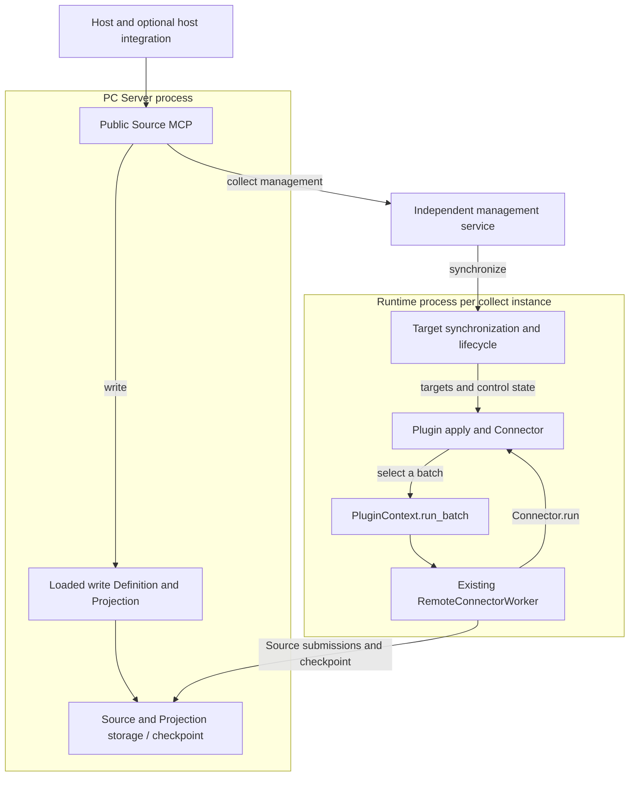
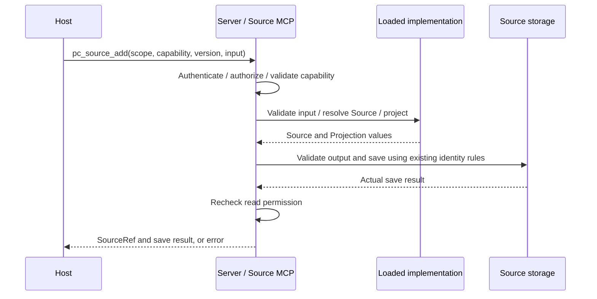
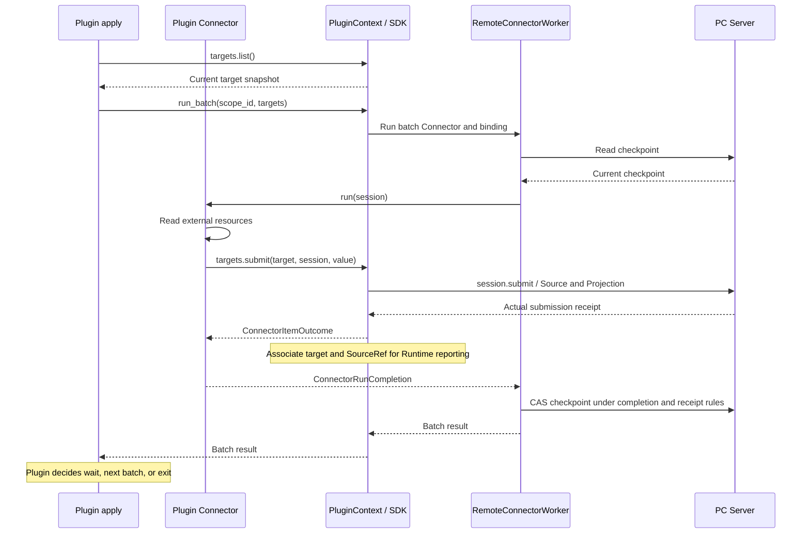
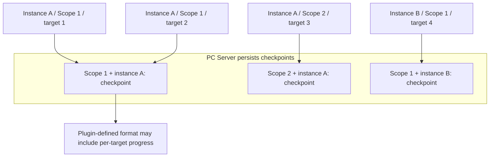
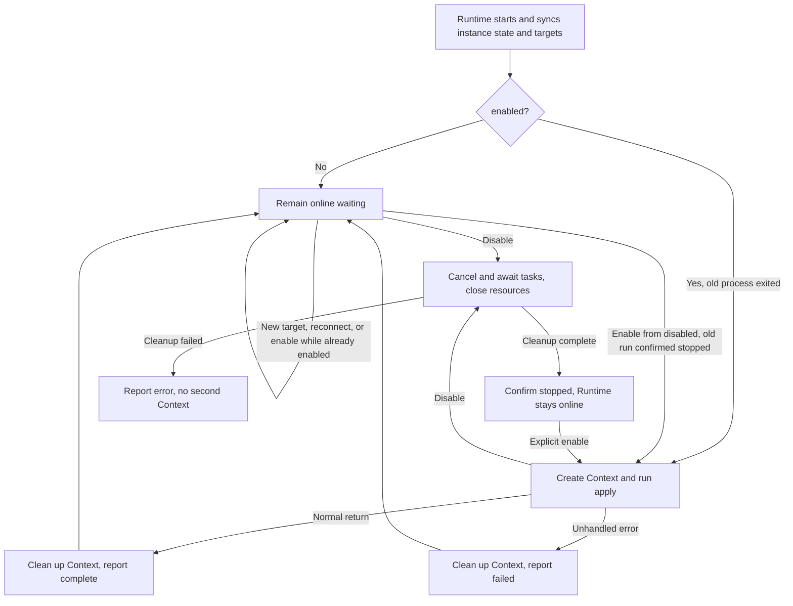

- Proposal Name: `source_plugin_framework`
- Start Date: 2026-10-14
- RFC PR: Not assigned

# Summary

This proposal introduces a Source plugin framework for PowerContext so users can develop or use plugins to define custom Source types, data models, and Projections, as well as collection logic for different data origins, without modifying PowerContext core. It supports two data-ingestion paths: `write` runs plugin-defined validation and transformation inside Server and synchronously saves complete content supplied by the caller; `collect` uses independently running plugins to continuously read external resources, with collection targets added and managed at runtime. The framework handles plugin loading, lifecycle management, and the submission pipeline, reusing existing Source persistence rules and authorization; plugins decide what to collect, when to run, and how to retry. Applications and other hosts use the public MCP to discover and use built-in and custom Source capabilities through a common interface.

This RFC specifies proposed behavior. Examples of interfaces and deployment commands do not imply availability in a released version.

**Example conventions:** Commands, configuration, and code illustrate intended usage and interface relationships rather than final released syntax. Proposed interface names, module paths, and configuration layouts may be adjusted during implementation. Changes to public interfaces or usage steps must be explained in the implementation PR and reflected in this RFC; runnable usage is documented in the user guide and examples shipped with the implementation. Responsibility boundaries, permissions, persistence, synchronous returns, and repeat-call semantics are design constraints; changing them requires a rationale and design review in the PR. Existing public interfaces remain subject to their established contracts.

# Motivation

Data brought into PowerContext has different business meanings. Data from different business domains varies in structure, Source identity rules, and Projection requirements; built-in Source types cannot cover every requirement. If every customization requires a core change, business extensions depend on PowerContext's own release and maintenance schedule. Users need to develop Source plugins independently or configure and use plugins supplied by others.

Defining a data type alone does not complete data integration. The same business data may come from systems with different authentication, APIs, and update patterns. Plugin authors need to implement the reading, filtering, or incremental collection their data origin requires and choose execution timing according to external access limits and business requirements. They should also be able to reuse PowerContext's submission and progress handling instead of reimplementing that common logic in every plugin.

Users also obtain data in different ways. An application may already hold complete content that only needs saving, or resources may remain in an external system whose changes need continuous collection. Both needs should share Source data definitions and Projections. Saving existing content should complete directly; ongoing collection needs to run independently and continue after the application or host that initiated it exits.

Collection scope changes during use. For example, a user may add a newly created document to a running collection instance or have the same instance serve another authorized Scope. Users should be able to add targets, inspect existing submissions, and stop or resume collection while reusing the instance and its progress, without deploying a separate plugin instance for every resource or Scope.

These capabilities need to serve business applications, automation workflows, coding agents, and other hosts. Custom Sources should have discovery and invocation consistent with built-in capabilities, and adding a plugin should not require a separate integration implementation for every host. A common entry point and shared collection instances let users reuse existing plugins and continue using the same data integration capabilities across applications and workflows.

# 1. Overview

Hosts use built-in and custom Source capabilities through **the same public MCP on PC Server**, with different execution paths for the two operations:

- **write**: the host already has complete content. PC Server uses loaded SourceDefinition and Projection implementations to save it synchronously and return the result; no plugin instance or management service is started.
- **collect**: plugins continuously read external resources. A shared background management service manages targets, and each plugin instance executes in its own background Runtime process. By default, Server startup discovers instances in a configured directory and automatically starts the local independent management service and Runtimes. Multiple hosts share instances. Remote Runtimes can connect to the same management service, which can also run on another machine.

Both paths reuse SourceDefinition and Projection contracts. The same Source type can be produced by host writes and plugin collection.

**The framework provides SourceDefinition (output type, identity, and Projection contracts) and the Source saving pipeline; collect plugins decide what to collect, when to execute, when to submit, and when to exit.** collect reuses the existing Worker and checkpoint pipeline, with batch execution invoked by the plugin. write validation and transformation execute within the current Server call.

One management service serves one Server. Multiple instances, Scopes, and execution machines are supported; management clusters, automatic migration, general-purpose task scheduling, and in-process Python code replacement are out of scope. This document specifies the target design. Appendix A describes directory discovery and automatic startup.

# 2. Architecture, connections, and storage

## Component organization



Arrows represent business calls or data flow. write implementations run inside the Server process; collect Context, Worker, and user Connector execute inside the corresponding Runtime process. The management service delivers targets and control state without relaying Source data or scheduling batches. Management messages are delivered in responses to polls initiated by the receiver; network connection directions are described below.

| Component | Responsibility and location |
| --- | --- |
| Public Source MCP | PC Server's `/mcp`; authenticates hosts, checks Scope permissions, and unifies discovery, submission, queries, and enable/disable operations |
| PC Server data pipeline | Loads custom write Definition and Projection code and registers Definitions; saves Source / Projection and checkpoint data and provides reads. Built-in and custom write use the Server saving pipeline directly |
| Shared management service | Independent background process; stores instances, collection targets, and results; executes Server-authorized management requests; checks Scope ownership and execution conditions; synchronizes collect capabilities and instance state to Server |
| Runtime | Outer framework in each collect instance process. A stable instance_id identifies an account, configuration, and execution environment that can serve multiple authorized Scopes. Loads the plugin, maintains management connectivity, synchronizes targets and control state, and creates and ends business runs |
| PluginContext (Context below) | Context for one business run, passed as ctx to apply; owns the Connector and business resources and provides the SDK (interfaces plugins call), including run_batch, submission, and cleanup |
| RemoteConnectorWorker | Existing execution pipeline; called by `run_batch()` to create a session, execute the Connector, and handle submission receipts and checkpoint CAS |
| apply / Connector | Plugin business code; apply decides timing, while Connector.run(session) reads or transforms data and submits it |
| Host-specific plugin | Optional adapter for Hooks, Scope defaults, and context injection; does not host Source instances or duplicate public MCP management logic |

Only Server is needed for built-in capabilities or custom write. N collect instances add one management service and N instance processes; Server startup prepares these independent services. System services host background processes. Installation/startup commands return when finished, and closing Codex does not stop collection.

## Startup loading and adding instances at runtime

**write: load implementations local to Server.** The deployer prepares trusted plugin code and dependencies on the Server machine and configures an entry. Server's generic loader imports it, reads `definitions` and write capability declarations, validates input, Definition, Projection, and name/version conflicts, and exposes capabilities only after SourceDefinition registration succeeds. Deployment requires `server.admin`; the CLI triggers loading, but the Server process imports the code. Registering SourceDefinition structures and contracts through an API does not transfer Python functions and cannot establish that write is executable.

Server saves successfully loaded entries and required configuration references, then imports and validates them again on restart. Explicit additions and repeated loading of identical configuration are supported; differing configuration conflicts. Existing implementations are replaced through the restart/update procedure in section 5, without in-process Python replacement. Interfaces and examples appear in section 4. This path creates no collect instance, Runtime, or target.

**collect: load an instance and start an independent Runtime.** The following configuration and deployment flow apply to collect.

The deployer specifies a trusted directory through Server's `source_plugins_dir`. Each `powercontext.yml` declares an instance: instance ID, code entry, plugin business configuration, and external credential references. Its `id` becomes the runtime `instance_id`, for example `yuque-personal`. It is unique within a PC deployment and stable across restarts, and is not a code name, Scope ID, or Source ID. Bundled code does not execute merely because it is installed; putting instance configuration in this directory authorizes loading. Different instance IDs can reuse the same code without copying it.

`powercontext.yml` may provide initial `targets`, each containing `scope_id`, a capability, and business input. On first startup, if targets have not been initialized for this instance, deployment adds them to the management service through normal add rules and marks the instance initialized. Subsequently, management targets and control state are authoritative. File targets do not overwrite or supplement them or participate in instance configuration conflict detection. An empty target set does not trigger reimport, nor does management connection failure imply an uninitialized instance.

Server's deployment flow scans the directory once at startup and supports explicit instance loading at runtime. It prepares independent management and Runtime services through the local service manager and generates and saves their connection configuration. Behavior is summarized below; Appendix A gives usage steps.

| Situation | Behavior |
| --- | --- |
| No local instances and management service not enabled | Run only Server; explicitly loading the first local instance later starts management on demand |
| First valid instance configuration | Start one management service as needed, validate code contracts and configuration, register Definitions and the instance, then start business execution. Preparation failures show their reason without blocking built-in functionality |
| New instance while Server is running | Prepare code, dependencies, and complete `powercontext.yml`, then explicitly load it. Placing files alone does not start it; existing instances are not restarted |
| Server restart or repeated load of the same plugin instance ID | Reuse registration and process by configured id. Identical configuration preserves control intent and does not call apply again in a surviving Runtime. Required process restarts follow section 5; differing configuration conflicts and requires its update procedure |
| Directory removed or all instances stopped | File deletion is not unload and does not delete targets, history, or the management database. An already started management service keeps waiting; instance disablement is explicit |

Stopping Server does not implicitly uninstall independent services or delete their state. Submissions fail or await recovery while Server is unavailable, subject to section 5. Remote code and Runtime deployment belong to the execution machine; local loading does not perform remote shell execution or code distribution.

## Component communication and connection directions

| Initiator | Receiver | Content |
| --- | --- | --- |
| Host | PC Server | `/mcp` and existing data-read interfaces |
| Management service | PC Server | Establish the management channel, register capabilities, receive management requests, and return results |
| Runtime | Management service | Instance authentication, resource identity resolution, target synchronization, control state and collection result reports |
| Runtime | PC Server | Worker Source submissions and checkpoint reads/updates |
| Plugin business code | External system | Read resources and check external business permissions |

The management channel uses **HTTP polling and reporting initiated by the management service**: it receives pending messages from Server and posts results back. Appendix C lists paths. Thus Server hands requests to management at the business level, while management always initiates network requests to Server. Server need not connect to management's listening address; Runtimes must still be able to reach it.

After connecting, management sends Server its complete collect capability list: names, versions, input requirements, associated instances, instance states, and public scope configuration needed for discovery. This is the capability catalog; management synchronizes changes proactively. Server merges it with built-in and locally loaded write capabilities and answers capability and business-instance discovery directly under the caller's PC permissions. It does not ask management on every discovery. collect add, target queries, control views, and enable/disable operations still use the management channel. The catalog does not replace operation-time authorization and execution checks. write executes locally on Server.

## Persistent data and storage ownership

| Owner | Storage and contents |
| --- | --- |
| Management service | Maintains `<state_dir>/management.sqlite3` without a separate database service. Stores instances, capabilities, collect targets, control state, and collection results; user authorization remains in PC Server |
| Runtime machine | Keeps only startup files: plugin code, startup configuration, and credential references. Target lists, current batches, and receipts are in process memory |
| PC Server | Existing data storage holds final Source, Projection, and checkpoints; also saves successful write code entries and required configuration references for restart. Code and dependencies remain on Server's filesystem; imported objects are in memory. Repeated write uses existing Source storage rules |

Management SQLite uses two tables:

| Table | Contents |
| --- | --- |
| `records` | Deployment bindings, instances, capability declarations, collect targets, and received submission records (Source references and timestamps). Scope ownership, creator records, and control state belong to their corresponding records |
| `follow_identity` | Maps stable collect resource identities to target_id to reuse targets on repeated add |

write inputs and responses are used only within the current synchronous call. Server persists the resulting Source and Projection.

**Management stores what to collect; PC Server stores what has been collected; Runtime performs current execution.** Management persists running collect targets, synchronized by Runtime on startup and reconnection. Initial file targets are not a replica of running state. Management owns desired instance/target control state; PC Server owns Source and checkpoint data. Management stores the latest received execution state and collection results for host queries.

Runtime process exit loses in-memory work. Restart reruns apply if enabled, using Server checkpoint data to determine subsequent collection positions. Plugins may persist data for their own business needs.

Source submission and result reporting to management are separate actions. A lost report does not remove a saved Source, but management may lack its submission record; the framework does not guarantee repair after restart. Management and Server databases need durable storage; Runtime needs only its startup files. System service managers start and stop processes without storing collection business state.

# 3. Public MCP: unified host usage

Hosts connect only to PC Server's `/mcp`. Public MCP provides capability discovery, Source writes, target management, and instance controls. Host-specific plugins provide connection, identity, and Scope context without connecting directly to management or Runtime.

This section describes the public MCP's **proposed interfaces**, explaining each method's required inputs, complete call/response flow, and result and error meanings. JSON illustrates proposed request and response formats; requests use the MCP `tools/call` parameter structure. Replace Scope, instance, and target IDs with real values. Method and field names may change during implementation review with corresponding RFC updates; authorization checks and behavior remain governed by the design below.

## Objects to understand before calling

| Object | Meaning |
| --- | --- |
| capability | Callable business operation with name, version, description, input_schema (business parameter structure), and kind. It is not a Source type; collect may produce several Source types, while write associates its input with a Definition |
| kind | Operation type declared by a capability: write synchronously saves content the host already has; collect accepts an external location or selection criteria and establishes ongoing collection. The capability declaration determines the operation type |
| instance_id | ID of the collect plugin instance, such as yuque-personal; represents an account, configuration, and execution environment and may serve multiple authorized Scopes. write does not use it |
| target_id | Persistent collect relationship ID for queries, stopping, and resuming; not a Source ID |
| SourceRef | Reference to a saved Source, with source_type and source_id. Use it with this call's scope_id to read through existing Server data interfaces |
| enabled | Desired target/instance control state; not confirmation that the execution side completed the transition |
| capability_version | Version of the capability's input and behavior contract, selected from discovery; separate from the output SourceDefinition version |

Invalid parameters, insufficient permissions, and processing failures return errors through the original MCP call. Steps that have not passed their checks are not executed.

Server authenticates the host on every call and applies operation-specific PC permissions; scope_id specifies data ownership. For collect, management checks target Scope ownership, instance service range, and execution conditions. Plugins handle external accounts, credentials, and business permissions during actual access.

Server answers capability and business-instance discovery directly. Calls requiring management use this handoff:

**Management requests share one handoff mechanism:** Server delivers a message in a response to management's `channel/poll`; management processes it and posts to Server's `channel/reply`, after which Server completes the corresponding MCP call. The framework matches the exchange with a temporary message_id, which hosts neither supply nor retain. “Server → management” below describes message flow, not a reverse network connection. Runtime also initiates its management connections. Appendix C explains communication details.

| Method | When hosts use it |
| --- | --- |
| `pc_source_capabilities` | Discover available operations, inputs, and executable instances |
| `pc_source_add` | Write existing content or add an ongoing collection target |
| `pc_source_status` | Read collect target results or control state |
| `pc_source_target_set_enabled` | Stop or resume one collect target |
| `pc_source_instances` | Discover instances or read instance control state |
| `pc_source_instance_set_enabled` | Enable or disable an instance's entire business run |

## pc_source_capabilities: discover capabilities and input requirements

Call when the host needs to choose a capability, understand input, or confirm available instances. Discovery only reads management information; it does not load code, start apply, or access external resources.

**Parameters:** scope_id and operation; business discovery here uses `operation="add"`. capability and instance_id can narrow results.

```json
{
  "name": "pc_source_capabilities",
  "arguments": {"scope_id": "scp_demo", "operation": "add"}
}
```

**Call-to-response flow:**

1. The host calls Server. Server checks Scope read permission and determines whether the caller can contribute. Discovery must not claim writable access when it is absent.
2. Server reads built-in capabilities, loaded custom write capabilities, and the collect catalog synchronized by management. It filters using public visibility, instance Scope ranges, and current PC permissions. This discovery sends no management query.
3. write availability depends on the local implementation being loaded and ready; collect uses catalog instance state and management connection availability. Visible offline or disabled instances may still appear, marked unavailable.
4. Server returns directly through the original MCP call, without channel/reply. Results contain only public information, not instance Config or external credentials.

**Host result:** capability name, version, kind, description, input_schema, PC permissions, and availability; collect additionally includes visible instances, a suggested default, and running state. Permissions and running state are separate: write permission does not imply Runtime connectivity; connectivity does not imply apply is processing work or external resources are accessible.

The host selects a capability and calls `pc_source_add`. collect also requires explicit instance_id. A default is only a discovery suggestion; retries must not select another account. write selects no instance. The chosen capability version is fixed as well. capability_version prevents upgrades from interpreting original calls and persistent collect targets under incompatible input rules. The same version must preserve inputs, operation meaning, and resource identity rules.

Without management configured, built-in and loaded custom write capabilities remain discoverable. Management disconnection marks collect unavailable for new management requests rather than failing all discovery or reporting stale cached states as executable. Unavailability does not imply Runtime stopped existing collection. Discovery reflects call-time state; add checks again.

## pc_source_add: write content or add a collection target

**Parameters:** scope_id, capability, capability_version, and input; collect also requires instance_id, while write does not. Input follows the discovered input_schema; capability kind determines the operation.

Server checks current `scope.contribute` and `scope.read`. write requires the capability version and associated Definition/Projection implementations to be loaded and validated on Server. New collect work also requires registered capability/version, completed SourceDefinition deployment validation, a valid Runtime management connection, enabled=true, and recently confirmed actual=running. A connected outer Runtime whose apply has ended cannot accept new collection work.

### write: the original call waits for Source persistence

For example, a host with existing text saves it through built-in `content.inline / 2`:

```json
{
  "name": "pc_source_add",
  "arguments": {
    "scope_id": "scp_demo",
    "capability": "content.inline",
    "capability_version": "2",
    "input": {"source_id": "meeting-note-001", "text": "Text to save"}
  }
}
```

source_id is the stable identity of this data and remains unchanged on repeated submission. Custom write uses the same tool with its public capability and business input, without instance_id.



**Call-to-response flow:**

1. The host submits complete content. Server authenticates, checks Scope permissions, capability version, and input requirements, then locates the associated loaded Definition.
2. Server validates input through the Definition input model, calls `resolve()` to form a Source with stable identity, then calls Projection `project()` implementations. Custom functions come from the loaded plugin module; adding a type needs no type-specific import in Server code.
3. Server validates output contracts and saves Source and Projection through existing write rules. Identical identity and data reuse storage; identical identity with different data conflicts.
4. Server obtains the actual persistence result, checks current read permission, and returns SourceRef through the original MCP call. Input, transformation, or storage failures return errors. The call waits for the actual result rather than returning acceptance first; no host query is required.

Both built-in and custom write execute this flow inside Server; custom implementations must be loaded first. write accepts complete content and does not continuously fetch remote resources.

**Successful response example:**

```json
{
  "kind": "write",
  "result": {
    "outcome": "saved",
    "source_refs": [{"source_type": "content", "source_id": "meeting-note-001"}]
  }
}
```

SourceRef comes from actual persistence receipts. saved means required writes completed; unchanged means storage confirmed an identical Source. Hosts read content with SourceRef through existing Server data interfaces.

**Repeated calls and failures:** write reuses `(scope_id, source_type, source_id)` rules: identical identity and data reuse; identical identity with different data conflicts; different IDs create distinct Sources. The underlying submitter owns stable identity: built-in adapters provide it, and custom plugins derive it through their Definition. If a host must supply a resource ID, input_schema says so. Repeated calls may rerun validation or transformation; there is no exactly-once guarantee for external side effects.

Timeout, disconnection, or Server exit can leave the result unconfirmed and do not prove nothing was saved. Server cleans up current processing when it detects an invalidated call; an already started save may succeed, and reconnection does not automatically replay it. Retries retain the same identity and actual submitted data, without new random IDs or changing metadata. Lost responses do not roll back saved data.

### collect: return the collection relationship, then continue processing

For example, add newly created Yuque document B to the running yuque-personal instance:

```json
{
  "name": "pc_source_add",
  "arguments": {
    "scope_id": "scp_demo",
    "capability": "yuque.document",
    "capability_version": "1",
    "instance_id": "yuque-personal",
    "input": {"url": "https://www.yuque.com/team/book/doc-b"}
  }
}
```

**Call-to-response flow:**

1. Server checks host identity, Scope permissions, and input, then hands the call and trusted caller identity to management through the channel.
2. Management invokes plugin `identify_target(request, config)` through Runtime to obtain target_key (stable resource identity) and normalized_input (full normalized input including collection options). This entry is independent of apply and resolves identity from input and instance configuration.
3. Management looks up “Scope + instance + capability and version + target_key.” Matching identity/configuration reuses a target; differing configuration returns target-config-conflict. New targets pass instance Scope-range and readiness checks before target and identity index are persisted together. Uniqueness constraints handle concurrent duplicates. Creator identity is recorded but does not determine target identity or management authorization.
4. Management returns the target through reply. Subject to current read permission, Server completes the original MCP call with target_id, tracking state, and existing collection results. This confirms the relationship, not that external content has been saved.

**First-creation response example:**

```json
{
  "kind": "collect",
  "target_id": "tgt_b",
  "enabled": true,
  "tracking": "enabled",
  "source_refs": [],
  "last_submitted_at": null
}
```

**Collection after the response:** Runtime synchronizes targets from management. Existing apply obtains B through a later `ctx.targets.list()` and chooses its own batches and timing. Worker executes Connector; plugin credentials read Yuque, and data is submitted directly to Server. SDK associates targets and Sources using actual successful receipts. Runtime reports Source references and timestamps to management for persistence. Reports describe received submissions. Worker handles batches and checkpoints under existing rules. Hosts may call `pc_source_status` for progress; querying neither triggers nor sustains collection.

Adding B does not restart the instance or recreate A's business client. Repeated add of an existing target does not reset progress, trigger extra collection, or resume stopping/stopped targets, and always requires current PC permissions. Identity confirmation requires a reachable Runtime, but reusing an existing target does not require apply to be running. If identity cannot be confirmed, return an error rather than guessing a new target. Management can still query or stop an existing target_id.

If the acceptance response is lost, repeating the original Scope, instance, capability version, and business input returns the original target. Within one Scope, different users reuse the same instance/capability-version/resource identity with identical configuration. Different Scopes, instances, or capability versions do not merge. Stopped targets retain their identities. This version provides neither hard target deletion nor automatic merging of historical duplicates.

## pc_source_status: query collection results or control state

This method queries collect targets and submission records saved by management.

**Parameters:** scope_id and target_id. The default view reads collection state; `view="control"` reads only control fields for subsequent control operations.

```json
{
  "name": "pc_source_status",
  "arguments": {"scope_id": "scp_demo", "target_id": "tgt_b"}
}
```

**Call-to-response flow:**

1. Server authenticates the host. The default view requires current scope.read; control requires scope.contribute.
2. After checking Scope permissions, Server forwards the query through the management channel. Management verifies actual target Scope matches the requested Scope; mismatches are rejected without revealing another Scope's target.
3. Management reads its target and received collection records without identify_target, a reachable Runtime, or waiting for another Worker batch.
4. Management replies to Server, which completes the original MCP call with permitted results. Collection data still requires current read permission; control responses include only authorized control fields.

**Host result:**

| View | Returned content and meaning |
| --- | --- |
| Default | target_id, enabled, tracking, source_refs, last_submitted_at, latest confirmation time, and instance availability. source_refs contains received actual submission associations; last_submitted_at is their latest submission time. Without records, these are an empty list and null |
| control | target_id, enabled, tracking; no input, SourceRef, or business error body. scope.contribute permits this view without additionally requiring scope.read |

tracking represents enabled / stopping / stopped for the collection relationship. source_refs and last_submitted_at reflect confirmed, reported submissions, not complete collection. Without new submissions, they do not distinguish unprocessed, absent, or unchanged content. Submission reports can be lost, so this view is not a complete Server data inventory. An offline instance retains past records but shows offline / unknown availability; past submissions do not establish current collection.

The call is repeatable without business side effects. Unreachable management returns unavailable, not a fabricated latest state from Server cache. Authorized hosts can still read Sources already saved on Server.

## pc_source_target_set_enabled: stop or resume a target

**Parameters:** scope_id, target_id, and enabled. Hosts express stop/resume intent directly.

```json
{
  "name": "pc_source_target_set_enabled",
  "arguments": {
    "scope_id": "scp_demo",
    "target_id": "tgt_b",
    "enabled": false
  }
}
```

**Call-to-response flow:**

1. Server checks scope.contribute for the target Scope and forwards the call through the management channel.
2. Management verifies target Scope ownership and, when resuming, the instance service range, then saves enabled while preserving target identity, existing Sources, and checkpoint. Setting the current state again creates no action.
3. Management returns control state through Server to the original MCP call. Runtime synchronizes target control state and applies it to collection.

The response confirms persisted intent, not completed execution. Resuming a target does not enable a disabled instance or rerun an ended apply.

## pc_source_instances: discover instances or read instance control state

This method manages collect instances. Server-local write capabilities have no associated instance.

capabilities starts from “what can be done”; instances starts from “which instances are available and how is this instance running.” It loads no code and starts no instance.

**Two parameter combinations:**

| View | Parameters | Purpose |
| --- | --- | --- |
| Business | scope_id, operation="add" | Find visible instances serving this Scope, PC permissions, and running state |
| Control | instance_id, view="control" | Read authorized control state for an instance without specifying Scope |

```json
{
  "name": "pc_source_instances",
  "arguments": {"scope_id": "scp_demo", "operation": "add"}
}
```

```json
{
  "name": "pc_source_instances",
  "arguments": {"instance_id": "yuque-personal", "view": "control"}
}
```

**Call-to-response flow:**

1. Server authenticates. Business view checks scope.read and determines current write permission; control view checks server.admin.
2. Server directly answers business view from synchronized public visibility, Scope ranges, and instance state without asking management. Catalog and connection handling match capabilities.
3. After server.admin authorization, Server forwards control queries to management without additional Scope permission requirements. Management reads persistent instance control state and latest execution reports, replies to Server, and Server returns to the host. Neither view reruns apply or accesses external accounts.

**Host result:** business view returns instance IDs, capabilities, PC permissions, and running state. Control view returns instance_id, enabled, actual, availability, and latest update time, without business Config, target inputs, or Source results.

Desired enabled=true does not guarantee actual=running. Normal apply completion can be actual=complete; unhandled errors can be failed, while outer Runtime remains online. Control view distinguishes desired and actual state; enabled alone must not be described as collecting.

Calls are read-only and repeatable. Business view uses Server's synchronized public information; invalid management connectivity marks the custom collect portion unavailable. Old catalogs do not guarantee current permission or executability, and records are withheld when visibility cannot be confirmed. Control view requires reachable management. If only Runtime is offline, persistent control state remains readable but running availability is unknown/offline. Built-in and custom write need no plugin instances.

## pc_source_instance_set_enabled: enable or disable instance business execution

This method controls apply / Context inside Runtime, affecting all Scopes and targets served by the instance. It is not a command to install, uninstall, or start a remote system process.

**Parameters:** instance_id and enabled. Hosts express intent directly.

```json
{
  "name": "pc_source_instance_set_enabled",
  "arguments": {
    "instance_id": "yuque-personal",
    "enabled": false
  }
}
```

**Call-to-response flow:**

1. Server authenticates and checks server.admin before forwarding instance control. An instance may serve multiple Scopes; one Scope's permission cannot control the entire instance.
2. Management checks instance existence and transition conditions, then transactionally sets desired state in processing order. Same-state requests return current results. Disable saves enabled=false and, if execution confirmation is outstanding, stopping. Enable requires the old run confirmed stopped, then saves enabled=true, creates a new run_id (business-run identity), and waits for Runtime execution.
3. Management replies with persistent control state; Server returns it to the host. Fields such as instance_id, enabled, and actual do not mean the system process was installed or business execution started successfully.
4. Runtime synchronizes and applies desired state. Disable blocks new batches, cancels and awaits apply and owned subtasks, and closes Context/business resources. It reports stopped only after completion; outer Runtime stays online. Enable creates a new Context, calls apply, and reports actual state. Hosts may use instances control view for confirmation; querying does not drive transitions.

An offline Runtime permits saving disable intent but not reporting completed stopping. Cleanup failure or surviving old tasks prevents creating a second Context. Management disconnection prevents confirmation of control changes. Re-enabling processes only still-enabled targets; it does not resume individually stopped targets or reset their checkpoints.

Within one Runtime process, repeated enable while already enabled does not rerun apply, even after complete or failed. Rerun requires explicit disable, confirmed stopped, then explicit enable. After Runtime is shut down or uninstalled, management cannot remotely start its system process. See sections 2 and 5 for deployment.

## Operation retries

Repeated collect add reuses targets; repeated write reuses underlying Source rules; controls directly set desired state. Setting the same state creates no action, and different intents take effect in processing order. Communication timeout does not roll back saved data or control changes. Hosts may retry or read state according to each method's rules.

# 4. Plugin interfaces and data pipeline

This section is for plugin authors. write provides input models, Definition, and Projection implementations that Server can load. collect additionally provides apply and Connector, controls its own timing, and submits through Worker. Section 3 describes host calls; section 5 describes loading, process controls, and restart behavior.

## Contracts provided by plugins

Plugin code can load from a local directory without publishing a wheel. write code and dependencies reside on the Server machine; collect code and dependencies reside on the Runtime machine. Both may reuse Definition and Projection implementations from one package without splitting packages.

**Shared data contracts.** SourceDefinition declares its input model, Source model, name, and version. `resolve(value)` converts input to a Source with stable identity; `project(source)` on each implementation in `projections` produces its Projection. `definitions` exports these objects. Capability declarations contain name, version, description, kind, and input_schema and describe callable operations; Definitions describe how results are saved. One collect capability can submit several Source types, and several capabilities can reuse one Source type.

**write loading contract.** Each write capability explicitly associates a Definition name and version, with input_schema matching its input model. Server can validate input and call the associated Definition directly. Plugins export `definitions` and `capabilities` for Server to load. Capability names cannot override built-ins; identical name/version combinations must preserve input and operation semantics.

The following **interface sketch** illustrates how Server obtains the Projection function by relating plugin exports to Server loading. Concrete class names, module paths, and supporting code may change during implementation; write association fields and deployment entry support remain to be implemented. Suppose a deployer prepares this importable local package:

```text
/srv/powercontext/custom_sources/tickets/
  __init__.py
  ticket_definition.py
```

`ticket_definition.py` implements TicketCapture, TicketDefinition, and TicketProjection. The key relationship is shown below, omitting the existing Source model and resolve implementation:

```python
class TicketProjection:
    # Also declare Projection name, version, input Source class, and output model.
    def project(self, source):
        return TextEvidence(
            source_type="example-ticket",
            source_id=source.name,
            content=f"{source.capture.title}\n\n{source.capture.body}",
        )


class TicketDefinition:
    name = "example-ticket"
    version = "1"
    input_class = TicketCapture
    projections = (TicketProjection(),)
    # resolve() produces TicketSource with stable identity; other members follow SourceDefinition.
```

The plugin's own `__init__.py` exports objects. Type-specific imports belong in the plugin:

```python
from .ticket_definition import TicketCapture, TicketDefinition

definitions = (TicketDefinition(),)
capabilities = ({
    "name": "ticket.write",
    "version": "1",
    "kind": "write",
    "description": "Save ticket content supplied by the host",
    "input_schema": TicketCapture.model_json_schema(),
    "definition_name": "example-ticket",
    "definition_version": "1",
},)
```

Server's configured entry points to this package, imported by a generic loader. This shows only the imported object relationship, not a complete loader:

```python
module = importlib.import_module(entry)  # For example tickets, from trusted deployment configuration.
registry = SourceDefinitionRegistry(module.definitions)
# registry.resolve / registry.project call these actual Python objects at runtime.
```

Server can execute TicketProjection.project because **it imported the local module containing that object**. Adding a type adds a module and entry configuration, not a hardcoded type-specific Server import. The deployer makes code available on Server's module search path and installs dependencies in that environment. The generic loader also resolves file-path entries. Implementations validate and transform current input without starting collection tasks during import.

**Registering SourceDefinition and loading code are separate actions.** The existing registration API saves type structure, identity, and Projection contracts, not Python implementations. Server's write loader validates code, contracts, and conflicts and publishes capabilities only after successful registration. Registration alone cannot execute write. collect still registers Definitions with `server.admin` during deployment or upgrade. Daily Worker execution uses only Scope execution permissions, without registering each batch or temporarily acquiring admin credentials. Missing or mismatched Definitions produce explicit errors.

**Additional collect runtime contracts:**

| Export or object | Plugin definition |
| --- | --- |
| `plugin_api_version` | Interface version used with Runtime, currently the string `"2"` |
| `Config` | Pydantic model defining and validating configuration needed by plugin logic, such as external credentials or credential references |
| `capabilities / definitions` | Nonempty collect capability declarations and SourceDefinition collection; capability input describes external locations or selection criteria |
| `connector_name / connector_version` | Stable Connector name and compatibility version for checkpoint ownership; cannot change randomly on restart |
| `identify_target(request, config)` | Derives stable resource identity and normalized collection parameters from input |
| `apply(ctx, config)` | Async business entry; creates clients, connects a Connector, and decides batches, waits, retries, and exit |
| `Connector.run(session)` | Processes and submits the batch, returning ConnectorRunCompletion (batch completion and next checkpoint) |

collect Config remains with the instance. Plugins handle external credentials and permissions. Capability descriptions and input_schema expose only what hosts need to call them; catalogs, results, and ordinary logs do not expose secrets. Same-version collect capabilities must also preserve resource identity rules.

**Identifying the same resource for collect:** Runtime invokes identify_target during target acceptance, independently of apply's collection loop. The request contains capability, capability_version, and input. The plugin returns:

| Result | Meaning |
| --- | --- |
| target_key | Stable resource identity used by management to reuse a target |
| normalized_input | Complete normalized collection parameters, preserving all options that affect collection, for detecting configuration conflicts on the same target |

For example, a plugin may remove URL fragments used only for page navigation and identify two addresses as the same target. identify_target resolves resource identity from input and instance configuration; content and readability are handled during actual collection. input_schema must require sufficient identifiers, and equivalence must not be promised when it cannot be established.

## collect: from apply to Source persistence

`ctx` is the PluginContext passed by Runtime to apply. It holds the Connector and business resources and exposes the SDK below. One Context connects exactly one Connector. Worker creates `session` per batch, providing its Scope, current checkpoint, and submission capability.

One apply can execute multiple batches. **One `run_batch()` is one batch, fixed to one Scope and a selected set of content.** A collect target may continue producing Sources over many batches. SDK associates targets with actual submissions; hosts do not generate batch IDs.

The diagram shows one batch's call order. apply and Connector on the left are plugin code; SDK and existing RemoteConnectorWorker are in the middle, and PC Server is on the right. Arrows indicate calls/returns, not process counts. It shows successful collect submission, and submit can be called repeatedly. binding identifies this instance's execution within a Scope; isolation is explained at the end of this section.



apply obtains work, selects entries for one Scope, and calls run_batch. Worker reads checkpoint and invokes Connector.run; Connector reads the external system and transforms data as needed, then submits through SDK. The plugin decides waiting and subsequent batches.

| Step | collect interface |
| --- | --- |
| Obtain currently eligible work | `ctx.targets.list()` |
| Execute the selected batch | `ctx.run_batch(scope_id=..., targets=selected)` |
| Submit one item | `ctx.targets.submit(...)` |

list returns a target snapshot for current processing:

| Field | Meaning |
| --- | --- |
| target_id | Corresponding target persisted by management |
| scope_id, instance_id, capability, capability_version | Ownership and capability contract |
| input | Normalized collection parameters confirmed by identify_target |
| source_refs | Actual submission associations received by management, available for plugin reference; not proof of complete collection |

After initial synchronization, ctx.targets.list / run_batch may use the last in-memory target/control snapshot while management is disconnected. Without an initial snapshot, they report unavailable rather than pretending there is no work. New targets appear after synchronization.

Batches in one Context execute sequentially without overlap. Each selects targets from one Scope without concurrently modifying its snapshot. Managed mode explicitly passes the selected set; autonomous collection uses an explicit empty set, and omission does not mean all targets. Direct execution retains `run_batch(scope_id=...)`.

submit accepts the current entry, session, batch-unique item_id, Definition name, and business value. SDK checks instance, Scope, and batch ownership, wraps `session.submit(...)`, and associates the actual receipt with that entry. Returned ConnectorItemOutcome describes the submission result; plugins must check acceptance. Processed data goes directly to PC Server rather than through management.

Actual collect submission associations are reported to management for persistence. Appendix B shows full apply and Connector code.

## collect receipts and batch completion

Plugins maintain loops, pagination, and retries and submit through `ctx.targets.submit(...)`. Submission receipts describe persistence results; ConnectorRunCompletion describes batch completion. An ongoing collection target may produce Sources across multiple batches.

| Action | Meaning |
| --- | --- |
| submit receives a successful receipt | Server accepted one item; SDK associates its actual SourceRef with the collect target |
| Connector returns ConnectorRunCompletion | Declares batch completion and next checkpoint; Worker validates and processes progress under existing rules |
| collect submission report reaches management | Saves confirmed Source references and timestamps for optional host queries, without waiting for the whole target or other targets in that batch to finish |

Without new submissions, the framework does not infer whether a target is unprocessed, unchanged, or empty. Plugins decide retries and continuation; unhandled exceptions end apply as described in section 5. Source saving, checkpoint updates, and reporting are separate: incomplete batches or lost reports do not undo saved Sources, and reports are not guaranteed to be restored after restart.

## Checkpoint isolation, advancement, and new targets

ConnectorBinding describes which instance's Connector executes in which Scope. This design uses instance_id as binding_id. PC Server stores checkpoints by `(scope_id, binding_id)` and verifies connector_name / connector_version. ConnectorBinding differs from the permission system's role-granting Scope Binding.



Server stores every checkpoint in the diagram; plugins define the content format. Multiple targets or capabilities in the same instance and Scope share one checkpoint. The framework does not automatically create a cursor per target; plugins may record individual target progress inside it. Different instances or Scopes do not share checkpoints.

Worker reads checkpoint at batch start, and Connector returns the next value based on business progress. Updates use CAS: save the new value only if Server still has the previously read value, preventing overwrites of concurrent progress. Plugins must not advance past unprocessed data.

For example, A has been collected through time T when document B, older than T, is added. The plugin must not skip B using A's cursor. It recognizes the new target, initializes B's progress, and backfills it using a plugin-defined representation. Stopping/resuming targets does not automatically clear checkpoints; changing Connector versions cannot bypass compatibility checks on existing progress.

After Runtime process restart, targets are resynchronized and Worker reads Server's current checkpoint. Plugins decide whether to continue or recollect; the framework does not restore individual steps from the previous batch.

# 5. Lifecycle, restarts, and permissions

Runtime, instance, and target lifecycle in this section applies to collect; apply still controls collection timing. write implementations load and release with Server without separate instance controls. New implementations can be loaded explicitly, and identical repeat loads reuse registration. Existing code replacement takes effect through controlled Server restart. Saved entries are revalidated on startup; failed capabilities are not marked executable, while other valid capabilities remain usable.

## Runtime connectivity and apply execution

In managed background mode, each instance has one Runtime process. Runtime maintains management connectivity and synchronizes targets/control state. **Context is the Connector, clients, and business tasks owned by one apply run.** Business waits or sleep do not block Runtime from receiving management operations.

Instances distinguish three things:

| Information | Meaning |
| --- | --- |
| enabled | Desired control state stored by management; true does not mean apply is currently running |
| actual | Latest reported business state, such as running, normal completion (complete), failure (failed), stopping, or stopped |
| Connection availability | Whether Runtime can communicate; disconnected means offline / unknown, not that an old actual state proves ongoing execution |

**Background Runtime remains online after apply ends.** It can receive controls but does not rerun apply because a target is added, connectivity recovers, or enable is repeated. Plugins that continuously handle new targets keep their own loop inside apply.



Uninstalling the system service exits Runtime; starting it again requires a deployment operation on the execution machine.

To rerun an ended apply within the same process, explicitly disable, confirm stopped, then enable. Direct `pc-source run` exits when apply ends; direct and background execution cannot occupy the same instance identity simultaneously.

Management saves desired state, latest actual state, and update time. Internal run_id distinguishes apply reports; only the current connection/run's messages are accepted so late reports cannot overwrite newer state. Hosts do not supply run_id, and Runtime does not use it for cross-process business recovery.

## Instance disablement and resource cleanup

To disable an instance, management saves enabled=false. Runtime blocks new batches, cancels and awaits apply and its subtasks, and closes Context. After cleanup, it reports stopped; outer Runtime remains online awaiting enable.

Business subtasks must belong to apply, for example through TaskGroup. Resources registered with `ctx.enter_async_context` / `ctx.on_dispose` close with Context. Plugins cannot leave detached background tasks or swallow cancellation. If tasks remain or cleanup fails, do not report stopped or create a second Context.

Instance disablement does not affect loaded write capabilities or undo saved Sources. An offline Runtime cannot be claimed stopped; unreachable management cannot confirm persistence of new control intent.

## Disconnections, restarts, and data recovery

**Reconnection preserves process memory; process restart creates a new business run.** Server or management restart is not Runtime restart. The system service manager maintains processes, not Worker invocations.

| Situation | Subsequent behavior |
| --- | --- |
| Runtime lacks an initial target snapshot | collect list / run_batch reports unavailable; plugin waits or exits. Process restarts also need targets first |
| Synchronized Runtime loses management | collect may start new batches using the last in-memory target/control state on plugin timing. Server still checks submission permissions; reports may be lost |
| Same Runtime process reconnects | Synchronize latest instance/target control before further processing. Apply synchronized control state; do not rerun active or ended apply |
| Runtime process restarts | In-memory batches and undelivered reports are lost. After synchronization, if enabled, create Context and execute apply even after previous complete / failed. Worker reads Server checkpoint |
| Only management-to-Server channel fails, while Runtime still connects to both | Host collect management is unavailable. Existing collection may continue under synchronized state. Built-ins and loaded custom write remain independently usable |

Do not start another Runtime when the old process's exit cannot be confirmed. Heartbeat loss is not grounds for cross-machine takeover. apply and external side effects are not guaranteed exactly once; repeat submissions use underlying Source identity rules.

Runtime retains startup files only, with execution information in memory. Section 2 defines storage ownership. Recovery uses management targets/control state and Server Sources/checkpoints.

collect **Source saving, checkpoint update, and submission reporting** are three separate actions; section 4 describes normal processing. Failures are handled separately:

| Failure point | Recovery and effect |
| --- | --- |
| Source saved before checkpoint update | Later collection may repeat; identical identity/data reuse storage. Plugins maintain stable Source identity and handle changed data according to their Definition |
| Checkpoint update response lost | Read actual Server progress next time. Do not claim this update confirmed, but actual successful submission receipts may still be reported |
| Source and checkpoint saved, report lost | Data and progress remain valid; management may lack submission records. Do not roll back checkpoint, and do not guarantee report repair after restart |

Missing management records do not prove Server lacks Sources; authorized hosts can still read through Server data interfaces. collect continues on plugin timing without restoring previous batch steps. Server restart interrupts in-flight write. After restart implementations reload, but old calls are neither resumed nor replayed. Saved Sources remain; retries retain the same identity and data.

## Adding instances, configuration changes, and upgrades

| Change | Handling |
| --- | --- |
| New instance | Prepare code/dependencies; deployment registers Definitions and instance and starts Runtime. Publish new capabilities without restarting existing instances |
| Add a Scope to a running instance | Grant its execution identity the appropriate Scope Binding and update service range. After Runtime sync, hosts can add targets in that Scope while preserving Context |
| Change business configuration or code | Disable and confirm stopped, stop old Runtime, then validate and update code, Config, and registration. Start the new Runtime and explicitly enable. External credential changes use the same configuration-update flow; plugins interpret their business meaning |

Scope Binding is Server's relation granting an identity a role in a Scope, not section 4's checkpoint ConnectorBinding. Passing a new scope_id grants no permissions and does not require a separate plugin instance per Scope.

Confirm old Runtime exit before updating collect code/configuration; retain Sources, targets, and checkpoints. For write, first handle in-flight Server calls, then load new code through controlled restart, preserving capability/Definition compatibility and Source identity without migrating old calls. collect upgrades check three compatibility dimensions:

| Retained data or contract | Requirement |
| --- | --- |
| Target capability/version, input, and identity rules | New code can still handle registered targets, including stopped ones; a v2-only entry cannot take over v1 targets directly |
| SourceDefinition, ConnectorBinding, and checkpoint format | Remain compatible with existing Sources and progress; do not bypass checks by changing versions or resetting cursors |
| Targets and received submission records | Preserve records and Scope ownership under current PC permissions; do not require business reruns to recreate history |

If compatibility cannot be established, remain disabled without deleting records or resetting progress. Deployers can supply compatible code or explicitly address incompatible targets and progress; the first version provides no automatic migration, and a new instance does not automatically inherit old targets.

After validation, the deployer updates registration through configure while keeping it disabled, then explicitly enables the new Runtime after successful validation. Failure leaves it non-executable without creating a second Context. Ordinary repeated startup/loading only reuses identical configuration; conflicting configuration must fail explicitly rather than substitute for the update procedure. Appendix C lists management interfaces.

## Permission responsibilities and operation conditions

**Reuse PC Server's existing Access authorization.** Principal is the user or service identity authenticated by Server. Hosts cannot claim another identity in input.

| Component | Responsibility |
| --- | --- |
| PC Server | Authenticate hosts and check current Scope/Server permissions before forwarding management requests. Check write persistence under the host identity, every collect submission under its execution identity, and current read permission when returning data |
| Management service | Accept only Server management requests over authenticated channels; verify actual target Scope, instance service range, and execution conditions |
| Plugin | Interpret private configuration/external credentials and handle business permissions when accessing external systems; identify_target resolves identity only and does not authorize |

| Operation | PC Server permission |
| --- | --- |
| Capability and business-instance discovery | scope.read; indicate whether scope.contribute is currently present |
| write and new/repeated collect | scope.contribute plus scope.read because responses contain data or existing Source references |
| Query collect targets/submissions or read Sources | scope.read |
| collect control view, target stop/resume | scope.contribute; only control fields returned, without additional scope.read |
| Load Server-local write; instance control view, loading, configuration, unload, or whole-instance enable/disable | server.admin; actual process operations still belong to deployment tools on the execution machine |
| Grant users/execution identities Scope permissions | Existing Access authorization rules |

All scope.contribute holders can control that Scope's targets, not only creators; creator identity is informational. An instance may serve multiple Scopes, so whole-instance control requires server.admin, not one Scope's permission. Instance control responses contain no business Config, target inputs, or Source data.

Server forwards the authorized operation together with Scope, target_id, or instance_id. Management verifies actual ownership to prevent using an authorized Scope to address another Scope's target; this adds no new authorization model. Management channels and instance connections still authenticate. Runtime can synchronize only its own targets and report its own state, not impersonate Server management commands.

Permission changes/revocation occur only in PC Server Access. Current read permissions remain checked while write waits and before returning. Revoked read permission prevents returning results but does not imply an accepted save did not occur. Continuous collect uses its own PC execution identity; creator permission changes do not automatically disable existing targets. Normal controls stop targets, and Server checks execution permission on every submission.

On external access refusal, the collect plugin decides to wait, retry, or end apply. Server returns write validation, resolve, project, or storage errors through the original call.

## Credentials and initial authorization

AuthenticationProvider verifies Server credentials and maps them to Principal. Local deployment may create or reuse execution identities through a deployment-controlled Provider. Externally managed Servers keep their own Provider; administrators pre-provision identities where needed. Deployment does not overwrite authentication configuration or promise automatic credential issuance.

| Credential | Purpose | Location |
| --- | --- | --- |
| Deployment | Load write, register Definitions, create Scopes, grant roles, and configure instances | Deployment secret storage, not distributed to Runtime |
| Host | Call Server as the host user/service identity | Host secure configuration |
| Management channel | Authenticate management to Server on its dedicated channel | Management service |
| PC execution | Per-instance Principal submits to authorized Scopes and handles checkpoints | Execution machine, without server.admin |
| Instance connection | Runtime proves instance identity to management for its own work/reports | Execution machine |
| External system | Plugin accesses Yuque, ticket systems, etc. | Plugin-managed storage/interpretation; Config may reference files, environment, or secret services |

write loading requires admin permission, but daily writes use the current host identity without creating another execution identity or credential. collect deployment uses separate Bearer credentials mapped by Provider to explicit identities. Before collect business execution, deployment:

1. Validates Server, deployment identity, permissions, and target Scope. Confirms actual host/execution Principals rather than treating credential-file existence as validation.
2. Registers SourceDefinition with deployment credentials and creates/reuses execution Scope Bindings through existing Access interfaces. Daily execution needs neither Definition registration nor server.admin.
3. Configures management channel identity, registers execution location and served Scopes, reuses Server Access for management authorization, and supplies Runtime only required credentials/references.
4. Checks actual execution identity and Scope permissions before allowing work in that Scope. An unauthorized instance may be registered but cannot accept that Scope's collection. Host MCP connectivity/authorization follows host integration procedures.

These steps use existing `POST /v1/source-definitions/register`, `POST /v1/access/bindings/create`, `GET /v1/access/me`, and `POST /v1/access/check`, without another registration or OAuth system.

Automatic local deployment generates internal configuration without bypassing authorization. Deployment credentials do not reach collect Runtime. Only administrators load trusted write code, while daily writes do not borrow deployment permissions. Credential values are excluded from command arguments, ordinary logs, and capability catalogs. Rotation uses Provider and secret references; invalid identities cannot remain in use. Cross-machine communication uses TLS or equivalent authenticated secure entry points.

# Appendix A: usage scenarios—startup and adding resources dynamically

These scenarios first show collect user operations and component interactions by deployment location, then write loading/calls. For local collect, Server startup scanning and `source load` prepare shared management and Runtime without separately running both `install` commands. For cross-machine deployment, deployers prepare full configuration, start management, complete registration/authorization, then start remote Runtime. Service installation commands here use Linux `systemd --user`; Server must already have authentication configured and PC Access enabled.

Commands and configuration in this appendix are **usage illustrations** showing deployment locations, operation order, and component interactions. Final commands and arguments are documented in the user guide shipped with the implementation. Run shell commands on the indicated machine. JSON uses MCP `tools/call` parameters for section 3's **proposed interfaces**, sent by the host to Server. Replace example Scopes, paths, and document URLs with real values.

## Scenario 1: start Codex, Server, and plugins on one machine

**1. Prepare the instance directory on the Server machine.** Assume bundled code, directory `/srv/powercontext/source-plugins/yuque-personal`, and external credentials kept separately in a protected file. `powercontext.yml`:

```yaml
id: yuque-personal
plugin: yuque
config:
  token_file: /srv/powercontext/secrets/yuque.token
  base_url: https://www.yuque.com
  poll_interval: 60
# Optional targets for first initialization.
targets:
  - scope_id: scp_demo
    capability: yuque.document
    capability_version: "1"
    input:
      url: https://www.yuque.com/team/book/doc-a
```

The plugin defines `config`, including business parameters such as external credential references. Target Scopes must exist, and both initialization caller and execution identity need appropriate permissions. Initial targets use normal add rules; management becomes authoritative after initialization. Later file changes do not overwrite or supplement targets, and neither empty lists nor connection failures trigger reimport. Omit targets if Scopes are not ready; complete Scope authorization/service-range expansion below, then add through public MCP.

**2. Configure the plugin directory and start Server in the background.** Keep existing database, authentication, and deployment settings in `pc.env`, adding:

```bash
POWERCONTEXT_SERVER_SOURCE_PLUGINS_DIR=/srv/powercontext/source-plugins
```

From the PowerContext repository root:

```bash
uv run powercontext service install --env-file ./pc.env
```

`service install` installs and starts Server's background service, then returns. Startup performs the following local deployment without separate `manager install` or `runtime install`:

| Order | Components and interactions |
| --- | --- |
| 1 | Server deployment scans trusted directories, reads instance configuration, and prepares local service configuration and internal identity references |
| 2 | Start/reuse independent management; management initiates its authenticated Server channel |
| 3 | Validate plugin declarations, register Definition/instance with deployment permission, and confirm execution Scope permissions and served range |
| 4 | Start Runtime, connecting to management and Server; Runtime creates Context and executes apply, with capabilities and instance state synchronized to Server |
| 5 | If targets are not initialized, import file targets through normal add after instance readiness. Plugin obtains them through ctx.targets.list() and decides collection timing |

Deployment permissions come from Server deployment configuration, not daily Runtime. Existing instance restarts do not reimport targets; management retains runtime additions and stop/resume state. Built-in and custom write need no management service when no collect instances exist.

**3. Install host integration and connect to the same Server.** If Codex is installed but PowerContext integration is not, run from repository root:

```bash
uv run powercontext setup codex --source . --server-url http://127.0.0.1:8000
POWERCONTEXT_CODEX_SCOPE_ID='scp_demo' codex
```

Prepare host credentials through existing host authentication. The second command starts a new Codex session from this shell. Desktop hosts use their own integration configuration and establish a new session; they do not inherit another terminal's environment. Verify the session Scope through `resolve_scope_binding` and explicitly pass the same Scope to Source MCP calls below.

Hosts access only Server `/mcp`, not management or Runtime directly. Closing Codex does not stop background plugins; adding a Source plugin does not require reinstalling host integration.

## Scenario 2: collect a new document through a running instance

Assume `yuque-personal` already collects A and needs document B added.

**1. Codex creates B through an authorized Yuque tool and obtains its actual URL.** For example, with Yuque CLI:

```bash
yuque create doc --namespace team/book --title 'Document B' --body-file /tmp/doc-b.md --yes --json
```

Public Source MCP neither creates Yuque documents nor monitors all external tool operations.

**2. Codex discovers capabilities and instances.**

```json
{
  "name": "pc_source_capabilities",
  "arguments": {"scope_id": "scp_demo", "operation": "add"}
}
```

Server returns capabilities, versions, schemas, and instance state based on current PC permissions and synchronized catalog. Choose the returned `yuque.document` version and `yuque-personal` instance.

**3. Codex adds B.**

```json
{
  "name": "pc_source_add",
  "arguments": {
    "scope_id": "scp_demo",
    "capability": "yuque.document",
    "capability_version": "1",
    "instance_id": "yuque-personal",
    "input": {"url": "https://www.yuque.com/team/book/doc-b"}
  }
}
```

Server checks current Scope permissions and forwards to management. Runtime invokes identify_target to confirm resource identity; management creates/reuses the target and returns target_id. The response establishes ongoing collection, not that B is saved. Repeating the same Scope, instance, capability version, and resource identity reuses the target without resuming stopped targets.

**4. The running plugin obtains and processes B.** Runtime synchronizes targets; apply reads B through `ctx.targets.list()` and calls `run_batch()` on its own schedule. Worker executes Connector, which reads Yuque and submits directly to Server. SDK automatically associates actual receipts, and Runtime reports Source references/timestamps to management.

**5. Call query/control tools only when the user needs results or wants to stop tracking.** Queries are not needed to sustain collection:

```json
{
  "name": "pc_source_status",
  "arguments": {"scope_id": "scp_demo", "target_id": "tgt_b"}
}
```

source_refs and last_submitted_at describe confirmed and reported submissions, not complete collection of B. Stop B using the actual returned target_id:

```json
{
  "name": "pc_source_target_set_enabled",
  "arguments": {"scope_id": "scp_demo", "target_id": "tgt_b", "enabled": false}
}
```

Any scope.contribute holder can stop/resume Scope targets, not only their creator; reading submissions requires scope.read. The response confirms saved intent; a disconnected Runtime may still collect from its last synchronized state. Resume uses the same target_id and enabled=true. Repeated add is not resume.

## Scenario 3: add plugins, Scopes, and remote execution

**Add a local custom plugin instance.** Prepare code, dependencies, and an independent instance configuration:

```text
/srv/powercontext/source-plugins/tickets-team/
  powercontext.yml
  plugin.py
```

```yaml
id: tickets-team
plugin: ./plugin.py
scope_ids: [scp_demo]
config:
  api_base: https://tickets.example.org
  token_file: /srv/powercontext/secrets/tickets.token
```

Business parameters must be declared by the plugin's Config. The instance ID is deployment-unique, and a local entry needs no published wheel. Once Server is running with the plugin directory configured, execute on the same machine using its `pc.env`:

```bash
uv run powercontext source load --config /srv/powercontext/source-plugins/tickets-team/powercontext.yml --env-file ./pc.env
```

`load` uses protected local deployment credentials, prepares/reuses shared management, registers Definitions and the instance, configures execution Scope permissions, generates RuntimeConfig, and installs/starts Runtime. First loading also imports optional initial targets. It calls the service-installation logic used by the two `install` commands, so this scenario needs only `load`. Background execution continues after the command returns, without restarting Server or existing instances. Prepare plugin dependencies beforehand.

Adding files alone while running does not start an instance. Repeat loading neither overwrites initialized targets nor restarts an instance with identical configuration. Hosts then call `pc_source_capabilities` again and use the new input_schema with `pc_source_add`, without modifying the MCP tool list.

The three plugin configuration files have different purposes:

- `powercontext.yml`: user-authored instance configuration with ID, entry, business config, served Scopes, and optional initial targets; read by `source load` or startup scanning.
- `source-manager.yml`: management deployment configuration (ManagerConfig), including Server address/credential file, management ID, listening address, and durable state directory; read by `manager install`.
- `plugin-runtime.yml`: full deployment configuration for one plugin process (RuntimeConfig), including plugin directory, business config, Server/management addresses, both connection credential files, and configuration digest; read by `runtime install`. An instance powercontext.yml cannot substitute for it.

`pc.env` is Server environment configuration used by load for connection addresses and local deployment directories.

**Add a Scope to the same instance.** An administrator grants the execution identity permissions through existing Access and expands the instance service range through `POST /v1/source-management/configure`. Hosts also need corresponding PC permissions. Add targets with the new scope_id without recreating Context or editing initialized file targets.

**Manual cross-machine deployment.** For example, machine A runs Server and management, while B can reach the ticket system and runs `tickets-team`. Codex connects only to A's public MCP. A's `source load` does not install code or start processes on B.

Prepare reachable addresses and connection credentials. With deployment permissions, register Definitions on Server, register instance ID, execution location, configuration digest, and served Scopes with management, and grant execution Scope permissions through PC Access. B's code, dependencies, and RuntimeConfig must match registration. If management has not started, install it first as below, register the instance, then install Runtime.

```bash
# Machine A: manually deploy shared management; skip if it already exists.
uv run powercontext source manager install --config ./source-manager.yml

# Machine B: after registration and authorization, start the prepared Runtime.
uv run powercontext source runtime install --config ./plugin-runtime.yml
```

These commands only install/start their background services; they do not install dependencies or automatically register Definitions/instances or authorize identities. Deployment generates or prepares RuntimeConfig from that information. Current source load orchestrates local deployment without remote configuration distribution or SSH execution.

Management initiates requests to Server; Runtime initiates requests to management, Server, and external sources. Cross-machine connections need reachable secure endpoints, not loopback-only defaults. Management may run on a third machine with the same responsibilities; each Server has one shared management service.

**Custom write: load implementations, then save complete content directly.** For example, a host already has complete ticket content to save as an `example-ticket` Source:

1. Prepare section 4's local `tickets` package and dependencies on Server's machine, importable from Server's Python environment.
2. Supply entry configuration and trigger Server loading with administrator permission. The configuration sketch is `entry: tickets`; loading validates/registers Definitions, saves entry references, and exposes `ticket.write / 1`.
3. The host connects to the same `/mcp`, discovers and submits below without an instance, target, or manager/runtime configuration:

```json
{
  "name": "pc_source_capabilities",
  "arguments": {"scope_id": "scp_demo", "operation": "add"}
}
```

After discovery confirms `ticket.write / 1` and its input model:

```json
{
  "name": "pc_source_add",
  "arguments": {
    "scope_id": "scp_demo",
    "capability": "ticket.write",
    "capability_version": "1",
    "input": {
      "namespace": "team",
      "project": "support",
      "ticket_id": "T-100",
      "title": "Login failure",
      "body": "A user reports being unable to log in."
    }
  }
}
```

Server validates TicketCapture, calls TicketDefinition.resolve and TicketProjection.project, saves, and returns actual SourceRef through this call. Hosts read Source/Projection through the reference without status queries. This example's Definition derives stable identity from the complete ticket snapshot, so identical-content retries reuse Sources. Continuous ticket-change collection uses collect above; both paths may reuse the same Definition.

# Appendix B: plugin collection pipeline reference

This collect **interface sketch** relates identity confirmation, plugin loops, submissions, and checkpoints; concrete class names, module paths, and helper functions may change during implementation. Plugins implement `BusinessClient`, `DocumentDefinition`, `TemporaryReadError`, and Config external-credential fields. It is not a complete runnable client and does not replace SDK changes still to be implemented.

Plugins declare `plugin_api_version = "2"`, Config, capabilities, definitions, and stable Connector name/version. Capabilities describe collect input/business contracts; identify_target confirms resource identity.

For collect input `{"document_id":"A"}`, an identity entry can return:

```python
async def identify_target(request, config):
    # document_id is a nonempty business ID required by input_schema.
    document_id = request.input["document_id"].strip()
    if not document_id:
        raise ValueError("document_id must not be blank")
    return {
        "target_key": document_id,
        "normalized_input": {"document_id": document_id},
    }
```

This entry resolves resource identity. If there are additional collection options, normalized_input must preserve all parameters affecting collection. Omitting options must not equate different requirements.

```python
import asyncio

from powercontext.source_management import ManagementError
from powercontext.sources import (
    ConnectorRunCompletion,
    ConnectorRunStatus,
    ConnectorSubmissionStatus,
)

plugin_api_version = "2"
connector_name = "document-reader"
connector_version = "1"
document_definition = DocumentDefinition()
definitions = (document_definition,)


class BusinessConnector:
    name = connector_name
    version = connector_version
    source_definitions = frozenset({document_definition.name})

    def __init__(self, ctx, client):
        self.ctx = ctx
        self.client = client
        self.targets = ()

    async def run(self, session):
        batch_complete = True
        for target in self.targets:
            try:
                document = await self.client.read(target.input)
                if document is None:
                    # Confirmed absent content; network or permission errors must not become None.
                    continue
                receipt = await self.ctx.targets.submit(
                    target,
                    session=session,
                    item_id=target.target_id,  # One item per target in this example, unique within the batch.
                    definition_name=document_definition.name,
                    value=document,
                )
                if receipt.status != ConnectorSubmissionStatus.ACCEPTED:
                    batch_complete = False
            except TemporaryReadError:
                # Retry in a later batch; do not swallow cancellation or other unhandled errors.
                batch_complete = False
        return ConnectorRunCompletion(
            status=ConnectorRunStatus.COMPLETE if batch_complete else ConnectorRunStatus.INCOMPLETE,
            checkpoint=session.checkpoint,  # Full reads in this example, without advancing an incremental cursor.
        )


async def apply(ctx, config):
    client = await ctx.enter_async_context(BusinessClient(config))
    connector = BusinessConnector(ctx, client)
    ctx.connect(connector)
    while True:
        try:
            targets = await ctx.targets.list()
            for scope_id in sorted({target.scope_id for target in targets}):
                selected = tuple(target for target in targets if target.scope_id == scope_id)
                connector.targets = selected
                await ctx.run_batch(scope_id=scope_id, targets=selected)
        except ManagementError as error:
            # Wait for an initial target snapshot; propagate other configuration/permission errors.
            if error.code not in {"targets-unavailable", "management-unavailable"}:
                raise
        await asyncio.sleep(config.poll_interval)
```

SDK records actual submission associations automatically. Connector batch results serve the Worker/checkpoint pipeline; section 5 defines disconnection and restart behavior.

Incremental/paginated plugins calculate checkpoints themselves and may maintain target-specific progress inside the instance/Scope checkpoint. New targets need backfill rather than being skipped because another target's cursor is newer. Repeated data must produce stable Source identity, with failure retries following existing saving rules.

Section 5 defines full cleanup and stop behavior. write loading/calls are in section 4 and Appendix A.

# Appendix C: management communication and instance configuration reference

This appendix serves deployers and framework implementers. Hosts use public MCP; plugins use SDK to obtain targets and submit data. Paths and configuration fields below are **interface sketches**; connection directions, permissions, and state semantics remain governed by the main design.

## Channels and identity

Sections 2 and 3 define connection directions and request handoff; section 5 defines authentication and permission responsibilities. Management and Runtime each use their own credentials to connect upstream.

| Interface | Purpose |
| --- | --- |
| Server `/v1/source-management/channel/open`, `catalog`, `poll`, `reply`, `close` | Authenticate management, synchronize catalog, receive/respond to messages. Once catalog is ready, Server answers discovery directly |
| Server `POST /v1/source-management/configure` | After server.admin checks, register or explicitly update instances through the management channel; does not upload arbitrary Python code |
| Management `POST /v1/source-management/instances/{instance_id}/sync` | Runtime authenticates with instance credentials and synchronizes its collect targets/control state; SDK handles pagination |
| Management `POST /v1/source-management/instances/{instance_id}/results` | Runtime reports actual Source references/timestamps for its instance. Duplicate reports reuse associations |

On reconnection, management authenticates again and synchronizes its complete catalog. Server checks capability names, versions, kind, and input contracts for consistency with existing capabilities. Management message size, in-flight count, and waiting time are bounded.

## Instance configuration and updates

`registration` in `POST /v1/source-management/configure` is complete instance registration; `update=true` requests an explicit update. Section 2 defines initial target import; section 5 defines configuration updates and upgrades.

Expanding an already authorized Scope range can preserve Context; shrinking the range or changing execution configuration follows the disable/update procedure.
