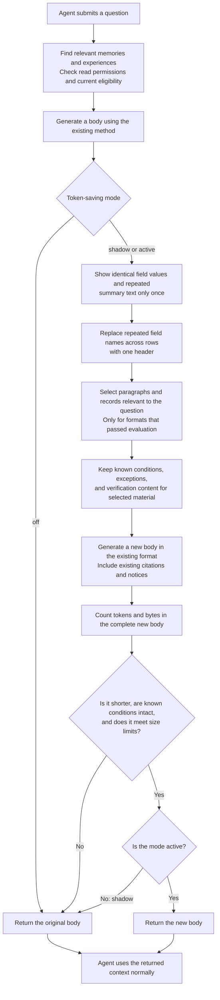

- Proposal Name: `token_budgeted_evidence_delivery`
- Start Date: 2026-10-13
- Status: Proposed
- RFC PR: Not created; assign a number after opening a PR through the RFC process.
- Related Issue: [#1989](https://github.com/oceanbase/powercontext/issues/1989)
- Related Discussion: [#1971](https://github.com/oceanbase/powercontext/discussions/1971)
- Related RFCs: [RFC 1489](1489_prepared_context_text_assembly.md),
  [RFC 1560](1560_recall_sufficiency_gate.md), [RFC 1809](1809-atomic-memory.md),
  [RFC 1400](1400_source_definition_and_observation_model.md),
  [RFC 0081](0081_end_to_end_evaluation_architecture.md)

# Summary

Add a server-side evidence compiler to PowerContext, disabled by default. After existing `prepare_context` authorization,
retrieval, admission, and current-state checks, construct protected groups, select representations, and allocate budgets
across the same typed candidates. Return context through existing renderers. Callers send existing requests and consume
existing responses, without replacing agent history, installing local readers, or extending checkpoints.

The first release adds **0 database tables, 0 HTTP endpoints, and 0 MCP operations**, with no public-field additions to
existing requests, PreparedContext, or Capabilities. `RuntimeConfig` adds deployment settings: `off / shadow / active`
use the original path, observe candidates only, or actually adopt optimized delivery. Once enabled server-side, existing
HTTP, SDK, and host integrations calling prepare receive results directly.

Direct savings come from five content transformations: render identical field values once, render duplicate snippets once,
render homogeneous table keys once, omit unrelated paragraphs in limited formats, and deliver fewer low-information-gain
candidates. The first three change representations; the last two change information coverage, with quality risks evaluated
separately. Protected groups, conditional closure, and token guards prevent degradation; they are not independent savings mechanisms.

The innovation hypothesis uses task information requirements to constrain these transformations, jointly selecting
representations within the same candidate pool by complete rendered costs and calibrating required conditions with
independent counterfactual experiments. Derived plans are in-memory data for one call, not persistent graphs, run ledgers,
or cross-request hard budgets.

Generality means independence from agent frameworks and reuse of existing context delivery entry points. It does not mean
automatic compression of every third-party tool or entire agent history. The current MCP catalog has no `prepare_context`;
search/get/hint retain their contracts and do not automatically receive this capability. Host input replacement is an
optional later enhancement, not a prerequisite for first-release design, acceptance, or value evidence.

# Motivation

## Current contracts and problems

- PreparedContextBuilder already limits candidates, entries, individual bodies, and total bytes, with no I/O, persistence,
  or reranking.
- Default JSON envelopes and explicit Markdown assembly can use prefix truncation, excluding trailing conditions and failure
  verification content from delivery.
- Runtime still holds complete Experience structures and Topic hits, checking current Atomic eligibility before final
  assembly. Plan from typed candidates rather than reconstructing missing conditions from truncated PreparedContext.
- Public PreparedContext contains only `schema/status/content/content_bytes`; inner bodies already have trust, citation,
  and truncated contracts. Improving delivery does not require another envelope.
- Native reads such as `get_artifact_revision` and `get_source` preserve originals and exact identities. Temporary
  representations do not need separate original stores.
- The current MCP allowlist excludes prepare. `prepare_handoff_hint` is a separate Handoff renderer, not the same entry point.

Entry points: [Builder](https://github.com/oceanbase/powercontext/blob/master/src/powercontext/builtin/runtime/prepared_context.py),
[Runtime prepare](https://github.com/oceanbase/powercontext/blob/master/src/powercontext/builtin/runtime/application.py),
[public models](https://github.com/oceanbase/powercontext/blob/master/src/powercontext/builtin/runtime/models.py),
[MCP catalog](https://github.com/oceanbase/powercontext/blob/master/src/powercontext/server/mcp.py).

Existing byte limits already bound delivery. Truncation, entry limits, Topic snippets, and deduplication are not new
contributions. The proposal must answer two new questions: can it reduce provable representation redundancy under the same
evidence and budget, and can it preserve complete conditional groups under budget competition to improve independent task
quality? Savings from fewer returned candidates must report coverage changes separately, without attribution to lossless compression.

## Differentiation hypotheses

| Design | New behavior | Rejection criterion |
| --- | --- | --- |
| Protected groups and known dependency closure | Budget applicability conditions, failure constraints, and verification fields with selected actions, without independently truncating trailing fields | No condition-quality advantage over the current fitter |
| Joint multi-representation budgets | Compare complete rendered costs and allocate representations within existing ranks/quotas instead of a fixed truncation length per entry | No advantage over reasonably configured existing assembly |
| Counterfactual necessity calibration | Independently test consequences of deleting conditions and release fixed policies validated on held-out tasks | Policies depend on test answers, or costs/severe errors increase |

Type routing, deterministic filters, protection rules, and recovery references all have precedents. Differentiation requires
proving effectiveness within PowerContext's official evidence and assembly contracts. This proposal claims neither an
industry first nor semantic losslessness for free text.

## Scope and constraints

Initially process Atomic Memory, Experience, and Topic Memory candidates already obtained by prepare. Profile, code,
and unsupported formats retain existing behavior; `include_code=true` requests entirely use legacy in the first release.
Add no Source reads, candidate pools, families, retrieval modes, rerank/gate expansion rounds, or memory writes. Existing
assembly choices for format/sections/limit/show must be preserved.

Build no generic tool executor, model proxy, third-party log compression service, cross-request sessions, original vault,
or agent history manager. Do not change native search/get record contents to manufacture savings; those operations carry
complete-read and business-governance contracts.

# Guide-level explanation

## A workflow requiring no agent modifications

An agent already asks PowerContext: “Fix order retry behavior and provide relevant history.” Requests, reception, and
injection remain unchanged.

1. PowerContext obtains short facts, experiences, and Topic hits through existing rules.
2. The compiler first reduces actual content. Identical Experience action/lesson values share one complete original with
   both roles. Snippets exactly equal to complete summary fields are not repeated; validated JSON row arrays use one header.
   Then select relevant complete paragraphs for limited formats that have passed quality acceptance.
3. Calculate complete token costs for legal representations and allocate budgets under existing entry, byte, and rank
   contracts. Required fields cannot be truncated into isolated actions.
4. Existing interfaces return the original four-field PreparedContext. Existing agents receive more compact bodies and
   continue normal question-answering.
5. Run paired off/active trials for the same question. Independent scoring and actual model usage establish whether
   smaller delivery yields real benefit.

For example, when both `Action` and `Lesson` contain “仅幂等查询最多重试三次，资金操作禁止自动重试,” old output repeats
that sentence twice. New output is `Action / Lesson: 仅幂等查询最多重试三次，资金操作禁止自动重试`. The sentence appears
once while retaining both field roles and every restriction. Reject transformations when complete output grows.
Section 5 provides individual rules, pseudocode, and measurement.

Agents need not learn new tools, reread material, or manage allowances. Exact native reads remain optional existing
capabilities; successful initial delivery cannot ordinarily require rereads to understand current advice. The compiler
cannot guarantee task success when historical material was already insufficient.



The saving actions are concrete: avoid repeating text, replace repeated field names with a header, and deliver fewer
unrelated paragraphs or low-contribution records in validated formats. Leave inputs unchanged when no rule applies.
Shadow records the comparison between bodies but still returns the original body.

The checks cover known conditions and body size; they do not establish that every implicit condition has been identified.
Task quality is validated separately offline: answer the same question using original and new bodies, then compare results
and actual usage. This is not an online step performed for every request.

## Deployment switch

These proposed settings are not supported by the current release:

```bash
export POWERCONTEXT_SERVER_RUNTIME_TOKEN_OPTIMIZATION_MODE=off
export POWERCONTEXT_SERVER_RUNTIME_TOKEN_OPTIMIZATION_MODE=shadow
export POWERCONTEXT_SERVER_RUNTIME_TOKEN_OPTIMIZATION_MODE=active
```

`off` is the default. `shadow` calculates candidates only on the server, with actual bodies, origins, and existing statistics
identical to baseline. `active` returns optimized bodies when contract/gain checks pass, otherwise falling back to the old path.

This is a server deployment switch, requiring neither request modes nor caller upgrades. Use existing settings loading
at startup and restart server processes after environment-variable changes; the first release promises no hot reconfiguration.
For client-specific gradual rollout, use separate controlled deployments and existing routing without new business fields.

Disabling restores original assembly for subsequent requests. Servers cannot recall bodies already stored in agent history.
Underlying interfaces remain available; disabling neither deletes official evidence nor invalidates existing citations.

# Reference-level explanation

## 1. Changes and ownership

| Area | First-release changes |
| --- | --- |
| Database | 0 new tables, 0 new columns, 0 new indexes, 0 migrations |
| HTTP/MCP operation | 0 additions; existing prepare entry points unchanged, MCP catalog not expanded |
| Request/response models | 0 new fields; existing PreparedContext status/schema contracts |
| RuntimeConfig | Deployment settings for mode, token targets, and tokenizer profiles |
| Runtime | One stateless planning/pure-rendering pass after existing candidate acquisition |
| Host SDK | No new readers, state channels, history hooks, or checkpoints required |
| Statistics/evaluation | Existing trace/log sinks and evaluation artifacts record comparisons; no new business statistics tables |

Domain rules remain in Runtime; HTTP, SDK, and MCP do not implement separate compression logic. The compiler handles only
Runtime-authorized/admitted typed candidates, without database queries, network access, model calls, or persistence.
Reuse cohesive helpers in existing builders/renderers rather than a new composition root, contributor registry, or parallel
context service.

## 2. Modes and deployment configuration

Proposed settings:

| Runtime field | Default | Meaning |
| --- | --- | --- |
| `token_optimization_mode` | `off` | `off / shadow / active` |
| `token_optimization_target_tokens` | `1800` | Planning target for one prepared body; cannot override request.max_bytes |
| `token_optimization_tokenizer` | `o200k_base` | Registered deterministic profile; initially cl100k_base/o200k_base |

Token targets are policy settings, not request hard allowances, provider complete-input ceilings, or entire-task budgets.
Successful optimization satisfies both targets and original byte/format contracts. Otherwise return legacy and explicitly
record unmet targets, without labeling success.

Off executes no compiler, dedicated tokenizer, or additional candidate calculation. Shadow produces internal diagnostics
only; CPU/memory overhead is not free savings. Active permits new representations across the entire instance. Models cannot
select modes, policy versions, tokenizers, or Scopes. Existing gate/Memory compaction settings retain their meanings and
cannot substitute for this switch.

Unavailable policy/tokenizer dependencies explicitly record fallback in shadow/active and use legacy, without blocking
ordinary prepare. Runtime configuration validation still rejects invalid enums/values; configuration errors cannot silently
map to an enabled deployment.

## 3. Typed snapshots and exact sources

Planning occurs in `ScopedContextApplication` after existing gates, authorization, and Atomic current-eligibility filtering,
but before the first truncation. The same bounded candidate snapshot generates both legacy and candidates. Shadow cannot
repeat retrieval, add Source originals, or inspect task answers.

Artifacts use native Scope, family, artifact_id, and revision identities. Content digests provide integrity rather than
replacing business identities. Identical text across Scopes/revisions is not merged. Origins contain only actually delivered
exact sources and are empty when nothing is delivered.

Current candidates are not always originals: Topic hits lack complete detail/offsets; Atomic text lacks conditional graphs;
Experience fields are largely free text. The compiler cannot present retrieval snippets as originals, summaries as all
conditions, or invent Source revisions.

Original domain services own authorization/lifecycle checks. The compiler neither expands reference Scopes/search families
nor bypasses current Atomic eligibility. Existing Runtime read contracts govern concurrent state changes; no additional
atomic cross-object snapshots or immediate revocation of already delivered content are promised.

## 4. Protected groups and known dependencies

A derived group includes native sources, complete field sets, representation policy versions, and known associations,
existing only within the current call.

```text
Experience group:
  situation
  action
  outcome
  lesson
  failure.signature / repair_surface / verification (when present)

A compact action representation cannot remove conditions or verification content in this group unless proven redundant.
```

Initial closure is structural protection, not free-text semantic parsing:

- Experience: complete situation/action/outcome/lesson and every failure field form protected groups. Do not remove outcome/
  lesson because keywords do not match. Repeated expressions within fields use verified deterministic rules only.
- Atomic Memory: deliver short text in full. No native structure identifies implicit conditions, so do not split isolated sentences.
- Topic hits: representation reduction protects titles, complete summaries, and nonduplicate snippets. Task projections
  select complete relevant/protected paragraphs only in verified limited formats, explicitly marking lossy excerpts.
  Hidden detail is absent from input; complete dependencies cannot be claimed.
- Profile, code, unknown prose: preserve legacy initially without high-risk pruning policies.

Plan cycles/shared conditions only when input actually provides trusted relationships; do not infer missing ones automatically.
Add no relationship tables or Artifact writes initially. Scope diagnostics use `known_dependencies_only`.

Simple vocabularies cannot reliably identify free-text negation, versions, and cross-paragraph exceptions. Preserve complete
groups outside formats accepted through independent quality tests. Overlarge closures do not receive a second ordinary
prefix-cut. Use the old path
and record `protected_group_unfit`, without claiming legacy satisfies closure guarantees.

## 5. Five transformations that directly reduce tokens

### 5.1 Where savings come from

| Transformation | Content no longer repeated/delivered | Information change | Release conditions |
| --- | --- | --- | --- |
| R1 Experience identical-value grouping | Long field values repeated verbatim across roles | All distinct values/roles retained; body representation changes | Fixed-format round-trip/consumer acceptance and complete token guards |
| R2 Exact Topic deduplication | Snippet copies exactly equal to summaries | Matching roles retained; body appears once | Complete-field equality initially; no semantic merging |
| R3 Homogeneous rows as tables | Repeated per-row keys and structural symbols | All columns, values, types, row order, and multiplicities retained | Supported flat homogeneous structures round-trip |
| R4 Task-relevant excerpts | Complete unrelated paragraphs in limited formats | Lossy; not all material delivered | Independent held-out quality thresholds; unknown formats fall back |
| R5 Fewer low-marginal-gain candidates | Complete candidates adding little information in the same pool | Reduced source/information coverage | Report coverage changes separately; pass independent task acceptance |

Smaller budgets, condition protection, references, and token measurements do not automatically save anything. Only changes
to bodies or delivered sets in the table can reduce input. Recalling tens of thousands of original-store tokens into a few
thousand is not this feature's incremental benefit.

The first three retain distinct values and explicit roles but still require validation that models interpret new
representations correctly. Structural round trips alone cannot establish unchanged task quality. The last two deliberately
deliver less material and require lossy-policy evaluation, separate from same-origins lossless results.

### 5.2 R1: Write identical Experience field values once

Original representation:

```text
Situation: 服务出现瞬时错误。
Action: 仅幂等查询最多重试三次，资金操作禁止自动重试。
Outcome: 查询恢复成功，验证没有重复副作用。
Lesson: 仅幂等查询最多重试三次，资金操作禁止自动重试。
```

Candidate representation:

```text
Situation: 服务出现瞬时错误。
Action / Lesson: 仅幂等查询最多重试三次，资金操作禁止自动重试。
Outcome: 查询恢复成功，验证没有重复副作用。
```

The duplicate complete value is removed, not the Lesson role. Rules:

1. Compare complete original field strings for exact equality, preserving numbers, versions, negation, case, whitespace,
   and multiplicities.
2. Group equal values and render all roles in first-occurrence order with one complete value.
3. Retain complete `failure` paths/distinct values unchanged; initially do not merge across failure roles.
4. Do not deduplicate actions/lines inside a field; multiplicity may carry meaning.
5. Return the original when fields are all distinct or the complete new representation is not shorter.

```python
groups = group_exact_values(
    ordered_fields=("situation", "action", "outcome", "lesson")
)
for group in groups:
    emit(all_original_roles(group), one_complete_original_value(group))
emit_complete_failure_block()
```

Native Experience GETs, values, revisions/digests remain unchanged. This is directly readable representation within existing
item.content, without requiring agent alias decoders.

### 5.3 R2: Do not repeat already covered Topic snippets

Original bodies already contain both summaries and query-specific snippets:

```text
Title: 订单重试规则
Summary: 仅幂等查询最多重试三次，资金操作禁止自动重试。
Snippet: 仅幂等查询最多重试三次，资金操作禁止自动重试。
```

Exact-deduplication candidate:

```text
Title: 订单重试规则
Summary: 仅幂等查询最多重试三次，资金操作禁止自动重试。
Snippet: 与 Summary 全文相同。
```

Initially try only complete-field, byte-for-byte equality between a Topic's snippet and summary. Notices explicitly identify
complete text, retaining the matching snippet's location. Even exact substrings cannot be replaced by vague containment
notices: summaries mentioning three retries in an old version and five in a new one require identifying the actual match.
Future substring support requires self-contained precise match ranges in the body. R2/R3 combinations on the same fields
revalidate role associations and are not composed when associations cannot be retained. Partial overlap, semantic similarity,
and identical text across Scopes/revisions do not qualify. Official Topic data remains unchanged; existing snippet retrieval
is not a new algorithm. Notices cost tokens and can make short snippets longer, requiring rejection.

### 5.4 R3: Replace repeated JSON keys with one header

Process only complete, validated flat homogeneous JSON row arrays in supported fields. For example, a Topic summary may
contain a complete list. Do not add arbitrary third-party tool logs to prepare or rewrite complete Atomic text.

```json
[
  {"path":"a.py","status":"fail","line":7},
  {"path":"b.py","status":"fail","line":11},
  {"path":"c.py","status":"pass","line":19}
]
```

Candidate body:

```text
完整表格，字段、类型、行序及重复行保留：
path | status | line
"a.py" | "fail" | 7
"b.py" | "fail" | 11
"c.py" | "pass" | 19
```

Savings grow with row counts by eliminating repeated path/status/line keys. For few rows, header explanations may offset
savings; complete guards still apply.

Admission requires identical field sets/order and supported scalar values. Reliably escape strings; preserve original
numeric lexemes instead of first converting to floats, distinguishing string/number/boolean/null. Missing fields, duplicate
object keys, nested values, mixed structures, uncertain escaping, or failed round trips fall back. Schemas, row order,
duplicate rows, values, and types must be recoverable; only after round-trip acceptance evaluate actual model readability.

Tables occupy original content strings, without changes to JSON item/citation or official GET schemas. They are not new
transport protocols.

### 5.5 R4: Deliver relevant complete paragraphs for the question

This is the principal potential gain for large bodies and is explicitly lossy. For the question “What restricts order
retries?”, a current Topic summary may contain independent “Retry rules,” “Interface themes,” and “Monitoring dashboards”
groups. Old output includes all three; candidates include only retry groups and global constraints/exceptions/versions/
failure-verification paragraphs explicitly identified by the format, marking other groups undelivered.

Implementation:

1. Enable only format parsers validated on held-out tasks. Separate headings/groups and explicit protection relationships;
   do not infer semantics from arbitrary prose.
2. Use deterministic term matching against original queries and existing hits/snippets to select relevant groups, without
   synchronous LLM calls whose costs are ignored.
3. Select complete paragraphs/groups and retain format-global protected paragraphs/known dependencies. Send summary/snippet
   repetition to R2.
4. Retain originals for incomplete relationships, unparseable cross-paragraph references, or unsupported formats.
5. Set `truncated=true` and mark bodies as task-relevant excerpts with some material undelivered; separate policy omissions in traces.
6. Do not fetch details absent from candidates or expand retrieval. Topic hits lack original offsets; do not invent range recovery protocols.

Fixed-format relationships are known structures, not proof that all implicit conditions were identified. Negation vocabularies
are detection signals, not safety proofs. Only after shadow screening, held-out non-inferiority, and severe-error acceptance
may fixed-version policies become active for corresponding formats. Before acceptance, gains are experimental candidates,
not released savings.

### 5.6 R5: Stop spending tokens on low-information-gain candidates

R1–R4 optimize individual candidates; R5 chooses which candidates in the same pool to deliver. For example, the first two
of three hits may cover only known retry limits while the third adds a financial-operation exception. Under tight budgets,
prioritize newly required constraints instead of simply the top two ranks.

This is evidence selection, not treating distinct Artifacts as the same object. Retain input identities separately and
exclude unselected objects from origins. Compute marginal coverage only for validated formats with defined information
requirements/contributions. Unknown Atomic prose is not semantically deduplicated; conflicts, different versions, or
independent corroborating sources cannot be dropped because strings are similar.

```text
marginal(candidate) = query information requirements supported by the current format
                      − requirements covered by delivered evidence
```

Original ranks break ties; render selections in original order without expanding family/section/count limits. Do not
combine raw scores across families, rerun retrieval, or add reranker calls. Runtime owns selection rules rather than hosts
inventing them. Report coverage changes/condition gaps separately and release after paired task evaluation.

This can reduce total body sizes but may omit implicit requirements. Record it explicitly as selection_changed, never
as lossless deduplication.

### 5.7 Per-rule gains and attribution

For every rule, retain complete baseline/candidate body tokens/bytes and report actual acceptance rates, fallback reasons,
and applicable-input proportions. Separate three classes: same-origins representation reduction, same-origins lossy excerpts,
and selection_changed. Combine rules in fixed R1/R2/R3→R4→R5 order and record incremental changes without crediting overlapping
removals twice.

```text
Incremental savings at one step = previous complete body tokens − current complete body tokens
Final savings                  = complete legacy body tokens − complete final body tokens
```

Actual model input includes trust, citations, labels, and hints; per-rule gains are counted after complete wrapping by
original renderers. Reject shorter raw bodies that become longer after wrapping. Inputs without matching rules retain
baseline; selectively reporting positive samples cannot establish average savings.

### 5.8 Reproducible offline mechanism measurements

These are actual tokenizer counts for synthetic samples, not implemented product behavior, real agent results, or billing
savings. Baselines use the existing PreparedContextBuilder, asserting equality with complete baseline
bodies. Candidates use experimental transformations wrapped by original JSON/Markdown renderers. No sample triggers existing
2000-byte entry or 32768-byte total truncation, excluding gains from the old fitter. Using tiktoken 0.13.0, the table reports
complete o200k_base content, including trust, citations, labels, escaping, and omission notices. Examples retain the original
Chinese synthetic text verbatim so body bytes and token measurements remain reproducible.

| Synthetic positive sample | JSON tokens | Markdown tokens | Information boundary |
| --- | --- | --- | --- |
| R1: Identical Action/Lesson; failure separately complete | 416→341, 18.03% | 436→360, 17.43% | Same origins; distinct values/roles retained |
| R2: Identical complete summary/snippet | 271→202, 25.46% | 289→220, 23.88% | Same origins; match explicitly refers to complete text |
| R3: One set of column names for 8 homogeneous JSON rows | 522→343, 34.29% | 366→298, 18.58% | Same origins; row order/duplicates/values/types retained |
| R4: Retry/protection groups retained, omitting color/report/layout paragraphs | 322→230, 28.57% | 334→242, 27.54% | Lossy excerpts; no proof of unchanged task quality |
| R5: Select one of two same-body candidates in the pool | 316→195, 38.29% | 343→208, 39.36% | Origins decrease from 2 to 1; coverage changes |

Every rule also has a negative control: distinct fields, snippets adding conditions, all paragraphs required, candidates
with independent constraints, or JSON rows missing fields. All 5 negative samples remain byte-for-byte unchanged under
both renderers, with 0 savings. The 20 results also record cl100k_base, complete bytes, source identities, and body digests.
Synthetic source objects retain identical digests before/after. No native GET, database, Server, Reader, or Judge executed.

These experimental transformations are offline feasibility/measurement probes. In particular, R4/R5 use preconstructed
candidate excerpts/selections, not an automatic planner correctly determining what can be omitted. R1/R2/R3 structural
retention also does not establish equivalent real-model understanding. Release still requires complete acceptance in
section 13. Table averages cannot represent average savings across actual material distributions.

Reproduction materials: [script](https://github.com/hidb4ai/powercontext/blob/codex/rfc-token-budgeted-evidence-delivery/docs/rfc-assets/token-budgeted-evidence-delivery/probe.py),
[complete synthetic inputs](https://github.com/hidb4ai/powercontext/blob/codex/rfc-token-budgeted-evidence-delivery/docs/rfc-assets/token-budgeted-evidence-delivery/samples.json),
[complete measurements](https://github.com/hidb4ai/powercontext/blob/codex/rfc-token-budgeted-evidence-delivery/docs/rfc-assets/token-budgeted-evidence-delivery/results.json).
Run in Python 3.11+ with builtin dependencies and tiktoken 0.13.0 installed. Offline environments use TIKTOKEN_CACHE_DIR
or --tokenizer-cache to provide existing vocabulary caches. Write results under /data/codex-tmp, keeping generated files
out of documentation directories.

```bash
python3 docs/rfc-assets/token-budgeted-evidence-delivery/probe.py \
  --repo-root . \
  --output-dir /data/codex-tmp/powercontext-token-mechanism-recheck
```

## 6. Joint budgets and selection algorithms

### 6.1 Boundaries

Bodies simultaneously satisfy original `max_bytes`, individual/total entry limits, assembly, and deployment token targets.
Tokenize complete `content`, including trust, formatting, citations, and hints. `content_bytes` remains actual UTF-8 bytes.
Fix `cl100k_base`/`o200k_base` implementations/vocabulary versions; unknown/unavailable profiles do not use bytes/4 as exact counts.

### 6.2 Bounded planning

1. Freeze candidate ranks, family/Scope interleaving, and original quotas; generate the legacy baseline.
2. Build protected groups from typed candidates. Retain at most 4 nondominated representations per candidate: complete,
   R1–R3 representation reduction, validated R4 excerpts, and legacy. Rules are not unlimited Cartesian products;
   unknown formats generate no lossy representations.
3. Compare complete rendered token/byte costs within the same object; different families' raw scores are not common utility.
4. First reduce actual consumption with shorter representations of the same selected objects. Formats allowing R5 then
   compare marginal coverage. Representations violating protections are ineligible; original ranks break ties, retaining
   count/section contracts.
5. Prefer comparing plans with identical origins. When saved allowance reaches later candidates in the same pool, report
   added coverage separately rather than counting it as compression of the same material.
6. Recheck final complete rendered tokens/bytes, references, protected fields, status, and escaping.
7. Return baseline with diagnostics for no legal plan, unknown formats, larger-than-baseline results, or unmet targets.

Initially use bounded beam planning rather than arbitrary combination enumeration. Extend legal representations in original
candidate order, retaining at most 32 states per round satisfying complete byte/token constraints. Compare validated coverage,
rank deviations, and complete cost. With R5 disabled, lock the same selected object set and compare representations only.
Each step actually renders/tokenizes; summing fragment tokens cannot assume BPE additivity. Revalidate final output and
return legacy on state/time limits. Each candidate has at most 4 plans, retaining existing candidate/family/output limits.

Shorter output is a necessary gain check, not sufficient quality evidence. Fewer candidates yielding smaller bodies do not
bypass complete task acceptance. Fallback for groups that do not fit is not closure success; empty responses cannot
masquerade as dramatic savings.

### 6.3 Costs and objectives

Servers can establish prepare-body tokens/bytes only. Complete independent question-answering task costs include actual
input, output, caching, auxiliary calls, additional reads, and failures/retries. Existing agents also carry other history;
no task-wide hard limit or universal savings percentage is promised.

For fixed inputs, use `legacy_text_tokens / active_text_tokens` to measure delivery changes, reporting same-origins and
coverage-expanded results separately. The goal is non-inferior quality and lower actual workflow net cost, without an
unvalidated claim that complete agent costs must fall by 20%.

## 7. Existing responses and body compatibility

The outer PreparedContext remains unchanged:

```json
{
  "schema": "powercontext.prepared-context.v1",
  "status": "ready",
  "content": "Example context",
  "content_bytes": 15
}
```

This example illustrates field shape, not actual inner renderer output. Actual content_bytes counts UTF-8 content. Empty
still requires content=null and content_bytes=0; ready retains nonempty/byte invariants.

Defaults retain original BEGIN/END, trust/items, citation/content/truncated. Explicit assembly retains original format/
sections/show, labels, and identity escaping. Unchanged outer fields do not authorize arbitrary inner machine-readable shapes.

Atomic bodies retain original hit.text before compilation; default JSON with `truncated=false` decodes to equivalent original
text. Markdown retains existing newline normalization and control-character visualization without promising original-byte
round trips. Excerpts cannot masquerade as complete originals. Deterministic structural reordering retaining all values is
not automatically truncation. Any representation deleting distinct body content honestly marks incompleteness under its
family's existing semantics. Native Source/Artifact GET
still returns original content, digests, ETags, and states; compact projections are not written back to official records.

Existing omissions track byte-budget truncation/drops. Policy projections use separate internal traces rather than being
conflated with budget shortages. Deployment settings require no old schema/operation generated-file changes, while
implementation still runs contract regressions.

## 8. Original reads and stateless recovery

Initially issue no run_id, temporary evidence_id, delivery_id, or new reread tools. Official originals remain in existing
immutable revisions and are available through existing `get_artifact_revision`, `get_source`, and related contracts,
with original authentication and family-specific resolvers.

Compiled references retain native citations. Agents need not parse new range protocols, and automatic rereads are not
guaranteed for every client. Representations must directly support normal context delivery; returning inventories alone
while waiting for new tools is not a general active result.

Future range reads must distinguish native Source/Artifact digests from locally rendered text digests. Reserialized JSON
is not remote original bytes. Establish this need separately; initially add no interfaces, locator stores, or original copies.

## 9. Statelessness, caching, and restarts

Planners consume one typed snapshot, configuration, and query, returning context, actual origins, and internal diagnostics.
They allocate no cross-request allowance, persist no idempotency ledger, create no sessions, and depend on no agent threads/checkpoints.

The first release needs no persistent cache. If repeated compilation becomes a measured CPU bottleneck, use bounded
in-process derived caches keyed by source identities/content digests, policies/tokenizers, formats, and every representation-
affecting field. Authorization/current eligibility are checked under existing contracts before cache use; cached results
are not read authorization.

Restarts simply replan, without feature-run recovery. Disabled modes do not execute feature algorithms; official storage
stays unchanged. Feature original stores/ledgers cannot be hidden as JSON in Source/Memory/Statistics/configuration tables.

## 10. General coverage and optional host enhancements

| Integration | First-release result |
| --- | --- |
| Existing HTTP prepare | Existing requests/responses; server activation directly yields optimized bodies |
| Python SDK prepare | Existing methods/types; no new client call logic |
| Host recall hooks already using prepare | Existing injection logic, with only received bodies changing |
| MCP search/get/hint | Existing contract regressions; no current prepare operation, so no automatic compiler entry |
| Arbitrary third-party tool logs/entire agent history | Outside initial control |

LangGraph is not a special prerequisite. Its existing recall is one HTTP prepare consumer among others. The first release
requires no `llm_input_messages`, `messages`, tools-schema, or checkpointer changes. Other prepare integrations benefit
similarly without separate compiler rules.

Host-controlled input views, tool proxies, and model proxies may further reduce repeated history, but add integration/
deployment capabilities. Evaluate adaptation cost, original recovery, and authorization separately; they are not implicit
prerequisites for server compilation. Without interception points, servers cannot delete bodies from external history.

## 11. Work and resource costs

Retain existing per-family candidate limits, with at most 4 representations per candidate and bounded derived group counts,
text totals, and computation time. Scan no whole Scopes, Sources, or historical revisions; do not read Topic details for
compilation or write synchronous new state.

Legacy/candidates may share basic rendering work. Measure extra compilation, tokenization, and validation in shadow/active
separately. Cover languages, sizes, formats, cold/warm tokenizers, concurrent prepare, unfit closures, and fallback rates.

Measure CPU, memory, p50/p95/p99, throughput, errors, render/tokenize counts, returned network body sizes, and database
queries/I/O. Smaller server bodies may reduce response traffic but do not establish fewer database candidate reads.
No-op/off retains the original overhead boundary.

## 12. Observability and actual benefits

The existing recall estimator compares full Sources traced from selected origins against final PreparedContext. This is a
Source→context measure, not this feature's legacy→compiled comparison. Do not rename/reuse it or expand undelivered origins
to inflate denominators.

Record feature diagnostics through existing trace/log sinks or evaluation artifacts:

- Modes, fixed policy/tokenizer versions, formats, targets, and fallback reasons.
- Complete legacy/active body tokens/bytes, matching actual origins, protected-group coverage, policy projections, and budget omissions.
- CPU/latency/memory, shadow overhead, and coverage-expanded results.
- Observed actual model requests, provider usage/caching, and independent task scores.

Distinguish prepared, emitted, model-request-observed, and task-verified. Without actual input observation, do not claim
model adoption. Missing usage is unknown, not zero. Defaults retain no complete prompts, user messages, hidden reasoning,
or extra Source copies.

Gates use original probes for admission; compact output cannot masquerade as greater sufficiency. Observe final delivery
separately. Recall effort probes and final active bodies are not the same cost figure.

## 13. Evaluation and existing repository infrastructure

### 13.1 Contracts and switches

- Off retains original bodies, origins, request/response models, and existing statistics, without dedicated planners/tokenizers.
- Shadow returns byte-for-byte equivalent baseline, calculating candidates internally without repeated retrieval.
- Active validates trust, escape, citation, truncated, byte ceilings, and four-field readback for default JSON/explicit Markdown.
- Trailing negation, versions, and Experience failure/verification in the same complete candidates avoid secondary truncation.
- Unsupported formats/Profile/include_code, oversized closures, unavailable dependencies, and internal failures explicitly
  fall back without bypassing authorization.
- HTTP, SDK, and actual existing host calls share Runtime results. MCP tests cover only actually exposed operations retaining contracts.
- Current states/source identities, identical text across Scopes, subsequent active→off requests, and server restarts remain correct.
- Original GETs, ETags, digests, and search/get field contents remain unaffected by compact representations.

Recording HTTP verifies interfaces; recording models or saved actual Reader messages verify adoption. Real-model/provider
usage and external backend acceptance are reported separately. Initial loops require neither complete agent-history
replacement nor checkpoint adaptations.

### 13.2 Algorithm ablations and static Readers

| Arm | Changed factor |
| --- | --- |
| A | Old default builder, reasonable budgets |
| B | Reasonably configured existing assembly, identical families/counts/budgets |
| C | Same candidates/origins; R1/R2/R3 separately and combined |
| D | C plus R4 lossy excerpts, constrained by protected groups/known closure |
| E | D plus joint budgets/R5 selection, reporting coverage changes separately |
| F | E plus independent counterfactual-calibrated policies |
| External control | Comparable competitor mechanisms at identical material/delivery boundaries; support differences reported separately |

First replay the same authorized typed candidates to isolate representation/condition quality; then run actual prepare→Reader→
independent scoring and record added coverage from the same pool. Treatments do not expand retrieval, receive extra Sources,
or change models/Judges/downstream budgets.

[LongMemEval-V2](https://github.com/oceanbase/powercontext/blob/master/evaluation/memory/longmemeval_v2/README.md)
already has a `query-time-compact-v1` arm calling public prepare and sending actual content to a static Reader, well suited
to this initial server-side design. Default `current-memory-fts-v1` does not call prepare; default runs cannot establish
compiler effectiveness. New treatment identities/manifests freeze modes/policy versions, database revision snapshots,
queries, `recall_fts_weight` / `recall_vector_weight`, and Readers/Judges without new product protocols to confirm active.

Existing prepare_worker records body tokens/bytes and complete messages/prompt digests. Reader provider usage measures
actual input/output/caching. Report `memory_context_was_truncated` if downstream truncation recurs; harness pruning is not
compiler savings. Build fixed counterexamples for conditions, exceptions, versions, and trailing Experience failures;
aggregate memory scores cannot replace them.

An initial 20 tasks are smoke/screening only. Expanded experiments freeze held-out sets, preregister non-inferiority margins,
and report paired differences/confidence intervals. Release active only with no additional severe conditional errors, lower
net tokens/cost across complete question-answering, and acceptable latency.

### 13.3 Tasks and performance

[Bub/Harbor](https://github.com/oceanbase/powercontext/blob/master/e2e/bub/README.md)
provides fixed tasks, isolation, alternating order, and paired statistics. Existing whole-PowerContext OFF/ON is not a
feature treatment. Only integrations actually calling prepare validate the compiler; unused harness paths are not evidence.

Synthetic [Work continuity](https://github.com/oceanbase/powercontext/blob/master/evaluation/coding/work_continuity/README.md)
fixtures may reuse local scoring; independent patch acceptance in [SWE-bench Pro](https://github.com/oceanbase/powercontext/blob/master/evaluation/coding/swebench_pro/README.md)
may support later task validation. Neither replaces current actual prepared-body input observation.

The [Performance directory](https://github.com/oceanbase/powercontext/blob/master/evaluation/performance/README.md)
has no directly reusable load-test suite. Add pure compiler/public prepare workloads for 1 KiB/20 KiB/over-limit candidates,
cold/warm behavior, formats, concurrent requests, and fallback. The compiler itself adds no I/O, and candidate counts remain
unchanged. Database queries in same-origins isolation arms should match baseline. Changes to final origins in coverage-expanded
arms may add full Source reads by the existing recall estimator; measure incremental queries/I/O separately. Additional
algorithm costs are bounded CPU/tokenization/rendering, without vault, Scope quota, CAS, or TTL tests.

### 13.4 Necessity thresholds for tables and interfaces

Initially add no persistence or business operations. Later minimal changes require actual needs, insufficient existing
contracts, and complete cost/benefit evidence together. For example:

- If full-object reads become demonstrated bottlenecks, first evaluate ranges on existing read interfaces.
- If hard shared cross-request allowances become necessary, first evaluate existing scheduling/state ownership.
- If MCP must consume new assembled context, identify current catalog gaps and necessary operation extensions explicitly.
- For third-party tools/entire history compression, establish proxy/host integration boundaries rather than presenting
  them as zero-adaptation existing service capabilities.

Do not prebuild feature tables, hide blobs in Source/Memory/configuration tables, or expand protocols for hypothetical
future use. If caller-specific switching becomes necessary, evaluate minimal opt-in fields on existing requests rather
than presupposing new endpoints.

## 14. Implementation order, exit criteria, and rollback

1. Fix actual prepare baselines/reasonable assembly controls, server-default off/shadow, and zero protocol/database changes.
2. Implement R1 identical-value grouping, R2 exact snippet deduplication, R3 supported-format tables, original renderers,
   and complete token guards. Measure positive and nonredundant/heterogeneous negative cases; condition protection is
   validation rather than a savings metric.
3. Start R4/R5 in shadow, then complete format-limited parsers, counterfactual condition samples, and A/B/C/D/E ablations.
   Add corresponding policies to active allowlists only after independent quality/cost thresholds pass; reuse query-time-compact
   Readers for independent tasks.
4. Gradually enable active after quality/cost/performance pass; then evaluate F, MCP coverage, or optional host enhancements.

No advantage over existing assembly, mostly falling-back protected groups, or gains principally from delivering less material
cannot establish compiler effectiveness. If smaller bodies increase actual question-answering costs, return to off.
Only demonstrated new bottlenecks justify interfaces/storage extensions.

# Drawbacks

Control covers only PowerContext delivery bodies, not third-party tool history retained by external agents. Existing max_bytes
already limits context; savings opportunities need measurement. Complete short Atomic facts/protected groups may offer no reduction.

Free-text conditional structure is limited, so initially many unknown cases fall back. Dual representations/rendering/
tokenization add CPU/latency. Active affects every prepare caller on the instance and requires controlled rollout. Identical
interfaces do not guarantee arbitrary body rewrites remain compatible; original inner formats require validation.

# Rationale and alternatives

| Alternative | Advantages | Tradeoff |
| --- | --- | --- |
| Lower max_bytes/configure assembly | Existing general configuration, lowest cost | Strong baseline; build no compiler if sufficient |
| Stateless server compiler | Current prepare users need no agent modifications | Controls its own delivery only; accept that product boundary |
| Host input replacement | Reduces repeated multi-turn history | Requires adaptation; optional enhancement rather than initial prerequisite |
| Headroom-style model proxy | Covers actual model requests | Proxy deployment/configuration adds product boundaries |
| Context Mode-style execution/indexing | Controls more tool results | Outside the first release's no-executor/no-original-store scope |
| New compress API | Arbitrary external text | Requires caller changes/expanded scope; #1023 describes related tradeoffs |
| Central vault/ledger | Cross-host recovery/hard budgets | Unnecessary for current single-call compilation |

Prove effects at delivery boundaries PowerContext already owns, distinguishing framework independence from control over
all agent costs.

# Prior art

This proposal reuses existing context assembly, recall admission, exact citations, and original-reading contracts.
Stateless representation planning sits between typed candidates and the final renderer, while official records,
transport models, and caller delivery retain their existing boundaries.

# Unresolved questions

Before accepting this RFC, confirm:

1. R1/R2/R3 hit rates in actual typed samples, per-rule savings/wrapping costs, and sufficient gains over existing assembly.
2. Initial verifiable R4/R5 formats, complete protected-paragraph relationships, compatible samples, severe conditional
   error definitions, and held-out quality thresholds.
3. Default token targets/tokenizer dependencies, deployment fallback/rollout, and final performance thresholds.
4. Expanded independent task families, non-inferiority margins, and actual model/provider-usage observation coverage.
5. Whether deployment-level switches meet initial needs, and clear product documentation of current MCP coverage limits.

Explicitly add no database migrations, HTTP/MCP operations, public request/response fields, local readers, checkpoint state,
or third-party execution proxies. Any extension first meets necessity thresholds in section 13.4.

# Future possibilities

After initial thresholds pass, explore automatic dependency recognition, independent counterfactual calibration, more
native delivery entry points, and MCP assembled-context capabilities. Host views/generic proxies independently establish
additional value without promises of zero adaptation or crediting their gains to this compiler. Future needs provide
compatibility, cost, quality, and necessity evidence, not implicit dependencies of the first-release design.
