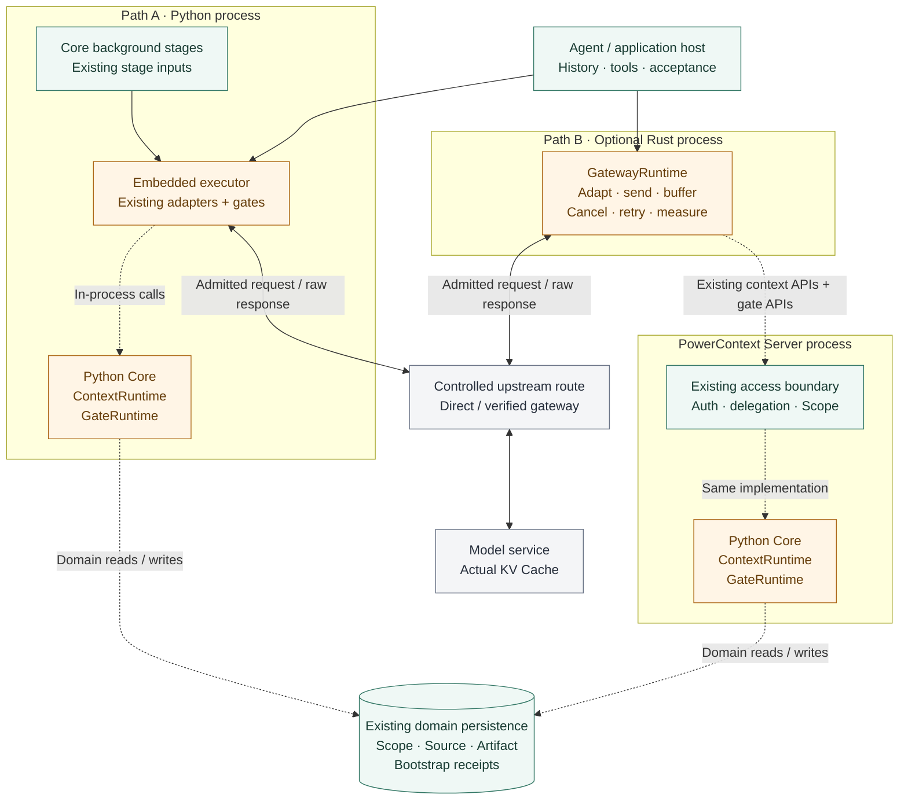
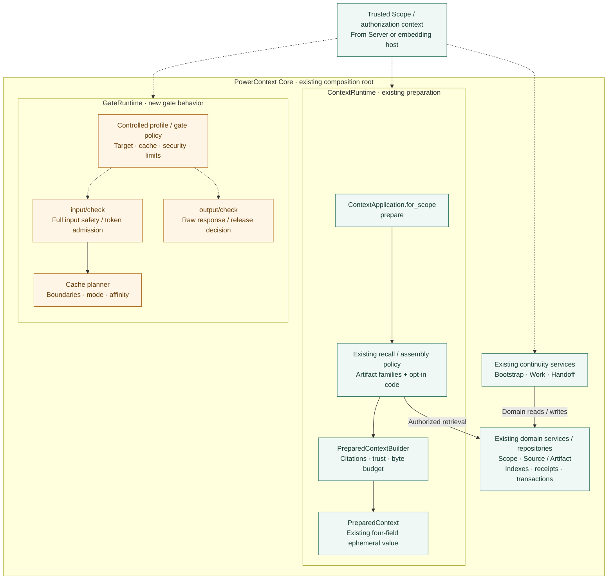
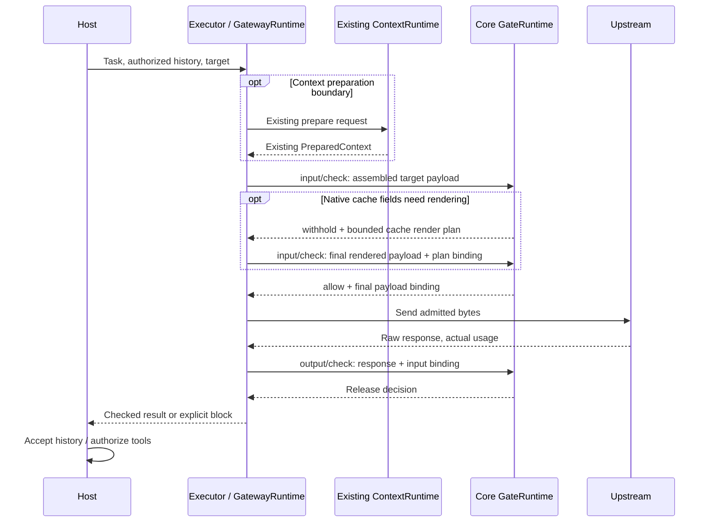

- Proposal Name: `context_gate_and_optional_gateway_runtimes`
- Start Date: 2026-10-19
- RFC PR: [oceanbase/powercontext#2086](https://github.com/oceanbase/powercontext/pull/2086)
- Related RFCs: [RFC 0016](0016_pydantic_ai_inference_integration.md), [RFC 0028](0028_context_pack.md),
  [RFC 0046](0046_observability_foundations.md), [RFC 0048](0048_handoff_artifact.md),
  [RFC 1435](1435_explainable_prepared_context_receipts.md), [RFC 1770](1770-decision-policy-governance.md),
  [RFC 1783](1783-handoff-session-rollover.md)

# Summary

This RFC is a design proposal. Its implementation baseline is repository commit e4efb39b; accepting the RFC does not
establish implementation, host compatibility, or measured cache savings.

**ContextRuntime is PowerContext's existing context organization capability participating in model invocation.** Its
implementation remains `ContextApplication.for_scope(scope_id).prepare(...)`, the existing recall and assembly policies,
and `PreparedContextBuilder`. Bootstrap, Work, and Handoff keep their existing entry points and domain ownership.
There is no second context selector, transcript service, session database, or mandatory runtime wrapper.

**GateRuntime adds the invocation boundary that existing context preparation does not provide.** It consumes the
prepared context inside a complete model request, plans permitted cache use, checks the final outbound payload, and
checks the raw response before release. Full-request token admission belongs here; `prepare.max_bytes` remains the
UTF-8 budget for supplementary context. GateRuntime does not independently recall or reassemble Memory.

**Optional Rust GatewayRuntime executes this composition.** It calls the existing context API when preparation is
needed, maps the target protocol, obtains gate decisions, sends approved bytes, buffers output, and reports execution
evidence. Embedded applications and Core background inference can use the same gates without deploying Gateway.

The first delivery adds **two check operations and zero database tables**. The host owns conversation history, response
adoption, tools, and task scheduling. Existing Source, Artifact, Bootstrap receipt, Work, Handoff, and statistics services
retain their specific semantics. Transient requests, checked values, cache plans, and output buffers stay in memory.

| Design item | Decision |
| --- | --- |
| Context organization | Reuse the existing scoped prepare path, assembly settings, recall policies, citations, trust envelope, and byte budget. |
| Context continuity | Reuse host history and existing Bootstrap/Work/Handoff flows at their supported lifecycle boundaries. |
| New Core capability | GateRuntime owns final input admission, cache planning, and output checks. |
| New HTTP operations | Only `/v1/inference/input/check` and `/v1/inference/output/check`; context and continuity use existing operations. |
| New storage | Zero tables and no new Artifact family in v1; no mandatory persistence for checks. |
| Gateway role | Optional Rust executor; Core retains context and policy decisions. |
| KV Cache | Core plans reusable layout and cache constraints; Gateway executes them; the inference service owns KV state. |
| Default optimization | Stable existing context and history, explicit output limits, and validated provider caching; no automatic lossy compaction or semantic response cache. |
| Initial security | Text and structured tool content under an explicit profile; strict checks before sending and before response release. |
| Durable guarantees | Existing domain commits retain their contracts; v1 does not add durable inference recovery, exactly-once sending, or a shared financial ledger. |
| Acceptance | Complete-task quality, total measured cost, latency, and security counterexamples on a fixed supported integration. |

# Motivation

PowerContext already answers which authorized historical context should be delivered and how it should be represented.
The missing link is to carry that result faithfully into an actual model request, apply policy at the send and release
boundaries, and avoid changing the reusable prefix without a reason.

A separate context subsystem would duplicate recall, evidence handling, Scope authorization, and continuity semantics.
Persisting every plan, response, turn, and attempt would also create operational costs before establishing a useful
vertical slice. This proposal starts with an existing coding workflow:

1. Prepare bounded project context with the current API.
2. Retain that exact value across ordinary tool turns in the host's context ownership boundary.
3. Apply input admission and cache planning to the complete request.
4. Send through an existing executor or optional Gateway and check the response before delivery.
5. Use existing Handoff when the host needs a new session.

The runtimes name responsibilities within this flow. They do not require three new products, three composition roots,
or a general Agent scheduler. Core background generation, Embedding, reranking, and auxiliary decisions also need
appropriate gate coverage, but do not require an Agent conversation or automatic Memory recall on every model call.

# Guide-level explanation

## A coding task using existing PowerContext

A user asks a Coding Agent to fix an API client. The project already has a registered Scope and Memory describing its
OpenAPI regeneration requirements:

1. At a supported recall boundary, the host or Gateway calls existing `/v1/context/prepare` with the task query and Scope. Existing runtime policy recalls and assembles the permitted Memory, Experience, Topic Memory, optionally configured Profile, and opt-in code evidence. The normal empty result remains valid.
2. The host inserts the returned `PreparedContext.content` unchanged as historical data. It retains current instructions, repository rules, messages, tool definitions, and tool results under its existing authority. Prepared context is supplementary evidence, not a replacement system instruction.
3. GateRuntime evaluates the complete target request, including output reservation, security rules, and cache eligibility. GatewayRuntime sends only the final admitted representation.
4. The output gate checks complete text and tool arguments before release. The host then decides whether to accept the answer or authorize a tool. Passing the gate does not execute a tool or commit Memory.
5. Ordinary tool turns retain the same prepared value and already accepted history. A new task intent or explicit context refresh can call the same existing prepare API again. Near the model window limit, the host requests an existing Handoff or reports insufficient capacity.

This directly improves the current PowerContext flow. The host does not migrate its transcript into Core or create a
second session before using the gates.

## Reusable context and Gateway cache behavior

For a fixed model, protocol, tool set, and task boundary, the executor preserves this logical layout:

```text
Turn 1: Stable rules + tools + exact PreparedContext | Current request
Turn 2: Same prefix + accepted turn 1 history        | New message/tool results
Turn 3: Same prefix + accepted turns 1 and 2         | New message/tool results
```

Actual roles, ordering, and tool-call/result pairs follow the target protocol. The layout is not permission to move
messages into more privileged roles or to reorder existing history.

Core plans eligible prefix boundaries and cache settings. Gateway maps those settings to the verified protocol,
submits the final representation to the input gate, and sends it without subsequent mutation. The output gate keeps
rejected content out of the executor-managed replay path; the host appends accepted results using its existing history.
This maintains a reusable next-turn prefix. An output check cannot create a hit for a request already sent.

Actual KV state stays at the inference service. A stable prefix only creates eligibility: provider evidence must show
cache reads, writes, and their cost. Full input normally still travels to the provider unless the verified protocol
explicitly supports a cache reference. Model switches retain portable host context or Handoff while the new target
builds its own KV state.

## Switching models and continuing work

The host provides model B with permitted portable history and the existing prepared context, or with a checked exact
Handoff plus current evidence. GateRuntime applies B's capability profile and complete-request budget. It rejects
unsupported opaque model state; it does not reinterpret private reasoning or provider session identifiers as portable
text. If the context does not fit, the host uses an explicit Handoff rather than silently summarizing or dropping it.

Cross-session continuity uses existing Work/Handoff prepare, inspection, finalize, optional commit, delivery, and
continuation semantics. A committed Handoff remains readable through its current exact-read path. The receiving Agent
checks current repository state, permissions, and evidence. Model output never becomes long-term Memory merely because
it passed an output gate.

## Core background calls without Gateway

A Memory extraction stage reuses its current Source window, instructions, output schema, and Artifact commit service.
It runs input and output checks around its real inference boundary, then performs existing domain validation.
Embedding and reranking retain their existing ports. No stage calls `context.prepare` merely to satisfy the runtime
naming, and auxiliary policy calls do not recursively trigger context enhancement or more auxiliary judges.

# Reference-level explanation

## Existing implementation and concrete reuse

| Responsibility | Existing implementation | Decision in this RFC |
| --- | --- | --- |
| Scoped context entry | `ContextApplication` / `ScopedContextApplication.prepare` | This is the ContextRuntime entry, not a lower-level source for a second selector. |
| Recall and assembly | `_prepare_build`, selected families, existing recall effort policy | Retain current policy, candidate eligibility, bounded expansion, and authorization. |
| Final supplementary text | `PreparedContextBuilder`, prepared text/code rendering | Retain selection, citations, trust wrapping, omissions, and UTF-8 truncation. |
| Public value | `PreparedContext(schema, status, content, content_bytes)` | Keep the default four-field result and direct injection contract. |
| Bootstrap and deduplication | Existing bootstrap preparation and delivery receipt | Retain exact supported lifecycle and fully injected Atomic Memory revision deduplication. |
| Task continuity | Existing Work facade and Handoff Artifact lifecycle | Reuse existing Source/Artifact operations, exact revisions, and explicit commits. |
| Model execution | Inference ports, provider adapters, usage wrappers | Add gates at verified final-send/raw-response boundaries. |
| Observations | Current model usage, recall statistics, decision observations | Reuse their current purpose; they are not a recoverable inference ledger. |
| New work | Gate policy, full-request admission, cache planning, executor enforcement | Add only behavior the existing context path does not provide. |

The baseline is inspectable in the existing
[context application](https://github.com/oceanbase/powercontext/blob/e4efb39bd6b8303a508c83fd5fcde5f99290b785/src/powercontext/builtin/runtime/application.py),
[context models](https://github.com/oceanbase/powercontext/blob/e4efb39bd6b8303a508c83fd5fcde5f99290b785/src/powercontext/builtin/runtime/models.py),
[builder](https://github.com/oceanbase/powercontext/blob/e4efb39bd6b8303a508c83fd5fcde5f99290b785/src/powercontext/builtin/runtime/prepared_context.py),
[inference ports](https://github.com/oceanbase/powercontext/blob/e4efb39bd6b8303a508c83fd5fcde5f99290b785/src/powercontext/builtin/inference/protocols.py),
[provider adapter](https://github.com/oceanbase/powercontext/blob/e4efb39bd6b8303a508c83fd5fcde5f99290b785/src/powercontext/builtin/inference/pydantic_ai.py),
and [shared tables](https://github.com/oceanbase/powercontext/blob/e4efb39bd6b8303a508c83fd5fcde5f99290b785/src/powercontext/builtin/persistence/tables.py).

## Runtime ownership and composition

### Deployment and execution boundaries

The deployment view separates the model transport from context preparation and gate checks. The two Core boxes denote
reuse of the same components in different deployment modes, not a requirement to run two Core instances. The storage
symbol denotes current domain persistence supplied by each deployment; it does not require a database shared between
embedded and service modes. Remote mode reuses the Server's authentication, delegation, and Scope enforcement.



Solid arrows show host/executor calls and actual upstream traffic; dashed arrows show preparation, checks, and existing
domain access. A check RPC carries the content to inspect; a dashed line does not imply metadata-only transmission.
The configured route may be direct or pass through a verified downstream gateway. Actual KV state remains in the model
service. Core background stages can use the embedded executor without deploying Gateway.

### Core components and reuse

This component view expands the shared Core. Green identifies existing boundaries and components; amber identifies new
gate policy or execution integration; gray identifies host/executor responsibilities or external services. These are
responsibility groups within the existing composition root, not new persistent aggregates or mandatory wrapper classes.
Edges show internal processing and domain dependencies; the later invocation sequence diagram expands messages crossing
the Core/executor boundary.



Existing prepare owns recall, selection, citations, and supplementary byte limits. Its four-field value returns to the
host/executor, which assembles the complete request and retains authorized reusable context. GateRuntime sees that
complete request, plans caches, and admits the final representation; it does not independently select Memory. The
optional render loop uses the same input check operation. The output gate receives the executor's raw response and
returns a release decision. Bootstrap/Work/Handoff remain explicitly invoked domain services. New gates create no
Source/Artifact record or inference table merely by checking content.

| Owner | Owns | Integration constraint |
| --- | --- | --- |
| ContextRuntime | Existing authorized context retrieval and final bounded assembly; existing bootstrap and continuity composition | Do not add a second recall engine, contributor registry, transcript store, or generic session model. |
| GateRuntime | Invocation policy, complete-request limits, cache constraints, input admission, output release decision | Consume prepared values; do not repeat selection, parse citations into authority, or rewrite authoritative records. |
| Executor / GatewayRuntime | Target protocol rendering, permitted sending/retries, buffering, cancellation, evidence collection | Apply Core decisions faithfully; keep protocol code free of independent context/security policy. |
| Host | Conversation truth, acceptance, tools, scheduling, explicit context refresh and rollover | Declare actual integration coverage and preserve its existing delivery and persistence contracts. |
| Existing domain services | Source intake, Artifact revisions, Memory governance, Work/Handoff commits | A gate result cannot replace domain validation or grant write permission. |

The existing runtime remains the composition root. `ContextRuntime` is a capability name; v1 does not require a new
class that only forwards to `application.context`. Cohesive new gate behavior may have its own component, wired beside
current context and inference services. Embedded callers use existing scoped application objects; remote callers use
existing generated clients. Neither needs loopback HTTP to use Core policy.

## Context control through existing capabilities

### Preparation and exact reuse

Keep the existing request contract, including `assembly`, `include_code`, and `bootstrap_receipt_id` when applicable:

```json
{
  "scope_id": "project:powercontext",
  "query": "Fix the generated API client and follow repository regeneration rules",
  "max_bytes": 8000,
  "include_code": false
}
```

The default recall path can include Memory, Experience, and Topic Memory. Profile requires the existing selection and
configuration; code is opt-in. Skills are not implicitly added by context preparation. Existing recall/rerank policy
retains its own cost and failure semantics.

The host or Gateway retains the exact prepared value for a declared task context epoch: a local lifecycle boundary,
not a new server session resource. It does not recall again for every tool result or retry. A refresh uses the existing
prepare operation, fixes the new injection location, and leaves accepted history accurate. Never globally remove text
merely because it resembles an earlier Memory item.

The existing `bootstrap_receipt_id` excludes only supported, fully injected Atomic Memory revisions. It does not
establish generic deduplication of Topic Memory, code, arbitrary history, or Handoff. General history coverage is not
inferred from a matching string or an Artifact identifier without Scope and revision.

### Two budgets with different owners

`prepare.max_bytes` bounds supplementary UTF-8 text. GateRuntime checks the entire target request: instructions,
prepared text, history, tool/schema overhead, and output reservation against verified target limits. A byte count is
not a token count. Estimation methods and uncertainty margins are explicit; an unknown target window cannot satisfy
a required hard admission check.

If the request is too large, v1 withholds sending and reports the applicable limit. The host can request a smaller
`max_bytes` through the same prepare API or create an explicit Handoff. GateRuntime does not silently truncate the
prepared trust envelope, choose another set of Memory, cut tool exchanges, or mutate history. Re-preparation incurs
its real retrieval cost and starts a new prefix epoch.

### Refresh, permissions, and provenance

Current authorization is checked for each prepare, send admission, and release. Reusing bytes is not an authorization
cache. A frozen value does not continue to authorize material after its access has been revoked.

The four-field public PreparedContext has no trusted machine-readable origin list. An integration promising automatic
cross-turn reference reauthorization must retain actual origin Scope/revision information from a trusted runtime
boundary or another verified host-owned provenance mechanism. It cannot reconstruct authority from citation text.
The first cache demonstration uses one Scope without context references and a host-authorized history boundary.
Automatic cross-Scope frozen replay is outside that profile until provenance and reauthorization are verified.

When the required authorization/provenance is unavailable, withhold protected reuse and refresh through an authorized
path or let the host establish a permitted new boundary. Security changes can reduce cache reuse; cache affinity never
postpones enforcement. Already disclosed provider content cannot be recalled by invalidating a local plan.

[RFC 1435](1435_explainable_prepared_context_receipts.md) proposes optional, ephemeral preparation diagnostics on the
same prepare response. It is not implemented in the baseline, not required for v1, and not an authorization token or
proof of injection. Ordinary automatic recall retains its existing four-field result.

### Rollover and domain continuity

Reuse the existing Handoff workflow at the host's explicit rollover boundary, consistent with
[RFC 1783](1783-handoff-session-rollover.md). Core does not take ownership of a full transcript or implement a general
provider window manager. GateRuntime contributes invocation admission; the host decides when and how to open a new
session. Handoff evidence and omissions retain their existing semantics, and exact committed references remain
Scope-qualified. Work remains a facade over Source/Artifact, without a new persistent Work aggregate.

## Minimal API surface and Scope isolation

### Existing operations remain the main entry points

| Need | Reused HTTP operation | Effect |
| --- | --- | --- |
| Task-specific supplementary context | `/v1/context/prepare` | Existing ephemeral PreparedContext; no inference execution. |
| Lifecycle context | `/v1/context/bootstrap` | Existing curated bootstrap package. |
| Bootstrap delivery | `/v1/context/bootstrap/receipts` | Existing content-free terminal delivery receipt. |
| Current work boundary | `/v1/work/handoffs/prepare-current`, `/v1/work/handoffs/acknowledge` | Existing Work/Handoff continuity. |
| Explicit Handoff lifecycle | `/v1/handoff/prepare`, `/v1/handoff/finalize`, `/v1/handoff/commit`, `/v1/handoff/continue` | Existing domain preparation, validation, commit, and read paths. |
| Work intent and result | `/v1/work/contracts/create`, `/v1/work/outcomes/record` | Existing Source-backed observations where explicitly applicable. |

All listed paths already exist. Their DTOs, authorization, optional persistence, and failure semantics remain owned by
the current operations. No new `/inference/prepare`, session create/get, branch/fork, adoption, event append, attempt,
release, or recovery-query API is needed for the v1 flow.

### Two new check operations

| Proposed POST path | operationId | Scoped domain behavior |
| --- | --- | --- |
| `/v1/inference/input/check` | `check_inference_input` | Evaluate complete input; return a cache render plan when needed, or admit/block the final target-bound payload. |
| `/v1/inference/output/check` | `check_inference_output` | Check the corresponding complete raw response before release. |

These are proposed contracts, not current endpoints. They are check-only: no provider call, context recall, Source
append, or Artifact commit occurs merely by calling them. An embedded GateRuntime exposes the same two domain
operations with Scope bound using the existing `for_scope(scope_id)` convention. Protocol DTOs translate into these
operations; they do not create an independent service facade around context preparation.

The generated client keeps the existing flat operation style: `prepare_context` remains the context entry, with
`check_inference_input` and `check_inference_output` added only for gate behavior. The scoped domain request omits the
already bound Scope; the remote DTO includes `scope_id`. Do not introduce alternate names or duplicate SDK-only DTO
semantics for the same operation.

HTTP DTOs carry required `scope_id`, and the Server reuses `x-powercontext-scope-mode: current`,
`x-powercontext-access`, trusted authorization context, and registered Scope validation. Checks require current
`scope.read`; selecting policy profiles and actual paid execution also require the deployment's trusted configuration
and execution authority. Scope read access is not permission to select arbitrary credentials or incur model charges.
An embedded `for_scope` binds a partition, not authentication.

A Scope ID is opaque and compared using existing exact identity rules. Tenant, Principal, role, delegated authority,
and trusted background stage come from the authenticated boundary; request fields cannot manufacture them.
Gateway authenticates each caller and forwards a verified delegation. A shared administrator credential plus arbitrary
client `scope_id` is not tenant isolation. Context references still use existing authorization of actual referenced
Scopes and exact Artifact reads. Native model request bodies do not define PowerContext authority.

### Values and final payload binding

| Value | Required information |
| --- | --- |
| GateInput | Scope-bound caller context; invocation correlation; trusted origin/stage; approved target/profile; complete rendered payload; declared layout boundaries and output limits. |
| CheckedInput | `allow`, `block`, or `withhold`; stable reason category; final payload digest and target binding; policy/profile versions, expiry, and enforced limits; optional cache render requirements. |
| GateOutput | Checked-input binding; raw response and tool arguments; actual target; completion/error state; raw usage if available. |
| CheckedOutput | Release decision, content digest, policy version, permitted release scope, and content-free reason/coverage metadata. |

Remote checked bindings must be authenticated, bounded in size and lifetime, and tied to the trusted caller, Scope,
concrete target, protocol/profile, final body digest, content-affecting headers, output limit, and policy version.
Use an opaque integrity-protected envelope or equivalent authenticated transport binding; local executors can use
immutable values. Such envelopes require no row, contain no raw prompt, and grant neither new data access nor durable
single-use semantics. Sensitive content digests remain restricted metadata, not public log or metric labels.

The executor verifies the binding immediately before sending and rechecks current required policy. Any body, target,
header, model, tool, output-limit, or cache-setting change requires fresh admission. Output checks bind to that same
invocation, but a check-only API cannot prove an untrusted caller actually sent the claimed bytes or received the claimed
provider response. Strong execution claims apply only to the verified managed executor.

Unknown enum/schema versions and unsupported protocols are rejected before sending. Policy blocks use a structured
check result; authentication, authorization, format, size, and availability failures follow existing HTTP conventions.
Errors never echo matching secrets. `withhold` means do not send/release until its stated prerequisite is satisfied;
it is not an implicit success or permission to retry a paid request.

Implementing these operations requires changing `openapi/powercontext.yaml`, generating clients with `make api-generate`,
and running `make contract-test`. This RFC changes no generated contract. Existing PreparedContext consumers continue
to validate their current result without new mandatory fields.

## Invocation and cache planning sequence



Core's cache planner is a new cohesive part of GateRuntime consuming the existing prepared value and declared request
layout. It chooses permitted reusable boundaries, cache mode, TTL class, and target-affinity constraints from a controlled
`UpstreamProfile`. It does not perform a second context search. Planning can happen during the first input check.

When the adapter needs different native cache fields, the first result is `withhold` with a bounded render plan, bound
to the original semantic payload, target, layout, and policy. Gateway renders only permitted protocol fields, retains
the exact prepared content and history, and submits the final body to the same input check operation. Core validates
the plan binding, unchanged semantic content, current policy, token limits, and final representation. Only this final
check can return send admission. Limit v1 to one such rerender; nonconvergence blocks rather than starting an open-ended
planning loop. A profile needing no explicit cache controls can admit the first already-final payload.

This is a planning/rendering exchange within one invocation, not a persisted inference session. Cache hints are
advisory only where the upstream contract says so. A required affinity constraint that the executor or downstream
cannot enforce makes that profile ineligible; it is not silently ignored.

Input checks include instructions, every supported content field, tool schemas/arguments/results, and the final native
cache controls. Signing a logical plan before adaptation is insufficient. The executor must not add timestamps, request
IDs, trace text, safety wording, or fresh serialization changes inside a stable prompt after admission.

The first execution path fixes the target model. Explicit model switching requires fresh target admission. Automatic
model upgrades, fallback trees, and dynamic routing are deferred until their complete quality/cost effects are measured.
There is one declared retry owner. Any SDK/downstream hidden retry or target remap must be disabled, bounded and visible,
or excluded from claims of per-attempt checks and complete costs.

## Gates, security, and streaming

### Input and output policy

The input gate checks authorization context, allowed destinations, supported carriers, mandatory sensitive-content
rules, complete-request limits, and cache/profile compatibility. v1 allows unchanged semantic input or blocks it.
A cache-control field is a verified protocol adaptation, not permission to redact or rewrite user content. General
redaction, stable secret placeholders, reversible mappings, lossy compression, and automatic decryption are outside
v1; they would require distinct semantics, quality checks, and possibly restricted state.

The output gate checks raw text, complete tool arguments, provider errors that could be exposed, completion state,
and the current release policy. Core stages then retain their own schema, evidence, eligibility, and commit checks.
Passing output policy is not evidence that an answer is true, a tool is safe to execute, or an Artifact is valid.

Mandatory rules execute within the trusted boundary. Optional external judges see only an already approved projection;
sending raw secrets to an external safety or compression model is itself a prohibited disclosure. A judge failure or
`unknown` cannot override a mandatory block. Existing DecisionPolicy sanitizer/abstention behavior is reused only for
its existing purpose; it does not establish general outbound safety.

| Carrier | v1 rule |
| --- | --- |
| Text and protocol JSON | Parse and inspect every supported content-bearing field; reject unknown carriers on enforcing paths. |
| Tool calls and results | Inspect complete structures and preserve pairing; host tool authorization remains separate. |
| Opaque blocks, files, images, audio, remote links | Unsupported in the first strict profile unless a separately verified scanning boundary exists; checking a URL is not checking its contents. |
| Headers, errors, diagnostics | Controlled allowlists; no caller credentials forwarded to providers or content echoed in errors. |
| Existing prepared evidence | Preserve trust wrapping and exact citations; historical text never gains instruction authority. |

Destinations and credentials come from trusted configuration. Unapproved redirects and arbitrary client base URLs are
rejected. SDK integration does not isolate a process from its own network access; deployments requiring protection
against bypass use managed execution plus an enforced network boundary.

### Release modes and cancellation

| Mode | Behavior | Availability |
| --- | --- | --- |
| `strict` | Buffer the complete response, check it, then release approved content. | First supported enforcing mode. |
| `observe` | Observe checks while permitting delivery; cannot claim leakage prevention. | Explicit diagnostic mode. |
| `bounded` | Release verified safety units with cross-fragment rule state. | Future work; not a v1 guarantee. |

Strict buffering has configured response byte, time, and concurrency bounds. Exceeding a bound or receiving incomplete
JSON/tool arguments withholds release and cancels the upstream on a best-effort basis. It does not spill raw responses
into a new database table. A temporary buffer disappears on process loss. A protocol may emit connection/heartbeat
metadata before approval only if it contains no model content or sensitive values.

If strict delivery uses SSE, approved content can be framed after the full check; this does not preserve live content
token latency. Report upstream first-token time separately from first released content and final delivery time. Once
streaming headers have been sent, use supported protocol error/interruption events; do not pretend the earlier HTTP
status can be changed. Cancellation propagates through policy and executor boundaries without being normalized to allow.

Policy expiry/revocation is checked before sending and before first strict release. In-flight provider work can only be
canceled on a best-effort basis. Invalidating a plan cannot erase previously sent data or released content.

## Background inference and optimization limits

GateRuntime integrates at actual supported generation, Embedding, rerank, and auxiliary-call boundaries. A wrapper
around a high-level structured generator alone may miss SDK retries, raw errors, and final serialization; coverage
requires evidence from the real adapter boundary. Unsupported custom providers keep explicit coverage limits.

| Invocation origin | Context source | Gate behavior |
| --- | --- | --- |
| `agent_main` | Existing host history plus existing prepared context | Full target request admission and response release. |
| `core_background` | Existing stage-owned Source projection, prompt, and schema | Stage-specific admission and raw result checks, followed by existing domain validation. |
| Policy auxiliary | Already permitted bounded projection | Fixed bounded call; no recursive enhancement or judge chain. |

Embedding v1 checks or blocks unchanged input. It cannot silently redact or summarize documents while continuing to
write vectors into the existing index profile. Any future semantic transformation must define a compatible query and
document profile, versioned identity, and rebuild/migration policy before use. Rerank checks preserve candidate identity
and score/result mapping. Background cache reuse preserves exact stage prompt/schema versions and includes its actual
cost in task evaluation.

General response caching is disabled by default. Provider prefix/KV reuse is distinct from reusing an old answer.
Future exact or semantic response caching needs separate authorization, freshness, tool-side-effect, invalidation,
and quality contracts. Existing recall query-vector reuse within a preparation remains its current optimization; this
RFC does not turn it into an unrelated cross-session cache.

## GatewayRuntime and downstream integration

The optional Rust process owns HTTP/SSE handling, authenticated Scope/delegation translation, verified protocol
adapters, bounded buffers, cancellation, retry execution, and evidence normalization. Core remains the owner of context
assembly and gate policy. Gateway keeps a thin client for existing PowerContext context/continuity operations and the
two new checks. It has no new context selector, Source repository, or authoritative conversation database.

| Component | Responsibility |
| --- | --- |
| Ingress adapter | Authenticate caller, bind Scope, validate supported protocol and size. |
| Existing Core client | Call prepare/bootstrap/Handoff only at declared lifecycle boundaries. |
| Gate client | Submit complete input/output, enforce bindings and current policy. |
| Protocol adapter | Preserve semantic content, render approved cache fields, parse raw usage/error/completion evidence. |
| Transport | Send admitted bytes to configured targets, apply owned retries, cancel, and buffer safely. |
| Evidence adapter | Normalize actual target, usage completeness, cache counters, and latency without logging content. |

An `UpstreamProfile` fixes protocol and adapter version, model/window limits, supported carriers, cache capabilities,
credential/account boundary, permitted destinations, retry ownership, and evidence availability. Request fields select
only profiles the authenticated caller may use. Scope partitioning does not physically partition a provider's cache;
cache privacy and account isolation require their own verified upstream configuration.

Gateway may call a provider directly or a third-party gateway such as LiteLLM. Such products are integration candidates,
not accepted support based on protocol resemblance. Before claiming support, fix a version/configuration and verify
final bytes, target identity, cache field preservation, hidden retries, fallbacks, errors, streaming, and usage evidence.
Opaque delegated routing cannot satisfy a concrete-target guarantee. Its unsupported guarantees must be disabled or
the strict route rejected. Neither a nominal OpenAI-compatible path nor a green local mock establishes real support.

## Persistence: reuse current domains, add no tables

### Storage decisions

**V1 adds zero tables, zero new Artifact families, and no inference migration.** It does not require a new generic
payload store, event store, transcript database, durable cache, or execution ledger. Existing optional domain writes
continue through their current repositories and transactions.

| Information | Existing owner / location | Reuse boundary |
| --- | --- | --- |
| Registered Scope and context references | Existing Scope catalog and configuration | Retain exact Scope identities and current authorization. |
| Explicit permitted observations | `pc_sources` and existing Source journal | Record real domain observations only; do not append every request/response as a runtime log. |
| Memory, Experience, Profile, Topic Memory, Handoff | `pc_artifacts`, heads, lineage, current services | Preserve immutable revisions, governance, citations, and exact-read behavior. |
| Work contract/outcome/handoff continuity | Existing Source/Artifact-backed Work facade | No new Work aggregate, task table, or parallel continuity state. |
| Bootstrap delivery | `pc_context_bootstrap_receipts` | Specific content-free lifecycle receipt, not proof of arbitrary model delivery or response adoption. |
| Model and recall statistics | `pc_model_usage_daily`, `pc_recall_token_daily`, `pc_recall_effort_daily` | Current aggregate semantics; missing records remain possible. |
| Decision observations | `pc_decision_observations` | Existing bounded decision diagnostics, not generic per-attempt accounting. |
| PreparedContext, cache render plan, checked values, output buffer | Invocation-local memory; host-owned current context | Derived/transient values, no default persistence. |

Artifact review candidates, processing leases/intents, and Topic Memory work budgets have specific domain semantics.
They cannot be repurposed as generic LLM response candidates, inference attempts, or a financial budget ledger simply
because tables already exist. Nor should a large opaque JSON/BLOB be inserted into Source/Artifact to hide an unrelated
subsystem behind existing tables.

### Derived state, restart, and concurrency

A bounded executor-local cache may retain an already prepared value only under a verified reuse boundary. Keys include
Scope, caller/delegation boundary, host task/context epoch, prepared digest, policy version, and target representation.
The cache is derived, has byte/entry/TTL bounds, and is safe to discard. A cache hit still needs current authorization
and final input checks; a request ID or query string alone is insufficient. No shared Redis or SQL dependency is
required. Initial dogfooding can simply retain the value in the host, with no additional cache implementation.

The host serializes its conversation adoption using its existing contract. Independent invocations do not establish
server branches or a distributed selection frontier. On restart, host history may restore an explicitly retained value,
or the caller prepares again. A committed Handoff remains an existing recovery path. Core cannot recover an unpersisted
model response or prove whether an interrupted executor delivered it.

Preparation uses existing bounded searches and builder behavior. Gate work scales with the declared request/response
size; no turn requires a whole Source/Artifact collection scan, rewrite, or cloned transcript. Benchmark long-history
serialization, hashing, scanning, token estimation, buffers, and concurrency; stable prefixes alone do not prove lower
local CPU or network costs.

### Conditions for future storage

Durable response recovery, cross-instance execution, single-use send permits, and a shared hard spending budget are
outside v1. A future proposal must first identify the unmet user-visible guarantee, compare existing repositories and
transactions, and justify the smallest authoritative state needed. It must specify identity, Scope/Principal isolation,
CAS/idempotency, uncertain commits/sends, supported readback, retention/deletion, costs, and migration/rollback.

This RFC does not preapprove session, branch, context-event, payload, operation, attempt, event-ledger, or budget-account
tables. An optional feature is not sufficient justification for a new table. Reuse should follow domain meaning and
failure semantics; new storage requires evidence that transient composition or an existing domain operation is insufficient.

## Failure, usage, and guarantee boundaries

| Condition | Required v1 behavior |
| --- | --- |
| Preparation returns empty | Continue if task policy allows; no fabricated context or mandatory write. |
| Authorization or mandatory gate unavailable | Withhold sending/release; never turn unknown into allow. |
| Cache rendering changes semantic content or does not converge | Block the route; no second recall or silent fallback. |
| Target/payload/policy changes after admission | Obtain fresh admission before sending. |
| Definitely unsent transport failure | Retry only under the declared owner and limits, with valid admission. |
| Send may have reached upstream | Report send uncertainty; no automatic paid resend or refund claim. |
| Raw response incomplete or output check fails | Withhold content; preserve content-free failure evidence. |
| Output check passes, executor crashes before delivery | No durable result recovery guarantee; host handles its own unresolved invocation. |
| Host accepts result, later domain commit fails | Domain write remains failed/pending under its existing contract; gate success cannot imply a commit. |
| Usage or statistics unavailable | Mark unknown/incomplete; do not report a complete cost or zero charge. |

An invocation correlation ID is not an idempotency guarantee. A checked envelope is not an outbox or a consumption
ledger. Repeating a check is distinct from repeating a provider call or a Source/Artifact write. Existing domain
idempotency and transaction recovery retain their current meaning.

V1 can enforce a per-request target window and output ceiling. It cannot enforce a global budget across processes or
restart-safe reservations using lossy daily statistics. A host may apply its existing budget policy, but the resulting
guarantee must be stated separately. Known usage, estimates, unknown usage, and reconciled billing remain distinct.

## Evaluation and delivery

### A small dogfoodable vertical slice

P0 reuses one existing Coding Agent context preparation path, one Scope without context references, one fixed text/tool
protocol and model, input/output gates, and strict response buffering. An embedded executor establishes the Core path;
optional Rust Gateway demonstrates the same behavior over HTTP. No database or new session setup is added. Existing
host history is the multi-turn authority; explicit Handoff is the rollover path.

P1 adds a pinned real downstream gateway and a second supported model only after the first integration passes. Measure
protocol fidelity, actual cache evidence, target/retry visibility, Scope/delegation checks, and host acceptance. Extra
protocols or content carriers require their own coverage. Full durable inference storage and global budgets require a
separate justified design; they are not prerequisites for demonstrating value.

### Required behavior acceptance

- Exercise existing prepare with default/explicit assembly, empty context, byte limits, code opt-in, configured references, and denied reference access. Confirm identical preparation policy and existing result shape.
- Show that ordinary tool turns preserve the existing prepared value, citations, history, and tool pairing. A refresh uses the existing API and an explicit prefix boundary; model switches never transfer private KV state.
- Reject cross-Scope/caller binding reuse, forged background origin, target changes, expired policy, body/header mutation after admission, and unsupported content carriers.
- Demonstrate blocked input never reaches the real upstream, including SDK retry paths covered by the profile. Demonstrate strict-blocked text/tool arguments never reach the host before approval.
- Exercise split sensitive strings, invalid/incomplete tool JSON, upstream errors, buffer limits, cancellation, unknown sends, output-check failure, and process loss. Report the stated recovery limits.
- Confirm existing Source/Artifact/Handoff writes retain exact identities, validation, transactions, and readback; ordinary checks create no domain records or new persistence dependency.
- Keep bootstrap deduplication within its current scope. Reject claims of general delivery, history coverage, or cross-Scope frozen replay without trusted provenance.
- Gate Embedding without changing indexed semantic input. Verify background/auxiliary paths do not recursively recall context or spawn judges.

### Cache and complete-task experiments

Use the same repository task, starting state, model/profile, tool schema, output limit, and prepared context selection.
Compare (A) the ordinary existing workflow, (B) stable context reuse with existing provider defaults, and (C) the same
stable context with Core-planned/Gateway-executed explicit cache controls where supported. This distinguishes avoided
repeated preparation from provider caching and from the incremental value of cache planning. Do not claim a completely
cache-disabled baseline when the provider offers no verified control for it.

Run cold/warm and multi-turn cases, then perturb one variable: Memory refresh, tool schema, security policy, model,
account/affinity boundary, or ordering. Record actual read/write evidence and changes in task outcome. Missing usage
remains unknown rather than a hit inferred from an unchanged digest or a cache parameter.

| Measure | Required accounting |
| --- | --- |
| Quality | Completed coding task, correct final diff/tests, lost constraints, evidence fidelity, tool failures. |
| Preparation | Existing recall, query Embedding/rerank/decisions, frequency, latency, and known cost. |
| Input | Provider-reported ordinary input, cache reads, cache writes, and provider-specific overlap rules. |
| Output and work | Output/reasoning usage where observable, retries, failed attempts, auxiliary calls, total steps. |
| Cost | All known categories, cache writes/warm-up, tariff identity, estimates and missing coverage; avoid double counting cache tokens already included in totals. |
| Latency | Preparation, checks, local rendering, upstream first token, first released content, final delivery, P95/P99. |
| Resources | Full request bytes, scanning/hash/token CPU, bounded buffering, memory, and concurrency. |

The Gateway demonstration shows per-turn actual target, preparation/reuse decision, local prefix change, cache evidence,
cost completeness, and upstream versus release latency. Content-free comparison metadata is diagnostic; it does not
replace a durable ledger or prove physical provider cache isolation. Accept a cost reduction only with comparable task
quality and complete enough measurement to support the claim.

### Checks and observability

Implementation acceptance includes existing context/domain tests, new meaningful gate and executor behavior tests,
generated HTTP contract checks, and a real supported upstream/host probe. Mocks establish local handling only.
Read the existing [observability development guide](../development/observability.md) before adding operational fields.
Reuse registered operation/unit/outcome vocabulary, bound identity, field allowlists, and `log_safely`. No prompt,
response, Source body, credentials, sensitive paths, or high-cardinality execution identifiers belong in metric labels.
Operational logs and traces also exclude content and credentials; scanning evidence uses bounded reason categories.
Operational statistics may be incomplete; do not upgrade their semantics by changing dashboard wording.

# Drawbacks

Strict checks add scanning, serialization, token estimation, buffering, and possibly Core network round trips. Output
protection delays first released content. Stable preparation can trade freshness for prefix continuity, so refresh and
authorization boundaries must be explicit. Context and protocol checks still need careful integration at the actual
SDK/transport boundary; naming a wrapper does not establish coverage.

Zero new storage also limits the guarantees: v1 has no durable full response recovery, server-side conversation history,
or global financial reservation. Users needing those features need a separate justified persistence design. Embedded
integration cannot prevent arbitrary network bypass, and third-party opaque retries or usage reduce measurable coverage.
Security detection and smaller context/output limits still require quality and false-positive evaluation.

# Rationale and alternatives

| Alternative | Decision and tradeoff |
| --- | --- |
| Reuse context preparation + Core gates + replaceable executor | Selected; adds missing invocation behavior around current PowerContext capabilities. |
| Build a separate ContextRuntime with sessions, branches, and another selector | Duplicates authority and adds APIs/storage before the first useful task; excluded from v1. |
| Put all context/security rules in Gateway | Would require background and embedded users to deploy Gateway or duplicate rules. Core retains shared domain behavior. |
| Add an all-in-one inference preparation API | Repeats existing prepare semantics and complicates result compatibility; reuse current API and compose locally. |
| Persist every request/response in Source or Artifact | Violates their evidence/governance meaning and increases content retention; use existing domains only for actual domain work. |
| Create a generic JSON execution table immediately | A small table count alone does not establish a sound domain contract; first prove a durable guarantee is needed. |
| Only provide manual check APIs | Useful limited integration, but verified managed execution is required for send/release claims. |
| Automatically summarize, redact, route, and cache answers | Changes semantics and recovery requirements; defer behind separate quality/security evidence. |

# Prior art

The primary foundation is PowerContext's current scoped PreparedContext, Source/Artifact evidence, Bootstrap receipts,
Work/Handoff, inference ports, usage wrappers, and DecisionPolicy. Related RFCs are linked above. Their existing domain
boundaries determine reuse; optional preparation diagnostics do not create a new store or authorization mechanism.

Provider prefix caching and downstream gateways motivate protocol/evidence adapters, but integration support and cost
benefits require a pinned deployment and real measurements. This RFC does not assert universal provider equivalence,
portable KV state, or support for every product exposing a similar protocol.

# Unresolved questions

Before implementation acceptance, fix the first host/provider/SDK versions, supported fields, required rules,
false-positive cases, token estimation margin, buffer/concurrency limits, policy revocation latency, and workload SLOs.
These are measurable configuration choices. Context reuse, two new check operations, zero new tables, host history
ownership, mandatory failure blocking, and final-payload admission are already decisions of this proposal.

Automatic cross-Scope frozen replay needs a verified provenance and reauthorization contract before becoming a supported
profile. Any additive metadata should first be evaluated on the existing prepare path and remain distinct from
RFC 1435 diagnostics. A diagnostic receipt cannot be promoted into authority by interpretation.

# Future possibilities

After the vertical slice demonstrates useful quality/cost/security behavior, independently evaluate more protocols,
multimodal scanning, bounded streaming, lossless representations, verified lossy compaction, redaction, response caching,
and dynamic routing. Each extension states its semantic and storage costs. Durable invocation recovery or strict global
budgets require a separate minimal state proposal with concrete reuse analysis; accepting this RFC authorizes no
predefined set of new tables or parallel context service.
