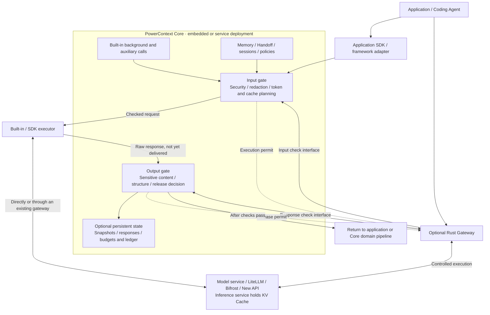
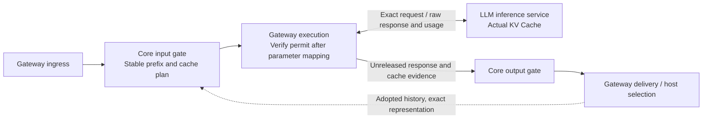

- Proposal Name: `core_inference_gates_and_optional_gateway`
- Start Date: 2026-10-19
- RFC PR: [oceanbase/powercontext#2086](https://github.com/oceanbase/powercontext/pull/2086)
- Related RFCs: [RFC 0016](0016_pydantic_ai_inference_integration.md), [RFC 0028](0028_context_pack.md),
  [RFC 0046](0046_observability_foundations.md), [RFC 0048](0048_handoff_artifact.md),
  [RFC 1435](1435_explainable_prepared_context_receipts.md), [RFC 1770](1770-decision-policy-governance.md)

# Summary

This RFC defines a design contract; it does not indicate that these capabilities have been implemented or released.
The current capability baseline is repository commit e4efb39b. Source code determines implementation and release status;
external gateway mechanisms depend on the specific version and deployment acceptance results.

The input gate and output gate are public runtime capabilities of PowerContext Core. Core implements security checks,
sensitive information handling, context transformations, token and cache policies, output checks, and optional session
continuity and authoritative execution records. Users can use the same gates through Core's built-in execution path or
an application SDK without deploying Gateway.

PowerContext Gateway is an independently deployed, optional Rust protocol entry point and remote executor.
It calls Core's gate interfaces, executes approved inputs, holds the necessary transport buffers, waits for release
permission, and connects to inference services or existing model gateways through adapters. Executors control actual
sending and delivery. Ownership of the gates by Core does not permit the transport layer to send or release content
before checks complete.

The system provides a testable product capability: when a task switches models, resumes across sessions, or runs in the
background, it can deliver context with provenance, prevent content prohibited by policy from being sent or delivered,
and account for costs across the complete task.

The gates also provide an execution loop for LLM KV Cache reuse: Core plans stable prefixes, reusable breakpoints, and
cache policy; Gateway or another executor selects compatible targets under the permit, sends approved bytes faithfully,
and collects actual cache usage. Checked output becomes replayable history only after explicit session adoption.
The inference service holds the actual KV state. Cache reads, write charges, and complete-task outcomes establish benefits.

| Design item | Decision |
| --- | --- |
| Deployment and languages | Core can be embedded in Python applications or deployed as a service; Gateway is an optional standalone Rust binary or container. |
| Gate ownership | Core GateRuntime implements shared rules, checks, transformations, and state semantics independently of Gateway. |
| Context authority | Core manages session semantics, frozen injections, summaries, evidence coverage, redaction mappings, and request snapshots. |
| Gateway scope | Protocols, connections, flow control, permit and byte verification, and execution evidence collection only; no second implementation of gate rules. |
| Gate definition | Core checks inputs before a model request is sent and responses before output is released; executors enforce these checkpoints. |
| Integration paths | Core's built-in executor, application SDK executors, and optional Rust Gateway share one gate contract. |
| Persistence requirements | Basic checks can run statelessly; session replay, budgets that survive restarts, and an authoritative ledger enable their respective storage capabilities as needed. |
| Invocation origins | `agent_main` is an application or Agent's primary model call; `core_background` covers Core generation, extraction, Embedding, reranking, and similar calls. |
| External gateway integration | Built-in executors, SDKs, and Rust Gateway can connect to LiteLLM and similar products through verified protocols, with additional evidence adapters as needed. |
| Models and retries | Core approves models, candidates, and budgets; integration configuration explicitly assigns execution ownership and prohibits independent, unbounded expansion at two layers. |
| KV Cache | Core plans prefixes, breakpoints, and target constraints; Gateway or another executor executes faithfully and collects cache evidence; adopted history supports later reuse, while the inference service holds actual KV state. |
| Default cost reduction | Start with stable replay, lossless representation optimization, and explicit output budgets; validate lossy compaction, dynamic model upgrades, and semantic response caching separately. |
| Default security | Mandatory rules check before release; block sending or delivery when authorization, security policy, or required scanning cannot be confirmed. |
| Acceptance unit | Quality, total cost, latency, retries, and leakage counterexamples for complete tasks; input length or the presence of cache parameters alone is not evidence of benefit. |

# Motivation

Users still need sensitive information checks, token control for complete requests, cache prefix stability, and model
output validation when they do not deploy an independent model gateway. Making the gates exclusive to Rust Gateway
would require Core background processing and application SDKs to deploy an additional proxy or maintain separate rules.
That coupling increases adoption costs and gives the same policy different meanings on different invocation paths.

This proposal addresses four specific problems:

1. **Capability availability**: Core background tasks, embedded applications, remote SDKs, and optional Gateway use the same gates; basic security requires neither a gateway nor a database.
2. **Actual execution boundaries**: Check the final model input and raw response, rather than only business parameters before an SDK call or results that have already parsed successfully.
3. **Task continuity**: When persistence is needed, preserve precise session, injection, handoff, and execution identities to avoid losing constraints or duplicating history on model switches.
4. **Verifiable cost reduction**: Measure input optimization, provider caching, generation volume, and work steps separately, including auxiliary models, failures, retries, cache writes, and warm-up costs.

The goal is an independently usable Core GateRuntime and replaceable executors that follow a shared execution contract.
Rust Gateway remains independent and optional, providing compatible HTTP/SSE entry points, a unified deployment boundary,
and integration with third-party gateways. This RFC does not implement general Agent orchestration, migrate private
model state, automatically protect traffic outside the integration, or guarantee zero leakage for arbitrary content.
It does not automatically promote generated results into Memory or replace Artifact lifecycles, evidence verification,
host tool authorization, or provider billing.

# Guide-level explanation

## User workflows

### Reusing model caches through Gateway

A user fixes code across successive turns through Gateway, retaining the selected model and protocol:

1. Core's input gate authorizes and prepares rules, tool definitions, schemas, and permitted Memory. It freezes their representations and versions and records reusable-prefix and incremental-content boundaries in the plan.
2. Gateway's adapter maps approved cache modes, breakpoints, and TTLs to the target protocol before submitting the final payload for checking. Once permitted, it sends exact bytes to the approved concrete target and preserves enforceable cache-affinity constraints.
3. The inference service reuses an available matching prefix, processes new input, and generates a new answer. Gateway captures the raw response, actual target, and cache usage.
4. Core's output gate checks the response. Persistent mode first saves a checked candidate; the host explicitly accepts it into session history. The next input preserves adopted content exactly and appends new messages and tool results at controlled positions.
5. The user sees cache reads, cache writes, ordinary input, known costs, upstream first-token time, and final delivery time per turn. Missing cache evidence appears as unknown rather than a claimed hit because a parameter was set.

This is a logical layout; actual rendering preserves protocol roles, message order, and complete tool exchanges:

```text
Turn 1: Stable rules, tools, and frozen Memory | Current request
Turn 2: Same stable prefix + adopted turn 1 history | New request
Turn 3: Same stable prefix + adopted turns 1 and 2 | New request
```

Both prefix content and reusable cache breakpoints determine eligibility. Complete input normally still travels on the
wire; only cache references explicitly supported by the target protocol may replace that content. Benefits appear as
provider cache reads and reduced prefill work, not automatic reductions in network traffic or input tokens because
content was stored once locally. Model switches preserve portable context while the new model builds its own cache.
Fixed-model multi-turn execution is the first cache demonstration. Basic mode can plan caches from caller-provided
complete history and fixed templates without persistent sessions; restart recovery uses the persistent contract below.

### Switching models within a task

A user asks model A to investigate a client contract issue. Core delivers project knowledge such as "regenerate the client
after changing OpenAPI." The Agent reads code, calls tools, and receives actual results. The user then selects model B
to continue the fix:

1. The application submits the existing history and new instruction through the SDK or optional Gateway, retaining the same task and session identities.
2. Core finds the injection records already delivered, restores the exact missing context, and preserves the user's latest corrections and tool results.
3. Core prepares input according to the target model's capabilities; it does not treat the old model's private session ID or encrypted reasoning state as portable text.
4. Core's input gate checks the actual outbound content. The executor calls the target model, and Core's output gate permits delivery after checking the result.
5. The ledger records the concrete target, input and output usage, cache reads and writes, auxiliary calls, and failed attempts.

The user does not have to copy project background manually. Whether model B understands and uses the material correctly
still requires validation through actual task outcomes.

### Continuing across sessions

At a work boundary, the caller uses the existing Handoff workflow to prepare and inspect the goal, progress, next steps,
evidence, and known omissions. The new session receives the complete Prepared Handoff or an exact committed version,
together with recent messages outside the handoff's coverage. The receiving Agent verifies the current repository and
execution environment before continuing. An ordinary handoff does not automatically create a long-term milestone.

### Core background processing

When Core extracts Memory or processes Topics from a Source window, it declares a trusted workload and stage and calls
models through the built-in executor and gates by default. Core determines input encoding, model candidates, output
schemas, and commit eligibility. Model results that pass the output gate must still pass Core's domain validation before
they can become candidates, Memory, or other Artifacts. This flow does not depend on Rust Gateway; a remote executor is
selected only when the deployment needs a unified entry point for model traffic.

### User-visible behavior

Normal requests retain the response shape of the verified protocol. Security blocks return an explicit reason category
and a correlatable request ID without echoing sensitive fragments in the error body. The UI or diagnostic interface shows
the actual model, any downgrade, context transformations, and known usage; missing values appear as unknown.
The cache view separates local prefix changes, actual provider cache reads/writes, normalized ordinary input, cost
completeness, and latency. Planned reusable lengths do not substitute for actual hits. strict reports upstream first-token
and final-delivery time separately.
Current user instructions, repository rules, and live facts always take precedence over historical material.

## System structure



The embedded path calls Core's Python runtime directly; service-based SDKs and Rust Gateway use authenticated Core APIs.
Background tasks reuse prepared stage inputs without triggering primary-model context enrichment again.
Regardless of the executor, sending input and releasing responses must wait for admission from the same GateRuntime.

### Responsibilities

| Responsibility | Core | Replaceable executor (built-in / SDK / Rust Gateway) | Existing gateway / inference service |
| --- | --- | --- | --- |
| Users, Scope, and delegation | Authoritative checks | Validate credentials and pass restricted delegation | Use the configured provider identity |
| Sessions, branches, and history coverage | Authoritative state | Pass event identities without guessing history | Not an authority for cross-provider sessions |
| Memory, Handoff, and evidence | Selection, versions, validation, persistence | Deliver exact projections | Receive final model input |
| Compaction, redaction, reversible encoding | Define and execute context transformations | Preserve approved bodies without rewriting | Perform only declared transformations |
| Model and capability policies | Approve targets or a closed candidate set | Select or delegate according to the plan | Execute a fixed target or controlled routing |
| Retries and total budgets | Policies, atomic reservations, settlement | Enforce admission and report uncertainty | Declare internal attempts and supply evidence |
| Gates | Rules, detection, transformations, security and release decisions | Invoke and obey the gates at final send and first release | May add protections but cannot replace this system's guarantees |
| KV Cache | Plan prefixes, breakpoints, modes, and target-affinity constraints; manage adopted history | Map parameters before permission, preserve bytes, and collect actual read/write usage | Hold and reuse the cache and return verifiable usage |
| Ledger | Authoritative appends, recovery, and reconciliation | Collect and reliably report execution evidence | Return raw usage or reconciliation material |

### What "thin" means

Gateway retains connection pools, active request state, SSE parsing, bounded buffers, policy snapshots, restricted cache
execution metadata, short-lived
execution credentials, and a body-free event outbox. It does not create another session database, decide whether Memory
is stale, summarize Handoffs, compute semantic coverage, or maintain its own sensitive content detection or compaction
engine.

Core holds persistent sessions and frozen projections. Session records are operational records, not a new Session
Artifact family. Specific material that must become evidence is collected as Source through a controlled process.
Source, Memory, Handoff, and session records each have explicit retention, read, and deletion policies.

Gateway may cache plan content that remains valid, but a cache is not an authorization source. Plan invalidation,
permission changes, or policy revocation require renewed admission.

### Using the gates without Gateway

| Integration | How it obtains the gates | Coverage |
| --- | --- | --- |
| Core built-in background calls | Core composes a controlled executor, invokes GateRuntime by default, then sends through a provider adapter. | Integrated actual generation, Embedding, reranking, and auxiliary attempts. |
| Application-managed calls through the SDK | The SDK coordinates the full lifecycle of input gate, execution, and output gate; the executor may use the application's own provider credentials. | Application primary-model traffic through the controlled entry point. |
| Applications retaining existing model calls | Explicitly call Core's check APIs before sending and before delivery, submitting the final input and raw output. | Checkpoints actually submitted and correctly enforced by the caller; no proof that the caller has no bypass. |
| Rust Gateway | Use a compatible HTTP entry point; Gateway calls Core's gates and control protocol. | Verified protocols, upstreams, and execution paths through that entry point. |

For hosts that only use prepare_context or MCP recall, Core can check only the supplementary material it delivers.
It cannot see the complete prompt subsequently assembled by the host, model responses, or tool behavior. Installing
PowerContext does not automatically protect all external model calls.

### Core public runtime

Introduce GateRuntime with two logical boundaries, before_inference and after_inference, returning checked inputs and
output release results respectively. These names are conceptual interfaces in this proposal; implementation will define
the Python and HTTP contracts consistently. A managed entry point coordinates "input gate → InferenceExecutor → output
gate," placing the complete lifecycle under the Core SDK. Manual interfaces expose the same capabilities to existing
applications while explicitly assigning responsibility for not skipping checks to the application.

InferenceExecutor handles final serialization, transport, retries, streaming events, and usage collection. It does not
choose sensitive content rules or context tradeoffs. Core's checks must receive the final payload formed by the adapter
and the model's raw response. Existing StructuredGenerator typed inputs or validated outputs can be business composition
points, but an outer wrapper alone cannot cover instructions later inserted by the SDK, internal retries, or raw failed
outputs. Every supported provider adapter must integrate the gates immediately before actual sending and first delivery.
Executor preparation or serialization must not issue model requests: Core forms the logical projection, the adapter
forms the final payload, Core checks and approves that payload, and only then does the executor send it. Checking business
parameters and then allowing the SDK to add body content is not a final check.

Basic checks and lossless representation optimization can run statelessly, without persistent sessions, Rust, an HTTP
service, or a ledger database. Session continuity, restart-safe budgets, and authoritative billing records enable their
respective Core repositories and acknowledgment steps as needed. Stateless mode guarantees checks and known usage only
within the current call; it does not guarantee persistent replay or cross-process total limits.

# Reference-level explanation

## Existing capabilities and required additions

| Capability | Current workspace facts | Proposed implementation |
| --- | --- | --- |
| PreparedContext | An ephemeral four-field value containing schema, status, content, and content_bytes; not a session or persistent request snapshot. | Preserve the existing contract and add separate execution plans and session records. |
| Supplementary context budget | max_bytes is a UTF-8 byte budget; integrations validate and use the content unchanged. | Core additionally calculates tokens for the complete request, tool definitions, and output reservation. |
| Delivery representation optimization | References and UTF-8 byte budgets exist; the general token representation optimizer defined here does not. | Add independently configurable lossless representation policies; advance lossy policies only after quality thresholds are met. |
| Background input encoding | Execution currently uses existing stage inputs, instructions, and schemas; the general shared codec defined here does not exist. | Reversible shared encoding is a new stage protocol and cannot be applied directly to arbitrary Agent history. |
| Handoff | Goals, status, next steps, evidence, omissions, and both ephemeral and persistent forms already exist. | Add session coverage associations while preserving its lifecycle. |
| Bootstrap receipt | Persistent delivery state and exact-version deduplication exist for specific host lifecycles. | Reuse monotonic state and precise identity principles without generalizing them into proof of delivery for all messages. |
| Core inference | Generation, embedding, rerank, and decision configuration and actual generation stages exist. | Add shared workload identities, model capability constraints, and execution plans. |
| Public gate runtime | Existing inference ports and usage wrappers offer composition points, but no shared mandatory gates as defined here. | Add Core GateRuntime and integrate executors at actual send and first-release boundaries. |
| Usage | Current statistics mainly record request counts and input/output tokens; the recorder permits loss. | Add a recoverable execution ledger distinguishing observations, estimates, and reconciled results. |
| DecisionPolicy | A bounded decision-request projection sanitizer exists, and some failed judgments abstain; it is not general model DLP. | Reuse precise projection boundaries, add enforcement policies, and never treat unknown as a security pass. |
| Gateway | The Rust Gateway and Core control protocol defined here do not exist in the current workspace. | Implement independently as an optional integration, not a prerequisite for Core gates. |

Repository references:
[PreparedContext](https://github.com/oceanbase/powercontext/blob/e4efb39bd6b8303a508c83fd5fcde5f99290b785/src/powercontext/builtin/runtime/models.py),
[context delivery contract](../docs/workflows/prepare-context-text.md),
[decision-request projection](https://github.com/oceanbase/powercontext/blob/e4efb39bd6b8303a508c83fd5fcde5f99290b785/src/powercontext/builtin/runtime/decision_projection.py),
[existing inference ports](https://github.com/oceanbase/powercontext/blob/e4efb39bd6b8303a508c83fd5fcde5f99290b785/src/powercontext/builtin/inference/protocols.py),
[actual provider call adapter](https://github.com/oceanbase/powercontext/blob/e4efb39bd6b8303a508c83fd5fcde5f99290b785/src/powercontext/builtin/inference/pydantic_ai.py),
[usage recorder](https://github.com/oceanbase/powercontext/blob/e4efb39bd6b8303a508c83fd5fcde5f99290b785/src/powercontext/builtin/runtime/_model_usage.py),
[DecisionPolicy design](1770-decision-policy-governance.md).

## Public values, errors, and compatibility

GateRuntime's before_inference and after_inference are public conceptual boundaries. Managed invocation coordinates
preparation, final-payload checks, execution, raw-response checks, and delivery as one lifecycle. Explicit check interfaces
judge only submitted content; they do not prove that an external caller obeyed the result.
New names, types, and HTTP paths in this RFC are contracts to implement, not currently released interfaces.

| Value | Required content |
| --- | --- |
| GateInput | Bound trusted invocation identity, workload and stage, target capabilities, original business input, final protocol payload, and policy selection. |
| CheckedInput | allow/block/withhold, the actual permitted payload or immutable reference, content digest, policy and transformation versions, coverage, and current-call constraints. |
| GateOutput | Identity of the corresponding input or attempt, raw response or safety unit, raw usage, parsing status, and streaming completion state. |
| CheckedOutput | Release decision, permitted delivery content or reference, digest, policy version, known omissions, and explicit release scope. |

Principals, delegation, tenants, and trusted stages originate at the invocation boundary; ordinary request bodies cannot
grant themselves authority. Stateless values are valid only for the current call; persistent mode additionally uses
ContextSnapshot, InferencePlan, and AttemptPermit. Local immutable values and remote signed permits express the same
binding. Embedded applications do not have to use signed tokens, loopback HTTP, or persistent repositories.

Errors retain stable categories, including at least unauthorized, policy_blocked, policy_unavailable, unsupported_payload,
target_incompatible, budget_exhausted, conflict, send_uncertain, and response_incomplete.
Rejection is not a successful model answer; unknown does not automatically become allow, and cancellation propagates.
HTTP maps categories to authentication, permission, conflict, size, format, rate-limit, or service-unavailable statuses
without echoing matched secrets in the body. Once streaming starts, earlier HTTP status cannot be rewritten. Use the
protocol's error or interruption events and state explicitly whether any content has been released.

Existing users retain current invocation behavior unless they enable new policies. Built-in Core paths can share the
GateRuntime composition point, but disabled performs no blocking and must not be presented as mandatory protection.
New deployments enable enforcing only after explicitly choosing a security profile. Security, optimization, caching,
and persistence are configured separately; they must not implicitly introduce external model calls, body logging, or
response persistence. Existing custom generators, embedders, and SDKs keep their interfaces. Coverage claims apply only
to calls using execution adapters that have passed acceptance checks.

PreparedContext retains its ephemeral four-field delivery semantics. It does not carry execution state and is not a
complete prompt. Source, Artifact, Memory, Handoff, Bootstrap receipt, and DecisionPolicy retain authority over their own
identities and lifecycles. Implementing new HTTP contracts requires updating openapi/powercontext.yaml, regenerating
clients, and running contract-test. This RFC itself does not change runtime code.

### Interaction with existing RFCs

[RFC 1783](1783-handoff-session-rollover.md) defines existing PowerContext as a handoff participant that does not host
complete transcripts or manage provider windows. The persistent inference session in this RFC is a separate, opt-in
subsystem extending managed execution. It does not turn existing Source/Memory/Handoff into a transcript store,
automatically import all host history, or impose session storage and window management on ordinary prepare or Handoff
users. Only calls explicitly enabling persistent sessions adopt this RFC's snapshot and replay contract; other paths
retain existing behavior.

Handoff continues to use explicit prepare, inspection, finalize, and optional commit. PreparedContext Receipt RFC 1435 is
a design precedent for explaining preparation results, not an implemented public receipt in this baseline. Existing
Bootstrap receipts cannot be promoted into proof that a model actually received content either.
Input security rejection differs from the Memory write-gate's privacy refusal: the latter may avoid an external judgment,
return unknown, and allow the domain write to continue. It is not proof that model egress security passed.

The basic path that checks caller-submitted payloads gains no project data read permissions. Injecting or restoring Source,
Memory, or Handoff still requires their respective Scope, Artifact, and evidence authorization for every item. Session
read/write permissions explicitly bind tenant, principal, and sharing scope; Scope IDs, model names, external session_id
values, or shared administrator credentials cannot implicitly grant them.

## The gates and the two invocation paths

### Input gate

The input gate covers any payload about to be sent to a model, including user messages, history, Memory injections,
Handoffs, tool results, tool definitions, structured parameters, and forwarded file or multimodal references.

Processing order:

1. At ingress, the executor validates identity, destination address, protocol, and size, then calls Core's input gate.
2. Core checks access, forms context with provenance, and completes the relevant security projection before invoking any external auxiliary model.
3. Core performs permitted redaction, representation optimization, or compaction to form a fixed input plan.
4. Core's input gate checks the final fields and body formed by the adapter, verifies model capabilities, budget, and destination, and returns admission.
5. The executor verifies that the bytes and destination it will actually send match admission; any change requires a new Core check.
6. Only then may it send to the upstream.

Checking only the original client messages is insufficient: newly injected Memory or tool material may also contain
sensitive information. Core's final check must cover the actual transformed and serialized payload; the executor sends
it faithfully. When a downstream also transforms requests, the "Third-party gateway integration" section defines scope.

### Output gate

The output gate sits before model results return to the application or Core. It covers text, tool arguments, structured
outputs, error content, and visible references. Core GateRuntime owns sensitive content checks, output projections,
secure release decisions, and record requirements. The executor parses, buffers, and releases according to the decision.
Core's domain pipeline separately validates business schemas, evidence, and commit eligibility.

Primary-model outputs retain verified protocol semantics by default. Do not truncate tool JSON, rewrite code patches,
or modify signed reasoning blocks to shorten responses. Required transformations must use Core's target protocol or
explicit compatibility rules.

### Invocation origins and gate composition

| Origin | Input gate | Output gate | Context enrichment |
| --- | --- | --- | --- |
| agent_main | User history, injections, tools, and target security checks | User-visible results and tool argument checks | Core prepares according to task and session |
| core_background | Source projection, stage encoding, output budgets, and destination checks | Candidate output security and protocol checks | Use stage inputs already prepared by Core |
| auxiliary | Classification, compaction, Judge, and other auxiliary requests are checked too | Auxiliary results are checked and validated by Core | No repeated automatic enrichment or recursive compaction |

auxiliary is a trusted execution purpose, not permission a client can obtain through an arbitrary header.
Client ingress validation and upstream protocol parsing are additional checkpoints, not substitutes for the gates.
All three origins can use built-in executors without an independent Gateway deployment.

## Execution of a primary-model call

```mermaid
sequenceDiagram
    participant A as Application
    participant C as Core GateRuntime
    participant E as Replaceable executor
    participant U as Upstream gateway or inference service
    A->>C: Submit this turn's input through SDK or Gateway
    C->>C: Authorize, prepare context, run input gate
    C->>E: Approved final input and execution constraints
    E->>E: Verify actual bytes and target; do not rewrite
    E->>U: Send model request
    U-->>E: Raw response or SSE, usage
    E->>C: Submit unreleased response
    C->>C: Output gate; record response and execution as configured
    C-->>E: Checked output and release result
    E-->>A: Deliver after checks pass or return explicit error
    E->>C: Actual target, usage, and release state
```

Executors may be in-process Python, an application SDK, or remote Rust Gateway; in-process calls do not need loopback HTTP.
Reporting and delivery in the diagram are different facts. With persistent budgets, execution permits and reservations
are persisted before egress. With persistent continuity, corresponding responses are confirmed before release.
Actual client receipt requires an additional acknowledgment; successful socket writes cannot prove it.

Core background calls reuse the same execution chain directly through GateRuntime and the built-in executor, referencing
prepared stage plans and skipping session synchronization and automatic Memory injection. Record the actual number of
provider calls according to executor and downstream evidence.

## Core session and context management

This section describes managed mode with persistent continuity enabled. A stateless gate invocation can provide security
and representation optimization for one model call without requiring a session, frozen history, or persistent ledger.

### Minimum identities

Core associates operations with tenant, authenticated principal, Scope, task, session, branch, turn request, and attempt.
Scope is a data access boundary, not authentication. Different tasks and branches in the same project must not share one
implicit session history.

Client-supplied model names, roles, Scope headers, and session IDs are inputs. Core must validate bindings against the
authenticated identity. Gateway's service identity must not use a shared administrator token on behalf of all end users.

### Original observations and actual model input

Core stores the following separately:

| Record | Purpose |
| --- | --- |
| Original events permitted for collection | Represent actually received user messages, assistant messages, and tool results, preserving order and provenance. |
| Injection records | Record exact bodies or recoverable references, insertion positions, source versions, and actual delivery state. |
| Model input projections | Represent redaction, encoding, compaction, and protocol representations actually used for outbound calls. |
| Transformation records | Associate inputs and projections, policy and codec versions, known omissions, and transformation scope. |
| Answer candidates and session selections | Separate saved checked answers, adopted branch history, and delivery receipts; saving alone does not advance selected history. |

Sensitive bodies not authorized for persistence do not enter original event storage. When only redacted content may be
stored, it is a clearly marked new collected observation, not a claim to preserve an unmodified original. Gateway logs
and event outboxes contain no bodies by default.

Distinguish raw model results from results actually delivered to users as well. User corrections are new events; actions
that a model plans to execute cannot become facts of completed execution. Client-replayed tool results retain
client_reported provenance. Only valid execution attestations from a trusted host or executor allow stronger evidence
labels such as host_attested. Gateway observing a message proves receipt, not that the corresponding command ran.

### Stable injections and exact deduplication

Core records the original content, position, and exact source of each context segment. Later replay does not rewrite
history already delivered. When the client resubmits complete history, match the overlapping prefix using stable event
identities and content consistency, and append only new events. Do not ingest the entire history again on every request.

Each session designates one automatic context delivery owner: a host Hook or Core's managed entry point (SDK / Gateway).
When the managed entry point takes over, the host stops independently recalling the same material automatically;
explicit Memory/Handoff tools remain available. Coexistence requires exact delivery records verifiable by Core, not a
generalization of existing bootstrap deduplication into complete history coverage. Source collection likewise designates
a source owner or uses correlatable original event identities across the Hook and managed entry point, preventing one
user prompt from becoming two independent extraction inputs. Text similarity must not merge distinct observations.

If client history omits Core injections, Core reinserts them at confirmed boundaries. If the client returns injections,
Core verifies them against authoritative records rather than trusting client claims of injection or coverage.
Initial integration, history truncation, edits to old messages, and answer regeneration require explicit branches or
reconstruction boundaries.

The first implementation requires stable session and request IDs and supports serial progression within each session.
History that cannot be matched reliably returns an explicit error or enters an explicit mode without continuity;
similarity-based splicing is not supported. Reusing a request ID with different content or conflicting policy requirements
returns a conflict.

Tenant, authenticated principal, session, branch, and caller request ID define the idempotency boundary. Core atomically
establishes a unique operation before any paid preparation. Repeated prepare calls verify the original input and caller
constraints and return the original operation's preparation state, plan, or existing result reference without repeating
recall, Embedding, or compaction. Incomplete preparation returns a queryable in-progress state. Controlled recovery uses
the original operation, frozen child-call identities, and remaining budget rather than starting another set of paid work.
Administrative policy upgrades use renewed authorization and plan versions, not a claim that the caller changed its input.

### Handoff and coverage

Handoff retains existing prepare, inspection, finalize, and optional commit semantics. The session service separately
records the exact covered event set. A single cutoff position may represent coverage only when it is confirmed to be a
gap-free contiguous prefix. A Source journal position is not proof that the complete conversation has been processed or
that a model actually saw it.

A new session combines "complete handoff value or exact version + uncovered tail + task-related Memory + current
instructions." Handoff hints locate material; they do not replace the complete handoff, evidence reads, or checks against
current facts. Possessing a handoff does not grant all evidence permissions. Each Source is authorized independently in
its original Scope.

### Concurrency, restarts, and incremental costs

Core advances state using an expected session version. Concurrent conflicts require explicit branching or retrying a
control operation; two answers must not be mixed into one selected history. Event appends and request IDs use unique
constraints. Frozen injections, plans, and recoverable content references must be persisted before promising restart-safe
continuation.

A persisted response is a candidate. Only an explicit session selection adds the request's input events and exact checked
answer to the selected branch and advances its version. While the previous request awaits selection, a new request must
first explicitly adopt or abandon the candidate, or branch. Response persistence alone never advances selected history.

The server reads incremental events through indexes rather than rewriting all history, searching all data, or summarizing
on every turn. If the client sends full history, network and parsing costs still grow with its length. Incremental server
appends do not make the complete path constant-cost. Storing history once locally also does not automatically reduce
history tokens resent to the model on each turn.

## Public contract between Core gates and executors

The following objects and control interfaces are new designs, not field extensions to the existing PreparedContext API.
Existing prepare retains its ephemeral context delivery contract; it does not advance sessions, create execution plans,
or reserve budgets. Persistent plans, budgets, and session writes use new explicit control operations. Recall itself may
still incur paid Embedding calls or diagnostic records.
Basic GateRuntime can operate on in-process values without persisting these objects. The persistent flow below applies
to managed execution with session continuity or persistent budgets enabled. Across processes, the same service contract
is exposed through authenticated HTTP interfaces.

### Three primary objects

| Object | Minimum content | Authority and purpose |
| --- | --- | --- |
| ContextSnapshot | Tenant, Scope, session and branch version, event range, exact injections, source versions, transformation versions, known omissions, and content references | Core's recoverable logical input snapshot; does not mean a model received it. |
| InferencePlan | operation, purpose and stage, snapshot, eligible targets, protocol, output constraints, security policy, cache_policy, budget, and expiration | Core-approved constraints; cache plans are versioned inside this object, without a separate cache Artifact or plan interface. |
| AttemptPermit | attempt, concrete target, upstream configuration fingerprint, final-body digest, budget reservation, executor instance, expiration, and single-use permit identity | Binds one concrete execution before sending; the actual executor must verify it before invoking the upstream. |

Embedded runtimes call the same Core services directly. Remote executors obtain plans over internal TLS and authentication;
execution permits crossing processes use verifiable signatures or an equivalent tamper-resistant service contract.
In-process use does not require signed tokens or network coordination. Keys, provider credentials, and sensitive placeholder
mappings do not enter ordinary plan logs. Digests verify content; they do not replace tenant, Scope, or business identities.

Body digests cover the exact UTF-8 bytes finally returned by Core. Adapters may add authentication headers, connection
information, and other fields explicitly permitted by the plan. Body cache markers, codec instructions, and output schemas
must be fixed before computing the digest. The first version returns exact bodies; later versions may use authorized,
immutable content references that never follow the latest content at read time. Executors only verify, allow, or block
permitted inputs. They must not redact, add cache markers, or rewrite bodies after permission. Required transformations
return to Core for new final bytes and permits. Digests cover only the body sent to the first upstream hop; subsequent
provider protocol conversion follows the "Third-party gateway integration" section. It cannot claim byte identity with
the first hop.

### Service interfaces and remote control APIs

Basic checks use before_inference and after_inference, coordinated automatically by a managed SDK or called explicitly
by an application. Proposed remote endpoints are POST /v1/inference/gates/input and POST /v1/inference/gates/output,
returning projections, decisions, and scope statements bound to the checked input. Calling a check API alone does not
prove that the application sent or released content according to the result.

Persistent management uses the following operations. Python service interfaces and remote APIs share semantics;
in-process calls do not need HTTP:

| Operation | Proposed interface | Purpose |
| --- | --- | --- |
| Prepare plan | `POST /v1/inference/plans/prepare` | Idempotently bind principal, session, and request and establish the operation first; repeats recover preparation state, the immutable plan, or result references. |
| Begin attempt | `POST /v1/inference/plans/{plan_id}/attempts` | Verify policy and session version, select an eligible target, atomically reserve budget, and return an attempt and final execution permit. |
| Submit response | `POST /v1/inference/attempts/{attempt_id}/response` | Check the raw response and delivery projection, save a permitted checked candidate, and return a release permit without adopting session history. |
| Recover release | `POST /v1/inference/attempts/{attempt_id}/release` | Reauthorize a saved projection, check current output policy, and return the exact checked projection with a new executor-bound release permit without a new model attempt. |
| Select answer | `POST /v1/inference/operations/{operation_id}/selection` | The host idempotently adopts or abandons a candidate using an expected session version and exact answer reference; only adoption advances selected history. |
| Report events | `POST /v1/inference/attempts/{attempt_id}/events` | Idempotently record send, response, security, release, cancellation, usage, and uncertain-result events by event ID. |
| Query operation | `GET /v1/inference/operations/{operation_id}` | Under current authorization, query plans, exact candidate references, selection/delivery states, costs, and evidence completeness; reads do not issue permits. |

Plan preparation must establish an operation before triggering paid Embedding, classification, or compaction subcalls.
Auxiliary calls share parent-task association and total budgets, use separate restricted execution purposes, and do not
reenter primary-model plan preparation. Primary-model traffic does not gain a model Judge by default.
Core does not hold session write locks or database transactions across external model calls: obtain versioned input,
prepare outside the lock, then verify the version before publishing. Execution scheduling assigns separate concurrency
quotas and reserved capacity to primary, Core background, and auxiliary calls so that primary requests cannot saturate
an entry point while waiting for auxiliary work and deadlock each other.

Beginning an attempt in persistent mode is a strongly consistent write. Multiple execution instances must not consume
the same permit again. For cross-instance execution, Core establishes ownership and fencing identities. If an instance
is lost and send state is uncertain, lease expiration is not proof that no call occurred and does not automatically allow
a new permit. The network cannot provide exactly-once inference at a provider. Use provider idempotency mechanisms only
when their contract is explicit.
Beginning an attempt also carries a stable begin-request ID. Reusing it within an operation with the same constraints
returns the original attempt and state without reserving again or creating another execution. Retrieving a permit does
not authorize another send: attempts already sending or uncertain still follow single-use and recovery rules.

### Final plan bindings

A plan binds at least:

- Principal, Scope, invocation purpose, task, operation, and context snapshot.
- Source protocol and render profile, target model or closed candidates, data destination, and verified upstream configuration.
- Input body, tool schema, output schema, output token limits, and limits on other billable resources.
- Security and transformation policy versions, cache parameters, codec version, and permitted request transformations.
- Timeouts, total attempt limits, cost reservations, usage visibility requirements, and expiration.

Changing provider, model family, privacy boundary, or lossy representation requires an explicit new Core plan version
before admitting another attempt. Network retries against the same target reuse the same logical snapshot and final
body without recalling context again.

### Protocol versions and compatibility

Core and each executor declare schema and capability versions for the control protocol. Remote execution generates or
validates Python and Rust types against a common contract. Implementation manages new Core HTTP contracts through the
existing OpenAPI source of truth, runs generation and contract-test, and never hand-edits generated Python files.
Gateway's model-facing compatibility protocol separately declares supported endpoints, fields, and streaming events.

Verify the version intersection before upgrades. Reject unknown mandatory fields, unknown codecs, or unenforceable
security requirements before accepting writes or sending. Rolling upgrades retain parsing support for old plans or
explicitly invalidate them; they must not silently reinterpret old records under a new policy.

### Response submission and release

On the strict path, the actual executor collects the complete response and calls Core's output gate before delivery;
built-in executors call directly and remote executors use the controlled response interface. Core completes sensitive
content checks, necessary output projections, and current authorization and policy verification. As configured, it stores
permitted delivery content and transformation associations, then returns a release result bound to exact bytes, executor
instance, and expiration. The executor checks bytes against the permit and does not modify them afterward. Core must
reconstruct valid protocol responses when redaction is needed rather than deleting arbitrary JSON strings.

Response submission uses stable submission IDs and digests. Duplicate submissions recover the same checked candidate;
changing submitted content returns a conflict. For blocked content, retention permissions determine the minimal
non-sensitive decision record; storing raw secrets is not mandatory. Routes requiring persistent continuity must receive
Core's persistent acknowledgment before releasing any content. Actual user receipt is reported separately.
Basic gate calls without persistent continuity do not require response database writes but must complete the same
security checks; they do not promise recovery of that content after a restart.

observe or bounded mode may submit declared safety units, but only confirmed records may be used for restart recovery;
unconfirmed tails are explicitly incomplete. If policy prohibits storing recoverable response projections, select a mode
without persistent continuity or reject routes requiring exact replay. Body-free events or client resubmission on the next
turn cannot replace promised server-side persistent records.

### Session adoption and response recovery

Persistent primary-model calls distinguish these facts:

| Fact | Effect on history |
| --- | --- |
| Checked candidate persisted | Exact delivery projection is recoverable; current branch version does not change. |
| Release started or completed | Record executor write progress; it does not prove host acceptance or user receipt. |
| Host adopts answer | Atomically verify the expected session version and add corresponding input events and this answer to selected history, advancing once. |
| Host abandons candidate | Retain an auditable disposition without adding the candidate to history, reversing incurred costs, or assuming tools did not run. |
| User receipt or tool-execution acknowledgment | Add the respective fact separately; neither adoption nor socket writes imply it. |

selection comes from the authenticated host bound to the session or a restricted SDK delegation, never ordinary message
content or arbitrary role fields. After accepting a complete checked answer, the host submits a stable selection ID, exact
candidate reference, and expected version. Repeating the same selection returns the original result; choosing another
answer requires an explicit branch rather than rewriting adopted history. Background domain commits retain their Artifact
Services; primary-model selection does not replace Memory/Handoff validation or commit operations.

For example, Core saves a checked answer containing a tool call and Gateway crashes before delivery. The caller repeats
prepare with the original request ID to recover the same operation and candidate. A new executor invokes release to
reauthorize and recover the same exact projection without invoking the model or treating the candidate as adopted.
Recovery requires the retained projection to satisfy current check coverage; otherwise report blocking or unrecoverability.
A policy change requiring a new projection assigns a new projection identity without rewriting the old candidate.
The old executor must be effectively fenced, or its release permit expired, before a replacement receives a recovery
permit. If this cannot be established, report uncertain delivery.

If adoption committed but its acknowledgment was lost, repeating selection returns the original session version.
Recovery does not automatically replay tool side effects when execution has happened or is uncertain. Without host
deduplication or execution evidence, return state and references for explicit host resolution. Only adopted history feeds
automatic replay and later cache prefixes; unselected or abandoned candidates cannot enter history to improve hit rates.
Compatible ingress without session-adoption acknowledgments can still use basic gates and fixed-prefix caching, but does
not claim the persistent session-recovery guarantee defined here.

## Security and sensitive information policies

### Mandatory policies and auxiliary judgments

Mandatory security policies and advisory judgments are configured independently. Actions include allow, block, redact,
and withhold. Each rule declares input or output direction, data types, applicable principals, destinations, version, and
behavior when checks fail. shadow only compares results; it neither blocks nor changes content and must not be described
as mandatory protection. Core performs redact before permit binding. Rust may only check or block a permitted body,
not modify its bound content.

Core GateRuntime implements rule semantics, deterministic sensitive content scanning, semantic judgments, and policy
version management. Executors supply content that has not been released and verify permits, bytes, and release order;
they do not maintain another sensitive detection rule set. The first version uses a closed declarative rule set and fixed
scanner capabilities. Rules run in Core; arbitrary scripts are not distributed to remote executors. Core detection tests
define handling of JSON strings, numbers, Unicode, escaping, and duplicate fields. Cross-language contract tests verify
content fidelity, digests, permits, and release order.

The existing KnownSecretDecisionRequestSanitizer handles known secrets and specified credential prefixes in bounded
decision requests. It does not independently read Source/Memory and is not an arbitrary PII or password detector.
That specialized projection and advisory DecisionPolicy do not constitute general DLP. Decision-layer fail-open results
cannot be reused as security approval by the gates. See current
[RuntimeConfig](https://github.com/oceanbase/powercontext/blob/e4efb39bd6b8303a508c83fd5fcde5f99290b785/src/powercontext/builtin/runtime/config.py) and
[DecisionModel](https://github.com/oceanbase/powercontext/blob/e4efb39bd6b8303a508c83fd5fcde5f99290b785/src/powercontext/builtin/runtime/decision_model.py).

### Establish a safe projection before calling external auxiliary models

Secret checks happen inside the trusted boundary first. Raw Source, tool outputs, or user inputs containing prohibited
outbound content must not be sent to external classification, compaction, or safety models before deciding on redaction.

Complex judgments may use only local models or projections already approved for external transmission. Auxiliary model
outputs are untrusted as well and require structure and reference validation; their failure cannot lift mandatory security
rules. All background inference destinations must enter execution configuration, and coverage claims require actual
integration of those paths into the execution chain. Embedded SDK guarantees depend on correct caller and executor
integration; the SDK itself is not network isolation independent of the application process. Deployments that must
prevent arbitrary bypasses use a unified execution entry point and outbound network policies. Optional Gateway is a
suitable centralized entry point.

### Projection redaction and stable placeholders

Redaction changes the send projection, not the authoritative bodies of existing Source, Memory, or Artifacts.
Core maintains restricted session-level placeholder mappings that remain stable within the same policy and privacy
boundary to avoid meaningless prefix changes. Placeholders must not contain original values or become cross-tenant
correlation identifiers.

Restoring original values is a new sensitive information release action requiring separate authorization and checks.
Provider responses, tool arguments, and user-facing results do not automatically restore secrets. Do not apply generic
regular-expression substitution to executable code, tool arguments, paths, identifiers, or signed content. Redaction that
changes program behavior or protocol identity requires a specialized, verified transformation; block the path if safe
transformation is not possible.

### Check coverage and bypasses

| Carrier | Required boundary handling |
| --- | --- |
| JSON content | Parse according to protocol and check every field allowed to carry content; a string allowlist must not automatically admit unknown fields. |
| Tool arguments and results | Check complete structures and preserve call/result pairing; the host still controls tool execution permissions. |
| Errors and observability | Redact error bodies, headers, traces, and diagnostics without echoing provider credentials, bodies, or internal authorization information. |
| Files, images, audio, and links | Declare scanning capabilities, resource-access identities, and permitted destinations; checking URL text is not checking remote content. |
| Hosted files and opaque blocks | Admit only when their boundaries can be verified; otherwise exclude the corresponding strict routes. |
| Cached results | Recheck current permissions and output policies; caches cannot bypass revoked security rules. |

Clients cannot choose arbitrary upstream base URLs. Destinations come from controlled configuration. Executors do not
follow unapproved redirects and forward only permitted headers; they must not pass user authentication headers or
internal service credentials unchanged to model services. If archives, encodings, or multimodal content exceed scanning
capabilities, report coverage limits or reject strict paths rather than claim universal zero leakage.

### Policy updates

Frozen history does not mean permanently permitted replay. Permission withdrawal, sensitive rule upgrades, or destination
changes cause Core to invalidate affected plans and projections, reverify them at the next admission, and establish a new
context epoch if needed. Expired policy snapshots must not continue authorizing requests for availability.

Service deployments define and monitor a revocation effectiveness watermark; executors that do not meet it stop sensitive
routes. Embedded runtimes use currently effective policies and reverify at execution and release boundaries.
Content already sent to providers cannot be recalled; in-flight calls can only be canceled on a best-effort basis.
Record cache loss from security updates separately, without delaying enforcement to preserve cache reuse.
Input execution permits do not authorize release of future responses. strict rechecks current output policy and revocation
watermarks before first release. bounded checks at declared safety-unit boundaries and stops subsequent disallowed content;
already released content cannot be recovered.

## Streaming responses and output security

### Three release modes

| Mode | Behavior | Guarantee |
| --- | --- | --- |
| strict | Buffer the complete answer, including complete tool arguments where necessary, and deliver only after mandatory checks | Check before release within declared detection capabilities; the first content token waits for checks to finish. |
| bounded | Retain state across fragments for rules decidable within a bounded window and release checked safety units | Guarantees only the rule's explicit boundary, not content requiring whole-response semantic judgments. |
| observe | Forward directly and record detection results | No guarantee of blocking response leakage. |

The first version uses strict for mandatory output protection, prioritizing bounded-size JSON responses. SSE routes
permitting observe must be labeled explicitly. Do not present observe latency and strict blocking as one product capability.
Core owns detection and release decisions; the actual executor owns buffering. Built-in Python, SDK, and Rust Gateway
perform checks and release ordering according to their strict / bounded declarations. observe explicitly provides no
check-before-release guarantee. Remote strict may submit the complete response in one operation. Future bounded interfaces
place event and rule-matching state in Core; executors handle protocol boundaries and wait for release rather than duplicate
matching rules in Rust. Bifrost Enterprise Guardrails documentation likewise distinguishes complete buffering for blocking
rules from direct forwarding for monitoring; this design does not depend on that commercial functionality.
[Official streaming safety documentation](https://docs.getbifrost.ai/enterprise/guardrails)

### Streaming execution rules

- Parse SSE events and protocol content blocks; TCP chunks are not complete semantic units. Handle Unicode, JSON, and sensitive fragments spanning chunks.
- Release tool arguments only after they are complete and verified by Core. Model executors do not execute business tools. Under strict, do not release argument fragments the host could execute early.
- Do not arbitrarily rewrite reasoning, signed, or opaque blocks. Reject combinations where scanning is impossible but required; omit explicitly omittable blocks as whole units under compatibility rules and record the omission.
- After content is released to the client, do not silently append a fallback model's answer. Return a protocol-supported interruption or termination and let the host recover explicitly.
- Bound complete buffering by output size, token count, duration, and concurrent memory limits. On overflow, stop further release and attempt cancellation; do not switch to pass-through.
- Do not write complete responses to local disk by default. Disk buffering, when required, uses restricted, encrypted, short-term storage with explicit cleanup policies.

Provider-generated output is generally already billable. Security blocks, client disconnects, and cancellation do not imply
zero cost. If terminal events or cost information arrive after HTTP headers, complete the record through Core queries or
asynchronous receipts rather than treating initial headers as final settlement.

## Third-party gateway integration

### Integration paths

Three paths share the same Core gates:

1. Core or application SDK → built-in executor → model.
2. Core or application SDK → built-in executor → existing gateway such as LiteLLM → model.
3. Client → optional Rust Gateway (calling Core gates) → existing gateway or model.

Existing LiteLLM users can integrate through Core SDK without deploying Rust Gateway just to obtain the gates.
Existing gateways provide provider connectivity, key management, and selected governance capabilities; direct connections
use the same upstream eligibility and usage contracts.

The first phase preserves one supported model protocol rather than creating a universal message intermediate format
for every provider. Core produces the corresponding render profile. Mechanical executor adaptation is limited to declared
paths, authentication, and transport encapsulation. Body conversion occurs before Core permission or through a verified
upstream gateway's provider protocol conversion. History rewriting, compaction, and cross-model projections requiring
business semantics remain in Core.

Placing an existing gateway before PowerContext Gateway covers only traffic it chooses to forward here; it may already
have logged or transmitted the original content. That topology is not the first mandatory egress-protection deployment.
Plugins calling Core may be added later but must prove that every final attempt requiring protection passes the same
checkpoints.

### UpstreamProfile

Controlled configuration declares each upstream integration:

| Field | Meaning |
| --- | --- |
| protocol / endpoint_family | Native protocol, paths, authentication, and request/response capabilities. |
| routing_mode | fixed or delegated. |
| eligible_targets | Models, providers, and data destinations that may actually be selected. |
| configuration_fingerprint | Identity of verified routing, mappings, parameter overrides, and plugin configuration. |
| allowed_request_transforms | Fields downstream may modify, including whether they change bodies, cache boundaries, or targets. |
| retry_owner / retry_policy | Retry owner, types, counts, and timeout constraints. |
| attempt_visibility | full, counts, or opaque. |
| usage_provenance / completeness | Raw usage source, field semantics, and completeness. |
| response_cache_mode | Whether responses are replayed and whether extra Embedding calls occur. |
| prompt_cache_capabilities | Per-model implicit/explicit modes, breakpoint and lookup limits, minimum length, TTL, routing-key semantics, and actual read/write usage fields. |
| streaming_mode / guardrail_owner | Streaming release mode and ownership of additional security rules. |

These fields are deployment declarations and acceptance results, not client self-reports.

### Fixed and delegated execution

In fixed mode, Core explicitly approves a concrete model. The executor holds a bounded attempt budget and executes;
the upstream follows verified configuration. Disable model fallback and automatic retries where possible. Any behavior
that cannot be disabled must be included in constraints with visibility confirmed.

In delegated mode, an existing gateway owns routing or retries. Core approves only a closed target set whose capabilities,
privacy, and budget are all eligible. The executor does not independently start another fallback cycle outside the shared
constraints. If internal cost limits cannot be proven, strict monetary hard-limit guarantees are unavailable.

Strict security routes must also prove that downstreams do not inject unchecked bodies after inspection or redirect to
unapproved destinations. Configuration fingerprints are control evidence, not proof of final production requests on their
own; deployment locking, change notifications, and actual request verification must support them. Unconstrained downstreams
are integrated only at an explicitly weaker scope, outside complete security or strict-budget promises.

### Initial integration targets

| Product | Reusable capabilities | Boundaries requiring verification |
| --- | --- | --- |
| LiteLLM | Compatible interfaces, provider conversion, model groups, response headers, and usage records. | body.model may be an alias; retry counts do not imply complete costs for every failure; call and deployment identities must be associated. |
| Bifrost | Compatible entry points, provider connectivity, prompt cache control, and attempt observability. | Each fallback may have its own retry budget; with multiple keys, some failures may still try another key when max_retries is zero. |
| New API | Compatible interfaces, Channel management, model mappings, and billing observability. | Parameter overrides and cross-Channel retries may change final requests; administrator logs and public responses have different evidence completeness. |

References:
[LiteLLM response headers](https://docs.litellm.ai/docs/proxy/response_headers),
[LiteLLM reliability](https://docs.litellm.ai/docs/proxy/reliability),
[Bifrost retries](https://docs.getbifrost.ai/features/retries-and-fallbacks),
[Bifrost observability](https://docs.getbifrost.ai/features/observability/default),
[New API Channels](https://docs.newapi.pro/en/docs/guide/feature-guide/admin/channel),
[New API logs](https://docs.newapi.pro/en/docs/guide/feature-guide/user/log).
These mechanisms inform integration; every supported version still requires real-path acceptance.

## Rust Gateway implementation structure

This section implements the optional remote executor. It is neither a Core GateRuntime dependency nor a gate detection
engine.

Suggested components are Tokio for asynchronous tasks, Axum/Hyper for ingress HTTP, Reqwest/Hyper for upstream HTTP,
Rustls for TLS, Serde for control contracts, and Tracing/OpenTelemetry for body-free observability. Pin specific versions
at implementation time according to security and compatibility requirements. Adding Gateway must not impose Rust build
dependencies on the Python package.

| Module | Responsibility |
| --- | --- |
| ingress | Protocol entry points, authentication, rate limits, size limits, and request identity. |
| core_client | Core plan, admission, and event interfaces; version negotiation and service identity. |
| executor | Single-use permit execution, total timeouts, cancellation, concurrency, and state transitions. |
| enforcement | Invoke Core gates and verify execution/release permits, body digests, and state order; no independent sensitive detection rules. |
| upstream | Generic protocol adaptation and evidence collection for products such as LiteLLM. |
| stream | SSE parsing, backpressure, transport fragment state, strict buffering, and interruptions; Core owns sensitive detection state. |
| evidence | Body-free event outbox, replay, acknowledgment, and health status. |

Gateway implements cache plans as concrete targets and transport parameters without selecting Memory again, rewriting
adopted history, or deciding breakpoints. With multiple eligible targets, it proposes a concrete target under Core's
approved affinity policy and sends only after obtaining admission bound to that target. Persistent mode uses attempt
permits; basic mode retains current-call checked-input bindings without introducing a budget database. Failover requires
readmission and records possible cold-cache costs; cache reuse cannot cross authorization, privacy, or model-capability
boundaries.

Adapter interfaces express only transport responsibilities such as prepare_transport, send, parse_event, extract_usage,
and cancel. They do not accept callbacks to recall Memory again or decide which history to discard. Cancellation means a
cancel request was issued; record confirmed cancellation only after reliable acknowledgment, and still handle unknown usage.

Explicitly configure redirects, internal HTTP-client retries, proxy environment behavior, connection timeouts, and request
timeouts. Do not infer attempt counts from library defaults. Current Reqwest documentation exposes separate redirect and
retry policies; verify actual behavior against the selected version.
[Reqwest ClientBuilder](https://docs.rs/reqwest/latest/reqwest/struct.ClientBuilder.html)

Gateway scales horizontally without local session affinity. Core session versions, execution permits, and unique keys
provide consistency. The local outbox stores body-free execution evidence only, with capacity and recovery-time limits.
When its queue exceeds limits, stop admitting new calls that require reliable accounting.

## Cost reduction design

### Four separately measured paths

| Path | Input gate and Core actions | Output gate and subsequent actions | Evidence of benefit |
| --- | --- | --- | --- |
| Less input | Exact deduplication, lossless shared encoding, budgeted material delivery, and validated lossy summaries when necessary. | Form explicit subsequent-input projections, preserving references and gaps. | Compare complete-request input with the target tokenizer alongside quality and lost cache reuse. |
| Reuse prompt/KV cache | Freeze prefixes, stabilize tools/templates and destinations, and configure supported cache markers. | Read actual cache read/write usage. | Provider usage and pricing, not local digest hits. |
| Less generation | Select stage-appropriate output schemas, output budgets, and model parameters before generation. | Verify completeness and record truncation and retries. | Actual output and reasoning usage together with task completion. |
| Fewer work steps | Core delivers verified facts, evidence, and next steps to reduce repeated retrieval or rework of verified work. | Check effects through Task Outcome or actual execution. | Model/tool steps, retries, quality, and total cost for complete tasks. |

Summarizing after output completes cannot reduce tokens already generated. It may reduce transport or future input, and
the summarization call itself costs money. The output gate does not start a second model to rewrite user answers by default.

### Input optimization

Core implements independently configurable lossless representation policies without changing selected evidence identities
or content coverage. Preserve complete semantics and call order for native Agent history first. Do not compact current
user instructions, unfinished tool exchanges, critical identifiers, code patches, or evidence requiring exact reads.

Lossy summarization is an explicit Core policy. Record original ranges, summaries, evidence references, omissions, and
versions, and enable it only after separate task-set acceptance. Summaries must not overwrite authoritative Source or
present conjecture as current fact. Compressor inputs and outputs both obey security and budget constraints; do not call
a compressor anew for every message unnecessarily.

Near the context-window limit, establish a new context epoch at an explicit boundary. Preserve current instructions and
unfinished actions, then rebuild the history projection under approved policy. Do not silently replace a snapshot's content
while retaining its old identity.

### Cache stability

Core stabilizes templates, tool definitions, schemas, delivered injections, and stage codecs. Dynamic request IDs,
timestamps, and unnecessary ordering changes do not enter the stable prompt prefix. Append new facts at controlled
boundaries when possible; security changes and actual user corrections take precedence. Dynamic fields here mean
non-semantic metadata added by this system. Business timestamps, versions, and other meaningful fields in user material
are preserved.

Changes to model, provider, deployment, account, tools, representation, or privacy policy can affect cache compatibility.
Cache routing keys use stable values that do not reveal identities and are partitioned by tenant and permission scope.
Identical text does not permit cross-permission response reuse. Local cache keys or context digests support association
and deduplication, not proof that a provider holds actual KV state.

Official OpenAI documentation requires matching reusable rendered prefixes and distinguishes model-specific cache controls
and billing. Anthropic describes cache hierarchy across tools, system, and messages. Gemini distinguishes implicit and
explicit caching. Parameters, minimum lengths, TTLs, and prices come from target capability configuration rather than one
universal rule hardcoded into Core.
[OpenAI Prompt Caching](https://developers.openai.com/api/docs/guides/prompt-caching),
[Anthropic Prompt Caching](https://platform.claude.com/docs/en/build-with-claude/prompt-caching),
[Gemini Context Caching](https://ai.google.dev/gemini-api/docs/caching)

Neither Core nor any executor guarantees hits before a call or migrates KV between different models. Policies that switch
models frequently within a task must include the cost of losing the original model's cache and building the new model's
cache in model selection.

### Cache plans and Gateway execution

InferencePlan.cache_policy is Core's cache execution plan. It references existing snapshots and prefix manifests rather
than creating a separate cache Artifact, cache session database, or budget. The input gate owns content and boundaries;
executors map protocols and actual targets; the output gate and session selection maintain history for subsequent reuse.

| Plan content | Contract |
| --- | --- |
| Stable prefix | Record versions, order, representation, and boundaries for templates, tools/schemas, exact injections, and adopted history, separately from the new tail. |
| Reusable breakpoints | Refer to content blocks or message endings supported by the target protocol; equal local text or digests do not prove an eligible breakpoint exists. |
| Mode and retention | Select off, implicit, or explicit mode and permitted TTL from the target profile, including minimum length, breakpoint count, and lookup-range eligibility. |
| Targets and grouping | Bind model, deployment/account constraints, upstream configuration, privacy boundaries, and any necessary stable grouping key; the attempt permit fixes the concrete target. |
| Evidence requirements | Specify provenance and field semantics for actual targets, cache reads/writes, ordinary input, costs, and timings; missing values remain unknown. |



Execution follows "Core plans logical prefixes and breakpoints → adapter maps protocol and cache parameters → Core checks
the final payload → obtain a permit bound to concrete target and bytes → Gateway sends faithfully." Cache markers, modes,
and output schemas are fixed before the final digest, never added after permission. A downstream gateway's permitted cache
transformations belong to verified provider-conversion configuration. Each path has one breakpoint decision owner.
Disable LiteLLM/Bifrost automatic injection or lock and accept it under Core-approved rules; it cannot independently
rewrite cache boundaries alongside Core.
[LiteLLM cache-marker injection](https://docs.litellm.ai/docs/tutorials/prompt_caching),
[Bifrost Auto Prompt Caching](https://docs.getbifrost.ai/features/prompt-caching)

Gateway preserves model, deployment, and account affinity within its control. Provider-internal machine routing follows
the actual provider contract; HTTP connection reuse, session IDs, or local prefix digests do not pin a request to a machine
holding KV state. Grouping keys contain no sensitive bodies and do not use the complete request digest that changes each
turn. Their role comes from the model profile: current OpenAI documentation distinguishes older models' routing assistance
from separate cache accounting on GPT-5.6 and later. One key parameter is not a universal hit switch. For targets supporting
explicit caching, choose breakpoints after stable content to avoid repeatedly paying to cache dynamic suffixes used once.
Multi-turn histories may advance breakpoints at protocol-supported boundaries. Mode changes must preserve required lookup
boundaries rather than assuming implicit and explicit writes are interchangeable.

The input gate preserves adopted prefixes and adds new project knowledge in a cited incremental region. User corrections,
authorization, and security changes take precedence, establishing a new epoch and renewed checks when needed. Preserve
business timestamps, user content, and tool-call identities. Cache reuse must not reorder tool exchanges or broaden unused
tool permissions. Record prefix mismatches caused by template or tool changes explicitly.

The output gate cannot manufacture a hit after generation or automatically summarize answers for caching. It checks the
exact output projection; once the session module adopts it under the selection contract, the next turn replays confirmed
content unchanged. Gateway collects raw usage and Core's ledger normalizes ordinary input and cache reads/writes without
adding cached_tokens again when included in total input. Missing fields require coverage reporting, not inferred hits from
matching prefixes. Response replay without a new call is always accounted for separately as response caching.

Cache diagnostics expose locally verifiable prefix, tool, target, or policy changes alongside actual provider hits and
costs. Without provider evidence, expiry, eviction, or internal routing remain unknown causes rather than Gateway facts.
Association data belongs in authorized execution queries and the ledger; prefix content, grouping keys, session IDs, and
request IDs do not enter operational metric labels. Record prefill benefits, upstream first-token time, strict waits,
final delivery, and complete-task costs separately. Include cache writes and warm-up before calculating net savings.

### Caching Core background calls

Background tasks use stable stage instructions, output schemas, and codecs. Templates and reusable material occupy
stable positions, while new Source batches occupy the variable portion. Cache stability must not change actual evidence
identity or omit new evidence. Retries use the same frozen window without rereading all Memory or Source in full.

Record models and usage separately for Embedding, reranking, extraction, conflict processing, classification, and compaction.
Embedding model, dimensions, and profile are storage deployment contracts. A cheaper route must not change them per call
and mix incompatible existing vectors. Likewise, background result representations can change only through independently
accepted generation schemas or codecs.

### Embedding input transformations and index compatibility

The first Embedding gates only check or block, preserving actual model-input texts, order, and existing query/document
semantics. Faithful request JSON serialization may vary, but the same profile must not silently redact, compact, rewrite
texts, or substitute session-specific placeholders. Reject an Embedding path that cannot safely send its input rather than
treating an unaccepted transformed projection's vector as the original input's vector.

Future Embedding preprocessing binds its version, input types, and document/query compatibility rules into profile identity
and fingerprints. Indexes retain original content identities separately from actual Embedding input digests, explicitly
preserving legitimate asymmetric query/document processing. Changes to actual input semantics require a new profile and
rebuild or explicit migration; new queries cannot silently mix with indexes built under older representations. An old
profile remains usable only while its original processing chain stays authorized; otherwise explicitly disable vector
search or degrade under declared capabilities. Cache, logging, or security changes affecting only generation do not
automatically require re-embedding. Generation-model KV Cache capabilities do not imply equivalent Embedding cache semantics.

### Response caching

Semantic response caching is off in the first version. Even identical-request replay must bind authorization, context
version, tool state, model, and current security policy. Do not reuse answers by default when model responses contain tool
actions, depend on live external state, or have unknown task execution state.

If response caching is enabled later, separately record response_cache_hit, the cached response's source model, and its
original generation time. Replaying a response without a model call is not a KV cache hit for the current call.
Embedding calls for semantic cache lookup are also billable and pass both gates.
[LiteLLM response caching](https://docs.litellm.ai/docs/proxy/caching),
[Bifrost response caching](https://docs.getbifrost.ai/features/semantic-caching)

### Model selection

Core holds model catalogs and pricing configuration. Gateway holds only upstream configuration and restricted credentials
needed for execution. The first version respects the caller's explicit primary-model selection when capabilities and
authorization qualify; Core background stages map statically to accepted models. Embedding profiles are fixed. Schemas,
codecs, tools, and privacy requirements determine candidate eligibility and cannot be bypassed for a lower price.

Dynamic selection or upgrades are later independent policies. Comparisons include cold caches, auxiliary Judges, failed
retries, and output growth rather than ranking only advertised per-million-token prices. Rule shadowing makes no model
calls; model Judge shadowing incurs actual costs and requires an explicit budget.

### Core background outputs and reversible codecs

Background extraction often returns structured facts and evidence associations. Before generation, reduce repeated fields
by referencing short identifiers already assigned by Core, then restore domain objects exactly in Core.
This is limited to declared, accepted stages: plans bind mapping tables, input windows, schemas, and codec versions.
Unknown identifiers, out-of-range references, missing fields, or restoration failures cannot enter the commit path.

The output gate checks transported content. After decoding, Core must also check the complete restored objects and
sensitive information before domain validation. Checking short identifiers alone does not prove the expanded content is
safe. The first version does not change existing extraction output contracts. P2 separately validates this capability
against actual output usage, lossless restoration, domain correctness, and structured retry costs. It does not apply to
arbitrary user answers, code patches, or provider-signed blocks.

## Execution ledger and budgets

The authoritative ledger, cross-call quotas, atomic reservations, and recovery in this section apply to modes with
persistent budgets or ledgers enabled. Basic stateless gates enforce only current-call constraints and return known usage,
provenance, and missing-data statements without a budget database or reliable event queue.

### Three execution identity levels

```text
Task
  └─ operation: one logical unit of work, including its auxiliary calls
       ├─ executor attempt: one controlled upstream execution initiated by a built-in, SDK, or Rust executor
       │    └─ upstream child attempt: an actual internal upstream call, created only with evidence
       └─ auxiliary operation / attempt: extraction, classification, compaction, or other subcalls
```

One HTTP request is not one provider call. With attempt_visibility set to counts, record only reported counts rather than
invent usage details for every internal attempt. With opaque, even internal counts may be unknown.
Parent operations aggregate child executions without counting child costs twice at both levels.

Client SDKs, model SDKs used by Core, Python / Rust HTTP clients, and existing gateways may all retry. The first version
assigns one execution retry owner and verifies the behavior of every other layer. SDK requests requiring association use
trusted operation bindings. Reusing a client idempotency ID does not automatically authorize a new billable attempt.

### Ledger fields

| Group | Fields |
| --- | --- |
| Association | Tenant, principal, Scope, task, session, operation, parent/child relations, plan, attempt, external request/call/trace IDs. |
| Target | Request alias, declared target, observed target, provider, deployment, account boundary, upstream configuration, and corresponding evidence source. |
| Input | Snapshot, body digest, transformation and policy versions, output limits, cache policy, start and send states. |
| Usage | Raw usage, normalized input, cache read, cache write, output, reasoning, other billable resources, and unknown fields. |
| Cost | Currency, pricing version, provider-reported values, local estimates, gateway markup, cache storage charges, and reconciliation differences. |
| Result | Success, failure, interruption, blocking, cancellation requested, uncertain sending or delivery, released bytes, and completion time. |
| Completeness | Attempt visibility, usage provenance, estimation status, reconciliation status, and missing evidence. |

Provider responses, third-party gateway response headers, administrator logs, local tokenizers, and provider invoices are
different evidence sources. Request aliases cannot be promoted directly into observed actual models, nor third-party cost
reports into final provider invoices. Streaming interruptions, unknown failed-call costs, security blocks, and auxiliary
calls all retain records.

Core's ledger is authoritative for this system's execution facts and budget state. Costs remain provisional until
reconciled. Existing lossy usage telemetry continues as observability and cannot substitute for this ledger. Use fixed
precision decimals or minimum currency units with explicit currency to avoid cumulative floating-point errors.

### Cost accounting

When provider semantics are clear and input categories have been normalized into mutually exclusive items:

```text
C_attempt =
    uncached_input × uncached_price
  + cache_read × cache_read_price
  + cache_write × cache_write_price
  + output × output_price
  + separately_billed_resources

C_task =
    Σ costs of all unique billable attempts (primary, auxiliary, failed, and retried)
  + explicit cache storage and integration surcharges
  + this system's processing costs
```

Convert pricing units according to the catalog. Some APIs report cached_tokens as a subset of input_tokens; others report
cache writes separately. Do not directly add raw total input and cache counts. Preserve uninterpretable fields in raw form
and as unknown. If reasoning is included in output, do not charge it twice. Handle multimodal content, server-side tools,
batches, and other resources according to actual provider rules.

Complete-task comparisons include sunk costs for unfinished tasks. Report cost per successful task and success rates
separately to avoid manufacturing savings by discarding difficult tasks. Missing costs require coverage figures and known
lower bounds, never unknown treated as zero.

### Reservations, settlement, and uncertainty

Before egress, Core atomically reserves budget based on input, maximum output, worst-case cache charges, controlled
internal attempts, and other billable resources. Auxiliary and primary calls compete for one total budget with their own
stage sub-budgets, preventing auxiliary work from exhausting the primary task's allocation.

Settle after receiving complete trustworthy usage. Timeouts, disconnections, and unknown send state retain the relevant
reservation pending reconciliation or controlled resolution. Cancellation requests, lease expiry, and missing usage do
not automatically refund budgets. A new operation cannot bypass the same task's total budget.

Strict routes require enforceable limits on upstream attempt counts, billable resources, and maximum input/output.
Unconstrained server-side tools or internal routing are excluded from that guarantee. The system guarantees that it will
not approve new calls beyond known budget constraints; provider-accepted calls and final commercial bills still require
reconciliation. Opaque upstreams receive explicitly labeled estimates or soft limits, not complete per-attempt hard-limit
claims.

### Example benefits

The following hypothetical cost units illustrate accounting, not any provider's prices:

| Approach | Primary calls | Compaction and other auxiliary calls | Extra retries | Total |
| --- | ---: | ---: | ---: | ---: |
| Stable history baseline | 0.80 | 0.00 | 0.00 | 0.80 |
| Summarize every turn and break existing cache reuse | 0.65 | 0.20 | 0.05 | 0.90 |
| Frozen injections and stage-based lossless optimization | 0.62 | 0.03 | 0.00 | 0.65 |

Shorter input can cost more. Report cost reductions only when task quality passes acceptance, actual costs are complete,
and coverage is equivalent.

## Failures, recovery, and idempotency

### Behavior matrix

| Condition | Behavior |
| --- | --- |
| Identity, Scope, or destination cannot be authorized | Reject egress; do not fall back to a shared administrator identity. |
| Optional recall fails | Only explicitly Core-approved degradation routes may use the original request without new recall; all mandatory security and budget checks still apply. |
| Compaction, encoding, or token optimization fails | Core returns to the original projection and readmits it; do not skip security checks or exceed the context window. |
| Security policy is missing or expired, or mandatory scanning is unavailable | Block egress or release; unknown is not allow. |
| A required Core GateRuntime check fails | Block egress or release; do not switch to an unchecked delegate. |
| Remote Core service is unavailable | Remote executors stop new sends and response releases; sent requests wait within bounds or are canceled, with state pending recovery. Embedded paths do not have this network dependency. |
| Plan expires or permissions are withdrawn | Readmit; a cached plan alone cannot authorize sending or delivery. |
| Same request ID, different body | Return conflict without session advancement or a duplicate billable call. |
| Request is definitely unsent | A controlled retry may be requested within the total budget and the same snapshot. |
| Provider may have received the request | Mark send_uncertain; do not automatically resend without a verified idempotency contract. |
| Raw output is blocked by security | Do not deliver the body; retain non-sensitive decisions and incurred costs. |
| Stream breaks after content release | Explicit interruption without appended fallback; the host decides how to recover. |
| Tool has executed or execution state is unknown | Do not automatically execute the tool again through model retries. |
| Response record has no persistent acknowledgment | Routes requiring persistent continuity do not begin release; other modes explicitly record unconfirmed continuity. |
| Candidate saved but release or adoption acknowledgment is lost | Recover state under the original request and selection identities; reauthorize release without another model call or assumptions about adoption or tool execution. |
| Usage reporting temporarily fails | With reliable ledgers enabled, replay a body-free outbox; basic mode returns current known usage and missing-data statements without reversing calls already made. |
| Source or Memory write fails | Report separately from model completion, retry under the corresponding identity, and do not claim Memory has been written. |

There is no global fail_open switch. Optional optimization, identity, security, budgets, and persistent continuity each
have their own failure semantics. Calling the model directly when Core checks fail or remote Core is unavailable bypasses
admission and is not a degradation path.

### State facts

Execution distinguishes at least prepared, reserved, send_started, upstream_completed, output_checked, release_started,
gateway_release_completed, and failed/blocked/uncertain. Different facts use different events; one success flag cannot
represent the complete process.
Candidate persistence, adopted/abandoned branch selections, and host receipt are recorded separately, not as one transport
terminal state.

Completed executor writes do not prove host consumption or model use. A model response does not prove task completion.
Source writes do not prove Memory extraction completion. Host acknowledgments, Task Outcome, and provider reconciliation
add their respective facts without substituting for one another.

### Outbox and recovery

With persistent budgets enabled, Core persists attempts and reservations before egress, and executors use stable event
IDs afterward. Built-in executors call the same repository services. Remote executors write Core first and use a bounded,
body-free outbox on failure. Core unique constraints prevent duplicate settlement. If a remote outbox disk or process is
lost completely, Core still holds unresolved executions rather than treating them as never having occurred. Reconcile
missing results through association IDs.

Complete bodies do not enter this outbox. Persistent continuity uses Core's dedicated response submission path, not
body-free events to reconstruct content. High availability requires explicitly configured persistent volumes or shared
event channels for the outbox. Capacity exhaustion triggers backpressure or rejection of new calls, never silent loss of
audit evidence.

## Cross-model and protocol support

| Content | Support policy |
| --- | --- |
| Ordinary text and visible assistant answers | Project in original order and roles, recording source models; current user instructions take precedence. |
| Fully paired ordinary function calls and results | Convert when supported by the target protocol, preserving call ID associations. |
| Unfinished tool exchanges | Preserve boundaries and prefer completion in the original compatible protocol; do not arbitrarily discard or merge. |
| Native session IDs / previous_response_id | Use only within the original provider's compatible scope; cross-model use requires recoverable history in Core. |
| Encrypted reasoning / signed thinking | Not general context; do not independently decrypt or rewrite. Use only explicitly supported preservation, complete omission, or rejection rules. |
| Hosted files, background tasks, and cache handles | Check ownership, target service, and lifecycle separately; do not assume cross-provider readability. |
| Code repositories, working directories, and tool permissions | Host-managed; Gateway cannot migrate execution environments by passing messages. |
| Embedding | Retain configured profiles, dimensions, and normalization independently of primary-model switches. |

If complete context exceeds candidate windows, Core selects an eligible model or executes an accepted reconstruction
policy. If no eligible path exists, reject explicitly rather than silently dropping latest constraints, evidence, or tool
results.

Publish protocol support by endpoints, fields, events, and actual host workflows. Chat Completions support is not proof
of support for Codex's Responses workflow; Messages endpoint support is not proof of all Claude Code behavior.
Record simulated inputs, direct hook calls, real proxy services, and complete hosts as distinct coverage levels.

## Storage, deployment, and performance

### Core operational records

The following repositories and tables apply to modes with persistent sessions, budgets, or ledgers enabled. Their existence
does not impose database creation on basic GateRuntime.

New records are separated by responsibility: sessions and events, frozen snapshots and injections, execution plans and
permits, budget reservations, and execution and usage events. They use independent tables or repositories within the
existing database and migration system, reference exact Source/Artifact identities, and do not enter long-term Memory.

Organize logical repositories around session selection, execution records, and budget ledgers rather than creating one
table for every object name. Before implementation, map physical tables to reusable content storage and define primary
and unique keys, transaction boundaries, retention/deletion, and migration of existing records. Content blocks may reuse
object-storage interfaces, but deduplication does not turn runtime history into Source or cache keys into business identity.
Strict persistent mode guarantees these atomic conditions in the same database transaction; complete object bodies before
publishing readable references:

| Operation | Records that must hold together |
| --- | --- |
| Establish operation | Request idempotency key, principal/session binding, original input constraints, and preparation state, before paid child calls. |
| Begin attempt | Begin-request unique key, eligible target, executor ownership/fencing, attempt, budget reservation, and total-task budget check. |
| Save candidate | Stable submission identity, exact projection digest/readable reference, checked policy, and response association, without changing the selected branch. |
| Adopt answer | Selection idempotency key, expected branch version, exact input/candidate association, selected events, and new version, with no partial advancement on conflict. |
| Settle usage | Evidence version for the unique attempt, reservation changes, and cost updates; repeated/out-of-order events do not charge twice, and corrections preserve original evidence. |

Repository interfaces must not split these atomic conditions into independent commits. Cross-database designs need an
equivalent explicit protocol before claiming the same guarantees.

Store shared history bodies as immutable content blocks. Snapshots hold ordered manifests, transformation parameters,
rendering versions, and final-body digests. Frozen versions recover exact bodies without repeatedly persisting full history
and producing quadratic storage growth with turn count. Manifests use immutable shared prefixes and incremental tails;
copying the full reference list each turn would only move quadratic growth into metadata. Use bounded checkpoints and
caches for reconstruction chains, measuring read, write, and space costs. Derived checkpoints preserve event identities,
content ordering, and old rendering versions. Reconstruction verifies the original body digest rather than reinterpreting
history using current knowledge. Content deduplication stays within authorization and retention boundaries; content hashes
do not become cross-Scope read credentials. Object and database publication ensures references are readable: complete
objects first, then publish manifests atomically. Collect unreferenced objects under an explicit policy.

Content lacking persistence permission uses permitted redacted projections, restricted short-term storage with explicit
expiry, or a mode without persistent continuity. Only records containing valid recoverable bodies promise replay and
restart continuation. After retention expires, queries explicitly report unrecoverability rather than following new content
to fill old snapshots.

Configure separate retention for bodies, metadata, placeholder mappings, and cost evidence. Retention periods and explicit
cache TTLs are independent. Deleting session records does not imply synchronized deletion of provider caches or received
data.

### Deployment boundaries

Embedded deployments compose Core and built-in executors directly, without Gateway, an independent Core Server, or
internal HTTP. Service deployments configure appropriate identities, TLS, least privilege, and health checks for Core,
application SDKs, and optional Gateway. The actual execution party holds provider credentials. Prefer restricted credentials
from existing gateways when integrating them; direct connections let built-in executors, SDKs, or Gateway read credential
stores. Core plans reference credential identities without returning keys. Deployment-level enforcement separately configures
outbound traffic and configuration-change permissions.

In persistent mode, Core owns database and object-storage recovery. Optional Gateway scales horizontally, with release
checks for control protocol version intersections. Report availability separately for Core gates, the actual executor,
upstream services, and enabled outboxes. Measure in-process and remote invocation overhead separately.

### Required overhead measurements

| Dimension | Observations |
| --- | --- |
| Latency | Core round trips, authorization and recall, optimization, permit writes, scanning, upstream first token, complete generation, and strict release waits. |
| Memory | Request bodies, concurrent full-response buffers, parsed objects, connection queues, and outbox indexes. |
| CPU | JSON/SSE parsing, scanning, hashing, token estimation, serialization, and repeated copying. |
| Storage | Write amplification per new message and attempt, snapshot manifests, content block reuse, retention, and cleanup. |
| Core load | External auxiliary model counts, cross-Scope queries, database lock waits, budget contention, and plan cache effectiveness. |

For example, one thousand requests retaining one MiB each require roughly one GiB for raw buffers alone, excluding parsing
and connection overhead. Deployments must bound worst-case memory with response limits and concurrency admission;
asynchronous Rust alone does not prevent resource exhaustion. strict delays the first content token until complete
generation and checking; report this separately without promising pass-through streaming's first-token latency.

Load tests combine small, medium, and large histories, long outputs, tool-heavy work, cross-chunk content, cold/warm
caches, Core failures, and high concurrency. Fix target loads and SLOs before acceptance, report actual percentiles and
resource use, and do not claim specific Rust speedups before measurement.

## Feature flags and configuration

Configure security enforcement, context enrichment, input optimization, output control, provider caching, and response
caching separately; they must not share one active switch. Security enforcement stays enabled for production routes
requiring mandatory protection. Disabling optimization does not disable security.

| Flag | Initial recommendation |
| --- | --- |
| context_enrichment | Enable for explicitly bound sessions. |
| input_optimization | Start in shadow, then enable accepted lossless policies. |
| output_generation_profile | Use explicit schemas and output limits; do not automatically summarize user answers. |
| lossy_compaction | Off until separate task-quality thresholds are met. |
| prompt_cache_policy | Enable according to target capabilities and record actual reads, writes, and write charges. |
| response_cache | Off. |
| dynamic_model_routing | No automatic primary-model reselection; configure background stages statically. |
| input_security | enforcing; reject egress when unavailable. |
| output_security | strict is the mandatory-protection baseline; observe routes explicitly promise no blocking. |

Configuration separates Core policies, executor limits, and upstream profiles, with explicit choices for sessions and
persistent ledgers. Core decides what is allowed. Executor resource limits may be stricter, never weaker. Upstream
configuration cannot exceed common candidate and privacy boundaries. No configuration coupling turns off the gates
when Gateway is disabled. Configuration changes produce versions and audit records; old plans follow compatibility or
invalidation rules.

## Delivery phases

### P0a: Independently usable basic gates and cache planning

First deliver one real generation adapter, a fixed-profile Embedding adapter, a built-in executor, and one managed SDK
entry point. Generation supports complete non-streaming input/output for text and ordinary function tools. Embedding
follows the initial check-or-block constraint. Input enforcing, deterministic sensitive rules, and output strict apply at
actual send and raw-response boundaries, with every internal SDK retry readmitted.

Choose one real compatible endpoint for a Core generation stage and application SDK using the same rules. Cache planning
initially covers fixed instructions, tools/schemas, and stable material explicitly supplied by the caller, mapping
breakpoints under target capabilities and collecting raw usage. Enable accepted lossless policies independently.
Delivery does not depend on lossy compaction, a complete session database, reliable ledger, or Rust. Acceptance covers
actual sensitive-marker blocks, complete tool exchanges, repeated generation with shared prefixes, and actual cache
read/write evidence. Stateless mode provides current-call constraints and known usage, not restart recovery or
cross-process total budgets.

### P0b: Persistent continuity and strict budgets as needed

After P0a is usable, independently enable operation idempotency, frozen injections, checked candidates, explicit selection,
release recovery, and a minimal execution ledger. Begin with serial sessions and verified fixed targets. Declare persistent
session and budget dependencies separately; each enabled capability must pass its atomicity and abnormal-recovery checks.
Add one LiteLLM profile and two fixed, verifiable models to test tool flows and switching, recording cold-cache costs and
actual attempt boundaries.

Before delivery, cover lost preparation acknowledgments, uncertain sends after reservation, crashes after saving candidates
but before delivery, lost adoption acknowledgments, duplicate/out-of-order usage, recovery after policy upgrades, and
unrecoverable bodies. Verify readback, unique identities, and budgets through real process restarts and supported databases
rather than deferring these basic recovery conditions to Gateway. Unaccepted persistent capabilities remain unavailable
without blocking P0a's basic gates.

### P1a: Gateway cache execution and visible benefits

Build a minimal Rust remote executor on the same P0a Core contract, first delivering a fixed-model, non-streaming strict
multi-turn cache demonstration. Gateway maps cache parameters, admits concrete targets, verifies permits and bytes, checks
responses, and collects actual cache usage. Compare identical prefixes and upstreams against built-in and SDK paths to
verify consistent decisions and faithful cache controls.

This demonstration may use caller-provided complete history and fixed prefixes without waiting for all persistent
subsystems or real Coding Agent compatibility. Server-frozen history, selection, and reliable ledgers require their P0b
acceptance first. Deliver per-turn cache views and complete-task cost reports including writes, warm-up, and Core/Gateway
overheads. Claim benefits only after predefined quality and cost thresholds pass.

### P1b: Real Coding Agents, multiple gateways, and distributed recovery

Extend Rust HTTP/SSE, backpressure, cancellation, and reliable outboxes while retaining the same Core detection rules.
Accept one real host and native protocol before another, covering Responses, Anthropic Messages, signed/encrypted blocks,
history truncation, tool lifecycles, reconnection, session-selection acknowledgments, and actual authorization. Integrate
Bifrost, New API, and remaining Core inference paths with versioned capability matrices. Complete revocation propagation,
multi-instance takeover, catastrophic outbox loss, provider reconciliation, and high-concurrency deployment acceptance.
Native hosts, multimodal content, and unintegrated endpoints do not inherit full compatibility from a basic cache success.

### P2: Further optimization validated for quality

Establish separate experiments for lossy context reconstruction, Core background output codecs, semantic response caches,
dynamic model selection, and Judge-based upgrades. Begin in shadow, then validate on fixed policies and task sets.
Enable each independently with separate rollback. Disable individual optimizations if token or cost benefits are
insufficient while preserving context delivery and mandatory security.

## Acceptance plan

### Behavior and security

| Scenario | Required observation |
| --- | --- |
| No Gateway deployment | Core background and managed SDK calls perform input/output checks without Rust or loopback HTTP. |
| Basic gates only | Current-call checks need no session or ledger database and make no claims of persistent replay or cross-process total budgets. |
| Executor consistency | Built-in, SDK, and Rust paths receive the same Core decision for the same checked content and policy, without early sending or release. |
| prepare / manual check only | Explicitly report checked content scope without claiming protection for host-appended history or unreported outputs. |
| SDK-internal retries | Every actual final request and raw response passes the gates; format repair and error outputs cannot bypass checks. |
| A analyzes, B edits | B receives the same goal, latest corrections, necessary tool results, and exact evidence without A's private session state. |
| Complete client replay | History and injections do not duplicate; same-ID/different-body conflicts and unselected branches stay excluded. |
| Restart continuation | Restore the same frozen input and permitted delivery content from Core without Gateway's in-process state. |
| Crash after saving a candidate but before delivery | The original request recovers the same operation/candidate; release recovery reauthorizes without a new billable attempt or implicit adoption. |
| Adoption committed but acknowledgment lost | Repeated selection returns the original branch version without appending inputs/answers again or triggering tools. |
| Embedding policy changes | Initial actual texts remain unchanged; unaccepted rewriting is rejected, and future representation changes require a new profile and migration. |
| Sensitive Memory injection | Test secrets added only by Core injections are blocked before final egress. |
| JSON and cross-SSE fragments | Strings, numbers, escaping, Unicode, and cross-fragment sensitive markers are detected under declared rules; strict releases nothing early. |
| External auxiliary models | Prohibited raw content does not reach classification or compaction services first; auxiliary requests do not recursively enrich. |
| Output blocks | Blocked text, tool arguments, and sensitive errors are not delivered, while incurred costs remain recorded. |
| In-flight permission withdrawal | Long responses are reverified before release; old permits cannot continue authorizing remaining content. |
| Unknown tool execution state | Model request retries do not retrigger tools already executed or of unknown execution state. |
| Core interruption or full outbox | Stop admission under the failure matrix, without silent bypasses or false success. |
| Unrecoverable content | Explicitly report continuity limits; new recall must not masquerade as old-snapshot replay. |
| Implicit downstream retries | Compare observed attempts against actual logs; incomplete evidence remains unknown, and strict routes do not assume zero extra calls. |

Local simulations protect parsing and state regressions. P0a real acceptance passes through Core, actual built-in or SDK
executors, and a direct model provider. P0b separately accepts persistence and LiteLLM, P1a verifies the Gateway cache loop,
and P1b verifies distributed operation and real hosts. Record coverage separately per path; one success cannot substitute
for another executor or complete-host acceptance.

### Cost and quality

Use a paired four-cell comparison with the same task set, model configuration, tools, budgets, evaluation criteria, and
security policies. Keep authorized facts, Memory and evidence selection, and security projections fixed across all groups;
change only representation policies and cache layout. Validate knowledge-delivery and reduced-retrieval-step effects in
separate experiments rather than attributing them to caching:

| Group | Representation optimization | Stable replay and cache policy |
| --- | --- | --- |
| A | Off | Provider-default baseline. |
| B | Fixed lossless policy enabled | Provider defaults. |
| C | Off | Stable injections and target cache policy enabled. |
| D | Same fixed policy enabled | Stable injections and target cache policy enabled. |

"Default" does not mean provider caching is actually disabled. Record baseline actual cache usage. Control experimental
interference with separate sessions, cache keys, or permitted isolation methods, randomize ordering, and report cold-start
and warmed-up results separately. Separate sessions or cache keys do not necessarily isolate implicit provider caches;
when isolation cannot be proven, record shared-prefix interference and limit causal conclusions. Include warm-up calls,
cache creation, and storage costs in complete tasks or a predeclared amortization window. Report cold, steady-state, and
warm-up-amortized costs, and check business correctness impacts from security redaction as well.

Report task success rates, specific regressions, all primary and auxiliary calls, failed costs, unknown-cost coverage,
actual cache reads/writes, input/output, tool steps, end-to-end latency, Core/Gateway resources, and cost per successful
task. Freeze quality non-inferiority criteria, critical zero-regression items, and performance SLOs before experiments;
do not select favorable definitions after seeing results.

Missing cache fields or unreconciled costs may still establish local representation changes or fewer requests, but do not
support claims of provider cache hits or complete net savings.

### Gateway cache demonstration and acceptance

Fix the task, facts, tools, security policy, model, and actual deployment. Compare "Gateway forwards under provider defaults"
against "the same Gateway executes Core's cache plan." Keep response caching off in both groups and verify real upstream
generation each turn, varying exact-prefix and eligible-breakpoint reuse. Apply the cold/warm isolation, warm-up accounting,
and quality rules above. At least one supported real target must report cache reads before accepting KV reuse for that path.

| Scenario | Required evidence |
| --- | --- |
| Successive turns with a shared prefix | Final fields and breakpoints satisfy the profile; subsequent calls show actual cache reads, and each new request has its own upstream execution record. |
| New history or Memory | Stable regions are not rewritten without cause, additions occupy permitted boundaries, and provider usage shows actual reuse. |
| Tool, policy, or model changes | Invalidate/update plans or select a new target as required, recording prefix changes and cold starts without preserving expired permissions or incorrect facts for caching. |
| Downstream automatic cache injection | Real outbound requests match approved rules without competing breakpoint owners; configuration drift invalidates eligibility. |
| Unadopted candidates, including uncertain delivery | Candidates do not enter automatic history or cache prefixes; selection/release recovery adds no unauthorized model attempts, and unknown user receipt does not override confirmed host selection. |
| Missing cache fields or misses | Distinguish unknown from observed zero; locally matching prefixes do not become claimed provider hits. |

Per-turn queries show at least request/plan association, model and known actual deployment, prefix-version changes, cache
reads/writes, normalized ordinary/total input, cost provenance/completeness, upstream first-token time, strict waits, and
final delivery time. For records with complete fields, calculate token cache-read ratio as total cache-read tokens divided
by total normalized input tokens,
reporting usage-evidence coverage separately. Do not fill missing fields with zero or average per-request percentages.
Cost reports include primary/auxiliary calls, failures, cache writes, warm-up, and Core/Gateway overhead. Input-gate planned
lengths, faithful Gateway execution, and actual provider hits are separate evidence, not substitutes for one another.

## Implementation work and completion criteria

| Work package | Deliverable | Completion criterion |
| --- | --- | --- |
| Core gate engine | Input/output checks, transformations, cache/token policies, and failure semantics. | Independently performs security and cost checks without Gateway or persistent sessions. |
| Built-in and SDK execution | Provider adapters, final-request checkpoints, raw-response checkpoints, and managed calls. | Every actual attempt is checked, support limits are explicit, and strict never releases early. |
| Core control contract | In-process/remote checks, delegation, idempotent plans/attempts, responses, release recovery, selection, and queries. | Shared semantics without mandatory loopback HTTP; lost acknowledgments recover exact results without duplicate calls or adoption. |
| Core sessions and projections | Incremental events, frozen injections, candidates/explicit adoption, branches, manifests, retention, and Handoff associations. | Separate saving, release, adoption, and receipt; reproducible replay, concurrency, restart, and retention boundaries. |
| Cache planning and execution | InferencePlan.cache_policy, eligible breakpoints, target affinity, parameter mapping, normalized usage, and per-turn views. | Real Gateway cache reads, faithful prefixes/controls, and complete-task costs including writes and other overhead meeting thresholds. |
| Optional Rust execution component | HTTP/TLS, Core gate clients, permit verification, SSE, backpressure, cancellation, and outbox. | Reuses Core decisions without rule copies, has bounded resources, and never releases early. |
| First upstream adapter | Direct and LiteLLM profiles, actual targets, and raw usage evidence. | Real services confirm fixed targets, attempt counts, and capability scope. |
| Core background integration | Selected generation/Embedding stages use GateRuntime and built-in executors by default. | No Gateway dependency, recursive enrichment, or changes to existing domain and commit semantics. |
| Execution ledger | Reservations, deduplicated events, unknown states, restart recovery, and reconciliation entry points. | No duplicate settlement, no unknown-as-zero, and explicit cross-layer attempt boundaries. |
| Quality and cost experiments | Behavioral counterexamples, real paths, paired four-cell comparisons, and performance reports. | Enable and advertise each optimization only after its predefined thresholds are met. |

Deliver Core gates and the built-in/SDK execution loop without Gateway first. Add persistent context and optional Rust
Gateway as needed, then enable accepted cost policies individually. Every work package has its own switch and rollback.
Disabling optimization does not disable required security, and implementation rollback does not modify historical evidence.

## Observability and the authoritative ledger

The execution ledger is not operational logging. Logs, metrics, and sampled traces remain best-effort. They cannot replace
persistent permits, response acknowledgment, or cost reconciliation. Logging failures must not change business outcomes
or suppress cancellation. Follow the [observability development contract](../development/observability.md).

New fields reuse the owning boundary's operation, unit, outcome, and error vocabulary. Emit them through log_safely,
include them in the structured-field allowlist, and synchronize English and Chinese operational contracts. High-cardinality
identities such as requests, traces, sessions, operations, and attempts are not metric labels. SDKs and embedded runtimes
do not configure global logging; the Server or host owns handlers, formats, and exporter lifecycles.

Logs and traces exclude prompts, queries, Source/Memory bodies, model responses, vectors, credentials, and sensitive paths
by default. Review error values and tracebacks at the actual boundary before emission rather than relying on allowlists
for automatic redaction. Cost ledgers may store controlled identities and body-free execution evidence. Body snapshots
use separate permissions and retention policies; the two must not be conflated.

# Drawbacks

Unifying the gates in Core increases the cost of provider adaptation, final-payload visibility, error-response handling,
and consistency across execution paths. Wrapping existing high-level generators is insufficient for this RFC's coverage;
every SDK retry and final transport boundary must be verified.

strict output protection waits for complete results and holds buffers, increasing first-content-token waits and worst-case
memory. Service-based execution adds Core round trips. Embedded execution avoids that network overhead but still incurs
scanning, serialization, token estimation, and auxiliary-model costs. Persistent continuity and strict budgets introduce
additional concurrency, recovery, storage, and reconciliation work; they must not become implicit dependencies of basic
gates.

An SDK cannot prevent malicious or erroneous bypasses independently of its host process. A unified network boundary that
cannot be bypassed still requires a centralized execution entry point and deployment-level egress restrictions. Unknown
downstream retries, model mappings, and parameter overrides reduce observability and prevent equivalent security or hard
cost guarantees for every provider and format. Detection coverage is bounded. Redaction, compaction, and lower output
budgets can hurt task quality; default security language cannot replace real counterexamples and quality acceptance.

# Rationale and alternatives

| Approach | Tradeoff and decision |
| --- | --- |
| Core gates + replaceable executors | Shared rules support users without Gateway; executors enforce actual send/release boundaries. Selected by this RFC. |
| Gates only in Rust Gateway | Clear deployment boundary, but Core background and SDK users need extra proxies, contrary to independently usable basic capabilities. |
| Rules implemented separately by each host or gateway | Supports local adoption, but semantics, versions, failure policies, and cost accounting diverge and consistent behavior is difficult to guarantee. |
| All users use a Core HTTP model proxy | Centralized execution is simple, but mandatory services and content round trips do not suit embedding. This RFC retains in-process execution. |
| Manual check APIs only | Flexible for existing applications but cannot prove absence of rewriting, bypasses, or early release. Retained as an explicitly limited integration tier. |
| A shared outer StructuredGenerator wrapper | Reuses business composition points but misses complete instructions, SDK-internal attempts, raw outputs, and errors. Cannot provide complete gates alone. |
| Full lossy summaries and dynamic routing in the first version | Potentially larger gains but changes fact coverage and cache state. Deferred to independent quality and cost experiments. |
| No new shared capability | Simpler implementation, but most Core users continue lacking a consistent path for security, cost reduction, and model continuity. |

One semantic authority does not require all computation to run remotely. Embedded and service-based GateRuntime run the
same Core code. Rust owns an explicit, limited execution contract rather than implementing a second set of domain rules.

# Prior art

PowerContext already has Scoped PreparedContext, Source/Artifact evidence, Handoff, Bootstrap receipts,
DecisionModel/DecisionPolicy, inference ports, and usage wrappers. They provide composition points and specialized
capabilities, but do not prove that every model call passes final-input and raw-output checks. The Memory write-gate's
decision projection sanitizer is a bounded decision-request projection, not general model DLP or complete gates.

Related RFCs:

- [RFC 0016: inference integration](0016_pydantic_ai_inference_integration.md).
- [RFC 0028: Context Pack](0028_context_pack.md).
- [RFC 0046: observability](0046_observability_foundations.md).
- [RFC 0048: Handoff](0048_handoff_artifact.md).
- [RFC 1435: PreparedContext Receipt](1435_explainable_prepared_context_receipts.md).
- [RFC 1770: DecisionPolicy governance](1770-decision-policy-governance.md).

LiteLLM, Bifrost, and New API provide different combinations of model connectivity, routing, retries, and observability.
The third-party gateway integration section cites their official mechanisms individually. Provider prompt caching reuses
stable prefixes but does not migrate KV between different models or replace context records, response caches, or complete
task cost accounting. External references inform the design; integration support depends on fixed versions, configuration,
and real-path acceptance.

# Unresolved questions

The following are explicit RFC contracts, not implementation choices: Core owns the gates; Gateway is optional; executors
check before sending and releasing; basic capabilities have no persistence dependency; unknown is not security approval;
mandatory-policy failures block; projections do not overwrite authoritative material.

The acceptance plan must fix these configuration items before implementation:

- Specific versions, native fields, and observability scope for the first provider/SDK and LiteLLM.
- Initial sensitive rule set, supported content types, false-positive samples, and policy promotion criteria.
- Target loads, input/output limits, strict buffers and timeouts, and P95/P99 SLOs.
- Concrete retention periods, reconciliation sources, and admission configuration when complete ledgers are unavailable in persistent deployments.

Freeze these items before running experiments. They do not change this RFC's ownership, failure, or coverage semantics.
New Artifact families, general Agent scheduling, complete host tool authorization, and cross-provider migration of private
execution environments are outside this RFC.

# Future possibilities

After basic gates and optional executors pass acceptance, independently gated extensions may include:

- Native Responses, Anthropic Messages, more Coding Agents, and multimodal adaptation.
- bounded streaming with explicit safety units and rule state, remaining distinct from strict/observe.
- Validated lossy compaction, background output codecs, dynamic model selection, and auxiliary Judges.
- Exact or semantic response caching in constrained scenarios, plus more complete provider cost reconciliation.
- Task Outcome-based quality evaluation, policy promotion, and rollback rather than optimizing input length alone.

These extensions are not prerequisites for independently usable Core gates. Accepting this RFC does not automatically
authorize enabling them in production.
