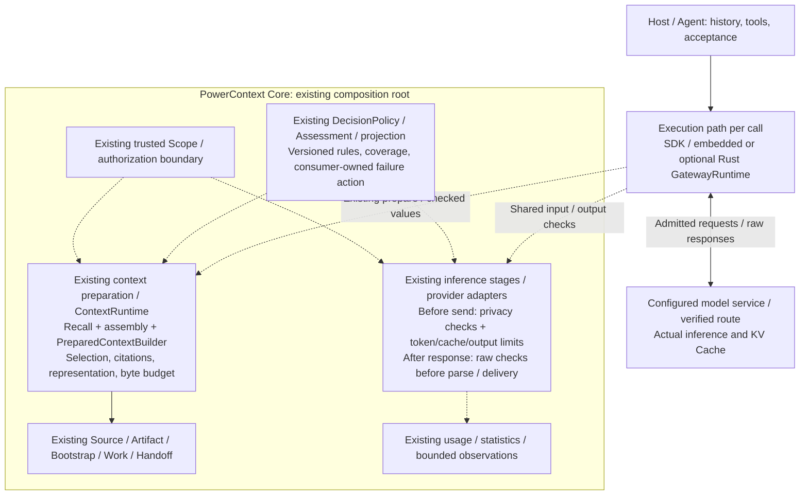
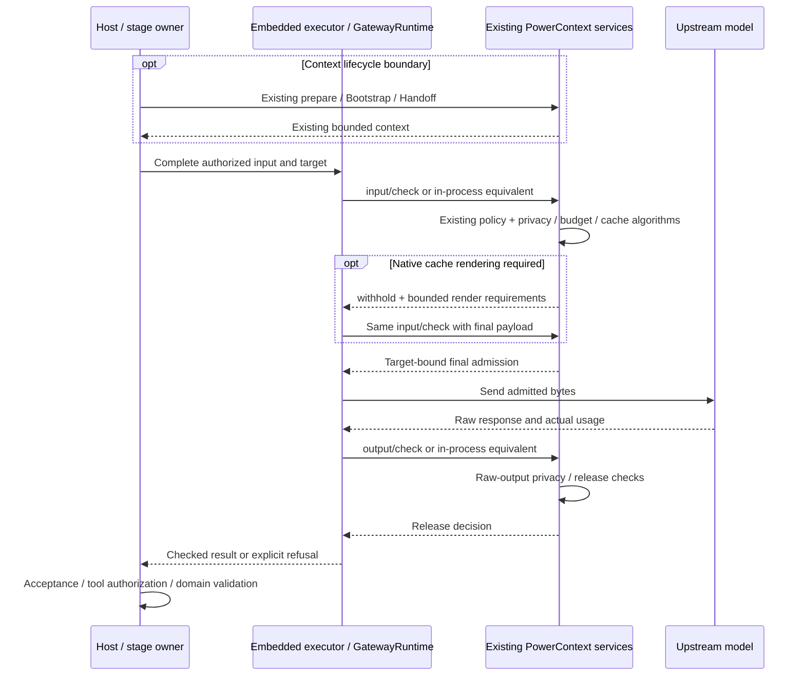

- Proposal Name: `integrated_privacy_interception_and_token_efficiency`
- Start Date: 2026-10-19
- RFC PR: [oceanbase/powercontext#2086](https://github.com/oceanbase/powercontext/pull/2086)
- Related RFCs: [RFC 0016](0016_pydantic_ai_inference_integration.md), [RFC 0028](0028_context_pack.md),
  [RFC 0046](0046_observability_foundations.md), [RFC 0048](0048_handoff_artifact.md),
  [RFC 1435](1435_explainable_prepared_context_receipts.md), [RFC 1770](1770-decision-policy-governance.md),
  [RFC 1783](1783-handoff-session-rollover.md)

# Summary

This RFC has two product goals: **intercept prohibited privacy/security disclosures** and **improve token efficiency
without weakening task quality or evidence fidelity**. Both capabilities extend existing PowerContext modules. They do
not introduce an independent policy runtime, a second context system, or a new execution database.

ContextRuntime names the existing `ContextApplication.for_scope(scope_id).prepare(...)` capability: authorized recall,
assembly, `PreparedContextBuilder`, and explicit Bootstrap/Work/Handoff composition. Token selection and representation
algorithms belong in this path. Existing inference stages and provider adapters own input inspection before actual
sending, complete-request budgets, native cache planning, output limits, and raw-response inspection before delivery.
Existing `DecisionPolicy`, `DecisionAssessment`, and projection contracts supply versioned governance where applicable.
Mandatory checks do not depend on an LLM judge or inherit advisory fail-open behavior.

SDK/embedded execution and optional Rust GatewayRuntime are **two execution paths configurable per call**. A deployment
may use both. They execute the same Core decisions; Gateway handles protocol mapping, transport, buffering, cancellation,
owned retries, and usage evidence. The actual KV cache remains at the inference service.

The implementation baseline is repository commit e4efb39b. This is a design proposal, not a claim that general outbound
privacy interception, complete-request checks, cache adapters, or measured savings are implemented in that baseline.

| Decision | Contract |
| --- | --- |
| Primary goals | Privacy interception and token efficiency, with safety and task correctness taking precedence over savings. |
| Algorithm ownership | Extend existing context preparation, stage projections, inference adapters, and policy consumers. |
| ContextRuntime | Existing context organization capability; no second selector, transcript store, or forwarding runtime class. |
| Security checkpoints | Inspect before model egress and before response release; these are steps inside existing call boundaries. |
| Executor | Embedded/SDK or optional Rust GatewayRuntime, selected per invocation; both may coexist. |
| Public API | Reuse context/continuity APIs; at most two new check operations for remote execution. Embedded use needs no HTTP. |
| Storage | Zero new tables, zero new Artifact families, and no inference migration in v1. |
| Default optimization | Existing bounded selection, stable reuse, approved structural encoding, cache compatibility, explicit output limits. |
| V1 privacy behavior | Allow unchanged semantic content or block/withhold; no automatic general redaction or secret restoration. |
| Acceptance | Actual disclosure counterexamples, false blocks, task quality, complete usage/cost, and end-to-end latency. |

# Motivation

PowerContext already selects and delivers cited project context, manages Source/Artifact evidence, supports Handoff,
and calls generation, Embedding, rerank, and decision backends. Users need these existing paths to answer two questions:

1. Will prohibited material leave the trusted boundary or reach a recipient through model output?
2. Can the same task use fewer unnecessary tokens and repeated calls, while preserving required facts and quality?

The useful change is to add the appropriate algorithms at these existing boundaries. A separate runtime would add
another composition root, configuration surface, and authority without removing the need to integrate actual provider
calls. It would also obscure that context selection, privacy decisions, serialization, and Artifact validation have
different owners and failure semantics.

The priority order is mandatory safety, correctness/evidence, complete-task cost, then cache-hit rate. A shorter input
that loses a constraint, causes more retries, or destroys a valuable cache prefix is not established improvement.
Keeping a prohibited prefix stable is never an acceptable cache optimization.

# Guide-level explanation

## One coding task

A user asks an Agent to fix an API client in a registered project Scope:

1. The host calls existing `/v1/context/prepare` at its supported recall boundary. Existing runtime policy retrieves and assembles relevant authorized evidence, retaining citations and the historical-data trust envelope.
2. The host retains that exact prepared value across ordinary tool turns. Current instructions, accepted history, and tool execution remain host-owned. A refresh uses the same prepare API at an explicit boundary.
3. The executor constructs the complete model request. Existing inference-boundary code applies configured privacy rules, full-request token admission, approved cache settings, and output limits. Prohibited content is blocked before sending.
4. The executor sends admitted bytes to the configured target, obtains the complete raw response, and requests its required release checks. In strict mode nothing containing model content is delivered before approval.
5. The host accepts the checked answer or authorizes a tool. Core background results still pass their existing schema, evidence, eligibility, and Artifact commit validation. A successful inspection does not imply a tool execution or durable write.

A configured secret in a tool result must be caught even when it was never part of PreparedContext. An ordinary tool
turn must not trigger a new context search solely to run a security check. Empty prepared context remains a normal result;
a privacy refusal is explicit and cannot be disguised as an empty success.

## A Core background stage

Memory or Topic processing uses its current Source projection, instructions, and output schema. Where a versioned stage
codec is approved, it can encode repeated structures more efficiently before inference while retaining every occurrence,
identity, order, and evidence reference. The authoritative Source remains unchanged.

The provider boundary checks the actual request, then checks raw output before parsing and domain validation. The stage
keeps its existing generation/output budget. Embedding v1 only inspects or blocks unchanged semantic input; no generic
compression is applied to documents or queries under an existing index profile.

## What users can observe

Privacy results distinguish allowed, blocked, unavailable, and unsupported coverage without echoing the matching secret.
Efficiency diagnostics distinguish preparation frequency, estimated text reduction, actual input/output usage, provider
cache reads/writes, failed attempts, and missing accounting. Strict mode reports upstream first-token time separately
from first released content. No percentage saving or cache hit is inferred solely from shorter text or a configured flag.

# Reference-level explanation

## Concrete integration into current modules

| Existing owner | Current capability | Extension in this RFC |
| --- | --- | --- |
| `ScopedContextApplication.prepare` / `_prepare_build` | Scoped recall, assembly, bounded recall effort, per-preparation query-vector reuse | Retain selection authority; compose approved context representation strategies here. |
| `PreparedContextBuilder` / prepared text/code | Final selection, citations, trust wrapping, omissions, UTF-8 budget | Apply context representation changes before final fit/count; never truncate an already built envelope elsewhere. |
| Stage-owned input projection | Domain-specific instructions, schema, Source windows and evidence | Add only verified structural codecs for those exact stage contracts. |
| `InferenceConfig`, inference ports and provider adapters | Generation, Embedding, rerank, decision configuration and real calls | Integrate mandatory send/release checks, whole-request limits, cache mapping, and per-attempt enforcement. |
| `TokenEstimator` / estimator profile | Deployment-fixed text estimates and estimator identity | Reuse estimates with explicit scope/uncertainty; do not relabel them as provider token counts. |
| `DecisionPolicy` / `DecisionAssessment` | Policy versions, modes, local-rule/model verdicts and unknown coverage | Register narrow privacy consumers when needed; keep final action owned by the call boundary. |
| `decision_projection` | Bounded, request-only projection protection for decision calls | Reuse its contract and verified algorithms where compatible, not its payload bounds as a universal scanner. |
| Existing Source/Artifact and Work/Handoff | Evidence, exact revisions, explicit continuity and commits | Preserve domain identities, authority, transactions, and supported readback. |
| Usage wrappers / statistics / observations | Best-effort usage and bounded policy diagnostics | Reuse applicable fields and sinks; do not turn them into a financial or response-recovery ledger. |

Source baseline:
[context application](https://github.com/oceanbase/powercontext/blob/e4efb39bd6b8303a508c83fd5fcde5f99290b785/src/powercontext/builtin/runtime/application.py),
[context builder](https://github.com/oceanbase/powercontext/blob/e4efb39bd6b8303a508c83fd5fcde5f99290b785/src/powercontext/builtin/runtime/prepared_context.py),
[inference configuration](https://github.com/oceanbase/powercontext/blob/e4efb39bd6b8303a508c83fd5fcde5f99290b785/src/powercontext/builtin/runtime/config.py),
[provider adapter](https://github.com/oceanbase/powercontext/blob/e4efb39bd6b8303a508c83fd5fcde5f99290b785/src/powercontext/builtin/inference/pydantic_ai.py),
[policy governance](https://github.com/oceanbase/powercontext/blob/e4efb39bd6b8303a508c83fd5fcde5f99290b785/src/powercontext/builtin/runtime/decision_policy.py),
[projection protection](https://github.com/oceanbase/powercontext/blob/e4efb39bd6b8303a508c83fd5fcde5f99290b785/src/powercontext/builtin/runtime/decision_projection.py),
[token estimation](https://github.com/oceanbase/powercontext/blob/e4efb39bd6b8303a508c83fd5fcde5f99290b785/src/powercontext/builtin/inference/tokens.py).

## Architecture and ownership

### Algorithms inside existing components



The boxes identify existing component owners; checks and optimizations are internal algorithms and call steps. Context
preparation retains its own policy and byte budget. Inference helpers consume the complete request assembled by the
executor. A policy consumer cannot authorize retrieval or replace an Artifact commit. The dotted check requests carry
content to inspect, not metadata alone.
Deterministic preparation/encoding helpers are not automatically DecisionPolicy consumers. Only a registered narrow
consumer uses its governance contract; existing advisory and mandatory call boundaries retain their own actions.

Core background calls can use the embedded executor. Remote Gateway uses existing Core APIs plus the two check
operations below. Both execution paths may coexist in one deployment; each invocation has one declared owner for
sending and retries. Gateway implements protocol behavior and transport, not another context selector or rule engine.

### Implementation boundaries

New cohesive algorithm functions may live beside current context or inference code. Share a scanner, codec, or budget
algorithm only when callers have the same carrier contract and failure semantics. Do not add a forwarding runtime,
generic plugin framework, parallel policy registry, or session facade just to group those functions.

Existing narrow decision consumers retain their behavior. A `DecisionRequest` is bounded for its own purpose; forcing
a full prompt into that DTO and scanning only its truncated prefix is not complete-request protection. A structured
high-level generator wrapper alone also cannot prove coverage of final serialization, internal retries, raw errors,
and first response release. Each promised provider path must integrate and test its actual boundary.

## Goal 1: privacy and security interception

### What is inspected and where

| Boundary | Inspection | Owner and result |
| --- | --- | --- |
| Context retrieval/delivery | Existing Scope/Artifact authorization, source eligibility, trust wrapping; configured delivery rules if applicable | Current context/domain operation; preserve its response contract. |
| Before every covered model send | Complete instructions, supported content, tools/schema/results, allowed target and content-affecting settings | Existing inference-boundary consumer; allow unchanged content, block, or withhold. |
| Before strict response release | Complete raw text, tool arguments, exposed provider errors, completion state and current release policy | Existing inference/executor boundary; withhold until checks pass. |
| Before domain writes | Existing schema, evidence, review, identity and commit checks | Owning Source/Artifact service; an allowed model response does not bypass these checks. |

Permission to read a Source or obtain prepared context does not automatically permit sending it to every model service.
Prepare does not know arbitrary future destinations and cannot certify a complete request that the host has not yet
assembled. Final egress checks remain necessary, including when context preparation is skipped.
Query Embedding, reranking and auxiliary calls made during retrieval need their own covered pre-send boundary; checking
only the eventual prepared result cannot protect earlier disclosures.

The initial enforcing profile covers configured secret values/patterns, supported text/structured tool carriers, and
controlled destinations. It states detection bounds and false-positive cases. It does not claim universal semantic
privacy detection, prompt-injection prevention, or protection of unsupported opaque/multimodal content.

### Policy reuse and explicit failure semantics

Deterministic rules run locally first. A substantive local judgement can use the existing `DecisionAssessment` vocabulary;
registered consumers reuse version, mode, reason, coverage and observation contracts. A consumer maps that assessment
to its own send/release action. `deny` blocks, and `unknown`, missing mandatory coverage, or unavailable enforcement
withholds. An LLM result cannot override a mandatory rule or grant data/tool authority.

`FailOpenDecisionModel` keeps its existing abstention contract. Optional advisory consumers may ignore abstention under
their domain contract. A mandatory privacy consumer must interpret that same abstention as insufficient evidence to
send/release. Do not globally change all decision consumers or treat a provider failure as a clean privacy result.

External auxiliary models receive only an already permitted bounded projection. Raw prohibited material cannot first
be sent to a hosted classifier, compressor, or judge to decide whether it was safe to send. Existing decision projection
sanitization remains specific to decision requests and does not establish universal model DLP coverage.

### Inspection algorithm and content handling

1. Bind trusted caller, Scope, stage, target and policy version. Resolve permitted destinations/credentials from controlled configuration.
2. Validate protocol, carrier, encoding, nesting and size limits before acceptance. Unsupported strict carriers are rejected or withheld.
3. Inspect supported raw representations and parsed content fields. JSON normalization must not hide a secret in an overwritten duplicate key, numeric lexical form, escaped value, error body, or tool structure.
4. Evaluate required local rules and any eligible optional assessment. Preserve whether content was actually inspected; unknown is not allow.
5. Check the complete final send representation or complete raw release unit. Return a content-free reason and bounded coverage metadata.

V1 does not automatically redact code, tool arguments, identifiers, or signed content, and has no persistent placeholder
mapping. It allows unchanged semantic content or blocks it. Future specialized transformations must prove validity,
retain authoritative originals, recheck the resulting representation, and state their storage/security costs.

Unapproved redirects, arbitrary caller base URLs, credential forwarding, and unknown content-bearing fields are not
admitted by a permissive string allowlist. Cancellation propagates. Security errors and logs do not echo matched content.

### Privacy mode and optimization mode are independent

| Axis | Modes / contract |
| --- | --- |
| Privacy policy | Use existing disabled/shadow/advisory/enforcing governance where applicable. Only enforcing with verified coverage can claim interception. |
| Mandatory deployment rules | Remain effective regardless of optional optimization or judge settings; clients cannot select a weaker policy through request fields. |
| Representation optimization | Proposed `off`, `shadow`, `active` settings per eligible strategy. Defaults off until that strategy passes acceptance. |
| Cache planning | Explicit profile choice; requires final-payload admission and does not weaken privacy checks. |

Optimization shadow computes a candidate while sending the approved original; it does not imply a second model request.
Privacy shadow/observation does not block disclosures and must not be presented as enforcing protection. Policy promotion
uses existing narrow-consumer evidence requirements, not a new central policy service.

## Goal 2: token efficiency

### Strategies and owning locations

| Strategy | Owning location | Acceptance constraint |
| --- | --- | --- |
| Bounded relevant selection | Current recall/assembly and builder | Preserve current family selection, authorization, exact citations and omission semantics; measure incremental benefit against this existing baseline. |
| Avoid repeated preparation | Host lifecycle integration using existing prepare/bootstrap receipts | Ordinary tool turns reuse approved values; bootstrap deduplication remains limited to fully injected exact Atomic Memory revisions. |
| Context representation | Existing prepared text/builder path | Strategy-specific, deterministic and opt-in; preserve trust markers, citations, scalar content, order, and complete budget accounting. |
| Background input encoding | Stage-owned input projection before provider rendering | Only approved schema/codec pairs; retain identity, time, metadata, order, multiplicity and evidence reconstruction. |
| Provider prefix reuse | Existing inference adapter/profile and executor | Preserve rendered prefix, eligible message/content boundaries and cache controls; measure real provider evidence. |
| Output efficiency | Existing stage schema, instructions and `InferenceLimits`/model settings | Explicit output ceiling and required fields; retain evidence and completion checks, avoid automatic truncate-and-accept behavior. |
| Avoid unnecessary model work | Existing bounded recall effort and stage scheduling | Account for actual saved calls and any added Embedding/rerank/judge cost; no new Agent scheduler. |

The current checkout does not contain a general-purpose input/output optimizer implementing all these strategies.
Proposed strategy names or examples are not implementation claims. Every active strategy needs its own supported input,
invariant, reference behavior, version, fallback, and quality evidence.

### Representation algorithms and invariants

A first structural codec can encode strictly identical repeated bodies once and retain an ordered occurrence/reference
list within a controlled stage schema. Equality includes the content that the codec promises to preserve; timestamps,
identities, metadata, counts and repeats are not silently deleted. Differing log lines are not equivalent merely because
they share a template. This is a proposed stage-local algorithm, not a generic log compressor.

For context delivery, representation algorithms run before the builder's final render/fit/count. They retain exact
citations, historical trust boundaries, required fields and honest truncation/omission markers. Existing whitespace,
code, JSON values or tool arguments cannot be rewritten by an unverified regular expression. Removing a field required
by the current public display contract is not a lossless optimization.

For each eligible transformation: verify the supported format, construct a candidate, validate reconstruction or the
promised field-equivalence contract, count with the same estimator/profile, and apply only an accepted strategy. If
there is no measured reduction or validation fails, use the original only when it still passes privacy and full-request
limits. An unsafe or oversized original is not a valid fallback. In shadow, record bounded candidate diagnostics while
retaining the approved original; do not make a second paid inference call unless a separate experiment authorizes it.

Lossy summaries, generic compaction, arbitrary redaction, and semantic response caches remain separate future work.
Model output that is too long or incomplete still needs domain validation; reducing output tokens is not permission
to discard required evidence or accept a cut-off JSON result.

### Supplementary bytes and complete-request tokens

Existing `prepare.max_bytes` remains the supplementary UTF-8 byte budget. The complete target request also includes
instructions, history, tools/schema, protocol overhead and an output reservation. Its admission uses the verified target
window and an explicit tokenizer/estimation profile with uncertainty margins. A heuristic estimate cannot establish an
exact hard token guarantee; use a conservative verified bound or reject a profile requiring precision it cannot supply.

When the request does not fit, withhold sending. The host can request a smaller context through the same prepare API or
use an explicit Handoff. Inference code does not silently recall another set of Memory, truncate a built trust envelope,
remove tool exchanges, or pretend that a byte limit is a token limit.

### Cache reuse and Gateway compatibility

```text
Turn 1: Stable instructions / tools + exact PreparedContext | Current request
Turn 2: Same prefix + original accepted history             | New messages / tool results
```

The layout is logical: actual roles, trust levels, message boundaries and tool pairs retain the target protocol's
semantics. The host owns history and accepted results. Preserve the prepared value and injection location across an
explicit local task epoch; new intent, permissions or a deliberate refresh establish an appropriate new boundary.
An epoch is not a server session resource. Output inspection affects future permitted replay, not a hit already decided
for the request that produced that output.

Cache planning is an algorithm in the existing inference path. An approved `UpstreamProfile` describes model/version,
protocol/renderer, relevant tools/schema/settings, account/region or non-sharing deployment boundaries, supported cache
modes/breakpoints/retention, and usage evidence. These are controlled configuration and transient plan data, not a new
database service. Profiles must distinguish native caching mechanisms rather than applying one vendor's fields everywhere.

Gateway preserves roles, tool ordering, content blocks, reusable boundaries and approved native cache settings. It does
not insert request IDs/timestamps into stable prompt content, merge old messages arbitrarily, or silently remap the
target. A required affinity constraint that the path cannot enforce makes the profile ineligible. Cache hints do not
pin a provider machine or guarantee availability. Hidden downstream retries/fallbacks must be controlled and visible or
excluded from execution and cost guarantees.

Final outbound-body integrity and prefix-cache eligibility are distinct. A body digest binds the approved request;
a change requires fresh admission. A digest of the entire growing request is not a stable cache-routing key. HTTP JSON
formatting alone does not establish whether the provider-rendered token prefix changed. Local visible-prefix fingerprints
and boundary metadata help diagnose misses but cannot substitute for provider cache evidence.

Gateway instances can change without erasing provider KV. Their renderer/profile must remain compatible, and the host
must retain the exact context/history or reprepare explicitly. If a lost local value is rebuilt differently, reuse may
fall. Scope isolation does not physically partition provider caches; upstream account/privacy configuration is separately
verified. The first demonstration uses one Scope without context references and a host-authorized history boundary.

### Provenance and index compatibility

The public PreparedContext remains an ephemeral four-field value: `schema`, `status`, `content`, `content_bytes`.
It is not a full prompt, trusted origin manifest, authorization token, or injection proof. Automatic cross-Scope frozen
replay requires a verified provenance/reauthorization mechanism before it is supported. Do not infer permission from
citation text or treat a revoked historical projection as permanently permitted.

Existing `bootstrap_receipt_id` deduplicates only its supported fully injected Atomic Memory revisions. It does not
prove coverage of arbitrary history, Topic Memory, code or Handoff. Optional diagnostics proposed by
[RFC 1435](1435_explainable_prepared_context_receipts.md) are not implemented in the baseline and cannot become authority.

Embedding v1 inspects or blocks the unchanged document/query. A future transformation requires a compatible versioned
query/document profile and explicit reindex/migration policy. Rerank keeps candidate identity/order mapping intact.
Background calls do not inject Agent Memory automatically or recursively invoke enhancement/judges. Switching models
preserves portable history/Handoff, never private KV or opaque reasoning state; rollover remains host-owned under
[RFC 1783](1783-handoff-session-rollover.md).

## Execution flow and minimal interfaces

### Reuse existing entry points

| Need | Existing HTTP path |
| --- | --- |
| Task context | `/v1/context/prepare` |
| Lifecycle context / delivery | `/v1/context/bootstrap`, `/v1/context/bootstrap/receipts` |
| Current work continuity | `/v1/work/handoffs/prepare-current`, `/v1/work/handoffs/acknowledge` |
| Explicit Handoff | `/v1/handoff/prepare`, `/v1/handoff/finalize`, `/v1/handoff/commit`, `/v1/handoff/continue` |
| Work observations | `/v1/work/contracts/create`, `/v1/work/outcomes/record` |

Context preparation retains its current request and default result shape:

```json
{
  "scope_id": "project:powercontext",
  "query": "Fix the generated API client and preserve repository regeneration requirements",
  "max_bytes": 8000,
  "include_code": false
}
```

No invocation/session/branch creation, context-plan API, policy-runtime API, or event ledger is required. Existing
`assembly`, `include_code` and bootstrap receipt settings retain their supported behavior. Normal automatic recall must
not repeat prepare solely to execute a check or opt into diagnostic receipts.

### Two remote check operations when needed

| Proposed POST path | operationId | Behavior |
| --- | --- | --- |
| `/v1/inference/input/check` | `check_inference_input` | Reuse Core inference algorithms to inspect complete input, return required cache rendering or final target-bound admission. |
| `/v1/inference/output/check` | `check_inference_output` | Reuse the same boundary algorithms to inspect a complete raw response and decide release. |

These are remote access to integrated algorithms, not an independently deployed subsystem. Embedded execution calls
those algorithms directly with existing bound Scope/caller context. HTTP handlers translate DTOs into the same behavior;
no `application.gates` facade or forwarding runtime is required. The checks do not send a provider request, perform a
second context recall, append Source, or commit Artifact.

Remote DTOs require `scope_id`. Reuse current scope-mode/access declarations, Server authentication/delegation, registered
Scope validation and current `scope.read`; actual paid execution and profile selection additionally require trusted
execution authority. Embedded `for_scope` binds a partition, not authentication. A shared admin credential plus arbitrary
caller Scope IDs is not isolation. Context references and exact Artifact reads still receive their actual authorization.

Policy configuration cannot be weakened by untrusted model-body fields. Profile/stage/Principal/delegation bindings are
verified at the owning boundary; native provider session IDs or user-supplied correlation IDs grant no authority.

### Transient values and binding

Input check values carry the complete target payload, trusted invocation identity, relevant layout and output limits.
Results carry `allow`, `block` or `withhold`, content-free reasons, coverage, current policy/profile identity, and final
body/target binding. Optional cache-render requirements are bound to the same semantic input and expire promptly.
Output requests carry that input binding, complete raw response, actual target/completion state and available usage;
results bind the permitted release to the inspected content and current policy.

A local immutable value or a bounded authenticated remote envelope needs no persisted row. It binds caller, Scope,
concrete target, protocol/profile, final bytes, relevant headers, limits, policy and expiry. It does not provide durable
single-use permission or exactly-once execution. A check-only API cannot prove an untrusted caller sent or received the
claimed content; managed-executor coverage requires actual transport integration.

If cache fields require native rendering, return withhold, render only approved fields, and call the same input check
again. Preserve semantic content and prepared context; allow at most one such rerender in v1. Only final admission permits
sending. Any later body/target/settings change requires fresh admission. Unsupported formats/versions, missing required
coverage and expired policy do not silently downgrade to allow.

Implement new HTTP paths in `openapi/powercontext.yaml`, generate clients and run `make contract-test` when implementing;
this RFC changes no runtime or generated API. Keep existing flat client operation names and scoped domain semantics.

### One managed invocation



Core stage representation optimization happens before final provider rendering and is followed by mandatory final
inspection. Inspect the original stage projection before encoding as well, so a codec cannot hide a prohibited value
from later carrier checks. Optional optimization failures may fall back only to an otherwise permitted, valid, within-budget input.
There is no security bypass when optimization is disabled, fails, or produces a shorter candidate.

## Streaming, failure, and recovery

Strict mode buffers the complete supported response before release, with byte, time, and concurrency limits. Incomplete
JSON/tool arguments, buffer overflow, failed mandatory checks or unavailable policy withhold release and best-effort
cancel upstream work. No content is spilled to a new response database. Connection/heartbeat metadata before approval
must contain no model or sensitive content. Observe mode cannot claim leakage interception; bounded streaming needs a
separate verified safety-unit contract and is outside the initial enforcing profile.

| Situation | Required behavior |
| --- | --- |
| Optional representation optimization fails | Keep the original only if privacy, format and full budget still permit it. |
| Mandatory privacy check fails/unavailable/unknown | Withhold sending or release; never fall back to an uninspected original. |
| Input within context byte limit but too large for target | Withhold; explicit smaller prepare or Handoff, no hidden truncation. |
| Target or final payload changes | Recheck before sending. |
| Definitely unsent transport failure | Retry only under one declared owner, valid admission and bounded limits. |
| Send may already have reached upstream | Report uncertainty; no automatic paid resend or refund assumption. |
| Raw response incomplete or unapproved | No strict content release; preserve content-free failure evidence. |
| Checked response lost before delivery | No durable response recovery guarantee in v1; host resolves its own invocation. |
| Allowed output later fails domain validation/commit | Domain operation remains failed/pending under its existing contract. |
| Usage unavailable | Mark incomplete/unknown, not zero or fully accounted. |

Cancellation remains control flow. For SSE, approved content may be framed after a complete strict check, which delays
first released content. After headers are sent, use supported error/interruption events rather than pretending to change
the earlier HTTP status. Recheck current required policy before send and first release; revocation can break cache reuse.
Already sent or released material cannot be recalled by invalidating a local projection.

## Storage, configuration, and observations

### Reuse domain storage; add zero tables

| Information | Existing owner | Reuse constraint |
| --- | --- | --- |
| Scope / references | Scope catalog and access plane | Existing exact identity and authorization. |
| Actual observations | `pc_sources` / Source journal | Explicit domain evidence only, not every model request/response. |
| Memory and other Artifacts / Handoff | `pc_artifacts`, heads and lineage | Existing immutable revisions, governance, transactions and exact reads. |
| Work continuity | Source/Artifact-backed Work facade | No new task/session aggregate. |
| Bootstrap delivery | `pc_context_bootstrap_receipts` | Its specific content-free lifecycle contract only. |
| Policy assessments | `pc_decision_observations` when the consumer fits its contract | Register typed consumer/reasons and reuse existing retention; no prompt bodies or per-attempt financial ledger. |
| Model / recall aggregates | `pc_model_usage_daily`, `pc_recall_token_daily`, `pc_recall_effort_daily` | Existing incomplete/best-effort statistics semantics. |
| Prepared values, candidate encodings, check bindings, cache plans and buffers | Invocation/host memory | Bounded derived values; discardable, no mandatory persistence. |

Do not repurpose review candidates, processing leases, Topic Memory work budgets, or Source/Artifact blobs as generic
inference storage. Rules and profiles extend existing trusted runtime/inference configuration and policy manifests;
there is no new policy database or universal workflow registry.

Host history retains conversation truth. Gateway-local prepared-value reuse is optional, bounded, and keyed by the
actual authorization/context boundary, not query text alone. Reusing it still requires current policy. On restart the
host can supply retained context or reprepare; existing committed Handoff remains available through its own read path.
Core does not recover an unpersisted transcript/response or establish a distributed selection frontier.

Durable invocation recovery, global hard spending reservations and single-use distributed send permits require a
separate minimal-state proposal. It must first compare current repositories, define the missing guarantee, then justify
identity, isolation, transactions, uncertain sends/commits, retention, readback, costs and migration. No tables are
preapproved by this RFC.

### Configuration and accounting

Extend existing configuration at the owning boundary: policy version/mode/failure action, approved strategy and codec
version, estimator/profile, target/cache capability, response bounds, and retry ownership. Privacy enforcement and
optimization settings remain independent. Existing users with those new features disabled retain their existing contract;
disabled or observation-only paths must not advertise enforcing coverage.

Do not relabel best-effort aggregate usage as a budget ledger. Per-request window/output limits are enforceable only
within their verified profile; distributed restart-safe spending ceilings are not a v1 claim. Correlation IDs are not
idempotency guarantees. Record known, estimated, unknown and reconciled usage separately, including auxiliary calls,
failed attempts and cache writes where observable.
Baseline `InferenceUsage` has request/input/output counts only. Cache read/write, reasoning usage and actual target
evidence need typed optional metadata at the existing inference/usage boundary when implemented, with unknown values
preserved. Existing daily aggregates cannot reconstruct those counters; v1 need not persist them to demonstrate a task.

Before adding operational fields, follow the existing [observability guide](../development/observability.md): stable
operation/unit/outcome vocabulary, bound identities, registered field allowlists and `log_safely`. Logs/traces omit
queries, prompts, responses, evidence bodies, credentials and sensitive paths. Do not place execution identities in
metric labels or convert sampled diagnostics into an audit or billing claim.

## Delivery and acceptance

### P0: integrated Core vertical slice

Choose one existing context preparation path, one background generation stage, a fixed supported text/tool protocol and
model, one Scope without context references, and explicit enforcing rules. Integrate algorithms in current context/stage/
provider boundaries. Deliver strict raw-response checks and one opt-in structural efficiency strategy with shadow first.
Use existing host history and explicit Handoff. No new runtime service, table, Artifact family, or session setup.

### P1: optional Gateway and native cache proof

Expose the two remote checks only as needed by remote execution, add optional Rust GatewayRuntime, and validate the same
Core rules with one pinned real upstream route and host. Embedded background and Gateway Agent traffic may coexist.
Verify native cache fields/boundaries, final input, retries, actual targets, usage and latency. More protocols/carriers,
redaction, lossy compaction, routing and response caches require separate acceptance.

### Privacy and behavior acceptance

- Confirm existing prepare selection, citations, byte limits, empty results, Profile/code opt-in, denied references, Bootstrap receipt scope and Handoff readback remain valid.
- Place configured prohibited values in every supported input/output field, tool structures, raw errors, escaped/numeric representations and duplicate keys. Verify blocked input never reaches the controlled upstream and strict-blocked output never reaches the host.
- Cover mandatory check timeout/unavailable/unknown, forged Scope/caller/stage, target mutation, expired policy, unsupported carriers, split stream content, incomplete JSON, buffer limits and cancellation.
- Demonstrate advisory abstention behavior is retained while mandatory privacy consumers withhold. Optimization off/shadow/failure must not disable required interception.
- Validate codec reconstruction, order, multiplicity, identities, citations, code/JSON scalar fidelity and malformed/unsupported inputs. Differing log rows must not collapse into one occurrence.
- Cover unchanged Embedding semantics, rerank identity mapping, no recursive judges/recall, per-attempt provider checks, unknown sends/usage, process loss and the stated recovery limits.
- Verify ordinary checks create no Source/Artifact content, and existing domain commits retain validation, transactions and supported exact reads.

### Token efficiency and complete-task experiments

Hold repository task, starting state, model/profile, tools/schema, policies and quality criteria fixed. Mandatory privacy
rules remain enabled in every comparable optimization arm. Compare the current workflow, approved stable-context reuse,
and the same reuse with opt-in representation/cache planning. Baselines reflect the real host; do not introduce fake
repeated retrieval to exaggerate improvement. Shadow without a second model call is distinct from a paid paired experiment.

Measure cold/warm conditions and message-boundary, tool/schema, context refresh, policy, model and route changes.
Compare direct versus Gateway execution under controlled equivalent prefixes and warm-up conditions. Provider defaults
may already cache; do not claim a cache-disabled baseline without a verified control.

| Goal | Required evidence |
| --- | --- |
| Privacy interception | Coverage by carrier/rule, known leakage counterexamples, observed blocks, false positives, unknown/unavailable rate. |
| Task quality | Correct final result/tests, required constraints, evidence fidelity, tool errors, retry/repair work. |
| Input efficiency | Preparation frequency, original/candidate estimates with estimator/version, actual ordinary input/cache reads/writes. |
| Output efficiency | Actual output/reasoning usage where available, valid completion/schema/evidence, total attempts. |
| Complete cost | Retrieval/Embedding/rerank/decision/auxiliary costs, warm-up/cache writes, retries/failures, estimates and missing usage; avoid double counting overlapping cache counters. |
| Performance | Local scan/encoding/token CPU, request bytes, buffers/memory/concurrency, preparation/check latency, upstream first token, released content and final delivery, P95/P99. |

A higher cache-hit rate, smaller prepared value or lower input estimate alone does not establish total savings. Accept an
optimization only within measured coverage and comparable task quality; report inconclusive outcomes honestly. Real
provider/host support requires actual execution, not a mock or direct hook invocation. This RFC itself runs no such
acceptance experiment and publishes no measured saving.

# Drawbacks

Integrating algorithms into existing modules requires clear ownership and per-provider boundary work; a high-level
wrapper cannot supply missing visibility. Deterministic rules have finite coverage and false positives. Strict output
checks add memory, CPU and delivery latency. Structural encodings and smaller output limits can harm quality if their
invariants or acceptance are weak. Frozen context trades freshness for continuity and must remain reauthorized.

The small initial scope has no durable inference recovery, general transcript ownership, automatic secret mapping or
global financial reservation. Opaque downstream routing/retries and missing usage limit guarantees. Network-level bypass
prevention still requires an enforced deployment boundary; a library cannot police arbitrary application egress.

# Rationale and alternatives

| Alternative | Decision |
| --- | --- |
| Integrate algorithms into existing context, policy and inference components | Selected; reuse current authority and add behavior at real boundaries. |
| Introduce a separate policy runtime/service | Duplicates composition and still needs provider integration; not required for these goals. |
| Put algorithms entirely in Gateway | Forces embedded/background users to deploy Gateway or duplicate semantics. |
| Reuse the decision sanitizer as the complete scanner | Its carrier limits and advisory semantics are narrower; only compatible primitives/contracts are reusable. |
| Optimize every input/output automatically | Risks changing evidence, code, index semantics and cache prefixes; use scoped, versioned opt-in strategies. |
| Persist every check or create a generic execution table | Adds content retention/state guarantees before demonstrating need; keep v1 transient and domain-specific. |

# Prior art

Existing scoped context assembly, token estimation, stage limits, Source/Artifact lineage, Bootstrap/Work/Handoff,
DecisionPolicy/Assessment/projection, inference adapters and usage wrappers provide the foundation. Related RFCs are
linked above. Existing narrow governance and context helpers do not establish complete model egress/release coverage.
Provider KV caching is distinct from answer reuse; support and savings depend on the actual model/profile/deployment.

# Unresolved questions

Before implementation acceptance, fix the initial host/provider/SDK versions, secret/rule coverage, false-positive set,
first eligible codec/schema pair, required reconstruction/equivalence invariants, estimator uncertainty, cache settings,
revocation latency, buffer/concurrency bounds and workload SLOs. These are measurable configuration choices.

Privacy interception and token efficiency are the goals; existing component ownership, independent security/optimization
failure semantics, Scope authorization, minimal APIs and zero new tables are already design decisions. Automatic
cross-Scope frozen replay or additional native protocol support needs its own verified provenance and compatibility path.

# Future possibilities

After the vertical slice passes, independently evaluate more structural codecs, approved context representations,
multimodal scanning, bounded streaming, specialized redaction, quality-validated lossy compaction, dynamic routing and
response caching. Each extension states its evidence, trust, semantic and storage costs. Durable invocation accounting
or recovery requires a separate minimal-state justification; these capabilities are not hidden prerequisites of v1.
