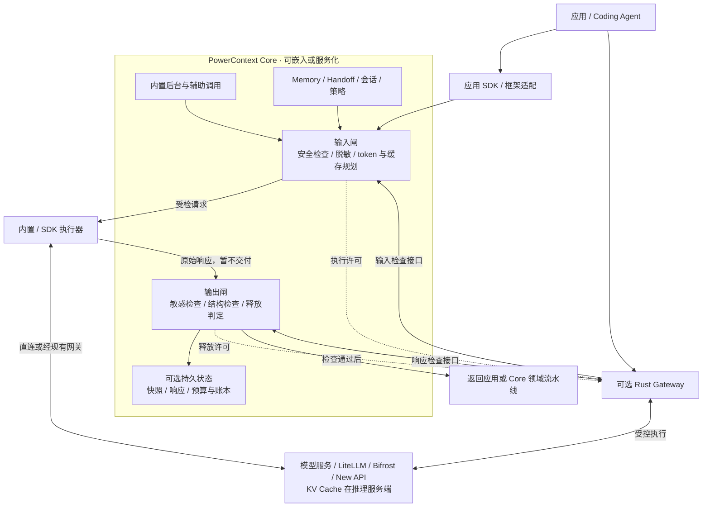
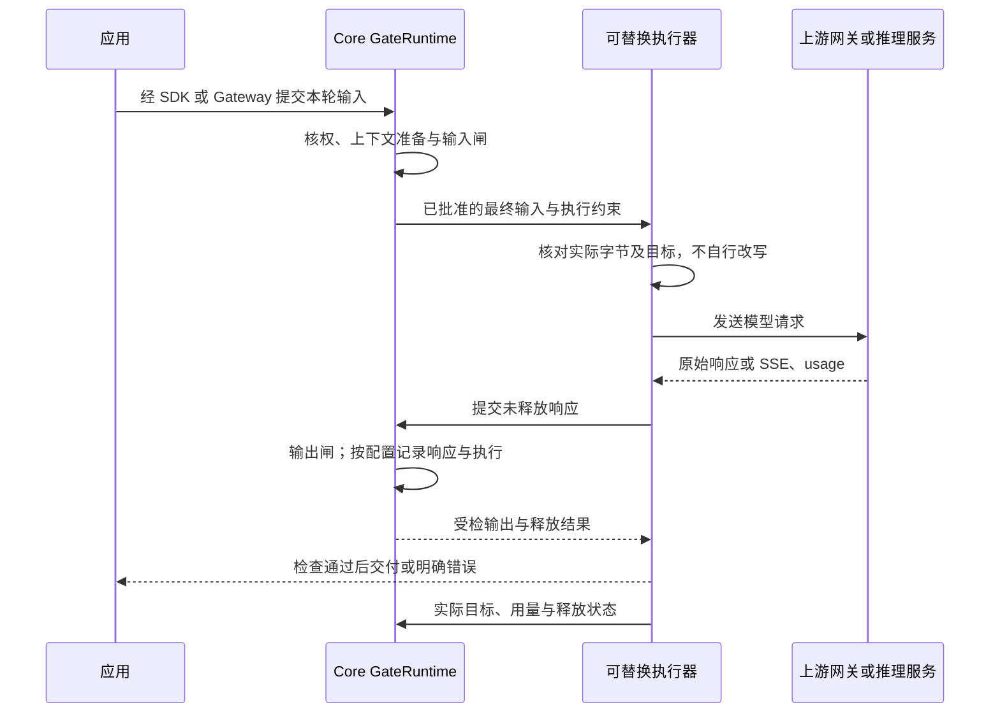

- Proposal Name: `core_inference_gates_and_optional_gateway`
- Start Date: 2026-10-19
- RFC PR: 未分配
- Related RFCs: [RFC 0016](0016_pydantic_ai_inference_integration.md)、[RFC 0028](0028_context_pack.md)、
  [RFC 0046](0046_observability_foundations.md)、[RFC 0048](0048_handoff_artifact.md)、
  [RFC 1435](1435_explainable_prepared_context_receipts.md)、[RFC 1770](1770-decision-policy-governance.md)

# Summary

本 RFC 定义设计契约，不表示能力已经实现或发布。当前能力基线为本仓库提交 e4efb39b，
实现与发布以源码为准；外部网关机制以对应版本和部署验收为准。

输入闸和输出闸是 PowerContext Core 的公共运行时能力。Core 实现安全检查、敏感信息处理、上下文变换、
token 与缓存策略、输出检查，以及可选的会话连续性和权威执行记录。用户不部署 Gateway，也能通过
Core 内置调用链或应用 SDK 使用相同的双闸能力。

PowerContext Gateway 是独立部署、可选的 Rust 协议入口和远端执行器。
它调用 Core 的双闸接口，执行批准的输入，保留必要的传输缓冲并等待释放许可，通过适配器连接推理服务或现有模型网关。
实际发送和交付由执行器控制，因此双闸能力归 Core，并不意味着传输层可以绕过检查先发送或先释放。

这套系统提供一个可检验的产品能力：同一个任务在切换模型、跨会话续接或后台处理时，能够交付有出处的上下文，
阻止策略规定不得外发或交付的内容，并按完整任务核算成本。

| 设计项 | 决定 |
| --- | --- |
| 部署与语言 | Core 可嵌入 Python 应用或作为服务；Gateway 为可选的独立 Rust 二进制或容器。 |
| 双闸归属 | Core GateRuntime 实现统一规则、检查、变换与状态语义，独立于 Gateway 提供。 |
| 上下文权威 | 会话语义、冻结注入、摘要、证据覆盖、脱敏映射和请求快照均由 Core 管理。 |
| Gateway 的厚度 | 只承载协议、连接、流控、许可与字节核验、执行证据采集；不实现另一套双闸规则。 |
| 双闸定义 | Core 在模型请求发送前检查输入、在输出释放前检查响应；执行器保证检查点不能被跳过。 |
| 接入方式 | Core 内置执行器、应用 SDK 执行器、可选 Rust Gateway 共享同一双闸契约。 |
| 持久化要求 | 基础检查可无状态运行；会话重放、跨重启预算和权威账本按需启用对应存储能力。 |
| 调用来源 | `agent_main` 是应用或 Agent 主模型调用；`core_background` 是 Core 的生成、提取、Embedding、重排等调用。 |
| 外部网关接入 | 内置执行器、SDK 或 Rust Gateway 均可通过已核验协议连接 LiteLLM 等；按需补充证据适配。 |
| 模型与重试 | Core 批准模型、候选与预算；执行责任方由接入配置明确指定，禁止两层独立无限扩张。 |
| KV Cache | 缓存在推理服务端。Core 规划稳定表示，执行器保真传递缓存控制，实际命中以供应商用量为证。 |
| 默认降本方式 | 先做稳定重放、无损表示优化和明确输出预算；有损压缩、动态模型升级和语义响应缓存独立验收。 |
| 默认安全方式 | 强制规则先检查再释放；授权、安全策略或必要扫描无法确认时阻止外发或交付。 |
| 验收单位 | 完整任务的质量、总费用、延迟、重试和泄漏反例；不以输入长度或缓存参数是否设置作为收益证明。 |

# Motivation

用户在不部署独立模型网关时，仍然需要检查敏感信息、控制完整请求的 token、保持缓存前缀和验证模型输出。
如果把双闸作为 Rust Gateway 独占能力，Core 后台提取和应用 SDK 就必须额外部署代理，或各自维护一套规则。
这种绑定提高接入成本，也使同一条策略在不同调用路径中产生不同含义。

本提案解决四个具体问题：

1. **能力可达性**：Core 后台任务、嵌入式应用、远端 SDK 和可选 Gateway 使用相同双闸，基础安全不要求网关或数据库。
2. **真实执行边界**：检查最终模型输入和原始响应，而不是只检查 SDK 调用前的业务参数或已经解析成功的结果。
3. **任务连续性**：有持久需求时保留准确的会话、注入、交接和执行身份，避免切模型丢失约束或重复历史。
4. **可验证降本**：分别计量输入优化、供应商缓存、生成量和工作步骤，纳入辅助模型、失败、重试、缓存写入与预热成本。

目标是交付可独立使用的 Core GateRuntime，以及遵守统一执行契约的可替换执行器。
Rust Gateway 保持独立且可选，提供兼容 HTTP/SSE 入口、统一部署边界和第三方网关接入。
本 RFC 不实现通用 Agent 编排，不迁移模型私有状态，不承诺自动保护未接入的流量，也不保证任意内容零泄漏。
它不将生成结果自动升级为 Memory，不替代 Artifact 生命周期、证据核验、宿主工具授权或供应商账单。

# Guide-level explanation

## 用户使用流程

### 同一任务切模型

用户让模型 A 排查客户端契约问题。Core 为该任务交付“修改 OpenAPI 后重新生成客户端”等项目知识，
Agent 读代码、调用工具并得到实际结果。用户随后选择模型 B 继续修复：

1. 应用通过 SDK 或可选 Gateway 提交已有历史与新指令，保持同一任务和会话身份。
2. Core 找到已交付的注入记录，补回准确缺失的上下文，保留用户的最新纠正和工具结果。
3. Core 根据目标模型能力准备输入，不把旧模型的私有会话 ID 或加密推理状态当成可移植文本。
4. Core 输入闸检查实际外发内容，执行器调用目标模型，Core 输出闸检查结果后允许交付。
5. 账本记录具体目标、输入和输出用量、缓存读写、辅助调用以及失败尝试。

用户不需要手工复制项目背景。模型 B 是否理解并正确使用这些材料，仍通过实际任务结果验证。

### 跨会话继续

在工作边界，调用方通过已有 Handoff 流程准备并检查目标、进展、下一步、证据和已知遗漏。
新会话接收完整 Prepared Handoff 或精确的已提交版本，并得到未被交接覆盖的近期消息。
接手 Agent 核对当前仓库和执行环境后继续工作。普通交接不自动创建长期里程碑。

### Core 后台处理

Core 对 Source 窗口执行 Memory 提取或 Topic 处理时，声明可信工作负载和 stage，默认通过内置执行器与双闸调用模型。
输入编码、模型候选、输出 schema 和提交资格由 Core 决定。模型结果通过输出闸后，仍须经过 Core 的领域校验，
才可能成为候选、Memory 或其他 Artifact。该流程不依赖 Rust Gateway；部署需要统一模型流量入口时才选择远端执行器。

### 用户能观察到的行为

正常请求保持所选协议的响应形态。安全阻断返回明确原因类别和可关联请求 ID，不在错误正文回显敏感片段。
界面或诊断接口展示实际模型、是否降级、是否发生上下文变换及已知用量；缺失值显示 unknown。
用户当前指令、仓库规则和实时事实始终优先于历史资料。

## 系统结构



嵌入式路径直接调用 Core 的 Python 运行时，服务化 SDK 与 Rust Gateway 使用受认证的 Core API。
后台任务复用已经准备的阶段输入，不再次触发主模型上下文增强。
无论选择哪个执行器，输入发送与响应释放都必须等待同一 GateRuntime 的准入结果。

### 职责分配

| 责任 | Core | 可替换执行器（内置 / SDK / Rust Gateway） | 现有网关 / 推理服务 |
| --- | --- | --- | --- |
| 用户、Scope 和委托权限 | 权威检查 | 验证凭据，传递受限委托 | 执行已配置的供应商身份 |
| 会话、分支、历史覆盖 | 权威状态 | 传递事件身份，不猜测历史 | 不作为跨供应商会话权威 |
| Memory、Handoff 和证据 | 选择、版本、校验、持久化 | 交付精确投影 | 接收最终模型输入 |
| 压缩、脱敏、可逆编码 | 制定并执行上下文变换 | 保真发送已批准的正文，不自行改写 | 只允许已声明的变换 |
| 模型与能力策略 | 批准目标或封闭候选集合 | 按计划选择或委托执行 | 执行固定目标或受控路由 |
| 重试与总预算 | 策略、原子预留和结算 | 执行准入，报告不确定状态 | 内部尝试需声明与提供证据 |
| 双闸 | 规则、检测、变换、安全与释放判定 | 在最终发送与首次释放处调用双闸并服从结果 | 可增加防护，不能替代本系统保证 |
| KV Cache | 决定稳定表示和缓存策略 | 保留前缀，传递缓存参数 | 实际持有和复用缓存 |
| 账本 | 权威追加、恢复与对账 | 采集并可靠上报执行证据 | 返回原始 usage 或对账材料 |

### “薄”的具体边界

Gateway 保留连接池、活动请求状态、SSE 解析、有限缓冲、策略快照、短期执行凭据和无正文事件 outbox。
它不建立另一套会话数据库，不决定 Memory 是否过时，不自行总结 Handoff，不计算语义覆盖，也不维护独立敏感检测或压缩引擎。

Core 持有持久会话与冻结投影。会话记录是运行记录，不新增 Session Artifact 家族；需要成为证据的具体材料，
通过受控采集成为 Source。Source、Memory、Handoff 与会话记录分别拥有明确的保留、读取和删除策略。

Gateway 可以缓存仍有效的计划内容，但缓存不是授权依据。计划失效、权限变化或策略撤销时，必须重新准入。

### 不部署 Gateway 的使用方式

| 接入方式 | 如何获得双闸 | 覆盖范围 |
| --- | --- | --- |
| Core 内置后台调用 | Core 组合受控执行器，默认经 GateRuntime，再由 provider adapter 发出请求。 | 已接入的实际生成、Embedding、重排和辅助尝试。 |
| 应用使用 SDK 托管调用 | SDK 组织输入闸、执行、输出闸的完整生命周期；执行器可以使用应用自己的供应商凭据。 | 经受控调用入口的应用主模型流量。 |
| 应用保留已有模型调用 | 在发送前和交付前显式调用 Core 检查 API，传入最终输入与原始输出。 | 调用方实际提交并正确执行的检查点；不能证明其没有旁路。 |
| 使用 Rust Gateway | 通过兼容 HTTP 入口接入，由 Gateway 调用 Core 的双闸与控制协议。 | 经该入口且通过验收的协议、上游与执行路径。 |

只使用 prepare_context 或 MCP 召回的宿主，Core 只能检查自己交付的补充材料，
无法看到宿主之后拼装的完整 prompt、模型响应或工具行为。安装 PowerContext 不等于自动保护所有外部模型调用。

### Core 公共运行时

新增 GateRuntime，拥有 before_inference 和 after_inference 两个逻辑边界，
分别返回受检输入与输出放行结果。名称是本方案的概念接口，实际 Python 与 HTTP 契约在实现时统一定义。
托管入口组织“输入闸 → InferenceExecutor → 输出闸”，将完整生命周期交给 Core SDK；
手动接口则向已有应用暴露相同能力，明确由应用承担不跳过检查的责任。

InferenceExecutor 负责最终序列化、传输、重试、流式事件和用量采集，不决定敏感规则与上下文取舍。
Core 的检查必须拿到适配器形成的最终载荷和模型原始响应。现有 StructuredGenerator 的类型化输入或已验证输出
可以作为业务组合点，但仅在其外层加 wrapper，无法覆盖 SDK 后续拼入的指令、内部重试和原始失败输出。
每个支持的 provider adapter 必须在实际发送前和首次交付前接入双闸。
执行器的准备或序列化步骤不得发出模型请求：Core 先形成逻辑投影，适配器形成最终载荷，
Core 再检查并批准该载荷，执行器最后发送。不能把“先检查业务参数，再让 SDK 自行补充正文”当成最终检查。

基础检查与无损表示优化可以无状态运行，不要求持久会话、Rust、HTTP 服务或账本数据库。
选择跨会话连续性、跨重启预算或权威计费记录时，再启用相应 Core 状态仓储与确认步骤；
无状态模式只承诺本次调用范围内的检查和已知用量，不承诺持久重放或跨进程总额度。

# Reference-level explanation

## 当前能力与需要新增的部分

| 能力 | 当前工作区事实 | 本方案的落点 |
| --- | --- | --- |
| PreparedContext | 临时四字段值，含 schema、status、content、content_bytes；不是会话或持久请求快照。 | 保持现有契约，新增独立的执行计划与会话记录。 |
| 补充上下文预算 | max_bytes 是 UTF-8 字节预算，接入端校验后原样使用。 | Core 另行计算完整请求 token、工具定义及输出预留。 |
| 交付表示优化 | 当前有引用与 UTF-8 字节预算控制，尚无本 RFC 的通用 token 表示优化器。 | 新增独立可配置的无损表示策略；有损策略按质量门槛推进。 |
| 后台输入编码 | 当前按既有阶段输入、指令和 schema 执行，尚无本 RFC 的通用共享 codec。 | 可逆共享编码属于新增阶段协议，不能直接用于任意 Agent 历史。 |
| Handoff | 已有目标、状态、下一步、证据和遗漏，以及临时与持久两种形态。 | 新增会话覆盖关联，保留其生命周期。 |
| Bootstrap receipt | 已有特定宿主生命周期的持久交付状态与精确版本去重。 | 借鉴状态单调和精确身份；不泛化成所有消息的交付证明。 |
| Core inference | 已有 generation、embedding、rerank、decision 配置，以及实际生成 stage。 | 新增统一工作负载身份、模型能力约束与执行计划。 |
| 双闸公共运行时 | 现有 inference ports 和 usage wrappers 提供组合位置，但尚无本方案的统一强制双闸。 | 新增 Core GateRuntime，并在实际发送与首次释放边界接入执行器。 |
| Usage | 当前统计主要记录请求数、输入与输出 token；记录器允许丢失。 | 新增可恢复的执行账本，区分观测、估算和对账结果。 |
| DecisionPolicy | 已有有界决策请求投影 sanitizer，部分判断失败 abstain；不提供通用模型 DLP。 | 复用精确投影边界，新增强制执行策略，不将 unknown 视为安全通过。 |
| Gateway | 当前工作区没有本方案定义的 Rust Gateway 与 Core 控制协议。 | 作为可选接入方式独立实现，不作为 Core 双闸的前置依赖。 |

仓库依据：
[PreparedContext](https://github.com/oceanbase/powercontext/blob/e4efb39bd6b8303a508c83fd5fcde5f99290b785/src/powercontext/builtin/runtime/models.py)、
[上下文交付约定](../docs/workflows/prepare-context-text.md)、
[决策请求投影](https://github.com/oceanbase/powercontext/blob/e4efb39bd6b8303a508c83fd5fcde5f99290b785/src/powercontext/builtin/runtime/decision_projection.py)、
[现有 inference ports](https://github.com/oceanbase/powercontext/blob/e4efb39bd6b8303a508c83fd5fcde5f99290b785/src/powercontext/builtin/inference/protocols.py)、
[实际 provider 调用适配](https://github.com/oceanbase/powercontext/blob/e4efb39bd6b8303a508c83fd5fcde5f99290b785/src/powercontext/builtin/inference/pydantic_ai.py)、
[用量记录器](https://github.com/oceanbase/powercontext/blob/e4efb39bd6b8303a508c83fd5fcde5f99290b785/src/powercontext/builtin/runtime/_model_usage.py)、
[DecisionPolicy 设计](1770-decision-policy-governance.md)。

## 公共值、错误与兼容性

GateRuntime 的 before_inference 和 after_inference 是公共概念边界。
托管调用入口将准备、最终载荷检查、执行、原始响应检查和交付组织为一个生命周期；
显式检查接口只对提交的内容产生判定，不证明外部调用方遵守判定。
本 RFC 中的新名称、类型和 HTTP 路径是待实现契约，不是当前已发布接口。

| 值 | 必须表达的内容 |
| --- | --- |
| GateInput | 已绑定的可信调用身份、工作负载与 stage、目标能力、原始业务输入、最终协议载荷和策略选择。 |
| CheckedInput | allow/block/withhold、实际允许的载荷或不可变引用、内容摘要、策略和变换版本、覆盖范围及本次调用约束。 |
| GateOutput | 对应输入或 attempt 的身份、原始响应或安全单元、原始 usage、解析与流式完成状态。 |
| CheckedOutput | 放行判定、允许交付的内容或引用、摘要、策略版本、已知遗漏和明确释放范围。 |

主体、委托、租户与受信 stage 来自调用边界，不能由普通请求体自行声明权限。
无状态值只在本次调用有效；持久模式另外使用 ContextSnapshot、InferencePlan 和 AttemptPermit。
本地不可变值与远端签名许可表达同一绑定，不要求嵌入式应用使用签名 token、loopback HTTP 或持久仓储。

错误保留稳定类别，至少区分 unauthorized、policy_blocked、policy_unavailable、unsupported_payload、
target_incompatible、budget_exhausted、conflict、send_uncertain 和 response_incomplete。
拒绝不是模型成功回答，unknown 不自动变成 allow；取消继续向上传播。
HTTP 层将类别映射到认证、权限、冲突、大小、格式、限流或服务不可用状态，不在正文回显命中秘密。
流开始后不能回写先前的 HTTP 状态；使用该协议的错误或中断事件，并明确内容是否已释放。

已有用户未启用新策略时保持原调用行为。Core 内置路径可以统一经过 GateRuntime 组合点，
但 disabled 不做拦截，也不能被展示为已经获得强制保护；新部署显式选择安全 profile 后才启用 enforcing。
安全、优化、缓存和持久能力分别配置，不隐式增加外部模型调用、日志正文或响应持久化。
已有自定义 generator、embedder 和 SDK 继续保持接口；只有经过已验收执行适配的调用才获得相应覆盖声明。

当前 PreparedContext 保持临时四字段交付语义，不承载执行状态，也不被当作完整 prompt。
已有 Source、Artifact、Memory、Handoff、Bootstrap receipt 和 DecisionPolicy 的身份与生命周期保持各自权威。
实施新增 HTTP 契约时更新 openapi/powercontext.yaml，再生成客户端并执行 contract-test；本 RFC 本身不修改运行时代码。

### 与现有 RFC 的交互

[RFC 1783](1783-handoff-session-rollover.md) 将既有 PowerContext 定义为不托管完整转录、不管理 provider 窗口的交接参与者。
本 RFC 的持久推理会话是选择加入的独立子系统，扩展受管执行的范围；它不把既有 Source/Memory/Handoff 自动变成转录库，
不默认导入全部宿主历史，也不使普通 prepare 或 Handoff 用户承担会话存储和窗口管理。
只有显式启用持久会话的调用采用本 RFC 的快照与重放契约；其他路径保留既有行为。

Handoff 继续显式 prepare、检查、finalize 和可选 commit。PreparedContext Receipt RFC 1435 是准备结果解释的设计先例，
并非本基线已经实现的公共 receipt；现有 Bootstrap receipt 也不能升级成模型实际收到内容的证明。
新输入安全拒绝的语义与 Memory write-gate 的 privacy refusal 分开：后者可能是不发外部判断并返回 unknown，
然后让领域写入继续，不能拿来作为模型外发安全已经通过。

只检查调用方提交载荷的基础路径不因此获得任何项目资料读取权。需要注入或恢复 Source、Memory 或 Handoff 时，
仍逐项执行对应 Scope、Artifact 与证据授权；会话读写权限显式绑定租户、主体与共享范围，
不能由 Scope ID、模型名、外部 session_id 或共享管理员凭据隐式授予。

## 双闸与两条调用链

### 输入闸

输入闸覆盖任何即将发送给模型的载荷，包括用户消息、历史、Memory 注入、Handoff、工具结果、
工具定义、结构化参数，以及被转发的文件或多模态引用。

处理顺序：

1. 执行器在接入处验证身份、目标地址、协议与大小，再调用 Core 输入闸。
2. Core 检查访问权限，形成有出处的上下文；在调用任何外部辅助模型之前完成相应安全投影。
3. Core 执行被允许的脱敏、表示优化或压缩，形成固定输入计划。
4. Core 输入闸检查适配器形成的最终字段与正文，确认模型能力、预算和目的地，返回准入结果。
5. 执行器核对实际发送字节、目标与准入结果一致；有变化则重新请求 Core 检查。
6. 通过后才允许发送给上游。

只检查客户端原始消息不够：新注入的 Memory 或工具材料也可能包含敏感内容。
Core 的最终检查必须覆盖变换与序列化后的实际载荷；执行器保真发送。
下游还会变换请求时，见“第三方网关适配”节的责任范围。

### 输出闸

输出闸位于模型结果返回应用或 Core 之前，覆盖文本、工具参数、结构化输出、错误内容和可见引用。
Core GateRuntime 负责敏感检查、输出投影、安全释放判定和记录要求，
执行器负责解析、缓冲与按判定释放；Core 领域流水线另行验证业务 schema、证据与提交资格。

主模型输出默认保持已验证的协议语义。禁止为了缩短响应，截断工具 JSON、重写代码补丁或修改带签名的推理块。
需要转换的结果必须由 Core 的目标协议或明确的兼容规则处理。

### 调用来源与双闸组合

| 来源 | 输入闸 | 输出闸 | 上下文增强 |
| --- | --- | --- | --- |
| agent_main | 用户历史、注入、工具和目标安全检查 | 用户可见结果与工具参数检查 | Core 按任务与会话准备 |
| core_background | Source 投影、阶段编码、输出预算与目的地检查 | 候选输出安全及协议检查 | 使用 Core 已准备的阶段输入 |
| auxiliary | 分类、压缩、Judge 等辅助请求同样受检 | 辅助结果受检并由 Core 校验 | 禁止再次触发自动增强或递归压缩 |

auxiliary 是受信任的执行用途，不是客户端能够通过任意 header 获得的权限。
客户端接入验证和上游协议解析是额外检查点，不代替两道闸。
三种来源都可选择内置执行器，不要求部署独立 Gateway。

## 一次主模型调用的执行过程



执行器可以是进程内 Python、应用 SDK 或远端 Rust Gateway；进程内调用不需要 loopback HTTP。
图中的“上报”与“交付”是两种事实。启用持久预算时，执行许可和预留在外发前持久记录；
启用持久连续性时，在释放前确认相应响应。客户端是否真正收到仍需额外回执，不能由写 socket 成功推断。

Core 后台直接通过 GateRuntime 与内置执行器复用相同执行链，引用已准备的阶段计划，
跳过会话同步与自动 Memory 注入。请求实际经过多少次供应商调用，按执行器与下游证据记录。

## Core 的会话与上下文管理

本节描述启用持久连续性的托管模式。只需要一次模型调用的安全与表示优化时，可以使用无状态双闸，
不强制创建会话、冻结历史或持久账本。

### 最小身份

Core 使用租户、已认证主体、Scope、任务、会话、分支、本轮请求和 attempt 关联操作。
Scope 是资料访问边界，不是认证信息；同一项目内不同任务和分支不能共享一条隐式会话历史。

客户端提供的模型名、role、Scope header 和会话 ID 只是输入。Core 必须依据已认证身份验证绑定；
Gateway 服务身份不能使用一个共享管理员 token 代表所有最终用户。

### 原始观察与实际模型输入

Core 分别保存以下内容：

| 记录 | 用途 |
| --- | --- |
| 允许采集的原始事件 | 表达实际接收到的用户消息、助手消息和工具结果，保留顺序与来源。 |
| 注入记录 | 记录精确正文或可恢复引用、插入位置、来源版本和实际交付状态。 |
| 模型输入投影 | 表达一次实际外发所用的脱敏、编码、压缩和协议表示。 |
| 变换记录 | 关联输入与投影、策略和 codec 版本、已知遗漏及变换范围。 |

未获准持久化的敏感正文不进入原始事件存储。只有脱敏内容被允许保存时，它是明确标记的新采集观察，
不能伪称保留了未经修改的原文。Gateway 日志和事件 outbox 默认均不存正文。

模型原始结果与实际交付给用户的结果也要区分。用户纠正是新事件，模型计划执行的动作不能成为“已经执行”的事实。
客户端重放的工具结果保留 client_reported 来源；只有受信宿主或执行器提供了有效执行凭据，
才能标记为 host_attested 等更强证据。Gateway 观测到某段消息只证明其接收，不证明对应命令实际运行。

### 稳定注入与精确去重

Core 记录每段上下文的原文、位置与准确来源，后续重放不重新改写已经交付的历史。
客户端再次发送完整历史时，以稳定事件身份和内容一致性核对重叠前缀，只追加新事件；
不能把每轮请求的整个历史再次采集一遍。

同一会话的自动上下文交付指定唯一入口：宿主 Hook 或 Core 托管入口（SDK / Gateway）。由托管入口接管时，
宿主不再独立自动召回同一批材料；显式 Memory/Handoff 工具仍可使用。
需要共存时只认可 Core 可验证的精确交付记录，不能将已有 bootstrap 去重泛化为全部历史已覆盖。
Source 采集同样指定来源所有者，或让 Hook 与托管入口使用可关联的同一原始事件身份，
避免同一用户提示成为两份独立提取输入；不以文本相似度合并不同观察。

客户端历史不包含 Core 注入时，由 Core 根据已确认的边界重新插入。若客户端回传了注入，以权威记录核对，
不信任客户端自行声明“这段已注入”或“这条已覆盖”。首次接入、历史截断、编辑旧消息和重新生成回答均需要明确分支或重建边界。

首个实现要求稳定会话及请求 ID，并只支持同会话串行推进。不能可靠匹配的历史返回显式错误或进入明确的无连续性模式，
不做相似度拼接。同请求 ID、不同正文或策略要求冲突时返回冲突。

### Handoff 与覆盖范围

Handoff 保持已有 prepare、检查、finalize 和可选 commit 的语义。
会话服务另外记录其覆盖的确切事件集合；只有确认是无缺口的连续前缀时，才允许用一个截止位置表示覆盖。
Source journal 的位置不等于整个对话已经被处理，也不等于模型实际看过它。

新会话的上下文由“完整交接值或精确版本 + 未覆盖尾部 + 任务相关 Memory + 当前指令”组成。
Handoff hint 只用于定位，不能替代完整交接、证据读取和当前事实核对。
持有交接不自动获得全部证据权限；每项 Source 仍在原始来源 Scope 中独立授权。

### 并发、重启与增量成本

Core 用期望会话版本推进状态；并发冲突显式分支或重试控制操作，不能将两个回答混入同一条已选历史。
事件追加和请求 ID 采用唯一约束；冻结注入、计划与可恢复的内容引用先持久化，才承诺重启后可续接。

服务端按索引读取增量事件，不在每轮重写整段历史，不自动全库检索或摘要。客户端发送完整历史时，
网络与解析成本仍随历史长度增长；即使服务端只追加增量，也不能宣称完整路径为常数成本。
每轮重新发送给模型的历史 token 也不因本地只保存一次而自动减少。

## Core 双闸与执行器的公共契约

以下对象和控制接口均为新增设计，不是现有 PreparedContext API 的字段扩展。
现有 prepare 保持临时上下文交付契约，不承担会话推进、执行计划或预算预留。
持久计划、预算和会话写入通过新的显式控制操作完成；召回本身仍可能调用收费的 Embedding 或记录诊断。
基础 GateRuntime 使用进程内值即可运行，不强制保存这些对象。下面的持久流程适用于启用了
会话连续性或持久预算的托管执行；跨进程时将同一服务契约暴露为受认证 HTTP 接口。

### 三种主要对象

| 对象 | 最小内容 | 权威与用途 |
| --- | --- | --- |
| ContextSnapshot | 租户、Scope、会话与分支版本、事件范围、精确注入、来源版本、变换版本、已知遗漏和内容引用 | Core 的可恢复逻辑输入快照；不代表模型已经接收。 |
| InferencePlan | operation、用途与 stage、快照、合格目标、协议、输出约束、安全策略、缓存策略、预算及有效期 | Core 批准的执行约束；模型切换不能突破候选资格。 |
| AttemptPermit | attempt、具体目标、上游配置指纹、最终正文摘要、预算预留、执行实例、失效时间和单次许可身份 | 在发送前绑定一次具体执行；实际执行器验证后才能调用。 |

嵌入式运行时直接调用相同 Core 服务；远端执行器通过内部 TLS 与认证取得计划，
跨进程携带的执行许可使用可验证签名或等价的防篡改服务契约。进程内无需引入签名 token 或网络协调。
密钥、供应商凭据和敏感占位符映射不写入普通计划日志。摘要用于核对内容，不代替租户、Scope 或业务对象身份。

正文摘要针对 Core 最终返回的精确 UTF-8 字节；认证 header、连接信息等允许由适配器补充，
其允许字段由计划单独声明。正文缓存标记、codec 指令和输出 schema 必须在摘要形成之前确定。
首版返回精确正文，后续可以使用经过授权的不可变内容引用，不能通过引用读取时追随“最新内容”。
执行器对已许可输入只核验一致性、放行或阻断，不在许可后做脱敏、加缓存标记或改写正文。
需要这些变换时，返回 Core 生成新的最终字节和许可。摘要只覆盖发给第一跳上游的正文；
后续供应商协议转换按“第三方网关适配”节核验，不能声称其字节仍与第一跳相同。

### 服务接口与远端控制 API

基础检查使用 before_inference 和 after_inference，可由托管 SDK 自动组织，也可由应用显式调用。
远端分别对应建议的 POST /v1/inference/gates/input 与 POST /v1/inference/gates/output，
返回与被检查输入绑定的投影、判定和范围声明；仅调用检查 API 不证明应用实际发送或按结果释放。

需要持久管理时使用以下操作；Python 服务接口与远端 API 共享语义，不要求进程内调用发送 HTTP：

| 操作 | 建议接口 | 作用 |
| --- | --- | --- |
| 准备计划 | `POST /v1/inference/plans/prepare` | 绑定主体与会话，建立 operation，读取或生成快照，返回不可变计划。 |
| 开始尝试 | `POST /v1/inference/plans/{plan_id}/attempts` | 核对策略与会话版本，选择合格目标，原子预留预算，返回 attempt 与最终执行许可。 |
| 提交响应 | `POST /v1/inference/attempts/{attempt_id}/response` | 受控提交完整响应及交付投影，检查当前输出策略，按保留权限持久化并返回释放许可。 |
| 上报事件 | `POST /v1/inference/attempts/{attempt_id}/events` | 按事件 ID 幂等记录发送、响应、安全判定、释放、取消、用量与不确定结果。 |
| 查询操作 | `GET /v1/inference/operations/{operation_id}` | 查询计划、执行状态、交付状态、已知费用和证据完整性。 |

准备计划必须先建立 operation，才能触发收费的 Embedding、分类或压缩子调用。辅助调用共享父任务关联与总预算，
使用独立的受限执行用途，不再次进入主模型计划准备。对主模型流量不默认引入模型 Judge。
Core 不跨外部模型调用持有会话写锁或数据库事务：先取得有版本的输入，在锁外准备，再核对版本后发布。
执行调度为主调用、Core 后台和辅助执行分别设置并发额度与保留容量，避免主请求占满入口后等待辅助调用而相互阻塞。

持久执行模式的开始尝试属于强一致写操作。同一许可不得被多个执行实例重新消费。
跨实例执行时 Core 设置所有权与 fencing 标识；实例失联后的发送状态不确定时，
不把租约到期当作“确定未调用”，也不自动重新发许可。
网络无法提供供应商侧的 exactly-once 推理保证；有明确供应商幂等契约时才使用对应机制。

### 最终计划的绑定

计划至少绑定：

- 主体、Scope、调用用途、任务、operation 和上下文快照。
- 源协议与 render profile、目标模型或封闭候选、数据目的地和已核验的上游配置。
- 输入正文、工具 schema、输出 schema、输出 token 与其他收费资源上限。
- 安全与变换策略版本、缓存参数、codec 版本、允许的请求变换。
- 超时、总 attempt 限制、费用预留、用量可见性要求以及失效时间。

更换供应商、模型家族、隐私边界或改变有损表示时，Core 形成明确的新计划版本，再准入下一次尝试。
同一目标上的网络重试复用相同逻辑快照和相同最终正文，不重新召回。

### 协议版本与兼容性

Core 与各执行器的控制协议声明 schema 和能力版本；远端执行时使用共同契约生成或验证 Python 与 Rust 类型。
实现时以现有 OpenAPI 真源管理新增 Core HTTP 契约，执行生成和 contract-test；不得手改生成的 Python 文件。
Gateway 面向模型的兼容协议单独声明支持端点、字段与流式事件。

升级前验证版本交集；未知强制字段、未知 codec 或无法执行的安全要求在接受写入和发送之前拒绝。
滚动升级期间保留旧计划的解析或明确使其失效，不能按新策略默默重新解释旧记录。

### 响应提交与释放

strict 路径由实际执行器收齐响应，并在交付前调用 Core 输出闸；内置执行器直接调用，远端执行器使用受控响应接口。
Core 完成敏感检查、必要输出投影、当前授权与策略核验，按配置保存获准保留的交付内容和变换关联，
返回绑定准确字节、执行实例和有效期的释放结果。执行器核对返回字节与许可一致，许可后不自行修改。
需要脱敏的结果由 Core 重建合法协议响应，不能只删除 JSON 中的任意字符串。

响应提交使用稳定提交 ID 和摘要，重复提交不能重复推进会话；修改已提交内容返回冲突。
blocked 内容按保留权限只记录必要的无敏感判定，不强制保存原始秘密。
要求持久连续性的路由，必须在首次内容释放前取得 Core 的持久确认；用户实际接收状态仍单独上报。
未启用持久连续性的基础双闸调用不强制写响应数据库，仍须完成同样的安全检查；它不承诺重启后恢复该次内容。

observe 或 bounded 模式可按声明的安全单元提交，但只有已确认记录可以用于重启续接；
未获确认的尾部明确标为不完整。若策略不允许保存可恢复的响应投影，则进入无持久连续性模式，
或拒绝要求精确重放的路由。不能用无正文事件或下一轮客户端回传替代已经承诺的服务端持久记录。

## 安全与敏感信息策略

### 强制策略与辅助判断

强制安全策略和 advisory 判断独立配置。动作包括 allow、block、redact、withhold；
每项规则声明输入或输出方向、数据类型、适用主体、目的地、版本以及检查失败时的行为。
shadow 只比较结果，不阻断或改变内容，不能被称为已经启用强制保护。
redact 由 Core 在许可绑定前执行；Rust 对许可正文只检查或阻断，不自行更改已绑定内容。

Core GateRuntime 实现规则语义、确定性敏感扫描、语义判断与策略版本管理。
执行器只提供未被提前释放的内容，并核验许可、字节与释放顺序，不维护第二套敏感检测规则。
首版采用封闭的声明式规则集合和固定扫描器能力，规则在 Core 运行，不向远端执行器下发任意脚本。
Core 检测测试规定 JSON 字符串、数字、Unicode、转义和重复字段的处理方式；
跨语言契约测试核对内容保真、摘要、许可和释放顺序。

当前 KnownSecretDecisionRequestSanitizer 可处理有界决策请求中的已知秘密与指定凭据前缀，
不会自行读取 Source/Memory，也不是任意 PII 或密码检测器。该专用投影与 advisory DecisionPolicy 不构成通用 DLP，
不能把决策层的 fail-open 结果直接移作双闸安全通过。相关现状见 [RuntimeConfig](https://github.com/oceanbase/powercontext/blob/e4efb39bd6b8303a508c83fd5fcde5f99290b785/src/powercontext/builtin/runtime/config.py)、
[DecisionModel](https://github.com/oceanbase/powercontext/blob/e4efb39bd6b8303a508c83fd5fcde5f99290b785/src/powercontext/builtin/runtime/decision_model.py)。

### 先建立安全投影，再调用外部辅助模型

秘密检查首先在可信边界内完成。原始 Source、工具输出或用户输入若含不可外发内容，
不得先交给外部分类、压缩或安全模型，再决定是否脱敏。

复杂判断只能使用本地模型，或策略已经允许外发的投影。辅助模型的输出同样不可信，
必须校验结构和引用；其失败不能解除强制安全规则。
所有后台 inference 目的地均须纳入执行配置；只有实际将对应路径纳入执行链，才能宣称覆盖。
嵌入式 SDK 的保证依赖调用方与执行器正确接入，本身不构成独立于应用进程的网络隔离。
需要在部署层阻止任意旁路时，选择统一执行入口并用网络策略约束出站；可选 Gateway 适合承担这种集中接入。

### 投影脱敏与稳定占位符

脱敏发生在发送投影上，不能修改已有 Source、Memory 或 Artifact 的权威正文。
Core 维护受限的会话级占位符映射，在同一策略和隐私边界内保持稳定，以减少无意义的前缀变化。
占位符不能携带原始值，也不能成为跨租户关联标识。

原值回填属于新的敏感信息释放动作，必须独立核权和检查。供应商响应、工具参数和面向用户结果默认不自动回填秘密。
不对可执行代码、工具参数、路径、标识符或已签名内容进行泛化的正则替换。
会改变程序行为或协议身份的脱敏，必须使用专门且已经验证的变换；无法安全变换时阻断该路径。

### 检查覆盖与旁路

| 数据载体 | 必须处理的边界 |
| --- | --- |
| JSON 内容 | 按协议解析，检查所有允许携带内容的字段；未知字段不能通过字符串白名单自动放行。 |
| 工具参数和工具结果 | 检查完整结构，保留调用与结果的配对；工具执行权限仍由宿主控制。 |
| 错误与观测 | 脱敏错误正文、headers、trace 和诊断，不回显 provider 凭据、正文或内部授权信息。 |
| 文件、图片、音频与链接 | 声明可扫描能力、资源访问身份和允许目的地；只检查 URL 文本不等于检查远程内容。 |
| 托管文件与 opaque block | 能验证其边界才允许通过；否则排除相应严格路由。 |
| 缓存结果 | 使用当前权限和输出策略复检；缓存不能绕过已撤销的安全规则。 |

客户端不能指定任意上游 base URL。目的地来自受控配置；执行器不跟随未经批准的重定向，
只转发允许的 header，不能将用户认证 header 或内部服务凭据原样传给模型服务。
压缩包、编码或多模态内容超出扫描能力时，报告覆盖限制或拒绝严格路径，不宣称通用内容零泄漏。

### 策略更新

冻结历史不等于永远允许重放。权限撤回、敏感规则升级或目的地变化时，
Core 失效受影响的计划与投影，在下一次准入重新核验，必要时建立新的上下文 epoch。
已过期的策略快照不能为了可用性继续授权。

服务化部署的撤销传播有明确生效水位和监测；未达到要求的执行器停止敏感路由。
嵌入式运行时使用当前有效策略，在执行和释放边界重新核验。
已发送给供应商的内容无法撤回，进行中的请求只能尽力取消。安全更新造成的缓存损失单独记录，不为了缓存复用延迟生效。
输入执行许可不能授权未来响应释放。strict 在首次释放前重新核对当前输出策略与撤销水位；
bounded 在声明的安全单元边界核验并停止后续不合格内容，已释放部分无法追回。

## 流式响应与输出安全

### 三种释放方式

| 模式 | 行为 | 能提供的保证 |
| --- | --- | --- |
| strict | 缓冲完整答复，必要时包括完整工具参数，完成强制检查后再交付 | 在已声明检测能力内先检查再释放；首个内容 token 延迟到检查完成。 |
| bounded | 对可在有限窗口内判定的规则保留跨片段状态，检查安全单元后释放 | 只保证该规则的明确边界；不保证需要整段语义才能判断的内容。 |
| observe | 直接转发并记录检测结果 | 不提供响应泄漏阻断保证。 |

首版强制输出保护使用 strict，优先支持有界 JSON 响应。允许观察模式的 SSE 路由必须明确标识，
不能把观察模式的延迟与严格阻断模式混为同一种产品能力。
检测与释放判定在 Core，缓冲由实际执行器持有。内置 Python、SDK 和 Rust Gateway
在 strict / bounded 下按各自声明执行检查与释放顺序；observe 明确不提供先检后放保证。
远端 strict 可以一次提交完整响应；未来的 bounded 接口将事件与规则匹配状态归 Core，
执行器只处理协议边界和等待释放，不在 Rust 复制匹配规则。
官方 Bifrost Enterprise Guardrails 也区分了阻断规则的整段缓冲和监测直通；本方案不依赖其商业功能。
[官方流式安全说明](https://docs.getbifrost.ai/enterprise/guardrails)

### 流式执行规则

- 按 SSE 事件和协议内容块解析，不能将 TCP chunk 当作完整语义单元；处理跨 chunk 的 Unicode、JSON 和敏感片段。
- 工具参数收齐并由 Core 验证后才释放，模型执行器自身不执行业务工具；strict 下不提前释放可被宿主执行的参数片段。
- reasoning、签名及 opaque block 不任意改写。无法扫描且策略要求检查时，拒绝该组合；明确可省略的块按兼容规则整体处理并记录。
- 已向客户端释放内容后禁止静默 fallback 拼接另一模型的回答。返回协议允许的中断或终止，让宿主显式恢复。
- 完整缓冲受输出大小、token、时长和并发内存限制；超限停止继续释放并尝试取消，不切回直通模式。
- 默认不将完整响应落本地磁盘；确需缓冲落盘时使用受限、加密、短期存储并明确清理策略。

供应商已经生成的输出通常已经计费。输出被安全阻断、客户端断开或取消请求，都不能据此认定费用为零。
结束事件或费用信息晚于 HTTP header 时，用 Core 查询接口或异步收据补齐，不能把开始时的 header 当最终结算。

## 第三方网关适配

### 接入形态

支持三种路径，均使用同一 Core 双闸：

1. Core 或应用 SDK → 内置执行器 → 模型。
2. Core 或应用 SDK → 内置执行器 → LiteLLM 等现有网关 → 模型。
3. 客户端 → 可选 Rust Gateway（调用 Core 双闸）→ 现有网关或模型。

用户已有 LiteLLM 时，可以通过 Core SDK 接入，不必为使用双闸再部署 Rust Gateway。
已有网关复用供应商接入、密钥管理和已选择的治理能力；直连使用相同上游资格与用量契约。

第一阶段保留一种已支持的模型协议，不建立覆盖所有供应商的通用消息中间格式。
Core 生成对应 render profile；执行器的机械适配限于已声明的路径、认证与传输封装，
正文转换在 Core 许可前完成，或由已核验的上游网关完成供应商协议转换。
需要业务语义的历史转写、压缩和跨模型投影留在 Core。

把现有网关放在 PowerContext Gateway 前面，只能覆盖其选择转发到这里的流量，
而且它此前可能已经记录或外发原文；该模式不作为首个强制外发保护拓扑。
插件调用 Core 可以作为后续接入形式，但必须证明所有需要保护的最终尝试都经过同样检查点。

### UpstreamProfile

每个上游接入由受控配置声明：

| 字段 | 含义 |
| --- | --- |
| protocol / endpoint_family | 原生协议、路径、认证方式、请求及响应能力。 |
| routing_mode | fixed 或 delegated。 |
| eligible_targets | 可被实际选择的模型、供应商与数据目的地。 |
| configuration_fingerprint | 已核验的路由、映射、参数覆盖和插件配置标识。 |
| allowed_request_transforms | 允许下游修改哪些字段，是否会改变正文、缓存边界或目标。 |
| retry_owner / retry_policy | 重试所有者、类型、次数和超时约束。 |
| attempt_visibility | full、counts 或 opaque。 |
| usage_provenance / completeness | 原始用量来源、字段含义与完整性。 |
| response_cache_mode | 是否重放响应，是否产生额外 Embedding 调用。 |
| prompt_cache_capabilities | 供应商支持的缓存控制与实际用量字段。 |
| streaming_mode / guardrail_owner | 流式释放模式及额外安全规则的责任方。 |

这些字段是部署声明和验收结果，不接受客户端自报。

### 固定执行与委托执行

fixed 模式由 Core 明确批准具体模型，执行器持有有限尝试预算并执行；上游按已经核验的配置工作。
能够关闭的模型 fallback 和自动重试应关闭，无法关闭的行为必须计入约束并确认可见性。

delegated 模式将路由或重试委托给现有网关。Core 只批准一个封闭且能力、隐私和预算都合格的目标集合。
执行器不再独立启动另一轮不受共同约束的 fallback。若不能证明内部费用上限，不能提供严格货币硬上限承诺。

严格安全路由还需要证明下游不会在检查后注入未审查的正文或改投未批准目的地。
配置指纹只是控制证据，不能单独证明线上最终请求；必须用部署锁定、变更通知和实际请求验证支持。
无法约束的下游仅按声明的较弱范围接入，不纳入完整安全或严格预算承诺。

### 首批适配对象

| 产品 | 可复用点 | 必须核验的边界 |
| --- | --- | --- |
| LiteLLM | 兼容接口、供应商转换、模型组、响应头与用量记录。 | body.model 可能是别名；重试计数不等于每次失败都有完整费用；需关联 call 与部署标识。 |
| Bifrost | 兼容入口、供应商接入、prompt cache 控制与尝试观测。 | 每个 fallback 可能有自己的重试预算；多 key 某些失败在 max_retries 为零时仍可能换 key 尝试。 |
| New API | 兼容接口、Channel 管理、模型映射及计费观测。 | 参数覆盖和跨 Channel 重试可能改变最终请求；管理员日志与公开响应的证据完整性不同。 |

依据：
[LiteLLM 响应头](https://docs.litellm.ai/docs/proxy/response_headers)、
[LiteLLM 可靠性](https://docs.litellm.ai/docs/proxy/reliability)、
[Bifrost 重试](https://docs.getbifrost.ai/features/retries-and-fallbacks)、
[Bifrost 观测](https://docs.getbifrost.ai/features/observability/default)、
[New API Channel](https://docs.newapi.pro/en/docs/guide/feature-guide/admin/channel)、
[New API 日志](https://docs.newapi.pro/en/docs/guide/feature-guide/user/log)。
这些机制只作为接入依据，每个支持版本仍须通过真实链路验收。

## Rust Gateway 实现结构

本节是可选远端执行器的实现，不是 Core GateRuntime 的依赖，也不承载双闸检测引擎。

建议使用 Tokio 承载异步任务，Axum/Hyper 承载入口 HTTP，Reqwest/Hyper 承载上游 HTTP，
Rustls 提供 TLS，Serde 管理控制契约，Tracing/OpenTelemetry 管理无正文观测。
具体版本在实现时锁定，并按安全与兼容要求选取；Python 包不因新增 Gateway 强制引入 Rust 构建依赖。

| 模块 | 职责 |
| --- | --- |
| ingress | 协议入口、认证、限流、尺寸限制和请求身份。 |
| core_client | Core 计划、准入、事件接口；版本协商与服务身份。 |
| executor | 单次许可执行、总超时、取消、并发和状态迁移。 |
| enforcement | 调用 Core 双闸，核验执行与释放许可、正文摘要和状态顺序，不实现独立敏感规则。 |
| upstream | 通用协议适配及 LiteLLM 等产品的证据采集。 |
| stream | SSE 解析、背压、传输片段状态、严格缓冲与中断；敏感检测状态归 Core。 |
| evidence | 不含正文的事件 outbox、重放、确认和健康状态。 |

适配器接口只表达 prepare_transport、send、parse_event、extract_usage 和 cancel 等传输职责，
不接收“重新召回 Memory”或“决定丢弃哪段历史”的回调。
取消只表示已发出取消请求；只有收到可靠确认才记录为已取消，仍须处理未知用量。

显式配置重定向、HTTP 客户端内部 retry、代理环境、连接和请求超时，禁止依赖库默认值推断尝试次数。
Reqwest 当前文档分别提供 redirect 和 retry 策略；具体行为随所选版本验证。
[Reqwest ClientBuilder](https://docs.rs/reqwest/latest/reqwest/struct.ClientBuilder.html)

Gateway 水平扩展不依赖本地会话亲和性；Core 的会话版本、执行许可和唯一键负责一致性。
本地 outbox 仅保存无正文执行证据，设置容量和恢复时间上限；排队超限时停止接纳需要可靠计量的新调用。

## 降本设计

### 四条独立计量的路径

| 路径 | 输入闸及 Core 的动作 | 输出闸及后续动作 | 收益如何确认 |
| --- | --- | --- | --- |
| 少输入 | 精确去重、无损共享编码、按预算交付材料，必要时采用已验收的有损摘要。 | 形成明确的后续输入投影，保留引用和缺口。 | 目标 tokenizer 的完整请求输入，连同质量与缓存损失一起比较。 |
| 复用 prompt/KV cache | 冻结前缀、稳定工具与模板、稳定目的地，配置支持的缓存标记。 | 读取真实 cache read/write usage。 | 供应商实际用量及价格规则，不以本地 digest 命中代替。 |
| 少生成 | 在生成前选择适合阶段的输出 schema、输出预算和模型参数。 | 校验是否完整，记录截断与重试。 | 实际输出及 reasoning 用量、任务是否仍完成。 |
| 少走步骤 | Core 交付经过核对的事实、证据与下一步，减少重复检索或重做已验证工作。 | 从 Task Outcome 或真实执行中核对效果。 | 完整任务的模型与工具步骤、重试、质量、总费用。 |

输出完成后再摘要不会减少已经生成的 token；它只可能减少传输或后续输入，
且摘要调用自身产生费用。输出闸默认不启动第二个模型重写用户答案。

### 输入优化

Core 在不改变所选证据身份和内容覆盖的前提下实现可独立配置的无损表示策略。针对 Agent 原生历史，先保留完整语义与调用顺序，
不压缩当前用户指令、未完成的工具往返、关键标识符、代码补丁和必须精确读取的证据。

有损摘要是 Core 的显式策略，必须记录原范围、摘要、证据引用、遗漏和版本，
并以独立任务集验收后启用。摘要不能覆盖权威 Source，也不能将推测写成当前事实。
压缩器输入和输出都经过安全与预算约束；无需为每条消息重新调用压缩器。

当上下文接近窗口上限时，在一个明确边界建立新上下文 epoch，保留当前指令和未完成动作，
按已批准策略重建历史投影。不能一边保持旧快照身份，一边悄悄替换其内容。

### 缓存稳定性

Core 固定 template、工具定义、schema、已交付注入和阶段 codec；动态 request ID、时间戳和不必要排序变化
不进入稳定 prompt 前缀。新增事实尽量追加到受控边界，安全变更与真实用户纠正优先。
这里的动态字段指本系统额外添加的非语义元数据；用户材料中的业务时间、版本或其他有意义字段仍保留。

模型、供应商、部署、账户、工具、表示与隐私策略变化都可能影响缓存兼容性。
缓存路由键使用不泄露身份的稳定值，并在租户及许可范围内分区；不能因为文本相同就跨权限复用响应。
本地缓存键或上下文 digest 仅用于关联与去重，不能证明供应商实际持有相同 KV。

官方 OpenAI 文档要求可复用的渲染前缀匹配，并区分不同模型的缓存控制和计费；
Anthropic 文档说明 tools、system、messages 的缓存层级；Gemini 区分隐式和显式缓存。
参数、最低长度、TTL 和价格均通过目标能力配置获取，不在通用 Core 逻辑中硬编码统一规则。
[OpenAI Prompt Caching](https://developers.openai.com/api/docs/guides/prompt-caching)、
[Anthropic Prompt Caching](https://platform.claude.com/docs/en/build-with-claude/prompt-caching)、
[Gemini Context Caching](https://ai.google.dev/gemini-api/docs/caching)

Core 或任何执行器在调用之前都不保证命中，也不迁移不同模型的 KV。
对同一任务频繁跨模型切换的策略，必须把失去原模型缓存和建立新模型缓存的费用计入模型选择。

### Core 后台调用的缓存

后台任务使用稳定的 stage 指令、输出 schema 和 codec，把模板与可复用材料放在稳定位置，
新增 Source 批次位于可变部分；不为缓存稳定而改变实际证据身份或遗漏新证据。
重试在同一冻结窗口上执行，不能重复全量读取所有 Memory 或 Source。

Embedding、重排、提取、冲突处理、分类与压缩分别记录模型和用量。
Embedding 模型、维度及 profile 是存储部署契约，不能按某次便宜的路由任意更换，导致既有向量混用。
同样，只有经过独立验收的生成 schema 或 codec 才能改变后台结果表示。

### 响应缓存

首版关闭语义响应缓存。完全相同的请求重放也必须绑定授权、上下文版本、工具状态、模型和当前安全策略。
模型响应含工具动作、依赖实时外部状态或任务执行状态未知时，不默认复用答案。

以后启用响应缓存时，必须独立记录 response_cache_hit、缓存来源模型与原生成时间；
不能把“未调用模型而重放响应”计作本次 KV cache hit。
产生语义缓存检索 Embedding 的调用同样计费并经过双闸。
[LiteLLM 响应缓存](https://docs.litellm.ai/docs/proxy/caching)、
[Bifrost 响应缓存](https://docs.getbifrost.ai/features/semantic-caching)

### 模型选择

模型目录和价格配置放在 Core；Gateway 只持有执行所需的上游配置与受限凭据。
主模型首版尊重调用方明确选择，在能力与授权合格时执行；Core 后台按 stage 静态映射到已验收模型。
Embedding profile 固定，schema、codec、工具和隐私条件构成候选资格，不因价格较低而跳过。

动态选择或升级属于后续独立策略。比较时计入缓存冷启动、辅助 Judge、失败重试和输出增长，
不只按每百万 token 的标价排序。规则 shadow 不发模型调用；模型 Judge shadow 实际计费并需要明确预算。

### Core 后台输出与可逆 codec

后台提取往往需要返回结构化事实和证据关联，可以在生成前减少重复字段，
让输出引用 Core 已分配的短标识，再由 Core 精确恢复为领域对象。
该方式只适用于声明并验收过的 stage：映射表、输入窗口、schema 与 codec 版本全部绑定计划，
未知标识、越界引用、缺字段或恢复失败均不能进入提交路径。

输出闸检查传输内容；Core 解码后还须检查恢复出的完整对象和敏感信息，再执行领域验证。
不能只检查短标识就认定最终展开内容安全。首版不改变现有提取输出契约，
该能力在 P2 中按真实输出用量、无损恢复、领域正确性和结构化重试费用独立验收。
它不适用于任意用户答案、代码补丁或供应商签名块。

## 执行账本与预算

本节的权威账本、跨调用额度、原子预留和恢复针对启用了持久预算或账本的模式。
基础无状态双闸只执行本次调用约束并返回已知用量、来源与缺失声明，不要求预算数据库或可靠事件队列。

### 三层执行身份

```text
任务
  └─ operation：一次逻辑工作，包括其辅助调用
       ├─ executor attempt：内置、SDK 或 Rust 执行器发起的一次受控上游执行
       │    └─ upstream child attempt：上游内部实际调用，仅有证据时建立
       └─ auxiliary operation / attempt：提取、分类、压缩等子调用
```

一次 HTTP 不等于一次供应商调用。attempt_visibility 为 counts 时，只能记录报告次数，
不能伪造每个内部尝试的用量明细；opaque 时连内部次数都可能未知。
父 operation 汇总子执行，不能把子执行费用在父子两层重复相加。

客户端 SDK、Core 使用的模型 SDK、Python / Rust HTTP 客户端和现有网关都可能重试。
首版明确一个执行重试所有者，并验证其余层的行为。需要关联的 SDK 请求使用可信 operation 绑定；
重用客户端幂等 ID 不会自动获得一次新的收费尝试。

### 账本字段

| 分组 | 字段 |
| --- | --- |
| 关联 | 租户、主体、Scope、任务、会话、operation、父子关系、plan、attempt、外部 request/call/trace ID。 |
| 目标 | 请求别名、声明目标、观测目标、供应商、部署、账户边界、上游配置与对应证据来源。 |
| 输入 | 快照、正文摘要、变换与策略版本、输出上限、缓存策略、开始与发送状态。 |
| 用量 | 原始 usage、归一化输入、cache read、cache write、输出、reasoning、其他收费资源、unknown 字段。 |
| 费用 | 币种、价格版本、供应商报告值、本地估算、网关加价、缓存存储费、对账差异。 |
| 结果 | 成功、失败、中断、阻断、取消请求、发送或交付不确定、释放字节和完成时间。 |
| 完整性 | 尝试可见性、用量来源、是否估计、是否已核账、缺少哪些证据。 |

供应商响应、第三方网关响应头、管理员日志、本地 tokenizer 与供应商账单是不同证据来源。
请求别名不能直接升级为观测到的实际模型，第三方费用报告也不能直接升级为供应商最终账单。
流式中断、未知失败费用、安全阻断和辅助调用均保留记录。

Core 账本是本系统执行事实与预算状态的权威；费用在对账完成前保持 provisional。
现有可丢失 usage telemetry 继续承担观测用途，不能作为这份账本的实现替代。
金钱使用固定精度十进制或最小货币单位，保留币种，避免浮点累计误差。

### 成本口径

在供应商语义明确、输入类别已经归一化为互斥项时：

```text
C_attempt =
    uncached_input × uncached_price
  + cache_read × cache_read_price
  + cache_write × cache_write_price
  + output × output_price
  + separately_billed_resources

C_task =
    Σ 全部唯一计费尝试的费用（含主调用、辅助、失败与重试）
  + 显式缓存存储及接入附加费用
  + 本系统处理成本
```

价格单位按目录定义换算。部分 API 的 cached_tokens 是 input_tokens 的子集，部分 cache write 在独立字段报告，
不得把原始输入总数和缓存数量直接相加。不能解释的字段保持原样和 unknown。
reasoning 若已经包含在 output 中，不再重复收费；多模态、服务端工具和批量等资源按实际供应商规则处理。

完整任务比较包含未完成任务的沉没费用，另外报告每个成功任务成本与成功率，避免通过丢弃困难任务制造省钱结果。
缺失费用给出覆盖率和已知下界，不将 unknown 当作零。

### 预留、结算与不确定状态

外发之前，Core 根据输入、最大输出、缓存最坏收费、受控内部尝试和其他收费资源原子预留预算。
辅助调用与主调用竞争同一总预算，并受各自阶段子预算限制，避免辅助处理耗尽主任务额度。

收到完整可信用量后结算；超时、连接中断或发送状态未知时保留相应预留，等待对账或受控处置。
取消请求、租约到期和缺少 usage 均不自动退款。不能用一次新的 operation 绕过同一任务总预算。

严格路由要求上游尝试数、收费资源和最大输入输出有可执行约束；无法约束的服务端工具或内部路由不能纳入该承诺。
系统保证不会批准突破已知预算约束的新调用，供应商已接收的调用和最终商业账单仍需对账。
对 opaque 上游仅提供明确标识的估算或软额度，不能宣传完整逐 attempt 硬上限。

### 收益示例

以下是假设费用单位，用于说明比较口径，不对应任何供应商报价：

| 方案 | 主调用 | 压缩等辅助 | 额外重试 | 合计 |
| --- | ---: | ---: | ---: | ---: |
| 稳定历史基线 | 0.80 | 0.00 | 0.00 | 0.80 |
| 每轮摘要、同时破坏原缓存 | 0.65 | 0.20 | 0.05 | 0.90 |
| 冻结注入、阶段性无损优化 | 0.62 | 0.03 | 0.00 | 0.65 |

输入变短的方案可能更贵。只有在任务质量满足验收、实际费用完整且覆盖相同时，才报告降本比例。

## 失败、恢复与幂等

### 行为矩阵

| 情况 | 行为 |
| --- | --- |
| 身份、Scope 或目的地无法授权 | 拒绝外发；不使用共享管理员身份兜底。 |
| 可选召回失败 | 只有 Core 明确批准的降级路由才使用无新增召回的原请求；仍须通过全部强制安全与预算检查。 |
| 压缩、编码或 token 优化失败 | Core 回到原投影并重新准入；不得跳过安全检查或突破窗口。 |
| 安全策略缺失、过期或强制扫描不可用 | 阻止外发或释放；不把 unknown 当成 allow。 |
| Core GateRuntime 必要检查失败 | 阻止外发或释放；不改走未受检的 delegate。 |
| 远端 Core 服务不可用 | 远端执行器停止新的发送与响应释放；已发送请求有界等待或取消，状态待恢复；嵌入式路径没有这次网络依赖。 |
| 计划过期或权限被撤回 | 重新准入；不能仅凭缓存计划继续发送或交付。 |
| 同请求 ID、正文不同 | 返回冲突，不推进会话、不重复计费调用。 |
| 请求确定未发送 | 可在总预算和同快照内申请受控重试。 |
| 供应商可能已经接收 | 标记 send_uncertain；没有已验证幂等契约时不自动再次发送。 |
| 原始输出被安全阻断 | 不交付正文，保留无敏感内容判定与已发生费用。 |
| 内容已经释放后断流 | 明确中断，不拼接 fallback；下一步由宿主显式恢复。 |
| 工具已执行或执行状态未知 | 不通过模型重试自动再次执行工具。 |
| 响应记录未持久确认 | 需要持久连续性的路由不开始释放；其他模式明确记录连续性不可确认。 |
| 用量上报暂时失败 | 启用可靠账本时使用无正文 outbox 重放；基础模式返回本次已知用量与缺失声明，不回滚已发生调用。 |
| Source 或 Memory 写入失败 | 与模型完成状态分开报告，按对应身份重试，不声称记忆已经写入。 |

不存在一个全局 fail_open 开关。可选优化、身份、安全、预算和持久连续性分别定义失败语义。
Core 检查失败或远端服务不可用时，直接绕过检查调用模型会跳过准入，因此不作为降级方式。

### 状态事实

执行至少区分 prepared、reserved、send_started、upstream_completed、output_checked、release_started、
gateway_release_completed 和 failed/blocked/uncertain。不同事实用不同事件表达，不以一个 success 覆盖全部过程。

执行器完成写出不证明宿主消费或模型采用；模型返回不证明任务完成；Source 写入不证明 Memory 提取完成。
宿主回执、Task Outcome 和供应商对账分别补充各自事实，不互相代替。

### outbox 与恢复

启用持久预算时，Core 在外发前持久化 attempt 和预留；执行器对后续事件使用稳定事件 ID。
内置执行器调用同一仓储服务，远端执行器优先写 Core、失败时写有界无正文 outbox。
Core 的唯一约束保证重复事件不重复结算。远端 outbox 磁盘或进程完全丢失时，
Core 仍保留未结执行，不会把它当成未发生；缺失结果通过关联 ID 对账。

完整正文不进入这个 outbox。持久连续性使用 Core 的专门响应提交路径，不依赖无正文事件重建内容。
需要高可用时，为 outbox 配置明确的持久卷或共享事件通道；容量不足时背压或拒绝新增调用，不能默默丢弃审计证据。

## 跨模型与协议支持范围

| 内容 | 支持策略 |
| --- | --- |
| 普通文本与可见助手回答 | 按原顺序和角色投影；记录来源模型，当前用户指令优先。 |
| 完整配对的普通函数调用与结果 | 在目标协议支持时转换；保留调用 ID 的对应关系。 |
| 未完成的工具往返 | 保留边界，优先在原兼容协议完成，不任意丢弃或合并。 |
| 原生会话 ID / previous_response_id | 仅在原供应商兼容范围使用；跨模型需要 Core 拥有可恢复历史。 |
| 加密 reasoning / 签名 thinking | 不当作通用上下文，不自行解密或改写；只能使用明确支持的保留、完整省略或拒绝规则。 |
| 托管文件、后台任务与缓存句柄 | 单独检查所有权、目标服务和生命周期；不默认跨供应商可读。 |
| 代码库、工作目录和工具权限 | 由宿主管理，Gateway 不能通过传递 messages 迁移执行环境。 |
| Embedding | 固定已配置 profile、维度和归一化，不随主模型切换。 |

完整上下文超过候选窗口时，Core 选择合格模型或执行已经验收的重建策略。
没有合格路径则明确拒绝，不静默删掉最新约束、证据或工具结果。

协议支持以端点、字段、事件和实际宿主流程为单位发布。
支持 Chat Completions 不等于已支持 Codex 的 Responses 流程；支持 Messages 端点也不等于已支持 Claude Code 的全部行为。
模拟输入、直接 hook 调用、真实代理服务与完整宿主分别记录覆盖。

## 存储、部署与性能

### Core 运行记录

以下仓储和表用于已经启用持久会话、预算或账本的模式；基础 GateRuntime 不因这些能力存在而强制创建数据库。

新增记录按职责分为会话与事件、冻结快照与注入、执行计划与许可、预算预留、执行与用量事件。
它们使用现有数据库与迁移体系中的独立表或仓储，关联精确 Source/Artifact 引用，不混入长期 Memory。

同一历史正文按不可变内容块保存，快照保存有序 manifest、变换参数、渲染版本和最终正文摘要。
按已冻结版本可恢复精确正文，避免每轮再次持久化完整历史导致存储随轮次数平方增长。
manifest 使用不可变共享前缀与增量尾部，不能每轮复制完整引用列表而把平方增长转移到元数据。
为重建链设置有界检查点与缓存，并测量其读取、写入和空间成本；派生检查点始终保留相同事件身份、
内容顺序和旧渲染版本，重建后核对原正文摘要，不用当前知识重新解释历史。
内容去重限制在授权与保留边界内；内容 hash 不成为跨 Scope 读取凭证。
大对象与数据库记录的发布保证引用可读：先确保对象完整，再原子发布 manifest；未引用对象按明确策略回收。

持久化权限不足的内容采用允许保留的脱敏投影、明确期限的受限短期存储，或进入无持久连续性模式。
只有存在有效可恢复正文的记录才承诺重放与重启续接。保留期届满后查询明确报告不可恢复，不追随新内容补齐旧快照。

所有记录配置正文、元数据、占位符映射和费用证据各自保留期。保留期与显式缓存 TTL 是独立策略，
不能以删除会话记录宣称供应商缓存或已接收数据同步删除。

### 部署边界

嵌入式部署直接组合 Core 与内置执行器，不要求 Gateway、独立 Core Server 或内部 HTTP。
服务化部署为 Core、应用 SDK 与可选 Gateway 配置相应身份、TLS、最小权限和健康检查。
供应商凭据由实际执行方持有：接现有网关时优先使用其受限凭据，直连时由内置执行器、SDK 或 Gateway 读取凭据存储。
Core 计划只引用凭据身份，不返回密钥。需要部署层强制边界时另行配置出站与变更权限约束。

启用持久模式时 Core 负责数据库与对象存储恢复；可选 Gateway 可水平扩展，发布时验证控制协议版本交集。
可用性分别报告 Core 双闸、实际执行器、上游服务和启用的 outbox；进程内与远端调用开销分别测量。

### 必须测量的开销

| 维度 | 观测内容 |
| --- | --- |
| 延迟 | Core 往返、授权与召回、优化、许可写入、扫描、上游首字、完整生成、strict 释放等待。 |
| 内存 | 请求正文、并发完整响应缓冲、解析对象、连接队列、outbox 索引。 |
| CPU | JSON/SSE 解析、扫描、摘要、token 估算、序列化与重复复制。 |
| 存储 | 每新增消息与 attempt 的写放大、快照 manifest、内容块复用、保留与清理。 |
| Core 负载 | 外部辅助模型次数、跨 Scope 查询、数据库锁等待、预算竞争与计划缓存效果。 |

例如，一千个请求各保留一 MiB 响应，仅原始缓冲就约一 GiB，还不包含解析和连接开销。
部署必须用响应上限和并发准入控制最坏内存，不能仅靠异步 Rust 避免资源耗尽。
strict 的首个内容 token 等待完整生成和检查完成，须单独报告；不承诺与直通流相同的首字延迟。

用小中大历史、长输出、工具密集、跨 chunk、缓存冷暖、Core 故障和高并发组合做压测。
验收前固定目标负载和 SLO，报告实际分位数与资源占用；不在未测试前宣称 Rust 带来具体性能倍数。

## 功能开关与配置

安全执行、上下文增强、输入优化、输出控制、供应商缓存和响应缓存分别配置，不能共用一个 active 开关。
对任何需要强制保护的生产路由，安全 enforcement 始终开启；优化 off 不等于关闭安全。

| 开关 | 首版建议 |
| --- | --- |
| context_enrichment | 在明确绑定的会话启用。 |
| input_optimization | 先 shadow，再启用已验收的无损策略。 |
| output_generation_profile | 使用明确 schema 与输出上限，不自动总结用户答案。 |
| lossy_compaction | 关闭；通过独立任务质量门槛后启用。 |
| prompt_cache_policy | 按目标能力启用，记录真实读写和写入费用。 |
| response_cache | 关闭。 |
| dynamic_model_routing | 主模型关闭自动改选；后台按 stage 静态配置。 |
| input_security | enforcing；不可用时拒绝外发。 |
| output_security | strict 为强制保护基线；observe 路由明确不承诺阻断。 |

配置分 Core 策略、执行器限制、上游 profile 三部分，另显式选择是否启用会话与持久账本。
Core 决定允许什么；执行器的资源限制可以更严格，不能放宽 Core 约束。
上游配置不允许突破共同候选与隐私边界，不存在“关闭 Gateway 就关闭双闸”的配置联动。
配置变更产生版本和审计记录，旧计划按兼容或失效规则处理。

## 分期交付

### P0：不依赖 Gateway 的 Core 双闸闭环

目标是让用户不部署 Rust Gateway，也能在 Core 后台与应用主调用中使用输入安全、无损表示优化、
缓存规划和输出检查；同时验证敏感标记不会在检查前外发或释放。

范围：

1. 新增 Core GateRuntime，先支持文本与普通函数工具的非流式完整输入输出；检查和策略不依赖 Rust。
2. 提供内置执行器与一个托管 SDK 入口，接入明确支持的 provider adapter；输入闸在最终序列化后检查，
   输出闸在原始响应进入交付或后续 schema 修复流程前检查。
3. Core 至少一个真实生成阶段和固定 profile 的 Embedding 路径直接接入；SDK 内部重试每次都重新准入，
   不只包装 StructuredGenerator 的最外层调用。
4. 应用通过 SDK 直连一个真实兼容端点，并直接接入一个 LiteLLM 部署；不要求新增 Rust 服务。
5. 基础模式可无状态运行；另用有持久需求的任务验证会话绑定、冻结注入、响应确认与最小执行账本。
6. 输入 enforcing、Core 确定性敏感规则、输出 strict；实现并验收明确支持的无损策略并记录有证据的 prompt cache 用量。
7. 使用固定、可核验的两个模型测试应用工具流与切换；未接入的远程 rerank、错误路径或专用端点明确列为未覆盖。

P0 不承诺原生 Codex、Claude Code、任意多模态或所有第三方网关的完整兼容。
基础双闸不以“Gateway 开发完成”或“持久会话上线”为完成条件。
需要持久预算的模式以已核验固定目标提供准入；无状态调用只提供本次约束，上游费用缺失照常标 unknown。

### P1：可选 Rust Gateway、真实 Coding Agent 与多网关

实现 Rust HTTP/SSE 入口与远端执行器，调用 P0 的同一 Core 双闸接口，
补充许可与字节核验、缓冲、背压、取消和 outbox；不移植或重写 Core 检测规则。
用相同输入、策略和上游分别跑内置、SDK 与 Rust 三条路径，验证判定与变换一致及传输边界等价。

选择一个真实宿主及其原生协议优先验收，随后扩展另一个：
Responses、Anthropic Messages、签名与加密块、宿主历史截断、工具生命周期、重连和真实授权。
实现 Bifrost 与 New API 的基础接入和增强证据适配，按版本发布能力矩阵。
补齐其余 Core inference 路径、撤销传播、供应商对账、跨重启异常恢复及并发部署验收。

### P2：经过质量验证的进一步优化

对有损上下文重建、Core 后台输出 codec、语义响应缓存、动态模型选择和 Judge 升级分别建立实验。
先 shadow，再在固定策略与任务集上验证，逐项启用并可独立回滚。
token 或费用收益不足时关闭对应优化，保留会话交付与强制安全能力。

## 验收方案

### 行为与安全

| 场景 | 必须观察到的结果 |
| --- | --- |
| 不部署 Gateway | Core 后台和托管 SDK 均能执行输入与输出检查，无 Rust、无 loopback HTTP 依赖。 |
| 只启用基础双闸 | 不需要会话或账本数据库即可完成本次检查，但不宣称持久重放与跨进程总预算。 |
| 执行器一致性 | 内置、SDK、Rust 对同一受检内容与策略得到同一 Core 判定，均不提前发送或释放。 |
| 仅使用 prepare / 手动 check | 能明确报告受检内容范围，不将宿主自行追加的历史或未上报输出宣称已保护。 |
| SDK 内部重试 | 每次真实最终请求及原始响应都经过双闸，格式修复和错误输出不绕过检查。 |
| A 分析、B 修改 | B 收到相同目标、最新纠正、所需工具结果与精确证据；不依赖 A 私有会话状态。 |
| 客户端完整重放 | 历史与注入不重复增长，同 ID 异正文冲突，不混入未选分支。 |
| 重启续接 | 从 Core 恢复同一冻结输入与允许保留的交付内容，不靠 Gateway 进程内状态。 |
| 敏感 Memory 注入 | 只在 Core 注入的测试秘密也会在最终外发前阻断。 |
| JSON 与跨 SSE 块 | 字符串、数字、转义、Unicode、跨块敏感标记按声明规则检测；strict 未先释放。 |
| 外部辅助模型 | 原始不可外发内容不会先发给分类或压缩服务；辅助请求不递归增强。 |
| 输出阻断 | 被阻断文本、工具参数与敏感错误不交付，但保留已发生费用。 |
| 运行中撤权 | 长响应在释放前重新核验，剩余内容不能由旧许可继续授权。 |
| 工具执行状态未知 | 不通过重试模型请求再次触发已执行或状态不明的工具。 |
| Core 中断或 outbox 满 | 按失败矩阵停止准入，无静默旁路或假成功。 |
| 不可恢复内容 | 明确报告连续性限制，不用新召回替代旧快照冒充重放。 |
| 下游隐式重试 | 观测尝试与真实日志核对；不完整部分保留 unknown，严格路由不假设零额外调用。 |

本地模拟保护解析与状态回归；P0 真实验收经过 Core、实际内置或 SDK 执行器、LiteLLM 或直连模型供应商。
P1 再验证 Rust Gateway 路径。每条路径分别记录覆盖，某条路径成功不替代另一执行器或完整宿主的验收。

### 成本与质量

在同一任务集、模型配置、工具、预算、评价标准和安全策略下做四格配对。
四组固定相同的已授权事实、Memory 与证据选择、安全投影，只改变表示策略和缓存布局；
增加知识交付、减少检索步骤的效果用独立实验验证，不混入缓存收益归因：

| 组别 | 表示优化 | 稳定重放与缓存策略 |
| --- | --- | --- |
| A | 关闭 | 供应商默认行为基线。 |
| B | 开启固定无损策略 | 供应商默认行为。 |
| C | 关闭 | 开启稳定注入与目标缓存策略。 |
| D | 开启同一固定策略 | 开启稳定注入与目标缓存策略。 |

“默认”不等于供应商缓存真的关闭；必须记录基线实际 cache usage。
使用独立会话、缓存键或允许的隔离方式控制实验串扰，随机化次序，并分别报告冷启动和预热后的结果。
独立会话或缓存键不必然隔离供应商隐式缓存；无法证明隔离时，记录共享前缀串扰并限制因果结论。
预热调用、缓存创建和存储费用计入完整任务或预先声明的摊销窗口，同时报告冷态、稳态和含预热摊销的成本。
同时核对安全脱敏对业务正确性的影响。

报告任务成功率、具体回归、全部主辅调用、失败费用、未知费用覆盖率、实际缓存读写、
输入输出、工具步骤、端到端延迟、Core/Gateway 资源和每成功任务成本。
非劣质量标准、关键任务零回归项及性能 SLO 在实验前冻结，不能看到结果后再选择有利口径。

缓存字段缺失或费用无法核对时，仍可证明本地表示变化或请求减少，
但不能将它们发布成供应商缓存命中或完整净收益结论。

## 实现任务与完成条件

| 工作包 | 交付物 | 完成条件 |
| --- | --- | --- |
| Core 双闸内核 | 输入输出检查、变换、缓存与 token 策略、失败语义。 | 脱离 Gateway 和持久会话，仍可独立完成安全与降本检查。 |
| 内置与 SDK 执行 | provider adapter、最终请求检查点、原始响应检查点和托管调用。 | 每次实际尝试均受检；支持边界明确，strict 不提前释放。 |
| Core 控制契约 | 进程内服务与远端检查、身份委托、计划、许可、响应、事件与查询。 | 同一语义，不强制 loopback HTTP；持久写入可精确读回。 |
| Core 会话与投影 | 增量事件、冻结注入、分支、manifest、保留策略和 Handoff 关联。 | 重放、并发、重启和不允许保留内容的边界可复现。 |
| 可选 Rust 执行组件 | HTTP/TLS、Core 双闸客户端、许可核验、SSE、背压、取消和 outbox。 | 复用 Core 判定，无规则副本，资源有界，无提前释放。 |
| 首个上游适配 | 直连与 LiteLLM profile、实际目标和原始 usage 证据。 | 固定目标、尝试数和能力范围在真实服务确认。 |
| Core 后台接入 | 选定 generation/Embedding 阶段默认经 GateRuntime 与内置执行器。 | 不依赖 Gateway、不递归增强、不改变原有领域与提交语义。 |
| 执行账本 | 预留、去重事件、未知状态、重启恢复和对账入口。 | 不重复结算、不将未知当零、跨层尝试边界明确。 |
| 质量与成本实验 | 行为反例、真实链路、四格配对和性能报告。 | 达到预先确定门槛后，才启用与宣传对应优化。 |

交付顺序先建立无 Gateway 的 Core 双闸及内置/SDK 执行闭环，再按需接入持久上下文和可选 Rust Gateway，
逐项打开经过验收的降本策略。
每个工作包保留独立开关和回滚方式；关闭优化不会关闭必要安全，回滚实现不会修改历史证据。

## 观测与权威账本的边界

执行账本不是 operational logging。日志、metrics 和 sampled traces 保持 best-effort，
不能替代持久许可、响应确认或费用对账，也不能因日志失败改变业务结果或抑制取消。
实现遵循 [Observability 开发规范](../development/observability.md)。

新增字段复用所属边界的 operation、unit、outcome 和 error vocabulary，通过 log_safely 输出，
纳入结构化字段 allowlist，并同步中英文运维契约。请求、trace、会话、operation 和 attempt 等高基数身份不作为 metric labels。
SDK 或嵌入式 Runtime 不配置全局 logging；Server 或宿主拥有 handlers、format 与 exporter 生命周期。

日志与 trace 默认不包含 prompt、query、Source/Memory 正文、模型响应、向量、凭据和敏感路径。
错误值和 traceback 在输出前按实际边界审查，不依赖 allowlist 自动脱敏。
费用账本可以保存受控身份和无正文执行证据，正文快照采用独立权限与保留策略，二者不可混用。

# Drawbacks

将双闸统一到 Core，会增加 provider 适配、最终载荷可见性、错误响应处理和多种执行路径的一致性维护成本。
只包装现有高层 generator 不足以达到本 RFC 的覆盖，必须验证每次 SDK 重试和最终传输边界。

strict 输出保护等待完整结果并持有缓冲，增加首个内容 token 的等待和最坏内存。
服务化执行增加 Core 往返；嵌入式执行虽没有该网络开销，仍承担扫描、序列化、token 估算与辅助模型成本。
持久连续性和严格预算另外引入并发、恢复、存储与对账工作，不能让它们成为基础双闸的隐式依赖。

SDK 不能独立于宿主进程阻止恶意或错误的旁路。需要统一不可绕过的网络边界时，仍要选择集中执行入口和部署级出站限制。
未知下游重试、模型映射和参数覆盖降低可观测性，无法提供所有供应商或所有格式的等价安全及硬成本承诺。
检测覆盖有边界，脱敏、压缩与较低输出预算都可能损害任务质量；默认安全措辞不能替代实际反例和质量验收。

# Rationale and alternatives

| 方案 | 权衡与选择 |
| --- | --- |
| Core 双闸 + 可替换执行器 | 统一规则并支持无 Gateway 用户；执行器在真实发送和释放边界提供必要约束，是本 RFC 的选择。 |
| 双闸仅在 Rust Gateway | 部署边界清晰，但 Core 后台和 SDK 用户必须额外代理，违背基础能力可独立使用的目标。 |
| 每个宿主或网关自建规则 | 接入可以局部推进，但语义、版本、失败策略和费用口径容易分叉，难以保证一致行为。 |
| 所有用户通过 Core HTTP 模型代理 | 容易集中执行，但强制网络服务与内容往返，不适合嵌入式；本 RFC 保留进程内执行。 |
| 只提供手动 check API | 对已有应用灵活，但不能证明没有改写、旁路或提前释放，作为明确受限的接入等级保留。 |
| 在 StructuredGenerator 外统一 wrapper | 可复用业务组合点，但看不到完整指令、SDK 内部尝试、原始输出和错误；不能单独提供完整双闸。 |
| 首版全量有损摘要与动态路由 | 潜在收益高，也会改变事实覆盖和缓存状态；留给独立质量与费用实验。 |
| 不新增共享能力 | 保持实现简单，但多数 Core 用户继续缺乏一致的安全、降本和模型连续性路径。 |

单一语义权威不要求所有计算都远端执行。嵌入式 GateRuntime 与服务化 GateRuntime 运行同一 Core 代码，
Rust 负责明确而有限的执行契约，避免实现第二套领域规则。

# Prior art

PowerContext 已有 Scoped PreparedContext、Source/Artifact 证据、Handoff、Bootstrap receipt、
DecisionModel/DecisionPolicy、推理 ports 和 usage wrappers。它们提供组合位置与部分专用能力，
尚不能证明所有模型调用都经过最终输入和原始输出检查。
Memory write-gate 的 decision projection sanitizer 属于有界决策请求投影，不是通用模型 DLP 或完整双闸。

相关 RFC：

- [RFC 0016：推理接入](0016_pydantic_ai_inference_integration.md)。
- [RFC 0028：Context Pack](0028_context_pack.md)。
- [RFC 0046：可观测性](0046_observability_foundations.md)。
- [RFC 0048：Handoff](0048_handoff_artifact.md)。
- [RFC 1435：PreparedContext Receipt](1435_explainable_prepared_context_receipts.md)。
- [RFC 1770：DecisionPolicy 治理](1770-decision-policy-governance.md)。

LiteLLM、Bifrost、New API 提供模型接入、路由、重试和观测的不同组合，本 RFC 在第三方网关适配节逐项引用官方机制。
供应商 prompt caching 可复用稳定前缀，但不迁移不同模型的 KV，也不替代上下文记录、响应缓存或完整任务成本核算。
外部资料只作为设计依据，接入支持以固定版本、配置和真实链路验收为准。

# Unresolved questions

双闸归 Core、Gateway 可选、执行器先检后发及先检后放、基础能力无持久依赖、unknown 不作安全通过、
强制策略失败阻断、权威资料不被投影覆盖，均为本 RFC 的明确契约，不留给实现方自行选择。

实现前需要在验收计划中固定的配置项包括：

- 首个 provider/SDK 与 LiteLLM 的具体版本、原生字段和可观测性范围。
- 初始敏感规则集合、支持内容类型、误阻断样本和策略晋升标准。
- 目标负载、输入输出上限、strict 缓冲与超时、P95/P99 SLO。
- 持久部署的具体保留期、对账来源，以及完整账本不可用时的准入配置。

这些配置项必须先冻结再执行实验，不改变本 RFC 的归属、失败和覆盖语义。
新 Artifact 家族、通用 Agent 调度、完整宿主工具授权和跨供应商私有执行环境迁移不在本 RFC 范围内。

# Future possibilities

在基础双闸和可选执行器验收之后，可以按独立门槛扩展：

- 原生 Responses、Anthropic Messages、更多 Coding Agent 和多模态适配。
- 有明确安全单元和规则状态的 bounded streaming，保持与 strict/observe 区分。
- 已验证的有损 compaction、后台输出 codec、动态模型选择和辅助 Judge。
- 受限场景的精确或语义响应缓存，以及更完整的供应商费用对账。
- 基于 Task Outcome 的质量评测、策略晋升和回滚，避免只优化输入长度。

这些扩展不作为基础 Core 双闸可独立使用的前提，也不因接受本 RFC 自动获得生产启用资格。
