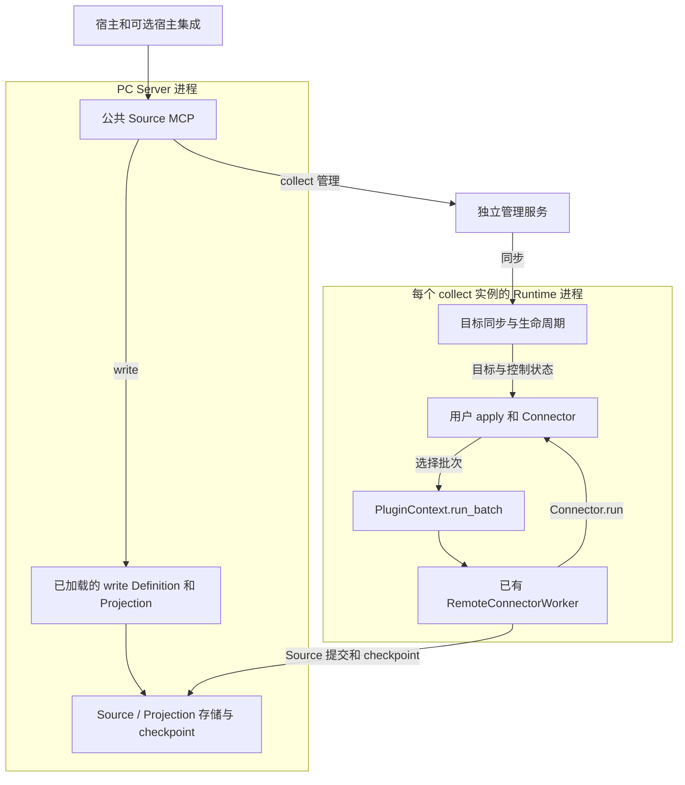
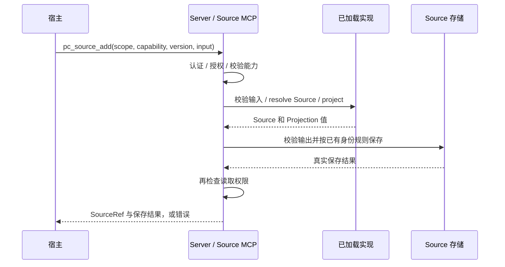
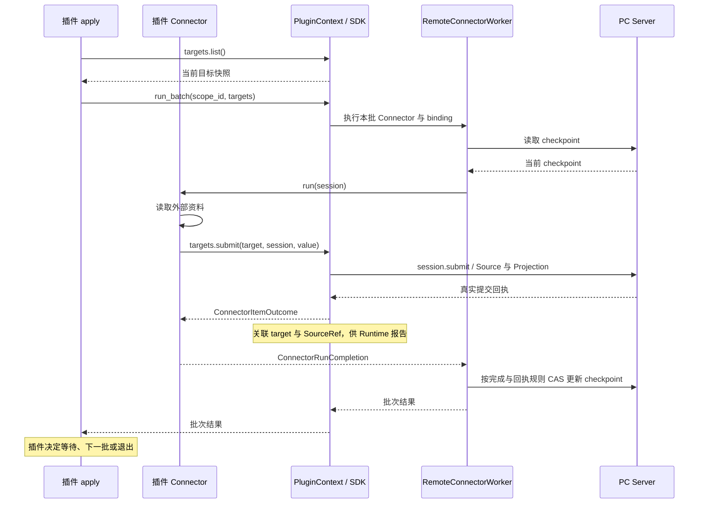
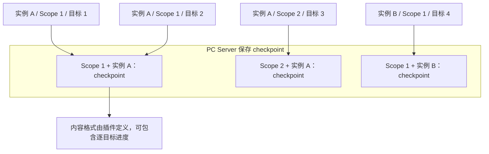
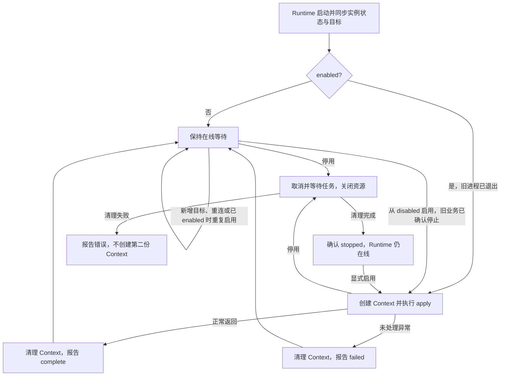

- Proposal Name: `source_plugin_framework`
- Start Date: 2026-10-14
- RFC PR: 尚未分配

# 概要

本提案为 PowerContext 引入 Source 插件框架，支持用户开发或直接使用插件，自定义 Source type、数据模型与 Projection，以及面向不同数据来源的采集逻辑，无需修改 PowerContext 核心代码。框架支持两种数据接入方式：`write` 由 Server 执行插件定义的校验与转换，同步保存调用方已有的完整内容；`collect` 由独立运行的插件持续读取外部资料，并支持在运行中新增和管理采集目标。框架负责插件加载、生命周期管理和数据提交管道，复用已有的 Source 保存规则与权限体系；插件决定采集内容、执行节奏和重试策略。应用和各类宿主通过公共 MCP 统一发现和使用内置与自定义 Source 能力。

本文规定提议的设计行为。接口和部署命令示例不表示对应功能已经在发布版本中可用。

**示例约定：** 本文中的命令、配置和代码用于说明预期使用方式与接口关系，不代表最终发布的语法。实现过程中可以调整拟议接口的命名、模块路径和配置布局；涉及公共接口或使用步骤的调整，应在实现 PR 中说明并同步本文，可执行用法以随实现发布的用户指南和示例为准。职责边界、权限、持久化、同步返回和重复调用语义等属于设计约束；如需改变，应在 PR 中说明理由并接受设计评审。已有公开接口仍遵循其既有契约。

# 动机

用户接入 PowerContext 的数据具有不同的业务含义。不同业务的数据在结构、Source 身份规则和 Projection 需求上存在差异，内置 Source type 难以覆盖所有需求。如果这些定制都依赖修改核心代码，业务扩展就会受 PowerContext 自身的发布和维护节奏限制。用户需要能够独立开发 Source 插件，也能够直接配置和使用他人提供的插件。

定义数据类型还不足以完成数据接入。同一种业务数据可能来自不同系统，各自有不同的认证方式、接口和更新规律。插件作者需要根据来源实现所需的读取、筛选或增量采集逻辑，并根据外部系统的访问限制和业务要求决定执行节奏；同时，应能复用 PowerContext 的提交和进度处理能力，避免每个插件重复实现这些通用逻辑。

用户获取数据的方式也不同：有时应用已经持有完整内容，只需将其保存；有时资料仍在外部系统，需要持续获取后续变化。这两类需求应能共用相同的 Source 数据定义与 Projection。保存已有内容应当可以直接完成，持续采集则需要独立运行，不随发起操作的应用或宿主退出而中断。

采集范围会在使用过程中变化。例如，用户需要把新建文档加入正在运行的采集实例，或让同一实例服务另一个获授权的 Scope。用户应能新增目标、查看已有提交并启停采集，复用已有实例与采集进度，无需为每份资料或每个 Scope 单独部署一套插件。

这些能力需要同时服务业务应用、自动化工作流、coding agent 等不同宿主。用户使用自定义 Source 时，应有与内置能力一致的发现和调用方式；新增插件也不应要求每种宿主分别实现对接逻辑。通过统一的使用入口和共享的采集实例，用户能够复用已有插件，并在不同应用和工作流中持续使用同一套数据接入能力。

# 1. 方案概览

宿主通过 **PC Server 的同一个公共 MCP** 使用内置和自定义 Source 能力，两类操作采用不同执行方式：

- **write**：宿主已有完整内容，PC Server 使用已加载的 SourceDefinition 和 Projection 实现，同步保存并返回结果；不启动插件实例或管理服务。
- **collect**：插件从外部系统持续读取资料，由一个共享的后台管理服务管理目标，每个插件实例在自己的 Runtime 后台进程中执行。默认在 Server 启动时发现指定目录中的实例，自动启动本机独立管理服务和 Runtime；多个宿主共享实例。远端 Runtime 也可接入同一个管理服务，管理服务亦可异机部署。

两条路径复用 SourceDefinition 与 Projection 契约，同一种 Source type 可以同时由宿主写入和插件采集产生。

**框架提供 SourceDefinition（输出类型、身份与 Projection 契约）和 Source 保存管道；collect 插件决定采集什么、何时执行、何时提交以及何时退出。** collect 复用已有 Worker 与 checkpoint 管道，由插件调用批次执行。write 的校验和转换则在当前 Server 调用内执行。

一个管理服务只服务一个 Server。支持多实例、多 Scope、多执行机器；不做管理集群、自动迁移、通用任务调度或进程内 Python 代码热替换。本文规定目标设计；目录发现与自动启动的目标使用步骤见附录 A。

# 2. 架构、连接与存储

## 组件如何组织



图中箭头表示业务调用或数据流向。write 的实现运行在 Server 进程内；collect 的 Context、Worker 和用户 Connector 均在对应 Runtime 进程内。管理服务交付目标与控制状态，不转存 Source 数据，也不调度采集批次。管理消息通过接收方主动发起的轮询响应交付，网络连接方向见下文。

| 组件 | 职责与运行位置 |
| --- | --- |
| 公共 Source MCP | 位于 PC Server 的 `/mcp`；认证宿主、检查 Scope 权限，统一发现、提交、查询和启停接口 |
| PC Server 数据管道 | 加载自定义 write 的 Definition 与 Projection 代码，注册 Definition；保存 Source / Projection 和 checkpoint，提供数据读取。内置和自定义 write 直接使用 Server 内的保存管道 |
| 共享管理服务 | 独立后台进程；保存实例、采集目标和结果，执行 Server 已授权的管理请求，检查 Scope 归属与运行条件，向 Server 同步 collect 能力和实例状态 |
| Runtime | 每个 collect 实例进程的外层框架；实例由稳定的 instance_id 标识，代表一份账号、配置和执行环境，可服务多个获授权的 Scope。Runtime 加载插件、维护管理连接、同步目标与启停状态，管理业务运行的创建和结束 |
| PluginContext（下文简称 Context） | 一次业务运行的上下文对象，作为 ctx 传给 apply；持有 Connector 和业务资源，提供 SDK（插件调用框架的一组接口），包括 run_batch、提交和清理 |
| RemoteConnectorWorker | 已有执行管道；由 `run_batch()` 调用，建立 session、执行 Connector、处理提交回执及 checkpoint CAS |
| apply / Connector | 插件业务代码；apply 决定节奏，Connector.run(session) 读取或转换数据并提交 |
| 宿主专属插件 | 可选适配层，仅负责 Hook、Scope 默认值和上下文注入；不托管 Source 实例、不复制公共 MCP 的管理实现 |

只使用内置能力或自定义 write 时只需 Server。使用 N 个 collect 实例时增加一个管理服务和 N 个实例进程；Server 的启动流程负责准备这些独立服务。系统服务托管后台进程，安装或启动命令完成后退出，关闭 Codex 不会停止已启动的采集。

## 启动加载与运行时新增实例

**write：加载 Server 本地实现。** 部署者先在 Server 机器准备可信插件代码与依赖，并配置代码入口。Server 的通用加载器导入入口，读取其 `definitions` 和 write 能力声明，校验输入、Definition、Projection 与名称版本冲突，完成 SourceDefinition 注册后才公开能力。部署操作要求 `server.admin`；命令行只触发加载，真正导入代码的是 Server 进程。仅通过 API 注册 SourceDefinition 的结构与契约，并不会把 Python 函数传给 Server，不能据此宣称 write 已可执行。

成功加载的入口与必要配置引用由 Server 保存，重启时重新导入和校验。支持显式新增和一致配置的重复加载；配置不一致时报冲突，修改已有实现按第 5 节重启更新，不做进程内 Python 代码替换。接口和示例见第 4 节；此路径不创建 collect 实例、Runtime 或目标。

**collect：加载实例并启动独立 Runtime。** 以下配置与部署流程用于 collect。

部署者通过 Server 的 `source_plugins_dir` 指定可信插件目录。目录中的每个 `powercontext.yml` 声明一个实例：插件实例 ID、代码入口、插件业务配置和外部凭据引用。配置中的 `id` 对应运行时的 `instance_id`，例如 `yuque-personal`；它在同一 PC 部署内唯一，重启后保持不变，不是插件代码名称、Scope ID 或 Source ID。随包代码不会仅因“已安装”而执行；将实例配置放入该目录表示部署者允许加载它。同一份代码可由不同 ID 的配置复用，无需复制代码。

`powercontext.yml` 可选配置初始 `targets`（每项包含 `scope_id`、能力及业务输入）；首次启动时，若该实例尚未初始化目标，部署流程按正常添加规则写入管理服务，并在实例记录中标记已初始化。此后以管理服务中的目标和启停状态为准，文件中的 `targets` 不再用于覆盖、补充目标或判定实例配置冲突；目标为空不重新导入，管理服务连接失败也不视为未初始化。

Server 的部署流程在启动时扫描一次指定目录，也支持运行中显式加载实例；通过本机服务管理器准备独立管理服务和 Runtime，生成并保存所需连接配置。行为如下，具体操作见附录 A。

| 情况 | 行为 |
| --- | --- |
| 没有本地实例，也未启用管理服务 | 只运行 Server；之后显式加载首个本地实例时，按需启动管理服务 |
| 首次加载有效实例配置 | 按需启动一个管理服务，校验代码契约与配置、注册 Definition、登记实例，再启动业务；准备失败的实例显示原因，不阻塞内置功能 |
| Server 运行中新增实例 | 部署者准备好代码、依赖和完整的 `powercontext.yml` 后显式触发加载；只放入目录不会自动启动，已有实例不重启 |
| Server 重启或再次加载同一插件实例 ID | 按配置中的 id 复用已有登记和进程；配置一致时不重置启停意图；已有 Runtime 存活时不重复调用 apply，进程需要重启时按第 5 节启动规则处理；配置不同则报冲突，更新须走第 5 节流程 |
| 删除目录或所有实例停止 | 不把文件删除当作卸载，不删除目标、历史或管理数据库；已经启动的管理服务继续等待，实例停用按显式管理操作执行 |

停止 Server 不隐式卸载独立服务或删除状态；数据提交在 Server 不可用时失败或等待恢复，仍遵守第 5 节的断线与重启规则。远端代码和 Runtime 由执行机器部署，本机加载不承担远程 shell 或代码分发。

## 组件通信与连接方向

| 发起方 | 接收方 | 通信内容 |
| --- | --- | --- |
| 宿主 | PC Server | `/mcp`、现有数据读取等接口 |
| 管理服务 | PC Server | 建立管理通道、注册能力、获取管理请求并回传处理结果 |
| Runtime | 管理服务 | 实例认证、资料身份确认、采集目标同步、启停状态和采集结果报告 |
| Runtime | PC Server | Worker 提交 Source、读取和更新 checkpoint |
| 插件业务 | 外部系统 | 获取资料、验证外部业务权限 |

当前管理通道使用**管理服务主动发起的 HTTP 轮询和回报**：管理服务从 Server 领取待处理消息，再向 Server 回传结果；具体路径见附录 C。因此，业务上是 Server 把请求交给管理服务，网络上却始终是管理服务访问 Server。Server 无需连接管理服务的监听地址；管理服务仍须能被 Runtime 访问。

连接建立后，管理服务把自己管理的完整 collect 能力清单发送给 Server，包括能力名称、版本、输入要求、对应实例、实例状态与发现所需的公开范围配置。这份清单称为能力目录；发生变化时管理服务主动同步。Server 将该目录与本地内置、已加载的 write 能力合并，结合当前调用者的 PC 权限直接回答能力和业务实例发现，不为每次发现再询问管理服务。collect 的添加、目标查询、控制视图和启停仍经管理通道处理；目录不代替实际操作的权限与执行条件检查。write 由 Server 本地处理。

## 持久化数据与存储归属

| 保存方 | 存储与内容 |
| --- | --- |
| 管理服务 | 自己维护 `<state_dir>/management.sqlite3`，无需独立数据库服务；保存实例、能力、collect 目标、启停状态与采集结果；用户授权统一保存在 PC Server |
| Runtime 所在机器 | 仅保留插件代码、启动配置、凭据引用等启动所需文件；目标列表、当前批次和提交回执保存在进程内存中 |
| PC Server | 已有数据存储保存最终 Source、Projection 与 checkpoint；另外保存成功加载的 write 代码入口和必要配置引用，供重启恢复。代码与依赖留在 Server 文件系统，导入后的实现对象留在内存；write 的重复提交沿用已有 Source 存储规则 |

管理服务的 SQLite 按以下两张表组织：

| 表 | 保存内容 |
| --- | --- |
| `records` | 部署绑定、实例、能力声明、collect（采集）目标及已收到的提交记录（Source 引用、提交时间）；Scope 归属、创建者记录与控制状态保存在对应记录中 |
| `follow_identity` | collect 的稳定资料身份与 target_id 的对应关系，用于重复添加时复用同一目标 |

write 的输入和应答仅在当前同步调用中使用，最终 Source 与 Projection 由 Server 持久保存。

**管理服务保存“需要采什么”，PC Server 保存“已经采到什么”，Runtime 负责当前执行。** collect 的运行目标由管理服务持久保存，Runtime 启动和重连时同步；文件中的初始 targets 不作为运行状态副本。实例和目标的期望启停状态以管理服务为准，Source 与 checkpoint 以 PC Server 为准；最近收到的执行状态和采集结果由管理服务保存，供宿主查询。

Runtime 进程退出时内存工作丢失；重启后若实例仍启用，就重新执行 apply，通过 Server 的 checkpoint 决定后续采集位置。插件可按业务需要自行持久保存数据。

Source 提交和向管理服务报告结果是两个独立动作。Source 已保存但结果报告丢失时，数据仍在 Server，管理服务可能缺少对应的提交记录；框架不保证重启后补齐。管理服务和 Server 的数据库须持久保存，Runtime 只需保留启动文件。系统服务管理器负责进程启停，不保存采集业务状态。

# 3. 公共 MCP：宿主如何统一使用

宿主只连接 PC Server 的 `/mcp`。公共 MCP 负责能力发现、Source 写入、采集目标管理和实例启停；宿主专属插件只提供连接、身份与 Scope 上下文，不直接连接管理服务或 Runtime。

本节描述公共 MCP 的**拟议接口**，按每个方法说明必要输入、从调用到返回的流程，以及结果和错误的含义。以下 JSON 是拟议请求与返回格式的示例，其中请求使用 MCP `tools/call` 参数结构；Scope、实例和目标 ID 均须替换为实际值。方法名和字段名可在实现评审中调整并同步本文，权限检查和行为语义仍按正文规定。

## 调用前需要理解的对象

| 对象 | 含义 |
| --- | --- |
| capability | 可调用的业务能力，包含名称、版本、说明、input_schema（业务参数结构）和 kind。它不是 Source type；collect 能力可以生成多个 Source type，write 能力关联其输入对应的 Definition |
| kind | 能力声明的操作类型：write 接收宿主已有内容，同步保存并返回；collect 接收外部资料位置或选择条件，建立持续采集关系。操作类型由能力声明确定 |
| instance_id | 执行 collect 能力的插件实例 ID，例如 yuque-personal；代表账号、配置和执行环境，可服务多个获授权 Scope。write 不使用 instance_id |
| target_id | collect 目标的持久 ID，标识持续采集关系，用于查询、停止和恢复；不是 Source ID |
| SourceRef | 已保存 Source 的引用，包含 source_type 和 source_id；结合本次 scope_id，通过 Server 已有数据接口读取内容 |
| enabled | 目标或实例的期望启停状态；不等于执行端已完成启停 |
| capability_version | 能力输入与行为契约的版本，宿主使用发现返回的版本；与输出 SourceDefinition 的版本分开 |

参数错误、权限不足或处理失败均通过原 MCP 调用返回错误；不执行尚未通过检查的后续步骤。

所有调用由 Server 认证宿主身份，并按操作检查 PC 权限；scope\_id 指定数据归属。collect 由管理服务核对目标所属 Scope、实例可服务范围与执行条件。外部系统的账号、凭据及业务权限由插件在实际访问时处理。

能力和业务实例发现直接由 Server 回答；需要管理服务处理的调用使用以下交接方式。

**管理请求的交接方式统一：** Server 将消息交给管理服务主动发起的 `channel/poll` 响应；管理服务处理后调用 Server 的 `channel/reply` 回传，Server 再结束对应的 MCP 调用。框架用临时 message\_id 匹配问答，宿主无需填写或保存。下文“Server → 管理服务”表示业务消息流向，不表示 Server 反向建立网络连接。Runtime 同样主动连接管理服务；通信细节见附录 C。

| 方法 | 宿主使用时机 |
| --- | --- |
| `pc_source_capabilities` | 了解能做什么、参数如何填写、哪些实例可以执行 |
| `pc_source_add` | 写入已有内容，或添加持续采集目标 |
| `pc_source_status` | 查询 collect 目标的采集结果或控制状态 |
| `pc_source_target_set_enabled` | 停止或恢复一个 collect 目标 |
| `pc_source_instances` | 查看可用实例，或读取实例控制状态 |
| `pc_source_instance_set_enabled` | 启用或停用整个实例的业务运行 |

## pc_source_capabilities：发现能力与输入要求

宿主不知道应选哪个能力、如何填写 input，或想确认可用实例时调用。发现只读管理信息，不加载新代码、不启动 apply，也不访问外部资料。

**调用参数：** scope\_id、operation；本节的业务发现使用 `operation="add"`。可用 capability、instance\_id 缩小查询范围。

```json
{
  "name": "pc_source_capabilities",
  "arguments": {"scope_id": "scp_demo", "operation": "add"}
}
```

**从调用到返回：**

1. 宿主向 Server 发出调用。Server 检查当前 Scope 的读取权限，并取得调用者是否具有写入权限的判断；没有写入权限时，发现结果不能宣称可写。
2. Server 读取内置能力、已加载的自定义 write 能力，以及管理服务主动同步的 collect 目录；根据公开范围、实例可服务 Scope 和当前调用者 PC 权限筛选结果。本次发现不再向管理服务发送查询。
3. write 根据 Server 本地实现是否加载就绪标注能否执行；collect 根据目录中的实例状态及管理连接可用性标注。可见但离线或停用的实例仍可显示，并明确不可用。
4. Server 将上述结果直接经原 MCP 调用返回宿主，不经过 channel/reply。返回只包含允许公开的信息，不暴露实例 Config 或外部凭据。

**宿主获得什么：** 每个能力的名称、版本、kind、说明和 input\_schema，以及 PC 权限和可用性；collect 另包含可见实例、默认实例建议与运行状态。权限和运行状态分开表达：有写入权限不等于 Runtime 在线，在线也不等于 apply 正在处理工作，更不保证外部资料可访问。

宿主据此选择能力，再调用 `pc_source_add`。collect 还须明确传 instance\_id；默认实例仅为发现建议，不在重试时重新选择账号。write 不选择实例。能力版本也固定为本次选定版本。capability\_version 用于防止插件升级后以不兼容的输入规则解释原调用和持久 collect 目标；同一版本须保持输入、操作含义和资料身份规则兼容。

未配置管理服务时仍返回内置和已加载的自定义 write 能力。管理服务断线时明确说明 collect 部分暂不能接收新管理请求，不能将整次发现变成失败，也不能把缓存中的旧状态报为可执行。这里的不可用不表示 Runtime 已停止已有采集；发现结果只是调用时的状态，add 仍会重新检查。

## pc_source_add：写入内容或添加采集目标

**调用参数：** scope\_id、capability、capability\_version、input；collect 还须 instance\_id，write 不需要。input 按发现所得 input\_schema 填写，操作类型由 capability 的 kind 决定。

Server 对 add 检查当前 `scope.contribute` 和 `scope.read`。write 要求能力版本、对应 Definition 与 Projection 实现已在 Server 加载并通过校验。新建 collect 工作还要求能力与版本已登记、SourceDefinition 部署校验完成、Runtime 管理连接有效、实例 enabled=true 且最近确认 actual=running。只有外层 Runtime 在线、apply 已结束的实例不能接下新采集工作。

### write：原调用等待 Source 保存结果

例如宿主已有一段正文，使用内置 `content.inline / 2` 保存：

```json
{
  "name": "pc_source_add",
  "arguments": {
    "scope_id": "scp_demo",
    "capability": "content.inline",
    "capability_version": "2",
    "input": {"source_id": "meeting-note-001", "text": "需要保存的正文"}
  }
}
```

source\_id 是这份数据的稳定身份，重复提交时保持不变。自定义 write 使用同一工具，选择其公开能力和业务输入，不传 instance\_id。



**从调用到返回：**

1. 宿主提交已有完整内容。Server 认证并检查 Scope 权限、能力版本和输入要求，找到该能力关联的、已加载的 Definition 实现。
2. Server 使用 Definition 的输入模型校验 input，调用 `resolve()` 形成带稳定身份的 Source，再调用对应 Projection 的 `project()` 形成投影数据。自定义函数来自已加载的插件模块，无需修改 Server 代码添加某个类型的 import。
3. Server 校验输出契约，沿已有 Source 写入规则保存 Source 和 Projection；同身份同数据复用，同身份不同数据报冲突。
4. Server 取得真实保存结果，检查调用者当前读取权限，经原 MCP 调用返回 SourceRef；输入、转换或保存失败则返回错误。原调用等待实际结果，不先返回“已受理”，宿主无需主动查询。

内置与自定义 write 都在 Server 内完成上述流程；自定义类型需要预先加载实现。write 接收完整内容，不承担远程资料的持续获取。

**成功返回示例：**

```json
{
  "kind": "write",
  "result": {
    "outcome": "saved",
    "source_refs": [{"source_type": "content", "source_id": "meeting-note-001"}]
  }
}
```

SourceRef 以实际保存回执为准。saved 表示所需写入已完成；unchanged 表示底层确认已有相同 Source。宿主使用 SourceRef 和现有 Server 数据接口读取正文。

**重复调用与异常：** write 复用底层 `(scope_id, source_type, source_id)` 规则：同身份、同数据复用；同身份、不同数据报冲突；不同 ID 保存为不同 Source。稳定身份由底层提交方负责，内置适配层提供，自定义插件按 Definition 生成；需要宿主提供资料 ID 时在 input\_schema 中说明。重复调用可以再次执行校验或转换，不承诺外部副作用只发生一次。

调用超时、连接中断或 Server 退出时，结果可能未确认，不能据此判断 Source 没有保存。Server 检测到调用失效后清理当前处理；已经开始的保存可能成功，重连不自动重放。宿主需要重试时保持相同身份和实际提交数据，不能重新生成随机 ID 或变化的元数据。已保存的数据不因应答丢失而回滚。

### collect：先返回采集关系，插件随后持续处理

例如把新建的语雀文档 B 加入已经运行的 yuque-personal 实例：

```json
{
  "name": "pc_source_add",
  "arguments": {
    "scope_id": "scp_demo",
    "capability": "yuque.document",
    "capability_version": "1",
    "instance_id": "yuque-personal",
    "input": {"url": "https://www.yuque.com/team/book/doc-b"}
  }
}
```

**从调用到返回：**

1. Server 检查宿主身份、Scope 权限和输入，将调用及可信调用者身份经管理通道交给管理服务。
2. 管理服务通过 Runtime 调用插件的 `identify_target(request, config)`，取得 target\_key（稳定资料标识）和 normalized\_input（包含采集选项的规范化输入）。该入口独立于 apply，根据输入与实例配置确认资料身份。
3. 管理服务按“Scope + 实例 + 能力及版本 + target\_key”查找目标。同身份同配置复用，同身份不同配置返回 target-config-conflict。新目标须通过实例可服务 Scope 与就绪检查，再将目标和身份索引一并持久保存；唯一约束处理并发重复。创建者仅作记录，不参与目标身份或管理授权判断。
4. 管理服务通过 reply 返回目标。Server 在当前读取权限允许时，经原 MCP 调用把 target\_id、跟踪状态和已有采集结果返回宿主。到这里确认的是采集关系已建立，不是外部资料已保存。

**首次创建的返回示例：**

```json
{
  "kind": "collect",
  "target_id": "tgt_b",
  "enabled": true,
  "tracking": "enabled",
  "source_refs": [],
  "last_submitted_at": null
}
```

**返回之后如何采集：** Runtime 从管理服务同步目标，现有 apply 在后续 `ctx.targets.list()` 中取得 B，自行决定分批和节奏。Worker 执行 Connector，插件使用自己的凭据读取语雀并提交；数据直接存到 Server。SDK 根据实际成功提交回执关联目标与 Source，由 Runtime 向管理服务报告 Source 引用和提交时间，管理服务收到后持久保存。这些记录表示已收到的提交。Worker 仍按已有规则处理批次与 checkpoint。宿主需要了解进展时调用 `pc_source_status`；查询既不触发采集，也不是维持跟踪的必要动作。

新增 B 不重启实例，也不重建文档 A 的业务客户端。对已有目标的重复 add 不重置进度、不额外采集、不恢复 stopping/stopped 目标；调用始终需要当前 PC 权限。重复身份确认需要 Runtime 可达，但复用已有目标不要求 apply 正在运行；无法确认身份时明确报错，不猜测新建。已有 target\_id 的查询或停止仍可由管理服务处理。

受理响应丢失时，宿主可用原 Scope、实例、能力版本和业务 input 再次调用，取得原目标。同一 Scope 内，不同用户添加相同实例、能力版本及资料身份且配置一致时复用同一目标；不同 Scope、实例或能力版本不合并。停止目标仍占原身份，本版不提供目标硬删除或自动合并历史重复记录。

## pc_source_status：查询采集结果或控制状态

此方法查询管理服务已保存的 collect 目标和提交记录。

**调用参数：** scope\_id、target\_id；默认读取采集状态，`view="control"` 只读取启停字段，供后续控制操作使用。

```json
{
  "name": "pc_source_status",
  "arguments": {"scope_id": "scp_demo", "target_id": "tgt_b"}
}
```

**从调用到返回：**

1. Server 认证宿主。默认视图检查当前 scope.read；control 视图检查 scope.contribute。
2. Server 完成相应 Scope 权限检查后，经管理通道转交目标查询。管理服务核对目标实际所属 Scope 与请求 Scope 一致；不一致时拒绝，不返回其他 Scope 的目标信息。
3. 管理服务读取自己的目标记录和已经收到的采集结果，不调用 identify\_target、不要求 Runtime 在线、不等待新的 Worker 批次。
4. 管理服务经 reply 返回，Server 将允许读取的结果交给原 MCP 调用。采集结果返回仍须当前读取权限；control 响应只包含有权查看的控制字段。

**宿主获得什么：**

| 视图 | 返回内容与含义 |
| --- | --- |
| 默认 | target_id、enabled、tracking、source_refs、last_submitted_at，以及最近确认时间和实例可用性。source_refs 是管理服务已收到的实际提交关联，last_submitted_at 是这些记录中的最近提交时间；没有记录时分别为空列表和 null |
| control | target_id、enabled、tracking；不包含 input、SourceRef 或业务错误正文。具有 scope.contribute 的调用者可读取控制状态，不额外要求 scope.read |

tracking 表示采集关系的 enabled / stopping / stopped。source\_refs 和 last\_submitted\_at 仅反映已经确认并报告的提交事实，不表示目标已全部采完；没有新提交时，不区分尚未处理、暂无资料或内容未变化。提交报告可能丢失，因此此视图不是 Server 全部数据的清单。实例失联时保留已有提交记录，但可用性显示 offline / unknown，不能用历史提交表示此刻仍在采集。

该调用可以重复执行且无业务副作用。管理服务不可达时返回不可用，不由 Server 缓存伪造最新状态；这不影响有权限的宿主直接读取 Server 已保存的 Source。

## pc_source_target_set_enabled：停止或恢复一个目标

**调用参数：** scope\_id、target\_id、enabled。宿主直接表达停止或恢复意图。

```json
{
  "name": "pc_source_target_set_enabled",
  "arguments": {
    "scope_id": "scp_demo",
    "target_id": "tgt_b",
    "enabled": false
  }
}
```

**从调用到返回：**

1. Server 检查目标 Scope 的 scope.contribute，经管理通道转交调用。
2. 管理服务核对目标所属 Scope，恢复时检查实例可服务范围，再保存 enabled，保留目标身份、已有 Source 与 checkpoint；重复设置当前状态不产生新动作。
3. 管理服务返回控制状态，Server 经原 MCP 调用返回宿主。Runtime 同步后按目标启停状态处理采集。

返回表示启停意图已保存，不代表执行端已完成操作。恢复目标不会自动启用已停用的实例，也不会重新调用已经结束的 apply。

## pc_source_instances：发现实例或读取实例控制状态

本方法管理 collect 实例；Server 内的 write 能力没有对应实例。

capabilities 以“能做什么”为入口；instances 以“哪些实例可用、某实例当前怎样运行”为入口。此方法不加载代码或启动实例。

**调用参数有两种组合：**

| 视图 | 参数 | 用途 |
| --- | --- | --- |
| 业务视图 | scope_id、operation="add" | 查找能服务当前 Scope 的可见实例、PC 权限与运行状态 |
| 控制视图 | instance_id、view="control" | 读取有权管理的某个实例的控制状态；不要求指定 Scope |

```json
{
  "name": "pc_source_instances",
  "arguments": {"scope_id": "scp_demo", "operation": "add"}
}
```

```json
{
  "name": "pc_source_instances",
  "arguments": {"instance_id": "yuque-personal", "view": "control"}
}
```

**从调用到返回：**

1. Server 认证宿主。业务视图检查 scope.read，并取得当前 Scope 写权限判断；控制视图检查 server.admin。
2. 业务视图由 Server 根据已同步目录中的公开范围、可服务 Scope 和实例状态直接返回，不再询问管理服务；目录与连接可用性的处理同 capabilities。
3. Server 通过 server.admin 检查后，将控制视图查询经管理通道交给管理服务，不额外要求 Scope 权限。管理服务读取指定实例的持久控制状态与最近执行报告，经 reply 返回 Server，再交给宿主。两种视图都不重新调用 apply 或访问外部账号。

**宿主获得什么：** 业务视图返回实例 ID、可用能力、PC 权限及运行状态；控制视图返回 instance\_id、enabled、actual、可用性和最近更新时间，不包含业务 Config、目标输入或 Source 结果。

期望 enabled=true 不保证 actual=running；apply 正常结束可以是 actual=complete，未处理异常可以是 failed。Runtime 外层仍可能在线。控制视图用于了解期望状态与实际运行状态的区别，不能因“已启用”就宣称正在采集。

调用只读，可重复执行。业务视图按 Server 已同步的公开信息回答，管理连接失效时明确标注自定义部分不可用，不用旧目录保证当前权限或可执行性；无法确认可见范围时不暴露记录。控制视图依赖管理服务可达；仅 Runtime 失联时仍可读取持久控制状态，但运行可用性须标明未知或离线。内置与自定义 write 能力都不需要插件实例。

## pc_source_instance_set_enabled：启停整个实例的业务运行

此方法控制 Runtime 内的 apply / Context，影响该实例服务的所有 Scope 和目标；它不是安装、卸载或启动远端系统进程的命令。

**调用参数：** instance\_id、enabled。宿主直接表达启用或停用意图。

```json
{
  "name": "pc_source_instance_set_enabled",
  "arguments": {
    "instance_id": "yuque-personal",
    "enabled": false
  }
}
```

**从调用到返回：**

1. Server 认证宿主并检查 server.admin，再将实例控制调用交给管理服务；实例可能服务多个 Scope，单个 Scope 的权限不能用于启停整个实例。
2. 管理服务检查实例存在及切换条件，在事务内按实际处理顺序设置期望状态。同状态返回当前结果；停用保存 enabled=false，并在仍需执行端确认时标为 stopping；启用要求旧业务运行已经确认 stopped，再保存 enabled=true、生成新的 run\_id（一次业务运行的身份）并等待 Runtime 执行。
3. 管理服务通过 reply 将持久控制状态交回 Server，再返回宿主。响应包含 instance\_id、enabled、actual 等控制字段，不表示系统进程已经安装或业务已经启动成功。
4. Runtime 同步后执行期望状态。停用阻止新批次，取消并等待 apply 及所属子任务，关闭 Context 和业务资源；全部完成后报告 stopped，外层 Runtime 继续在线。启用创建新的 Context 并调用 apply，报告实际运行状态。宿主需要确认时调用 instances 的 control 视图；查询不驱动启停。

仅 Runtime 失联时可以保存停用意图，但不能报告已停止；清理失败或旧任务未退出时不启动第二份 Context。管理服务失联时不能确认控制变更。重新启用后只处理仍 enabled 的目标，不恢复已经单独停止的目标，不重置目标 checkpoint。

同一 Runtime 进程内，已 enabled 时重复启用不会再调用 apply，即使本次 apply 已 complete 或 failed。需要重新运行时明确停用，确认 stopped，再显式启用。关闭或卸载整个 Runtime 后，管理服务不能远程替它启动系统进程；部署操作见第 2、5 节。

## 操作重试

collect 重复 add 复用目标，write 重复提交复用底层 Source 规则，启停直接设置期望状态；相同状态不产生新动作，不同意图按实际处理顺序生效。通信超时不表示已保存的数据或控制变更被撤销，宿主可按各方法的规则重试或读取当前状态。

# 4. 插件接口与数据管道

本节面向插件作者。write 提供 Server 可以加载的输入模型、Definition 与 Projection 实现；collect 在这些数据契约之外提供 apply 和 Connector，自行决定采集节奏，通过 Worker 提交。宿主调用方式见第 3 节，加载、进程启停和重启行为见第 5 节。

## 插件需要提供的契约

插件代码可以从本地目录加载，无需发布 wheel。write 的代码与依赖部署在 Server 机器；collect 的代码与依赖部署在 Runtime 机器。两者可以复用同一个代码包中的 Definition 和 Projection，无需强制拆成两个包。

**共同的数据契约。** SourceDefinition 声明输入模型、Source 模型、名称和版本；`resolve(value)` 将输入转换成具有稳定身份的 Source，`projections` 中各实现的 `project(source)` 生成相应 Projection。`definitions` 导出这些实现对象。能力声明包含 name、version、description、kind 和 input\_schema，描述宿主能调用什么；Definition 描述结果如何保存。collect 的一个能力可以提交多种 Source，多个能力也可以复用同一 Source type。

**write 的加载契约。** 每项 write 能力明确关联一个 Definition 的名称与版本，input\_schema 对应它的输入模型；Server 可以据此直接校验 input 并调用该 Definition。插件导出 `definitions` 和 `capabilities` 供 Server 加载。能力名称不得覆盖内置能力，同名同版本须保持输入和操作含义兼容。

下面通过**接口示意**展示“Server 如何得到 Projection 函数”。示例说明插件导出对象与 Server 加载的关系，具体类名、模块路径和辅助代码可随实现调整；write 能力关联字段和部署入口尚待实现。假设部署者准备一个可导入的本地包：

```text
/srv/powercontext/custom_sources/tickets/
  __init__.py
  ticket_definition.py
```

`ticket_definition.py` 实现 TicketCapture、TicketDefinition 和 TicketProjection。其中关键关系如下（省略已有 Source 模型和 resolve 实现）：

```python
class TicketProjection:
    # 同时声明 Projection 名称、版本、输入 Source 类与输出模型。
    def project(self, source):
        return TextEvidence(
            source_type="example-ticket",
            source_id=source.name,
            content=f"{source.capture.title}\n\n{source.capture.body}",
        )


class TicketDefinition:
    name = "example-ticket"
    version = "1"
    input_class = TicketCapture
    projections = (TicketProjection(),)
    # resolve() 生成稳定身份的 TicketSource；其余成员遵循 SourceDefinition。
```

插件自己的 `__init__.py` 导出对象，类型专属 import 写在插件中：

```python
from .ticket_definition import TicketCapture, TicketDefinition

definitions = (TicketDefinition(),)
capabilities = ({
    "name": "ticket.write",
    "version": "1",
    "kind": "write",
    "description": "保存宿主提供的工单内容",
    "input_schema": TicketCapture.model_json_schema(),
    "definition_name": "example-ticket",
    "definition_version": "1",
},)
```

Server 配置入口指向这个包，由通用加载器导入。以下只展示导入对象关系，不是完整加载器实现：

```python
module = importlib.import_module(entry)  # 例如 tickets；来自受信任部署配置。
registry = SourceDefinitionRegistry(module.definitions)
# 运行时 registry.resolve / registry.project 调用这些实际 Python 对象。
```

因此，Server 能执行 TicketProjection.project，是因为**它已导入包含该对象的本地模块**。新增类型只增加模块与入口配置，不在 Server 中硬编码类型专属 import。部署者须将代码加入 Server 的模块搜索路径，并准备相同环境中的依赖；文件路径入口也由通用加载器解析。实现只校验和转换当前输入，不在导入时启动采集任务。

**注册 SourceDefinition 与加载代码是两个动作。** 现有注册 API 保存类型结构、身份和 Projection 契约，不传输 Python 实现。Server 的 write 加载流程校验代码、契约与冲突，并在注册成功后才发布能力；仅有注册记录不能执行 write。collect 仍在部署或升级阶段使用 `server.admin` 注册 Definition，日常 Worker 只使用 Scope 执行权限，不每批注册或临时取得管理员凭据；Definition 缺失或不匹配时明确报错。

**collect 额外提供的运行契约：**

| 导出项或对象 | 插件需要定义的内容 |
| --- | --- |
| `plugin_api_version` | 与 Runtime 对接的插件接口版本，当前为字符串 `"2"` |
| `Config` | Pydantic 配置模型，用于定义和校验插件自身逻辑所需配置，例如访问外部系统的凭据或凭据引用 |
| `capabilities / definitions` | 非空的 collect 能力声明与 SourceDefinition 集合；能力输入描述外部资料位置或选择条件 |
| `connector_name / connector_version` | Connector 的稳定名称与兼容版本，用于核对 checkpoint 归属，不能随重启随机变化 |
| `identify_target(request, config)` | 用输入确定稳定资料身份和规范化采集参数 |
| `apply(ctx, config)` | 异步业务入口；建立客户端、connect Connector，自行决定分批、等待、重试和退出 |
| `Connector.run(session)` | 处理并提交本批数据，返回 ConnectorRunCompletion（本批是否完成及下一 checkpoint） |

collect 的 Config 留在实例侧，外部凭据与业务权限由插件自行处理。能力描述和 input\_schema 只公开宿主调用所需信息；目录、结果和普通日志不暴露秘密。同版本 collect 能力还须保持资料身份规则兼容。

**collect 如何识别同一份资料：** Runtime 在受理目标时调用 identify\_target，独立于 apply 的采集循环。request 包含 capability、capability\_version 和 input；插件返回：

| 返回项 | 含义 |
| --- | --- |
| target_key | 稳定资料标识，管理服务据此复用同一目标 |
| normalized_input | 规范化后的完整采集参数，保留全部影响采集的选项，用于检查同一目标是否发生配置冲突 |

例如，插件可以去掉文档 URL 中仅用于页面定位的锚点，将两个地址识别为同一目标。identify\_target 根据输入和实例配置确认资料身份，文档内容与可读性在实际采集时处理。input\_schema 应要求足够的资料标识，无法确认相同时，不提前承诺合并。

## collect：从 apply 到 Source 保存

`ctx` 是 Runtime 传给 apply 的 PluginContext，持有 Connector 和业务资源，并提供下表中的 SDK 接口。一个 Context 只 connect 一个 Connector。`session` 由 Worker 为每批创建，提供本批 Scope、当前 checkpoint 和提交能力。

一次 apply 可以执行多个批次；**一次 `run_batch()` 就是一批，固定一个 Scope 和一组待处理内容。** 同一 collect 目标可以在多个批次中持续产生 Source，SDK 关联目标与实际提交，宿主不生成批次 ID。

下图展示一次批次调用的顺序。左侧 apply 和 Connector 都是插件代码，中间是 SDK 与已有 RemoteConnectorWorker，右侧是 PC Server；箭头表示调用或返回，不表示独立进程数量。图中展示 collect 的成功提交路径，submit 可以重复调用。binding 表示本实例在某个 Scope 的执行归属，隔离规则见本节末尾。



apply 先取得待处理内容，选择同一 Scope 的条目，再调用 run\_batch。Worker 读取 checkpoint，调用 Connector.run；Connector 按业务需要读取外部系统并转换数据，再通过 SDK 提交。等待和下一批由插件决定。

| 步骤 | collect 接口 |
| --- | --- |
| 获取当前可处理内容 | `ctx.targets.list()` |
| 执行所选批次 | `ctx.run_batch(scope_id=..., targets=selected)` |
| 提交一项数据 | `ctx.targets.submit(...)` |

list 返回的是本次处理使用的目标快照，字段含义如下：

| 字段 | 含义 |
| --- | --- |
| target_id | 对应管理服务持久保存的目标 |
| scope_id、instance_id、capability、capability_version | 归属与能力契约 |
| input | identify_target 确认后的规范化采集参数 |
| source_refs | 管理服务已收到的真实提交关联，供插件按需参考；不代表目标已采完 |

collect 首次同步成功后，ctx.targets.list / run\_batch 可在管理服务断线期间继续使用内存中最后同步的目标与启停状态；没有初始快照时明确报不可用，不用空列表冒充没有工作。新增目标在同步后的快照中出现。

同一 Context 的批次顺序执行，不重叠；一批选择同一 Scope 的 targets，不并发改写本批快照。管理模式必须显式传入所选集合；自主采集使用显式空集合，遗漏参数不表示执行所有目标。独立运行入口保留 `run_batch(scope_id=...)`。

submit 接收当前条目、session、本批唯一的 item\_id、Definition 名称和业务 value。SDK 校验实例、Scope 与批次归属，包装 `session.submit(...)`，并把实际提交回执关联到该条目。返回的 ConnectorItemOutcome 表示这一项提交的处理结果，插件必须检查是否被接受。处理后的数据直接进入 PC Server，不经管理服务转存。

collect 的实际提交关联报告给管理服务保存。完整 apply 与 Connector 代码见附录 B。

## collect 的提交回执与批次完成

插件自行维护循环、分页和重试，通过 `ctx.targets.submit(...)` 提交数据。提交回执表示数据保存结果，ConnectorRunCompletion 表示本批完成情况；持续采集目标可以跨多个批次产生 Source。

| 动作 | 含义 |
| --- | --- |
| submit 收到成功回执 | 一项数据已由 Server 接受；SDK 将真实 SourceRef 关联到对应 collect 目标 |
| Connector 返回 ConnectorRunCompletion | 声明本批是否完成及下一 checkpoint；Worker 按已有规则核对并处理进度 |
| collect 提交记录报告管理服务 | 保存已确认的 Source 引用与提交时间，供宿主按需查看；不等待该目标“全部采完”，也不要求同批其他目标完成 |

没有新提交时，框架不推断目标是尚未处理、没有变化还是暂无资料。失败后是否重试、何时继续仍由插件决定；未处理异常按第 5 节结束当前 apply。Source 保存、checkpoint 更新和向管理服务报告提交记录是独立动作：批次未完成或报告丢失不撤销已保存 Source，报告也不保证重启后补齐。

## checkpoint 的隔离、推进与新增目标

ConnectorBinding 表示“哪个实例的 Connector 在哪个 Scope 执行”。本方案用 instance\_id 作为 binding\_id，PC Server 按 `(scope_id, binding_id)` 保存 checkpoint，并核对 connector\_name / connector\_version。这里的 ConnectorBinding 不同于权限系统中授予角色的 Scope Binding。



图中的每个 checkpoint 由 Server 保存，内容格式由插件定义。同实例、同 Scope 的多个目标或能力共用一份 checkpoint，框架不会为每个 target 自动创建独立游标；插件可以在其中记录各目标的进度。不同实例或不同 Scope 的 checkpoint 互不共享。

Worker 在批次开始时读取 checkpoint，Connector 根据实际业务进度返回下一值；需要更新时，Worker 使用 CAS（仅当 Server 中仍是本次读取的旧值才写入新值），避免覆盖并发进度。插件不能在尚有未处理资料时推进游标而跳过它们。

例如文档 A 已采集至时间 T，后来加入一篇早于 T 的文档 B。插件不能直接用 A 的时间游标跳过 B，应识别新增目标，为 B 初始化进度并补采；具体记录方式由插件定义。停止或恢复目标不自动清空 checkpoint，Connector 升级也不能靠换版本号绕过已有进度的兼容性检查。

Runtime 进程重启后重新同步 targets，由 Worker 读取 Server 当前 checkpoint，插件决定继续或重新采集；框架不恢复上次批次的具体执行步骤。

# 5. 生命周期、重启与权限

本节的 Runtime、实例与目标生命周期用于 collect，采集节奏仍由 apply 决定。write 实现随 Server 加载和释放，没有独立实例启停：新增实现可显式加载，一致配置重复加载复用已有登记；已有代码替换通过受控重启 Server 生效。启动时重新校验已保存入口，加载失败的能力不标为可执行，其他有效能力照常使用。

## Runtime 在线与 apply 运行

后台管理模式下，每个实例有一个 Runtime 进程。Runtime 维护管理连接、同步目标和启停状态；其中的 **Context 是一次 apply 运行所持有的 Connector、客户端和业务任务的集合**。业务等待或 sleep 不阻塞 Runtime 接收管理操作。

实例需要区分三件事：

| 信息 | 含义 |
| --- | --- |
| enabled | 管理服务保存的期望启停状态；为 true 不代表 apply 此刻一定在运行 |
| actual | Runtime 最近报告的业务状态，例如正在运行、正常结束（complete）、异常结束（failed）、正在停止（stopping）或已停止（stopped） |
| 连接可用性 | Runtime 是否仍可通信；失联显示 offline / unknown，不能用旧的 actual 宣称业务仍在执行 |

**apply 结束后，后台 Runtime 仍保持在线。** 它可以接收控制操作，但不会因新增目标、通信重连或重复启用而自动再次调用 apply。持续处理新增目标的插件，需要在 apply 内保持自己的采集循环。



卸载系统服务会使 Runtime 进程退出；再次启动需要在执行机器执行部署操作。

若要在同一进程中重新执行已经结束的 apply，显式停用、确认 stopped，再启用。直接运行的 `pc-source run` 则在 apply 结束后退出；它与后台模式不能同时占用同一实例身份。

管理服务保存期望状态、最近实际状态及更新时间。框架用内部运行标识（run\_id）区分每次 apply 的报告，只接收当前连接和当前运行的消息，避免迟到报告覆盖新状态。宿主无需提供该标识，Runtime 也不用它跨进程恢复业务。

## 实例停用与资源清理

停用实例时，管理服务保存 enabled=false；Runtime 阻止新批次，取消并等待 apply 及其子任务，关闭 Context。清理完成后报告 stopped，外层 Runtime 保持在线，等待再次启用。

业务子任务必须归属于 apply，例如使用 TaskGroup；资源通过 `ctx.enter_async_context` / `ctx.on_dispose` 登记，随 Context 关闭。插件不能留下脱离生命周期的后台任务，也不能吞掉取消异常。任务未结束或资源清理失败时，不报告 stopped，不创建第二份 Context。

实例停用不影响 Server 已加载的 write 能力，也不撤销已经保存的 Source。Runtime 失联时不能宣称业务已经停止；管理服务不可达时不能确认新的启停意图已保存。

## 断线、重启与数据恢复

**连接重连保留当前进程内存，进程重启则创建新的业务运行。** Server 或管理服务重启不等于 Runtime 重启。系统服务管理器负责进程存活，不负责调用 Worker。

| 情况 | 后续行为 |
| --- | --- |
| Runtime 尚未取得初始目标快照 | collect 的 list / run_batch 报不可用，插件决定等待或退出；进程重启后也须先取得目标 |
| 已同步的 Runtime 与管理服务断线 | collect 可使用内存中最后同步的目标和启停状态开启新批次，节奏仍由插件决定；提交继续受 Server 权限检查，提交报告可能丢失 |
| 同一 Runtime 进程重连 | 先同步最新实例和目标启停状态，再允许后续处理；按同步后的启停状态处理，不重跑仍在运行或已经结束的 apply |
| Runtime 进程重启 | 内存中的批次和未送达报告丢失；重新同步后，实例仍启用就创建 Context、执行 apply，即使上次状态为 complete / failed；Worker 读取 Server checkpoint |
| 仅管理服务与 Server 的通道中断，Runtime 仍连接两者 | 宿主的 collect 管理操作不可用；已有 collect 可在当前同步状态允许下继续。内置功能与已加载的自定义 write 独立可用 |

同身份旧进程是否退出无法确认时，不启动另一份 Runtime；心跳丢失不构成跨机器接管的依据。框架不保证 apply 或外部副作用只执行一次，重复提交沿用底层 Source 身份规则。

Runtime 只保留启动所需文件，当前执行信息在内存中；持久存储归属见第 2 节。恢复依赖管理服务中的目标与启停状态，以及 Server 中的 Source 和 checkpoint。

collect 的 **Source 保存、checkpoint 更新、提交记录报告**是三个独立动作，正常处理关系见第 4 节。故障时分别处理：

| 故障位置 | 恢复依据与影响 |
| --- | --- |
| Source 已保存，checkpoint 尚未更新 | 下次可能重新采集；同身份同数据由底层复用。插件须保持 Source 身份稳定，数据变化按 Definition 的规则处理 |
| checkpoint 更新响应丢失 | 下次读取 Server 中实际保存的进度；不能声称本次进度已确认，但已有成功提交回执仍可报告 |
| Source 和 checkpoint 已保存，提交报告丢失 | 数据和进度有效；管理服务可能缺少对应提交记录，不回退 checkpoint，也不保证重启后补齐报告 |

因此，管理服务没有提交记录，不代表 Server 没有 Source；有权限的宿主仍可通过 Server 数据接口读取。collect 按插件节奏继续，不恢复上次批次的具体执行步骤。Server 重启会中断进行中的 write；重启后重新加载实现，不恢复或重放旧调用。已保存 Source 不受影响，重试仍沿用相同 Source 身份与数据。

## 新增实例、修改配置与升级

| 变更 | 处理方式 |
| --- | --- |
| 新增实例 | 准备代码和依赖，由部署流程注册 Definition、登记实例并启动 Runtime；发布新能力，不重启已有实例 |
| 给运行实例增加 Scope | 部署者授予执行身份相应 Scope Binding，并更新实例可服务范围；Runtime 同步后，宿主可添加该 Scope 的目标，原 Context 保留 |
| 修改业务配置或升级代码 | 停用并确认 stopped，停止旧 Runtime，再校验和更新代码、Config 与登记；启动新 Runtime 后显式启用。外部凭据变更按同一配置更新流程处理，其业务含义由插件解释 |

Scope Binding 是 Server 权限系统中授予身份某个 Scope 角色的关系，不是第 4 节用于 checkpoint 的 ConnectorBinding。仅提交新的 scope\_id 不会授予权限，也不要求按 Scope 新建插件实例。

collect 代码或配置更新前须确认旧 Runtime 已退出；已有 Source、目标和 checkpoint 保留。write 实现更新则先处置 Server 在途调用，再通过受控重启加载新代码；须保持能力与 Definition 契约兼容，不迁移旧调用或改变已有 Source 身份。collect 升级需核对三类兼容性：

| 保留的数据或契约 | 要求 |
| --- | --- |
| collect 目标的 capability/version、输入与身份规则 | 新代码仍能处理已登记的目标，包括已停止目标；只支持 v2 的入口不能直接接管 v1 目标 |
| SourceDefinition、ConnectorBinding 与 checkpoint 格式 | 兼容已有 Source 和进度，不通过更换版本或重置游标绕过检查 |
| 目标与已收到的提交记录 | 保留原记录和 Scope 归属，访问统一检查当前 PC 权限，不要求重新执行业务来重建历史 |

无法确认兼容时，保持停用，不删除记录或重置进度。部署者可准备兼容代码，或明确处理不兼容的目标与进度；第一版不提供自动迁移，新实例也不会自动继承旧目标。

通过检查后，部署者用 configure 接口更新登记，仍保持 disabled；新 Runtime 校验成功后再显式启用。失败保持不可执行，不并行启动第二份 Context。普通重复启动或加载只复用一致配置，配置冲突须明确报错，不能代替更新流程；管理接口见附录 C。

## 权限职责与操作条件

**用户授权统一复用 PC Server 的 Access 体系。** Principal 是 Server 认证得到的用户或服务身份，宿主不能在业务 input 中自行声明它。

| 负责方 | 职责 |
| --- | --- |
| PC Server | 认证宿主并检查当前 Scope 或 Server 权限，授权通过后才转交管理请求；write 按宿主身份检查保存权限，collect 每次提交检查实例执行身份；返回数据时检查当前读取权限 |
| 管理服务 | 只接受认证通道中的 Server 管理请求，核对目标实际所属 Scope、实例可服务范围和运行条件，再执行操作 |
| 插件 | 解释自身配置与外部凭据，在访问外部系统时处理业务权限；identify_target 只确认资料身份，不参与授权 |

| 操作 | PC Server 检查的权限 |
| --- | --- |
| 能力与业务实例发现 | scope.read，并在结果中说明当前是否具备 scope.contribute |
| write、新建或重复 collect | scope.contribute；本接口应答包含数据或已有 Source 引用，因此同时检查 scope.read |
| 查询 collect 目标及提交结果、读取 Source | scope.read |
| collect control 视图、停止或恢复目标 | scope.contribute；仅返回启停字段，不额外要求 scope.read |
| 加载 Server 本地 write 实现；实例 control 视图、加载、配置、卸载或启停整个实例 | server.admin；实际进程操作仍由执行机器的部署工具完成 |
| 为用户或执行身份授予 Scope 权限 | 沿用现有 Access 接口的授权规则 |

同一 Scope 内，具有 scope.contribute 的用户都可以控制该 Scope 的采集目标，不限于创建者；创建者只作记录。实例可能服务多个 Scope，因此控制整个实例需要 server.admin，不能以某个 Scope 的权限代替。实例控制响应不含业务 Config、目标输入或 Source 数据。

Server 将已授权操作与请求中的 Scope、target\_id 或 instance\_id 一并传给管理服务。管理服务必须核对实际资源归属，防止用有权限的 Scope 指向另一 Scope 的目标；这个检查不增加新的授权模型。实例接入与管理通道仍需认证，Runtime 只能同步自身目标和报告自身状态，不能冒充 Server 下发管理操作。

修改或撤销用户权限只操作 PC Server 的 Access 体系。write 等待期间和最终返回前仍检查当前读取权限；权限已撤销就拒绝返回结果，但不声称已接受的写入未发生。collect 的持续执行使用实例自身的 PC 执行身份，创建者权限变化不自动停用既有目标；停止目标使用正常控制操作，实例提交权限则由 Server 每次检查。

collect 遇到外部系统拒绝访问时，由插件决定等待、重试或结束 apply。write 的输入校验、resolve、project 或保存失败由 Server 经原调用返回错误。

## 凭据与初始化授权

AuthenticationProvider 是 Server 验证凭据并映射 Principal 的组件。本机部署流程可用部署控制的 Provider 创建或复用执行身份；连接外部管理的 Server 时，沿用它的 Provider，必要时由管理员预置身份，不覆盖认证配置或承诺自动签发凭据。

| 凭据 | 用途 | 保存位置 |
| --- | --- | --- |
| 部署凭据 | 加载 write 实现、注册 Definition、创建 Scope、授予角色与配置实例 | 部署工具的秘密存储，不下发 Runtime |
| 宿主凭据 | 以宿主用户或服务身份调用 Server | 宿主安全配置 |
| 管理通道凭据 | 管理服务向 Server 认证并建立专用通道 | 管理服务 |
| PC 执行凭据 | 每实例独立 Principal，向获授权的 Scope 提交 Source、处理 checkpoint | 执行机器，不保留 server.admin |
| 实例连接凭据 | Runtime 向管理服务证明实例身份，同步本实例工作与报告 | 执行机器 |
| 外部系统凭据 | 插件访问语雀、工单等业务系统 | 插件自行保存和解释，可在 Config 中引用文件、环境或秘密服务 |

write 的部署加载需要管理员权限，日常保存使用当前宿主身份，不另外创建 PC 执行身份或发放执行凭据。collect 部署使用独立 Bearer 凭据，经 Provider 映射到明确身份。启动 collect 业务前，部署流程完成：

1. 验证 Server、部署标识、部署权限和目标 Scope；实际确认宿主及执行凭据对应的 Principal，不以文件存在代替验证。
2. 使用部署凭据注册 SourceDefinition，并通过现有 Access 接口创建或复用执行身份的 Scope Binding；日常执行无需注册 Definition 或取得 server.admin。
3. 配置管理通道身份，登记实例执行位置与可服务 Scope；管理操作授权复用 Server Access，Runtime 只取得自身所需凭据或引用。
4. 用执行凭据检查实际身份和 Scope 权限，通过后才允许处理该 Scope。没有 Scope 授权的实例可以登记，但不能受理该 Scope 的采集。宿主 MCP 的连接与授权沿用宿主集成流程。

上述步骤使用现有的 `POST /v1/source-definitions/register`、`POST /v1/access/bindings/create`、`GET /v1/access/me` 和 `POST /v1/access/check`，不另建用户注册或 OAuth 系统。

本机自动部署生成内部连接配置，不跳过授权。部署凭据不下发 collect Runtime；Server 只允许管理员加载受信任的 write 代码，日常 write 不借用部署权限保存数据；凭据值不写入命令参数、普通日志或能力目录。轮换沿用 Provider 与秘密引用，失效身份不能继续使用；跨机通信使用 TLS 或等效的已认证安全入口。

# 附录 A：使用场景——启动与动态加入资料

以下先按部署位置展示 collect 的用户操作与组件交互，随后补充 write 的加载与调用。本机 collect 部署时，Server 启动扫描和 `source load` 会准备共享管理服务及 Runtime，无须再手动执行两个 `install`；跨机器部署时，部署者准备完整部署配置，启动共享管理服务，完成登记和授权后再启动远端 Runtime。本文中的服务安装命令使用 Linux `systemd --user`；PC Server 须已配置认证并启用 PC Access。

本附录的命令和配置为**使用示意**，说明部署位置、操作顺序和组件交互；最终命令与参数以随实现发布的用户指南为准。Shell 命令在标明的机器执行；JSON 为第 3 节**拟议接口**的 MCP `tools/call` 参数，由宿主发送到 Server。示例 Scope、路径和文档 URL 必须替换为实际值。

## 场景一：在同一台机器启动 Codex、Server 和插件

**1\. 在 Server 所在机器准备实例目录。** 假设代码随包提供，目录为 `/srv/powercontext/source-plugins/yuque-personal`，外部凭据单独保存在受保护文件中。`powercontext.yml` 如下：

```yaml
id: yuque-personal
plugin: yuque
config:
  token_file: /srv/powercontext/secrets/yuque.token
  base_url: https://www.yuque.com
  poll_interval: 60
# 可选：首次初始化的采集目标。
targets:
  - scope_id: scp_demo
    capability: yuque.document
    capability_version: "1"
    input:
      url: https://www.yuque.com/team/book/doc-a
```

`config` 由插件定义，包含外部凭据引用等业务参数；targets 中的 Scope 必须存在，且初始化调用方及实例执行身份具备相应权限。初始目标按正常添加规则写入管理服务，初始化后以管理服务为准；后续改文件不会覆盖或补充目标，空目标列表或连接失败也不会触发重新导入。尚未准备好 Scope 时可省略 targets；之后先完成下文的 Scope 授权与实例范围扩展，再通过公共 MCP 添加。

**2\. 配置插件目录并启动 Server 后台服务。** 复用已有 `pc.env` 中的数据库、认证与部署配置，增加目录配置：

```bash
POWERCONTEXT_SERVER_SOURCE_PLUGINS_DIR=/srv/powercontext/source-plugins
```

在 PowerContext 仓库根目录执行：

```bash
uv run powercontext service install --env-file ./pc.env
```

`service install` 安装并启动 Server 后台服务后返回终端；Server 启动时执行以下本机部署流程，无须另行执行 `manager install` 或 `runtime install`：

| 顺序 | 组件与交互 |
| --- | --- |
| 1 | Server 部署流程扫描可信目录，读取实例配置，准备本机服务配置与内部身份引用 |
| 2 | 启动或复用独立管理服务；管理服务主动连接 Server，建立认证后的管理通道 |
| 3 | 部署流程校验插件声明，使用部署权限注册 Definition、登记实例，并确认执行身份的 Scope 权限与实例可服务范围 |
| 4 | 启动 Runtime，连接管理服务和 Server；Runtime 创建 Context、执行 apply，能力与实例状态同步到 Server |
| 5 | 若实例尚未初始化目标，部署流程在实例就绪后按正常添加规则导入文件中的 targets；插件从 ctx.targets.list() 取得目标，自行决定何时采集 |

部署权限通过 Server 部署配置准备，不交给日常 Runtime。已有实例重启不会重新导入 targets；运行中添加、停止或恢复的目标状态由管理服务保留。没有 collect 实例时，内置与自定义 write 能力无需启动管理服务。

**3\. 安装宿主集成并连接同一个 Server。** Codex 已安装，但 PowerContext 集成尚未安装时，在仓库根目录执行：

```bash
uv run powercontext setup codex --source . --server-url http://127.0.0.1:8000
POWERCONTEXT_CODEX_SCOPE_ID='scp_demo' codex
```

按现有宿主认证流程准备宿主凭据；第二条命令适用于从当前 Shell 启动的新 Codex 会话。桌面宿主应使用自己的集成配置并重新建立会话，不会继承另一终端的环境变量。通过 `resolve_scope_binding` 核对会话 Scope，并为下面的 Source MCP 调用显式传入同一 Scope。

宿主只访问 Server `/mcp`，不直接连接管理服务或 Runtime。插件后台进程不会随 Codex 关闭而停止；新增 Source 插件不要求重新安装宿主集成。

## 场景二：新建文档，交给已运行实例采集

假设 `yuque-personal` 已经采集文档 A，需要加入文档 B。

**1\. Codex 使用已授权的语雀工具创建 B，取得真实 URL。** 例如语雀 CLI：

```bash
yuque create doc --namespace team/book --title '文档 B' --body-file /tmp/doc-b.md --yes --json
```

公共 Source MCP 不创建语雀文档，也不监听所有外部工具操作。

**2\. Codex 发现能力和可用实例。**

```json
{
  "name": "pc_source_capabilities",
  "arguments": {"scope_id": "scp_demo", "operation": "add"}
}
```

Server 根据当前 PC 权限和已同步目录返回能力、版本、输入 schema 与实例状态。选择发现返回的 `yuque.document` 版本和 `yuque-personal` 实例。

**3\. Codex 添加 B。**

```json
{
  "name": "pc_source_add",
  "arguments": {
    "scope_id": "scp_demo",
    "capability": "yuque.document",
    "capability_version": "1",
    "instance_id": "yuque-personal",
    "input": {"url": "https://www.yuque.com/team/book/doc-b"}
  }
}
```

Server 检查当前 Scope 权限，再经管理通道转交管理服务；Runtime 调用插件的 identify\_target 确认资料身份，管理服务创建或复用目标并返回 target\_id。响应表示已建立持续采集关系，不表示 B 已保存；相同 Scope、实例、能力版本及资料身份的重复添加复用目标，不恢复已停止目标。

**4\. 已运行的插件取得并处理 B。** Runtime 同步 targets，apply 从 `ctx.targets.list()` 取得 B，按自身节奏调用 `run_batch()`；Worker 执行 Connector，插件读取语雀并提交，Source 直接保存到 Server。SDK 自动关联真实提交回执，由 Runtime 向管理服务报告 Source 引用和提交时间。

**5\. 用户需要查看结果或停止跟踪时，再调用相应工具。** 查询不是维持采集的必要动作：

```json
{
  "name": "pc_source_status",
  "arguments": {"scope_id": "scp_demo", "target_id": "tgt_b"}
}
```

返回的 source\_refs 与 last\_submitted\_at 只表示已确认并报告的提交，不表示 B 已全部采完。使用实际返回的 target\_id 停止 B：

```json
{
  "name": "pc_source_target_set_enabled",
  "arguments": {"scope_id": "scp_demo", "target_id": "tgt_b", "enabled": false}
}
```

有 scope.contribute 的用户可以停止或恢复该 Scope 的目标，不限创建者；读取提交结果需要 scope.read。返回表示启停意图已保存；断线中的 Runtime 可能仍按最后同步状态采集。恢复使用相同 target\_id 和 enabled=true，重复 add 不代替恢复。

## 场景三：新增插件、Scope 与异机运行

**新增本地自定义插件实例。** 部署者准备代码、依赖和一份独立的实例配置，示例目录如下：

```text
/srv/powercontext/source-plugins/tickets-team/
  powercontext.yml
  plugin.py
```

```yaml
id: tickets-team
plugin: ./plugin.py
scope_ids: [scp_demo]
config:
  api_base: https://tickets.example.org
  token_file: /srv/powercontext/secrets/tickets.token
```

其中业务参数须由这个插件的 Config 声明。实例 ID 在部署内唯一，入口使用本地路径，无需发布 wheel。Server 已配置上述插件目录并启动后，在同一台机器使用其 `pc.env` 执行：

```bash
uv run powercontext source load --config /srv/powercontext/source-plugins/tickets-team/powercontext.yml --env-file ./pc.env
```

`load` 使用本机受保护的部署凭据，准备或复用共享管理服务，注册 Definition、登记实例、配置执行身份的 Scope 权限，生成 RuntimeConfig 并安装启动 Runtime；首次加载时还会导入可选的初始 targets。它内部调用两个 `install` 所用的服务安装逻辑，因此本场景只需执行 `load`。命令返回后后台进程继续运行，不重启 Server 或已有实例；插件依赖须事先准备。

运行中只放入目录不会自动启动，重复加载不覆盖已初始化 targets，也不会重启配置相同的实例。加载后宿主重新调用 `pc_source_capabilities`，按新能力的 `input_schema` 调用 `pc_source_add`，无需修改 MCP 工具清单。

三个插件配置文件的用途不同：

- `powercontext.yml`：用户编写的实例配置，声明实例 ID、插件入口、业务配置、可服务 Scope 和可选的初始 targets，供 `source load` 或 Server 启动扫描读取。
- `source-manager.yml`：管理服务的部署配置（ManagerConfig），包含 Server 地址及凭据文件、管理服务 ID、监听地址和持久数据目录，供 `manager install` 读取。
- `plugin-runtime.yml`：单个插件进程的完整部署配置（RuntimeConfig），包含插件目录、业务配置、Server 与管理服务地址、两套连接凭据文件及配置摘要，供 `runtime install` 读取，不能用实例 `powercontext.yml` 替代。

`pc.env` 是 Server 的环境配置，供 `load` 确定连接地址与本地部署目录等信息。

**给同一实例增加 Scope。** 管理员通过已有 Access 接口授予执行身份所需权限，并经 `POST /v1/source-management/configure` 扩展实例可服务范围；宿主也需要相应 PC 权限。随后添加携带新 scope\_id 的目标即可，不重建 Context，不修改已初始化文件中的 targets。

**跨机器手动部署。** 例如机器 A 运行 Server 和共享管理服务，机器 B 能访问工单系统并运行 `tickets-team`；Codex 只连接机器 A 的公共 MCP。机器 A 上的 `source load` 不会到机器 B 安装代码或启动进程。

部署者先准备机器间的连接凭据和可访问地址；使用部署权限向 Server 注册 Definition，向管理服务登记实例的 ID、执行位置、配置摘要及可服务 Scope，并通过 PC Access 授予执行身份相应 Scope 权限。机器 B 的插件代码、依赖和 RuntimeConfig 必须与登记信息一致。管理服务尚未启动时，先完成下面的管理服务安装，再登记实例，最后安装 Runtime。

```bash
# 机器 A：手动部署共享管理服务；已有管理服务时跳过。
uv run powercontext source manager install --config ./source-manager.yml

# 机器 B：登记和授权完成后，启动已准备好的插件 Runtime。
uv run powercontext source runtime install --config ./plugin-runtime.yml
```

这两条命令只安装并启动对应的后台服务，不安装插件依赖，也不自动完成 Definition 注册、实例登记或授权。RuntimeConfig 由部署阶段根据上述信息生成或准备；当前 `source load` 只编排本机部署，不提供远端配置分发或 SSH 执行。

管理服务主动访问 Server；Runtime 主动访问管理服务、Server 和外部数据源。跨机器连接需要可访问的安全入口，不能直接使用只监听本机的默认地址。管理服务也可部署在第三台机器，职责不变；每个 Server 只对接一个共享管理服务。

**自定义 write：加载实现后直接保存内容。** 例如宿主已经获得工单完整内容，只需保存为 `example-ticket` Source：

1. 部署者在 Server 机器准备第 4 节的 `tickets` 本地包及依赖，确保 Server 的 Python 环境能够导入它。
2. 部署者提供入口配置并以管理员权限触发 Server 加载。配置契约示意为 `entry: tickets`；加载流程校验并注册 Definition，保存入口引用，公开 `ticket.write / 1`。
3. 宿主连接同一个 `/mcp`，执行下面的发现和提交，不创建实例或 target，不准备 manager / runtime 配置：

```json
{
  "name": "pc_source_capabilities",
  "arguments": {"scope_id": "scp_demo", "operation": "add"}
}
```

确认发现返回 `ticket.write / 1` 及对应输入模型后：

```json
{
  "name": "pc_source_add",
  "arguments": {
    "scope_id": "scp_demo",
    "capability": "ticket.write",
    "capability_version": "1",
    "input": {
      "namespace": "team",
      "project": "support",
      "ticket_id": "T-100",
      "title": "登录失败",
      "body": "用户反馈无法登录。"
    }
  }
}
```

Server 校验 TicketCapture，调用 TicketDefinition.resolve 和 TicketProjection.project，保存后沿本次调用返回真实 SourceRef。宿主使用该引用读取 Source 或 Projection；无须调用状态查询。此示例的 Definition 根据完整工单快照生成稳定身份，相同内容重试复用已有 Source。若需要持续获取工单变化，则使用前述 collect 场景；两者可以复用同一个 Definition。

# 附录 B：插件采集链路参考

下面是 collect 的**接口示意**，展示资料身份确认、插件自循环、提交与 checkpoint 的关系；具体类名、模块路径和辅助函数可随实现调整。`BusinessClient`、`DocumentDefinition`、`TemporaryReadError` 和 Config 的外部凭据字段由插件实现；它不是可直接运行的完整客户端，也不能替代当前代码尚未完成的 SDK 调整。

插件声明 `plugin_api_version = "2"`、Config、capabilities、definitions 和稳定 Connector 名称与版本。capabilities 描述 collect 的输入与业务契约，并提供 identify\_target 确认资料身份。

例如一种 collect 输入为 `{"document_id":"A"}`，其身份入口可写为以下返回值示意：

```python
async def identify_target(request, config):
    # document_id 为 input_schema 要求的非空业务 ID。
    document_id = request.input["document_id"].strip()
    if not document_id:
        raise ValueError("document_id must not be blank")
    return {
        "target_key": document_id,
        "normalized_input": {"document_id": document_id},
    }
```

该入口用于确认资料身份。实际能力有其他采集选项时，normalized\_input 须保留全部影响采集的参数；不能通过省略参数把不同要求当成同一配置。

```python
import asyncio

from powercontext.source_management import ManagementError
from powercontext.sources import (
    ConnectorRunCompletion,
    ConnectorRunStatus,
    ConnectorSubmissionStatus,
)

plugin_api_version = "2"
connector_name = "document-reader"
connector_version = "1"
document_definition = DocumentDefinition()
definitions = (document_definition,)


class BusinessConnector:
    name = connector_name
    version = connector_version
    source_definitions = frozenset({document_definition.name})

    def __init__(self, ctx, client):
        self.ctx = ctx
        self.client = client
        self.targets = ()

    async def run(self, session):
        batch_complete = True
        for target in self.targets:
            try:
                document = await self.client.read(target.input)
                if document is None:
                    # 已确认没有资料；网络或权限错误不能伪装成 None。
                    continue
                receipt = await self.ctx.targets.submit(
                    target,
                    session=session,
                    item_id=target.target_id,  # 本例每个目标提交一项，批内唯一。
                    definition_name=document_definition.name,
                    value=document,
                )
                if receipt.status != ConnectorSubmissionStatus.ACCEPTED:
                    batch_complete = False
            except TemporaryReadError:
                # 此插件选择后续批次重试，不吞掉取消或其他未处理异常。
                batch_complete = False
        return ConnectorRunCompletion(
            status=ConnectorRunStatus.COMPLETE if batch_complete else ConnectorRunStatus.INCOMPLETE,
            checkpoint=session.checkpoint,  # 本例全量读取，不推进增量游标。
        )


async def apply(ctx, config):
    client = await ctx.enter_async_context(BusinessClient(config))
    connector = BusinessConnector(ctx, client)
    ctx.connect(connector)
    while True:
        try:
            targets = await ctx.targets.list()
            for scope_id in sorted({target.scope_id for target in targets}):
                selected = tuple(target for target in targets if target.scope_id == scope_id)
                connector.targets = selected
                await ctx.run_batch(scope_id=scope_id, targets=selected)
        except ManagementError as error:
            # 尚无初始目标快照时等待；其他配置、权限等错误继续抛出。
            if error.code not in {"targets-unavailable", "management-unavailable"}:
                raise
        await asyncio.sleep(config.poll_interval)
```

SDK 自动记录真实提交关联，Connector 返回的批次结果用于 Worker 与 checkpoint 管线；断线和重启行为见第 5 节。

增量或分页插件自行计算 checkpoint，可在同一实例、同一 Scope 的 checkpoint 中维护各目标进度；新增目标必须补采，不能因旧目标的游标较新而跳过。插件提交同一数据须生成稳定的 Source 身份，异常重试沿用已有 Source 保存规则。

完整 collect 资源清理及停止规则见第 5 节。write 的实现加载与调用见第 4 节和附录 A。

# 附录 C：管理通信与实例配置参考

本附录供部署者与框架实现者查阅；宿主使用公共 MCP，插件通过 SDK 获取目标和提交。下列路径与配置字段属于**接口示意**，调用方向、权限和状态语义仍遵循正文约定。

## 通道与身份

连接方向与请求交接见第 2、3 节，身份认证和权限职责见第 5 节。管理服务和 Runtime 分别使用自己的凭据连接上游。

| 接口 | 用途 |
| --- | --- |
| Server `/v1/source-management/channel/open`、`catalog`、`poll`、`reply`、`close` | 管理服务认证建连、同步能力目录、领取消息并应答；目录就绪后，发现由 Server 直接回答 |
| Server `POST /v1/source-management/configure` | Server 检查 server.admin 后登记或明确更新实例；经管理通道执行，不上传任意 Python 代码 |
| 管理服务 `POST /v1/source-management/instances/{instance_id}/sync` | Runtime 使用实例凭据同步自身 collect 目标和控制状态；分页由 SDK 处理 |
| 管理服务 `POST /v1/source-management/instances/{instance_id}/results` | Runtime 报告本实例实际提交的 Source 引用与时间，重复报告复用相同关联 |

重连后，管理服务重新认证并同步完整能力目录；Server 校验能力名称、版本、kind 和输入契约与已有能力的一致性。管理通道的消息大小、在途数量与等待时间有界。

## 实例配置与更新

`POST /v1/source-management/configure` 的 registration 表示完整实例登记，`update=true` 表示显式更新。初始 targets 的导入规则见第 2 节；配置更新和升级流程见第 5 节。

仅扩展已获授权的 Scope 范围可以保留原 Context；缩减范围或改变执行配置按停用更新流程处理。
