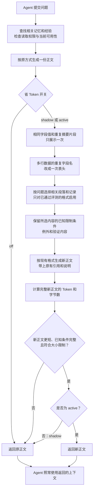

- Proposal Name: `token_budgeted_evidence_delivery`
- Start Date: 2026-10-13
- Status: Proposed
- RFC PR: [oceanbase/powercontext#1990](https://github.com/oceanbase/powercontext/pull/1990)
- Related Issue: [#1989](https://github.com/oceanbase/powercontext/issues/1989)
- Related Discussion: [#1971](https://github.com/oceanbase/powercontext/discussions/1971)
- Related RFCs: [RFC 1489](1489_prepared_context_text_assembly.md)、
  [RFC 1560](1560_recall_sufficiency_gate.md)、[RFC 1809](1809-atomic-memory.md)、
  [RFC 1400](1400_source_definition_and_observation_model.md)、
  [RFC 0081](0081_end_to_end_evaluation_architecture.md)

# Summary

为 PowerContext 增加默认关闭的服务端证据编译器。在现有 `prepare_context` 的授权、检索、准入与当前状态
检查完成后，对同一批结构化候选进行保护组构建、表示选择与预算分配，再通过原有 renderer 返回上下文。
调用方继续发送原请求、读取原响应，不需要替换 Agent 历史、安装本地 reader 或扩展 checkpoint。

首期新增 **0 张数据库表、0 个 HTTP endpoint、0 个 MCP operation**，不增加旧请求、PreparedContext 或
Capabilities 的公开字段。`RuntimeConfig` 新增部署配置，`off / shadow / active` 分别执行原路径、
只观测候选和实际采用优化交付。服务端启用后，当前调用 prepare 的 HTTP、SDK 及已有宿主集成直接获得结果。

直接节省来自五种内容变换：相同字段值只展示一次、重复 snippet 只展示一次、同构表格的键只展示一次、
限定格式中不相关段落不交付、低新增信息候选少交付。前三种改变表示，后两种改变信息覆盖，质量风险分别验收。
保护组、条件闭包和 Token guard 负责防退化，本身不作为独立节省机制。

创新假设是用任务信息需求约束这些变换，在同一候选池中按完整渲染成本联合选择表示，并通过独立反事实实验
校准必要条件。派生计划是一次调用内的内存数据，不构成持久图、run 账本或跨请求硬预算。

通用性指不绑定 Agent 框架、复用现有上下文交付入口；不是自动压缩全部第三方工具或整个 Agent 历史。
当前 MCP 目录没有 `prepare_context`，其 search/get/hint 保持原合同，不能宣称自动获得此能力。
宿主输入替换只属于可选后续增强，不作为首期设计、验收或价值证明的前提。

# Motivation

## 当前合同与问题

- PreparedContextBuilder 已有候选数、条数、单条正文与总字节限制，并且是无 I/O、无持久化、无 rerank 的 builder。
- 默认 JSON envelope 和显式 Markdown assembly 都可按前缀截断；尾部条件和失败验证内容可能因此退出交付。
- Runtime 仍持有完整 Experience 结构及 Topic hit，正式 Atomic 当前可用性在最终组装前检查。
  应在结构化候选上规划，不能从已经截断的 PreparedContext 反推丢失条件。
- PreparedContext 公开字段只有 `schema/status/content/content_bytes`；内层正文有 trust、citation 与
  truncated 合同，不需要额外 envelope 才能改善交付。
- `get_artifact_revision`、`get_source` 等原生读保留原文与精确身份。临时表示不需要另建原文库。
- 当前 MCP allowlist 排除了 prepare；`prepare_handoff_hint` 是独立 Handoff renderer，不能当作同一入口。

入口：[Builder](https://github.com/oceanbase/powercontext/blob/master/src/powercontext/builtin/runtime/prepared_context.py)、
[Runtime prepare](https://github.com/oceanbase/powercontext/blob/master/src/powercontext/builtin/runtime/application.py)、
[公开模型](https://github.com/oceanbase/powercontext/blob/master/src/powercontext/builtin/runtime/models.py)、
[MCP 目录](https://github.com/oceanbase/powercontext/blob/master/src/powercontext/server/mcp.py)。

现有字节限制已经避免无限交付，新能力不能把已有截断、条数限制、Topic snippet 或去重重新包装成创新。
需要回答两个新问题：在相同证据和预算下，能否减少确定的表示冗余；在预算竞争时，能否保住完整条件组并
提高独立任务质量。收益若仅来自少返回几条候选，必须单列覆盖变化，不能归因于无损压缩。

## 差异化假设

| 设计 | 新行为 | 否定条件 |
| --- | --- | --- |
| 保护组与已知依赖闭包 | 选择动作时同时预算适用条件、失败约束及验证字段，不单独截掉尾部 | 条件质量不优于当前 fitter |
| 多表示联合预算 | 比较完整渲染成本，在既有名次/配额内分配表示，而非每条固定截长 | 不优于合理配置的现有 assembly |
| 反事实必要性校准 | 用独立验收测条件删除的后果，发布经留出验证的固定策略 | 依赖测试答案、成本或严重错误增加 |

类型路由、确定性过滤、保护规则和恢复引用均有先例。差异化在 PowerContext 正式证据与组装合同中证明它们
有效，不声称行业首创，也不承诺自由文本语义无损。

## 范围与约束

首期处理当前 prepare 已获取的 Atomic Memory、Experience、Topic Memory 候选。Profile、代码及不支持格式
保持原行为；`include_code=true` 整个请求首期沿用 legacy。不增加 Source 读取、候选池、family、检索模式、
rerank/gate 扩展轮次或记忆写入。已有 assembly 明确选择的 format/sections/limit/show 必须保留。

不建设通用工具执行器、模型代理、第三方日志压缩服务、跨请求会话、原文 vault 或 Agent 历史管理。
不改原生 search/get 记录的内容来制造 Token 节省；这些操作承担完整读取和业务治理合同。

# Guide-level explanation

## 一个不要求 Agent 改造的闭环

Agent 原本调用 PowerContext：“修复订单重试问题，给我相关历史。”请求、接收和注入方式保持不变。

1. PowerContext 按原规则得到短事实、经验和 Topic hit。
2. 编译器先执行实际减重：如 Experience 的 action/lesson 逐字相同，就以两个角色共用一份完整原文；
   summary 与 snippet 整字段相同时，匹配正文不重复交付；验证过的 JSON 行数组提取一次表头。
   对已通过质量验收的限定格式，再按问题选择相关完整段落。
3. 对多个合法表示计算完整 Token 成本，在原有条数、字节与名次合同下分配预算。必要字段不能被截为孤立动作。
4. 原接口返回原四字段 PreparedContext，原 Agent 接收较紧凑的正文，继续原有问答流程。
5. 同一问题用 off/active 配对执行，独立评分与真实模型 usage 判断交付缩小是否变成了实际收益。

例如 `Action` 与 `Lesson` 都是“仅幂等查询最多重试三次，资金操作禁止自动重试”，原输出重复这句话两遍，
新输出为 `Action / Lesson: 仅幂等查询最多重试三次，资金操作禁止自动重试`。句子只出现一次，两个字段角色
和所有限制条件仍保留。完整结果比旧表示更长时拒绝变换。第 5 节逐项给出规则、伪代码与计量。

不强制 Agent 学习新工具、做补读或管理额度。精确原生读仍是可选既有能力，首期结果不能以“必须补读才能
理解当前建议”为正常成功前提。历史材料若原本就不充分，不能靠编译器承诺任务成功。



图中“省 Token”的动作就是：重复内容不再写第二遍、重复字段名改成表头，以及在已验证的格式中少交付无关
段落和低新增信息记录。没有命中规则时保持原样，不强行缩短。shadow 只记录新旧正文的对比，仍返回原正文。

图中检查的是已知条件和正文大小，不代表识别了所有隐含条件。任务质量在离线评测中另行验证：同一问题分别
使用原正文和新正文，让模型作答后比较结果与实际用量；这不是每次请求都执行的在线步骤。

## 部署开关

以下配置拟议新增，当前版本不能直接启用：

```bash
export POWERCONTEXT_SERVER_RUNTIME_TOKEN_OPTIMIZATION_MODE=off
export POWERCONTEXT_SERVER_RUNTIME_TOKEN_OPTIMIZATION_MODE=shadow
export POWERCONTEXT_SERVER_RUNTIME_TOKEN_OPTIMIZATION_MODE=active
```

`off` 是默认值；`shadow` 只在服务端计算候选，实际正文、origins 和旧统计与 baseline 一致；
`active` 在合同和收益检查通过时返回优化正文，否则按原路径回退。

这是服务端部署开关，不要求请求增加 mode 或调用端升级。沿用现有 settings 启动读取，改变环境变量后重启
服务端进程，首期不承诺热更新。需要按客户端灰度时，可使用独立受控部署及已有路由，不新增业务字段。

关闭后后续请求回到原组装；已经进入 Agent 历史的旧正文不会被服务器撤回。底层接口仍可用，停用不会删除
正式证据或让已有 citation 失效。

# Reference-level explanation

## 1. 变化清单与所有权

| 项目 | 首期变化 |
| --- | --- |
| 数据库 | 0 新表、0 新列、0 新索引、0 迁移 |
| HTTP/MCP operation | 0 新增；现有 prepare 入口不变，MCP 目录不扩大 |
| 请求/响应模型 | 0 新字段；PreparedContext status 与 schema 保持原合同 |
| RuntimeConfig | 新增模式、Token 目标及 tokenizer profile 的部署配置 |
| Runtime | 在现有候选获取之后加入一次无状态规划与纯渲染 |
| 宿主 SDK | 无需新 reader、state channel、history hook 或 checkpoint |
| 统计/评测 | 现有 trace/log sink 与评测工件记录专项对照，不新增业务统计表 |

域规则留在 Runtime；HTTP、SDK、MCP 不各自实现压缩。编译器仅处理 Runtime 已授权/准入的 typed 候选，
不执行数据库查询、网络、模型调用或持久化。复用现有 builder/renderer 的 cohesive helpers，避免形成新的
composition root、contributor registry 或平行上下文服务。

## 2. 模式与部署配置合同

拟议配置：

| Runtime 字段 | 默认 | 含义 |
| --- | --- | --- |
| `token_optimization_mode` | `off` | `off / shadow / active` |
| `token_optimization_target_tokens` | `1800` | 单次准备正文的规划目标，不能覆盖 request.max_bytes |
| `token_optimization_tokenizer` | `o200k_base` | 注册的确定 profile，首期支持 cl100k_base/o200k_base |

Token 目标是策略配置，不是请求中的硬额度、供应商完整输入上限或整项任务预算。优化成功必须同时满足目标和
原字节/格式合同；无法满足时返回 legacy，明确记录目标未达，不能标为成功。

off 不执行编译器、专项 tokenizer 或额外候选计算。shadow 只产生内部诊断，其 CPU/内存不是免费收益；
active 对整个服务实例允许采用新表示。模型不能选择 mode、策略版本、tokenizer 或 Scope。
现有 gate/Memory compaction 配置各自保持原含义，不复用它们代替专项开关。

策略/tokenizer 依赖不可用时，shadow/active 明确记录 fallback 并沿用 legacy，不阻断正常 prepare。
Runtime 配置验证仍拒绝非法枚举/数值；不能把部署配置错误偷偷映射为已启用。

## 3. 结构化快照与精确来源

规划位置在 `ScopedContextApplication` 的既有 gate、授权与 Atomic 当前可用性过滤之后、首次截断之前。
同一有界候选快照同时生成 legacy 和候选，不能为了 shadow 重跑检索、补充 Source 全文或回看 task 答案。

Artifact 采用 Scope、family、artifact_id、revision 的原生身份；内容 digest 用于完整性，不替换业务身份。
不同 Scope 或 revision 不因文本相同合并。origins 只记录实际交付的精确来源，全部未交付时为空。

当前候选并非全部原文：Topic hit 没有 detail 全文/offset；Atomic text 没有条件图；
Experience 字段多为自由文本。编译器不得把检索片段当全文，把 summary 当作全部条件，或为 Source 发明 revision。

权限/生命周期检查仍由原域服务完成。Compiler 不扩大引用 Scope、搜索 family 或绕过当前 Atomic eligibility。
并发状态变化的读合同沿用 Runtime，不能额外宣称所有跨对象返回原子快照或即时撤回已交付内容。

## 4. 保护组与已知依赖

一个派生组包含原生来源、完整字段集合、表示策略版本及已知关联。它只存在于本次调用内。

```text
Experience group:
  situation
  action
  outcome
  lesson
  failure.signature / repair_surface / verification (when present)

选择 action 的紧凑表示，不能删掉这组中未证明冗余的条件或验证内容。
```

首期的闭包是结构性保护，不是自由文本语义解析：

- Experience：完整 situation/action/outcome/lesson 及所有 failure 字段是保护组。
  不能因关键词没命中 outcome/lesson 就删掉；同字段重复表达只采用已验证的确定规则。
- Atomic Memory：短 text 完整交付；不存在隐含条件识别的原生结构，不拆孤立句子。
- Topic hit：表示减重时保护 title、完整 summary 与不重复的 snippet。任务投影只对已验证限定格式选择完整
  相关/保护段落，并标明有损摘录；其隐藏 detail 不在输入中，不能宣称依赖完整。
- Profile、代码、未知 prose：首期保持 legacy，不增加高风险裁剪策略。

循环关系和共享条件只有输入实际给出可信关系时才能规划；没有关系不自动推测。首期不新增关系表或写回
Artifact。适用范围诊断标为 `known_dependencies_only`。

任意自由文本的否定、版本、跨段例外不能通过简单词表可靠识别；不在经独立质量验收的格式范围时保持完整组。
闭包过大不做第二次普通 prefix-cut；采用原路径并记录 `protected_group_unfit`，不声称该 legacy 已满足闭包保证。

## 5. 直接减少 Token 的五种变换

### 5.1 节省从哪里来

| 变换 | 实际不再重复/交付的内容 | 信息变化 | 发布条件 |
| --- | --- | --- | --- |
| R1 Experience 同值分组 | 不同角色里逐字相同的长字段值 | 不同值与角色全部保留，正文表示变化 | 固定格式往返/消费者验收＋完整 Token guard |
| R2 Topic 精确消重 | 与 summary 逐字相同的 snippet 副本 | 匹配角色保留，正文只出现一次 | 首期要求整字段相等，不能语义合并 |
| R3 同构行表格化 | 每行反复出现的键和结构符号 | 列、值、类型、行序及重复次数全部保留 | 支持的扁平同构结构可往返还原 |
| R4 任务相关摘录 | 限定格式中与问题无关的完整段落 | 有损，未交付全部材料 | 独立留出质量门槛，未知格式回退 |
| R5 低边际候选少交付 | 同池中新增信息较少的完整候选 | 来源/信息覆盖减少 | 单列覆盖变化，通过独立任务验收 |

设置更小预算、保留条件、记录引用和测 Token 都不会自动产生节省。只有上表实际改变模型收到的正文或
交付集合，才有下降。这里不把“原文库里的几万 Token 被召回成几千 Token”当作专项新增收益。

前三种保留不同值与显式角色，仍需验证新表示不会使模型误读；不能仅凭结构可还原就宣布任务质量不变。
后两种主动少交付材料，必须按有损策略评估，不能混入 same-origins 无损成绩。

### 5.2 R1：Experience 相同字段值只写一次

原表示：

```text
Situation: 服务出现瞬时错误。
Action: 仅幂等查询最多重试三次，资金操作禁止自动重试。
Outcome: 查询恢复成功，验证没有重复副作用。
Lesson: 仅幂等查询最多重试三次，资金操作禁止自动重试。
```

候选表示：

```text
Situation: 服务出现瞬时错误。
Action / Lesson: 仅幂等查询最多重试三次，资金操作禁止自动重试。
Outcome: 查询恢复成功，验证没有重复副作用。
```

节省的是被重复的完整字段值，不是删掉 Lesson。规则：

1. 以字段完整原字符串做精确相等比较，不忽略数字、版本、否定、大小写、空白或重复次数。
2. 相等值分组，按首次角色出现顺序渲染全部角色及一份完整值。
3. `failure` 的完整路径和不同值保持原样，首期不跨 failure 角色合并。
4. 同一字段内的重复动作/行不消除，次数可能是含义的一部分。
5. 字段全部不同，或者完整新表示不更短，返回原表示。

```python
groups = group_exact_values(
    ordered_fields=("situation", "action", "outcome", "lesson")
)
for group in groups:
    emit(all_original_roles(group), one_complete_original_value(group))
emit_complete_failure_block()
```

原生 Experience GET、字段值、revision/digest 不改。该正文是现有 item.content 中的直接可读表示，
不要求 Agent 执行 alias decoder。

### 5.3 R2：Topic 已覆盖的 snippet 不重复写

原正文已经同时包含 summary 与 query-specific snippet：

```text
Title: 订单重试规则
Summary: 仅幂等查询最多重试三次，资金操作禁止自动重试。
Snippet: 仅幂等查询最多重试三次，资金操作禁止自动重试。
```

精确消重候选：

```text
Title: 订单重试规则
Summary: 仅幂等查询最多重试三次，资金操作禁止自动重试。
Snippet: 与 Summary 全文相同。
```

首期仅当同一 Topic 的 snippet 与 summary 整字段逐字相等时尝试，说明明确指向全文，不丢失匹配片段的位置。
即使是精确子串也不直接替换为模糊“已包含”：summary 同时含旧版三次与新版五次时，必须知道匹配了哪段。
将来支持子串需在正文自包含地标明准确匹配范围；R2/R3 同字段组合要重新验证角色关联，不能保持则不叠加。
部分重叠、语义相近、跨 Scope/revision 相同文本不适用；不修改正式 Topic 数据，也不把已有 snippet 检索
称为新算法。说明有 Token 成本，snippet 很短时变换可能变长，必须拒绝。

### 5.4 R3：重复 JSON 键改成一次表头

只处理支持字段中完整、经过验证的扁平同构 JSON 行数组。例如 Topic summary 本身包含一个完整列表，
不能把任意第三方工具日志加入 prepare，也不能改写完整 Atomic text。

```json
[
  {"path":"a.py","status":"fail","line":7},
  {"path":"b.py","status":"fail","line":11},
  {"path":"c.py","status":"pass","line":19}
]
```

候选正文：

```text
完整表格，字段、类型、行序及重复行保留：
path | status | line
"a.py" | "fail" | 7
"b.py" | "fail" | 11
"c.py" | "pass" | 19
```

节省随行数增加，来自每行不再重复 path/status/line 等键。行数很少时表头说明可能抵消收益，照常做完整 guard。

准入要求字段集合/顺序一致、值为受支持标量；字符串用可靠转义，数值保存原始 lexeme 而非先转 float，
区分 string/number/boolean/null。缺字段、重复对象键、嵌套值、混合结构、转义不确定或无法往返则回退。
schema、行序、重复行和值/类型必须可恢复；只有结构往返通过后才评估真实模型可读性。

正文表格放在原 content 字符串里，不改 JSON item/citation 或正式 GET schema。不是新增传输协议。

### 5.5 R4：按问题只交付相关完整段落

这是大正文的主要潜在收益来源，明确属于有损策略。示意问题：“订单重试有哪些限制？”当前 Topic summary
含“重试规则”“界面主题”“监控面板”三个独立段组。旧输出携带三个段组，新候选只携带重试组，以及当前格式
明确标出的全局约束/例外/版本/失败验证段，并标明其他段组未交付。

实现步骤：

1. 只启用已通过留出实验的格式 parser；先分出标题/段组和显式保护关系，不能对任意 prose 猜语义。
2. 由原 query 的确定词项匹配与已有 hit/snippet 选择相关段组，不同步调用 LLM 再忽略其成本。
3. 选择完整段落/组，保留该格式的全局保护段和已知依赖。summary/snippet 重复交付再交给 R2。
4. 关系不完整、无法解析的跨段引用或未支持格式，保持原表示。
5. `truncated=true`，正文注明“任务相关摘录，未交付全部材料”；策略遗漏进入独立 trace。
6. 不获取未在候选中的 detail、不扩大检索。当前 Topic hit 没有全文 offset，不发明范围恢复协议。

固定格式关系是已知结构，不证明所有隐含条件已识别。否定词表只是检测信号，不构成安全证明。
从 shadow 筛选到留出集非劣与严重错误验收通过后，固定版本策略才能在对应格式 active；未通过时收益记为
实验候选，不是已发布节省。

### 5.6 R5：不为低新增信息候选继续花 Token

R1–R4 优化单个候选；R5 决定同池里交付哪些候选。例如三个 hit 中，前两个只覆盖已知重试上限，
第三个提供明确资金例外。预算不足时优先保留新增必要约束，而不是简单拿排名前两个。

这是证据选择，不是把不同 Artifact 当成同一对象。输入身份分别保留，未选对象从 origins 排除。
只在可定义信息需求/贡献的已验证格式中计算 marginal coverage；未知 Atomic prose 不自动语义去重，
冲突/版本不同或独立来源佐证不能因字符串相近而压掉。

```text
marginal(candidate) = 当前格式支持的 query 信息需求
                      − 已交付证据覆盖的需求
```

原输入名次作为 tie-breaker；选出后按原顺序渲染，family/section/条数上限不扩大。
不复用不同 family 的 raw score 作统一效用，不重新检索或额外调用 reranker。选择规则由 Runtime 统一执行，
不由宿主另造。覆盖变动和条件缺口必须单列，通过配对任务评测再发布。

这项可减少正文总量，也可能删掉隐含必要信息；明确记为 selection_changed，不能当作无损去重。

### 5.7 逐项收益与归因

每个规则保存完整 baseline/candidate 正文的 tokens/bytes，统计实际接受率、回退原因与输入适用比例。
结果按三类报告：same-origins 表示减重、same-origins 有损摘录、selection_changed。
多个规则叠加时按固定顺序 R1/R2/R3→R4→R5 记录逐步差值，不把重叠删除重复计功。

```text
某一步新增节省 = 上一步完整正文 Token − 本步完整正文 Token
最终节省       = legacy 完整正文 Token − final 完整正文 Token
```

真正送入模型的包含 trust、citation、标签及提示，逐项收益必须在原 renderer 完整包裹后计数。
单规则原 body 变短但包裹后更长，不采用。没有命中规则的输入维持 baseline，不能靠只挑正样本宣传平均收益。

### 5.8 可复算的离线机制计量

以下是合成样例的真实 tokenizer 计数，不是已实现产品、真实 Agent 或账单收益。实验对照由现有
PreparedContextBuilder 生成，并断言与实际 baseline 完整正文相等；候选使用实验变换再经原 JSON/
Markdown renderer 包裹。各样本均未触发原单条 2000 字节或总 32768 字节截断，避免混入旧 fitter 的收益。
使用 tiktoken 0.13.0，表中为 o200k_base 的完整 content，包含 trust、citation、标签、转义与省略说明。

| 合成正样例 | JSON Token | Markdown Token | 信息边界 |
| --- | --- | --- | --- |
| R1：Action/Lesson 同值，failure 独立完整 | 416→341，18.03% | 436→360，17.43% | 同 origins，不同值及角色保留 |
| R2：summary 与 snippet 全文相同 | 271→202，25.46% | 289→220，23.88% | 同 origins，匹配明确指向全文 |
| R3：8 行同构 JSON 提取一次列名 | 522→343，34.29% | 366→298，18.58% | 同 origins，行序/重复行/值/类型保留 |
| R4：保留重试/保护组，省去配色/报表/排版三段 | 322→230，28.57% | 334→242，27.54% | 有损摘录，不证明任务质量不变 |
| R5：同池两个同正文候选仅选择一个 | 316→195，38.29% | 343→208，39.36% | origins 从 2 到 1，覆盖变化 |

每种规则另有负对照：字段不同、snippet 提供新增条件、全部段必要、候选具有独立约束、JSON 行缺字段。
5 个负样例在两种 renderer 下全部逐字不变，节省为 0；合计 20 条结果，同时记录 cl100k_base、完整字节、
来源身份和正文摘要。来源合成对象前后 digest 一致；没有执行 native GET、数据库、Server、Reader 或 Judge。

这些实验变换只是离线可实施性/计量探针，尤其 R4/R5 是预先构造的候选摘录/选择，不代表自动规划器已能
正确判断哪些材料可以省。R1/R2/R3 的结构保留也不等于真实模型理解等价；发布仍须第 13 节完整验收。
不能将本表平均值当作真实材料分布的平均省 Token 比例。

复算资料：[脚本](https://github.com/hidb4ai/powercontext/blob/codex/rfc-token-budgeted-evidence-delivery/docs/rfc-assets/token-budgeted-evidence-delivery/probe.py)、
[完整合成输入](https://github.com/hidb4ai/powercontext/blob/codex/rfc-token-budgeted-evidence-delivery/docs/rfc-assets/token-budgeted-evidence-delivery/samples.json)、
[完整计量结果](https://github.com/hidb4ai/powercontext/blob/codex/rfc-token-budgeted-evidence-delivery/docs/rfc-assets/token-budgeted-evidence-delivery/results.json)。
在已安装 builtin 依赖和 tiktoken 0.13.0 的 Python 3.11+ 环境中运行；离线环境通过 TIKTOKEN_CACHE_DIR
或脚本 --tokenizer-cache 指定已有词表缓存。结果写入 /data/codex-tmp，避免生成文件进入文档目录。

```bash
python3 docs/rfc-assets/token-budgeted-evidence-delivery/probe.py \
  --repo-root . \
  --output-dir /data/codex-tmp/powercontext-token-mechanism-recheck
```

## 6. 联合预算与选择算法

### 6.1 边界

正文同时受原 `max_bytes`、单条/总条数、assembly 与部署 Token 目标约束。
完整 `content` tokenize，包括 trust、格式、citation 和提示；`content_bytes` 仍为真实 UTF-8 字节。
固定 `cl100k_base`/`o200k_base` 实现与词表版本，未知或不可用不伪装为 bytes/4 精确计数。

### 6.2 有界规划

1. 固定候选名次、family/Scope interleave 与原配额，生成 legacy baseline。
2. 为 typed 候选构建保护组。每个候选最多保留 4 个非劣表示：完整、R1–R3 表示减重、已验证 R4 摘录、legacy。
   规则不是无上限笛卡尔积，未知格式不生成有损表示。
3. 比较同一对象的完整渲染 Token/字节成本，不用不同 family 的 raw score 作为统一效用。
4. 先用相同选中对象的更短表示降低实际消耗；允许 R5 的格式再比较 marginal coverage。保护约束不满足的
   表示不可选，原输入名次作为 tie-breaker，条数/section 合同保持。
5. 优先比较相同 origins 的方案。允许把节省额度给同池后续候选时，新增覆盖单列，不把它算作同材料压缩率。
6. 完整最终渲染再次检查 Token/字节、引用、protected fields、status 与转义。
7. 无合法方案、未知格式、比 baseline 更长或目标未达时返回 baseline，诊断原因。

首期采用有界 beam 规划而非任意组合枚举：按原候选顺序扩展合法表示，每轮保留最多 32 个满足完整 byte/token
约束的状态；比较已验证 coverage、原名次偏离和完整成本。未启用 R5 时锁定同一选中对象集合，只比较表示。
每步必须真实 render/tokenize，不能把各片段 Token 相加假装 BPE 可加；最终再校验，状态/时间超限回到 legacy。
同一候选的计划最多 4 种，本次候选/family/输出上限沿用原合同。

“更短”是必要收益检查，不是质量充分条件。仅删掉较多候选得到更短正文不能绕过完整任务验收。
全组无法容纳时 fallback 不算闭包成功；不通过返回 empty 冒充大幅节省。

### 6.3 成本与目标

服务端只能确定 prepare 正文的 Token/字节。独立问答任务的完整成本为实际输入、输出、缓存、辅助调用、
补充读取与失败/重试。现有 Agent 还会携带其他历史，不能承诺整任务硬上限或通用节省百分比。

在固定输入下以 `legacy_text_tokens / active_text_tokens` 衡量交付变化，并分别报告 same-origins 与
coverage-expanded 结果。目标是质量不劣且真实流程净成本下降，不设置未验证的“完整 Agent 必降 20%”。

## 7. 原响应及正文兼容

外层 PreparedContext 不变：

```json
{
  "schema": "powercontext.prepared-context.v1",
  "status": "ready",
  "content": "Example context",
  "content_bytes": 15
}
```

示例仅说明字段形状，不代表内层真实 renderer 输出；实际 content_bytes 按 UTF-8 内容计算。empty 仍要求 content=null、
content_bytes=0，ready 仍遵守非空与字节不变量。

默认路径继续原 BEGIN/END、trust/items、citation/content/truncated；显式 assembly 继续原 format/sections/
show、标签、身份转义。不能因外层四字段未变就随意改内层 machine-readable 形状。

编译前 Atomic 正文保持原 hit.text；默认 JSON 的 `truncated=false` 解码后等价于原文。Markdown 沿用既有
换行规范化与控制字符可视化，不承诺原始字节回还；摘录不能冒充全文。确定结构重排且全部值保留不自动叫
截断，任何删去不同正文内容的表示必须诚实标不完整，遵守其 family 已有语义。
原生 Source/Artifact GET 仍返回原内容、digest、ETag 与状态；不把 compact projection 写回正式记录。

已有 omissions 统计字节预算的 truncation/drop，策略投影另记内部 trace，不能混成预算不足。
旧 schema/operation 生成文件不需要因部署配置增加而变更；实现仍跑 contract regressions。

## 8. 原文读取与无状态恢复

首期不发 run_id、临时 evidence_id、delivery_id 或新补读工具。正式原文存在于现有不可变 revision，
需要时由已有 `get_artifact_revision`、`get_source` 等合同读取，沿用原认证与 family-specific resolver。

编译结果中的引用继续使用原生 citation。不要求 Agent 解析新范围协议，也不保证任何客户端自动补读。
候选表示必须可以直接用于正常上下文交付；不能把只返回目录并等待新工具当作普惠 active 结果。

未来若提供范围读取，Source/Artifact 原生 digest 与本地渲染 text digest 仍需区分；重新序列化 JSON 不叫
远端原始字节。这个需求应另行证明，首期不增加接口、locator 存储或原文复制。

## 9. 无状态、缓存与重启

规划器只消费一次 typed 快照、配置和 query，返回 context、实际 origins 与内部诊断；
它不分配跨请求额度、不保存请求幂等账本、不建立会话，也不依赖 Agent thread/checkpoint。

首期不需要持久缓存。若重复编译 CPU 成为实测瓶颈，可使用有界进程内派生缓存；
键包含来源身份/content digest、策略/tokenizer、format 及所有影响表示的字段。
授权和当前资格始终在缓存使用之前按原合同检查；缓存不代表读取授权。

服务重启后重新规划即可，没有恢复专项 run 的问题。关闭模式不执行专项算法，已有正式存储原样保留。
不通过在 Source/Memory/Statistics/配置表塞 JSON 的方式建设隐性原文库或账本。

## 10. 通用覆盖与宿主增强的分层

| 接入 | 首期结果 |
| --- | --- |
| 现有 HTTP prepare 调用 | 原请求响应，服务端启用后直接得到优化正文 |
| Python SDK prepare | 原方法/类型，客户端不需要新调用逻辑 |
| 已调用 prepare 的宿主 recall hook | 继续原注入逻辑，只有收到的正文变化 |
| MCP search/get/hint | 原合同回归；当前没有 prepare operation，不自动进入 compiler |
| 任意第三方工具日志/整个 Agent 历史 | 不在首期控制范围 |

LangGraph 没有特殊前提地位；其现有 recall 只是其中一个 HTTP prepare 消费者。
首期不要求更改 `llm_input_messages`、`messages`、tools schema 或 checkpointer。
其他已使用 prepare 的接入同样受益，不需要分别实现编译规则。

宿主可控输入视图、工具代理或模型代理有可能进一步减少历史重复，但属于额外接入/部署能力；
必须单独评估适配成本、原文恢复和权限，不把它们写成 PowerContext 服务端编译的隐含条件。
没有相应拦截入口时，服务器无法删除已在外部历史中的正文。

## 11. 工作量与资源成本

首期候选数沿用既有 family 上限，每候选最多 4 个表示，派生组数量/总文本与计算时间有界。
不扫描全 Scope、Source 或历史 revision；不为编译读取 Topic detail，也不同步写新状态。

legacy/candidate 可以共享基础 rendering 工作；shadow/active 的第二次编译、tokenize 与校验成本实测单列。
测试不同语言、大小、内容格式、冷/热 tokenizer、并发 prepare、闭包无法容纳与回退比例。

测 CPU、内存、p50/p95/p99、吞吐、错误、render/tokenize 次数、网络正文大小及数据库查询/IO。
服务端正文变短可能减少返回流量，但不能声称候选数据库读取也减少。No-op/off 只保持原开销边界。

## 12. 可观测性与真实收益

现有 recall estimator 的 baseline 是选中 origins 追溯到 Source 的全文，recalled 是最终 PreparedContext；
它是 Source→context 指标，不是本专项 legacy→compiled 对照。不能改名复用或扩大未交付 origins 来放大分母。

专项诊断通过现有 trace/log sink 或评测工件记录：

- mode、固定策略/tokenizer 版本、format、目标与回退原因；
- legacy/active 全正文 tokens/bytes、实际 origins 是否一致、保护组覆盖、策略投影与预算遗漏；
- CPU/延迟/内存、shadow overhead 与 coverage-expanded；
- 实际模型请求 observed、provider usage/缓存，以及独立 task score。

prepared、emitted、model-request-observed 与 task-verified 分开。没有真实输入观测就不称模型已采用；
usage 缺失标 unknown，不按零计算。默认不保存完整提示、用户消息、隐藏推理或额外 Source 副本。

gate 使用原 probe 进行候选准入；compiler 不能拿紧凑结果冒充 gate 更充分。
最终交付单独观测，recall effort 的探测与 active 最终正文不得混成同一个成本数字。

## 13. 评测与现有仓库复用

### 13.1 合同及开关

- off 保持原正文、origins、请求/响应模型及旧统计；不调用专项 planner/tokenizer。
- shadow 实际返回逐字等价 baseline，只在内部算 candidate；不重跑检索。
- active 对默认 JSON 与显式 Markdown 验证 trust、escape、citation、truncated、byte ceiling 和四字段读回。
- 同一完整候选上的尾部否定、版本、Experience failure/verification 不被二次截断。
- 未支持格式/Profile/include_code、闭包过大、依赖不可用、内部失败明确回退；不绕过授权。
- HTTP、SDK 与实际已有宿主调用同一 Runtime 结果；MCP 只测试已暴露的真实操作维持原合同。
- 当前状态与来源身份、同文本不同 Scope、active→off 后续请求和服务重启保持正确。
- 已有原文 GET、ETag、digest 与 search/get 字段内容完全不受 compact 表示影响。

录制 HTTP 验证接口行为；录制模型或保存的实际 Reader messages 验证采用；真实模型/provider usage 和外部
后端验收分别报告。无需完整 Agent 历史替换或 checkpoint 适配即可完成首期闭环。

### 13.2 算法消融与静态 Reader

| 组 | 改变因素 |
| --- | --- |
| A | 旧默认 builder，合理预算 |
| B | 现有 assembly 的合理配置，相同 family/条数/预算 |
| C | 相同候选/origins，分别启用 R1/R2/R3 及其组合 |
| D | C＋R4 有损摘录，保护组与已知闭包作为约束 |
| E | D＋联合预算/R5 选择，覆盖变化单列 |
| F | E＋独立反事实校准策略 |
| 外部对照 | 相同材料/交付边界的竞品可比机制，支持差异单列 |

先重放同一已授权 typed 候选，隔离表示与条件质量；再跑真实 prepare→Reader→独立评分，记录同池新增覆盖。
不让 treatment 扩大检索、获得额外 Source 或改变模型/Judge/下游预算。

[LongMemEval-V2](https://github.com/oceanbase/powercontext/blob/master/evaluation/memory/longmemeval_v2/README.md)
已有 `query-time-compact-v1` arm 调公共 prepare，并将实际 content 送静态 Reader；正适合本首期服务端设计。
默认 `current-memory-fts-v1` 不调用 prepare，不能直接用默认实验宣称编译器有效。
新增实验 treatment 身份/manifest 固定 mode/策略版本、数据库 revision 快照、query、
`recall_fts_weight` / `recall_vector_weight` 与 Reader/Judge，不用新增产品协议确认 active。

已有 prepare_worker 保存正文 Token/bytes、完整 messages/prompt digest；Reader provider usage 衡量真实输入/
输出/缓存。下游若再次截断，应报告 `memory_context_was_truncated`，不把 harness 裁剪算成编译器收益。
条件、例外、版本及 Experience 尾部 failure 另建固定反例集；总体记忆分数不能替代这些验收。

初始 20 个任务仅 smoke/筛选。扩大后冻结留出集、预注册非劣界限、报告配对差值与置信区间；
严重条件错误无新增，完整问答流程净 Token/费用下降且延迟可接受，才发布 active。

### 13.3 任务与性能

[Bub/Harbor](https://github.com/oceanbase/powercontext/blob/master/e2e/bub/README.md)
可复用固定任务、隔离、交替顺序和配对统计；现有整体 PowerContext OFF/ON 不是专项 treatment。
只有实际调用 prepare 的任务接入才能验证编译器，原 harness 没有使用它就不声称被测。

[Work continuity](https://github.com/oceanbase/powercontext/blob/master/evaluation/coding/work_continuity/README.md)
的合成 fixture 可复用局部评分，[SWE-bench Pro](https://github.com/oceanbase/powercontext/blob/master/evaluation/coding/swebench_pro/README.md)
的独立补丁验收可作后续任务验证；二者不能替代当前真实 prepared 正文输入观测。

[Performance 目录](https://github.com/oceanbase/powercontext/blob/master/evaluation/performance/README.md)
目前无可直接复用压测套件。新增 pure compiler 与公共 prepare workload，测 1 KiB/20 KiB/超限候选、
冷/热、格式、并发请求及 fallback。Compiler 本身不增加 I/O，候选数量不变；same-origins 隔离组数据库查询
应与 baseline 一致。coverage-expanded 改变最终 origins 后，既有 recall estimator 的 Source 全文读取可能
增加，查询/IO 增量单列测量。算法新增成本集中于有界 CPU/tokenize/render，不增加 vault、scope quota、CAS 或 TTL 测试。

### 13.4 表和接口的必要性门槛

首期明确无新增持久化和业务操作。以后只有真实需求、现有合同无法满足、完整成本收益证据同时成立，
才单独提出最小变更，例如：

- 原文整对象读成为已证实瓶颈时，先评估原读取接口的范围能力；
- 必须跨请求共享硬额度时，先评估已有调度/状态所有权；
- 必须让 MCP 消费新的 assembled context 时，明确现有目录缺口与必要的操作扩展；
- 想压缩第三方工具或整历史时，先说明代理/宿主接入边界，不把它冒充零适配现有服务能力。

不预建专项表，不在 Source/Memory/配置表塞 blob，不因“以后可能用到”扩大协议。
调用端选择性开关若成为需求，再评估既有请求最小 opt-in 字段，不预设新 endpoint。

## 14. 实施顺序、退出条件与回滚

1. 固定真实 prepare baseline 与合理 assembly 对照，服务端默认 off/shadow，零协议/数据库变更。
2. 实现 R1 同值分组、R2 精确 snippet 消重、R3 支持格式表格化、原 renderer 与完整 Token guard；正样本和
   无冗余/异构负样本都计量，条件保护是校验而非节省指标。
3. R4/R5 先 shadow，再完成格式限定 parser、反事实条件样本和 A/B/C/D/E 消融；通过独立质量/费用门槛后
   才将对应策略放入 active 白名单，复用 query-time-compact Reader 跑独立任务。
4. 质量/费用/性能通过后灰度 active，再评估 F、MCP coverage 或可选宿主增强。

若不优于现有 assembly、保护组多数只能 fallback、收益主要来自少交付材料，不能宣称新编译器有效。
若省正文但实际问答成本上升，退回 off。只有新的真实瓶颈才能推动接口/存储扩展。

# Drawbacks

控制范围仅是 PowerContext 交付正文，不能减少外部 Agent 已保留的第三方工具历史。现有 max_bytes 已限制
上下文，潜在节省空间需要实测；短 Atomic 全文和完整保护组可能完全没有可省内容。

自由文本条件结构有限，首期多数未知场景会回退。双表示/render/tokenize 增加 CPU/延迟；部署 active 影响同
实例所有 prepare 调用方，需要受控灰度。相同接口不等于任意正文重写都兼容，必须验证原内层格式。

# Rationale and alternatives

| 备选 | 优点 | 取舍 |
| --- | --- | --- |
| 只调小 max_bytes/assembly | 已有通用配置，最低成本 | 强 baseline；若已足够则不建设编译器 |
| 服务端无状态 compiler | 当前 prepare 用户无需 Agent 改造 | 只控制自身交付，接受这一产品边界 |
| 宿主输入替换 | 可减少多轮历史重复 | 依赖适配，作为额外增强，不是首期前提 |
| Headroom 类模型代理 | 可覆盖实际模型请求 | 需要代理部署/配置，增加新的产品和边界 |
| Context Mode 类执行/索引层 | 可控制更多工具结果 | 不符合零执行器/原文库的首期范围 |
| 新 compress API | 接受任意外部文本 | 需要调用方改造且扩大范围；#1023 已说明相关取舍 |
| 中央 vault/账本 | 跨宿主恢复或硬预算 | 当前单次编译不需要，因此不建设 |

先在 PowerContext 已拥有的交付边界证明效果，把“框架无关”与“所有 Agent 成本都可控制”区分清楚。

# Prior art

本方案复用现有上下文组装、召回准入、精确引用与原文读取合同。在结构化候选与最终 renderer 之间加入
无状态表示规划，正式记录、传输模型和调用方接收方式保持原有边界。

# Unresolved questions

接受 RFC 前需要确认：

1. R1/R2/R3 在真实 typed 样本中的命中率、各规则节省与包裹成本；是否存在优于现有 assembly 的足够空间。
2. R4/R5 首批可验证格式、完整保护段关系、兼容样本和严重条件错误定义，及留出质量门槛。
3. 默认 Token 目标/tokenizer 依赖和部署失败回退、灰度与最终性能阈值。
4. 扩大后的独立任务族、非劣界限与真实模型/provider usage 观测覆盖。
5. 部署级开关是否满足首期使用；当前 MCP 不含 prepare 的覆盖限制如何在产品文档中清楚表达。

明确不增加数据库迁移、HTTP/MCP operation、请求/响应公开字段、本地 reader、checkpoint 状态或第三方
执行代理。是否扩展任何一项必须先满足第 13.4 节的必要性门槛。

# Future possibilities

通过首期门槛后可研究自动依赖识别、独立反事实校准、更多原生交付入口以及 MCP assembled-context 能力。
宿主视图或通用代理可以单独证明额外价值，不承诺零适配或借其收益宣传本编译器。
未来需求各自提出兼容、成本、质量和必要性证据，不构成首期方案的隐含依赖。
