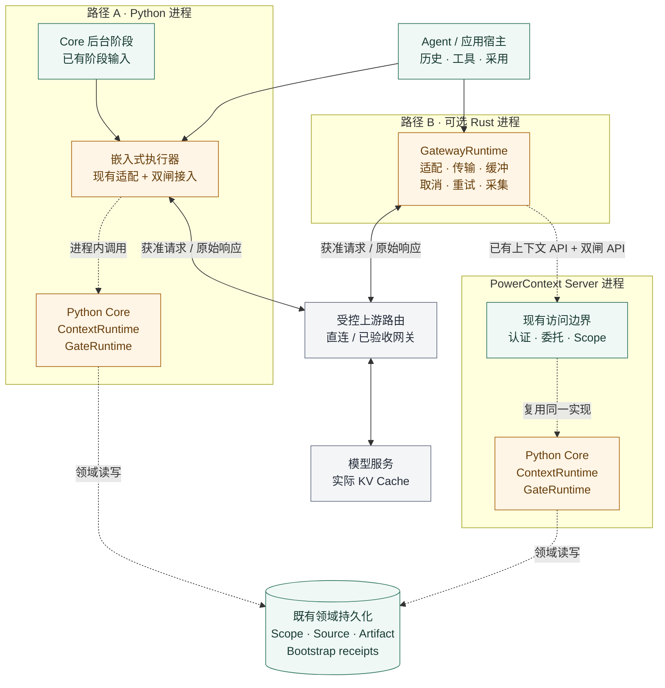
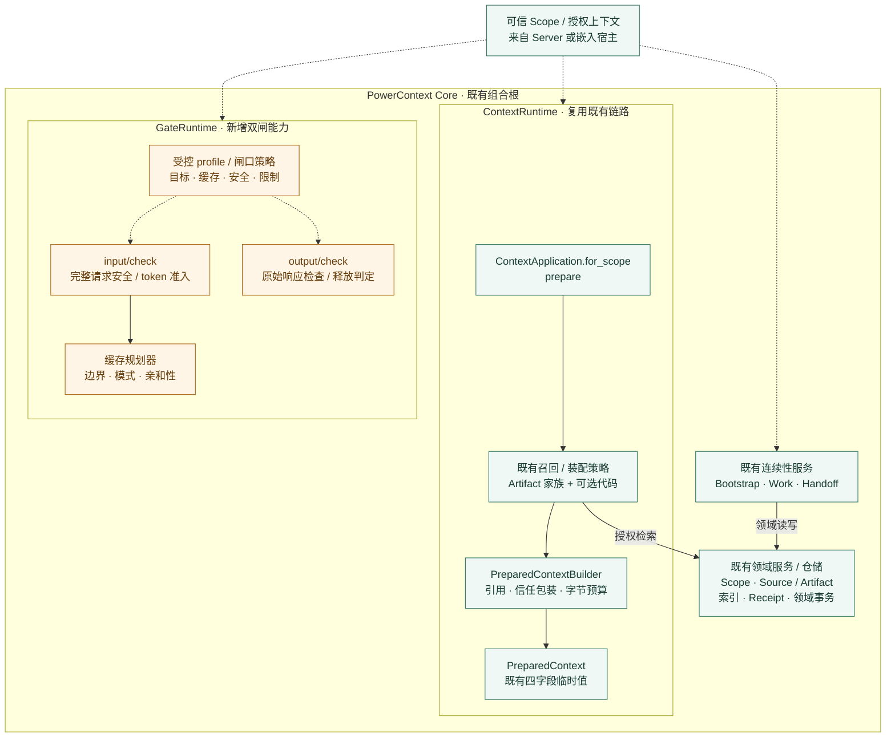
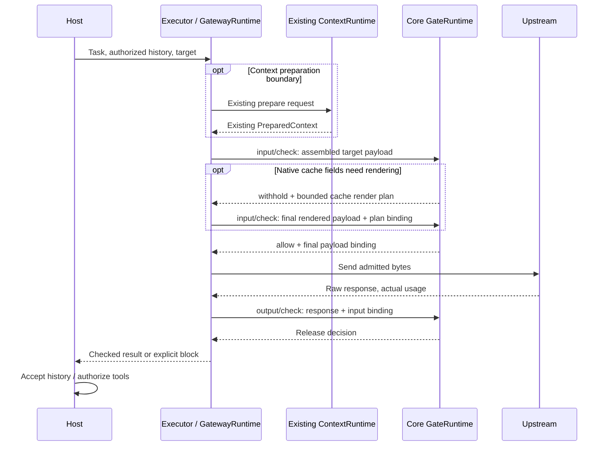

- Proposal Name: `context_gate_and_optional_gateway_runtimes`
- Start Date: 2026-10-19
- RFC PR: [oceanbase/powercontext#2086](https://github.com/oceanbase/powercontext/pull/2086)
- Related RFCs: [RFC 0016](0016_pydantic_ai_inference_integration.md)、[RFC 0028](0028_context_pack.md)、
  [RFC 0046](0046_observability_foundations.md)、[RFC 0048](0048_handoff_artifact.md)、
  [RFC 1435](1435_explainable_prepared_context_receipts.md)、[RFC 1770](1770-decision-policy-governance.md)、
  [RFC 1783](1783-handoff-session-rollover.md)

# Summary

本 RFC 是设计提案，实现基线为仓库提交 e4efb39b。接受本 RFC 不代表功能已实现、宿主已适配或缓存收益已得到验证。

**ContextRuntime 就是 PowerContext 已有的上下文组织能力参与模型调用。** 实现主体仍然是
`ContextApplication.for_scope(scope_id).prepare(...)`、既有召回与装配策略和 `PreparedContextBuilder`。
Bootstrap、Work、Handoff 沿用各自的入口与领域归属，不另建上下文选择器、转录服务、会话数据库或必需的运行时包装层。

**GateRuntime 补足现有上下文准备之外的调用边界。** 它消费完整模型请求中的已有准备结果，规划允许的缓存使用方式，
检查最终外发载荷，并在交付前检查原始响应。完整请求的 token 准入在这里处理；`prepare.max_bytes` 仍然表示补充上下文的
UTF-8 字节预算。GateRuntime 不独立召回或重新装配 Memory。

**可选 Rust GatewayRuntime 负责执行这个组合。** 它在需要准备上下文时调用现有 API，映射目标协议，取得双闸判定，
发送获准字节，缓冲输出并回收执行证据。嵌入式应用和 Core 后台推理也能使用相同双闸，无需部署 Gateway。

首期只增加**两个检查操作，新增数据库表为零**。宿主继续拥有对话历史、响应采用、工具和任务调度权。
现有 Source、Artifact、Bootstrap receipt、Work、Handoff 和统计服务保留各自语义。
临时请求、检查结果、缓存计划与输出缓冲放在内存中。

| 设计项 | 决策 |
| --- | --- |
| 上下文组织 | 复用现有 scoped prepare、assembly、召回策略、引用、信任包装与字节预算。 |
| 上下文连续性 | 在已支持的生命周期边界复用宿主历史和现有 Bootstrap/Work/Handoff。 |
| Core 新能力 | GateRuntime 负责最终输入准入、缓存规划和输出检查。 |
| 新增 HTTP 操作 | 只有 `/v1/inference/input/check` 与 `/v1/inference/output/check`；上下文和连续性沿用已有操作。 |
| 新增存储 | v1 零张表、零个新 Artifact 家族；基础检查无持久依赖。 |
| Gateway 职责 | 可选 Rust 执行器；上下文和策略决策仍归 Core。 |
| KV Cache | Core 规划可复用布局与缓存约束，Gateway 执行，推理服务持有实际 KV。 |
| 默认优化 | 稳定已有上下文和历史、显式输出上限、经验证的供应商缓存；不自动有损压缩或缓存语义答案。 |
| 初始安全范围 | 显式 profile 下的文本与结构化工具内容；外发前、响应释放前执行 strict 检查。 |
| 持久保证 | 现有领域提交保留原契约；v1 不新增持久推理恢复、恰好一次发送或共享财务账本。 |
| 验收单位 | 固定且受支持接入上的完整任务质量、总计量成本、延迟和安全反例。 |

# Motivation

PowerContext 已经解决了应交付哪些获准的历史上下文，以及怎样组织这些内容的问题。
需要补齐的是：让准备结果可靠进入真实模型请求，在发送与释放边界落实策略，并避免无理由地改变可复用前缀。

另建上下文子系统会重复召回、证据处理、Scope 授权和连续性语义；把每个计划、响应、轮次、尝试都持久化，
又会在验证使用价值之前增加运维成本。本方案从已有 Coding 工作流出发：

1. 用现有 API 准备有界项目上下文。
2. 在宿主拥有上下文的边界内，跨普通工具轮次保留这份精确值。
3. 对完整请求执行输入准入与缓存规划。
4. 通过已有执行器或可选 Gateway 调用模型，交付前检查响应。
5. 宿主需要新会话时，使用既有 Handoff。

三种运行时是这条流程中的职责名称，不要求增加三个产品、三套组合根或通用 Agent 调度器。
Core 后台生成、Embedding、重排和辅助判断同样需要对应的双闸覆盖，但不必拥有 Agent 对话，
也不应在每次调用前自动召回 Memory。

# Guide-level explanation

## 复用现有 PowerContext 完成 Coding 任务

用户让 Coding Agent 修复 API 客户端，项目已经注册 Scope，Memory 中已有 OpenAPI 重新生成规范：

1. 在受支持的召回边界，宿主或 Gateway 使用任务查询和 Scope 调用现有 `/v1/context/prepare`。由原运行时按权限召回与装配 Memory、Experience、Topic Memory，以及显式选择并配置的 Profile、按需启用的代码证据。正常的 empty 结果仍然有效。
2. 宿主把 `PreparedContext.content` 原样作为历史资料注入。当前指令、仓库规则、消息、工具定义与工具结果仍由宿主管理。准备结果是补充证据，不能代替系统指令。
3. GateRuntime 检查完整目标请求，包括输出预留、安全规则和缓存资格。GatewayRuntime 只发送最终获准的表示。
4. 输出闸在释放前检查完整文本和工具参数。之后由宿主决定采用回答或授权工具。通过输出闸不代表工具已经执行，也不代表 Memory 已经提交。
5. 普通工具轮次保留同一份准备结果和已采用历史。新任务意图或显式上下文刷新可再次调用相同 prepare API。接近模型窗口上限时，由宿主发起既有 Handoff 或报告容量不足。

这是对现有 PowerContext 流程的直接增强。用户无需先把转录迁入 Core，或另建一份服务端会话才能使用双闸。

## 可复用上下文与 Gateway 缓存行为

在模型、协议、工具集和任务边界固定时，执行器维持以下逻辑布局：

```text
Turn 1: Stable rules + tools + exact PreparedContext | Current request
Turn 2: Same prefix + accepted turn 1 history        | New message/tool results
Turn 3: Same prefix + accepted turns 1 and 2         | New message/tool results
```

实际角色、顺序和工具调用/结果配对遵守目标协议。这个布局不允许把消息搬到更高权限的角色，也不允许重排已有历史。

Core 规划可复用前缀边界与缓存设置。Gateway 映射到经过验证的协议，将最终表示提交输入闸，获准后不再修改。
输出闸把未通过的内容挡在执行器管理的重放路径之外；宿主用自己的历史机制追加已采用结果，为下一轮保留可复用前缀。
输出检查不能为已经发送的请求制造缓存命中。

实际 KV 留在推理服务侧。稳定前缀只建立复用资格，是否命中及其费用必须看供应商的读写证据。
除非经过验证的协议显式支持缓存引用，完整输入通常仍要发送。切换模型时保留可移植的宿主上下文或 Handoff，
新目标自行建立 KV 状态。

## 切换模型与继续工作

宿主将获准的可移植历史与已有准备结果交给模型 B，或交付经过检查的精确 Handoff 及当前证据。
GateRuntime 按 B 的能力 profile 和完整请求预算检查输入，拒绝不支持的模型私有状态；
不把私有推理过程或供应商 session 标识解释为可移植文本。放不下时，由宿主显式 Handoff，而不是静默摘要或丢弃内容。

跨会话连续性复用现有 Work/Handoff 的 prepare、检查、finalize、可选 commit、交付与 continue 语义。
已提交的 Handoff 仍可通过现有精确读取路径使用。接收 Agent 校验当前仓库、权限和证据。
普通模型输出不会仅因通过输出闸而成为长期 Memory。

## 无 Gateway 的 Core 后台调用

Memory 提取阶段继续使用现有 Source 窗口、指令、输出 schema 和 Artifact 提交服务。
在实际推理边界执行输入和输出检查，然后完成原有领域校验。Embedding 与重排保留现有 ports。
任何阶段都不为满足运行时命名而强行调用 `context.prepare`；辅助策略调用也不递归触发上下文增强或更多辅助 Judge。

# Reference-level explanation

## 现有实现与具体复用点

| 职责 | 当前实现 | 本 RFC 的决策 |
| --- | --- | --- |
| Scope 上下文入口 | `ContextApplication` / `ScopedContextApplication.prepare` | 这就是 ContextRuntime 入口，不把它降成另一套选择器的底层数据源。 |
| 召回与装配 | `_prepare_build`、所选家族、现有 recall effort 策略 | 沿用现有策略、候选资格、有界扩展和授权。 |
| 最终补充文本 | `PreparedContextBuilder`、prepared text/code 渲染 | 沿用选择、引用、信任包装、遗漏和 UTF-8 截断。 |
| 公共值 | `PreparedContext(schema, status, content, content_bytes)` | 保持默认四字段与直接注入契约。 |
| Bootstrap 与去重 | 现有 bootstrap 准备和交付 receipt | 保持已支持生命周期，以及完整注入的 Atomic Memory 精确版本去重。 |
| 任务连续性 | 现有 Work 门面、Handoff Artifact 生命周期 | 复用已有 Source/Artifact 操作、精确版本与显式提交。 |
| 模型执行 | inference ports、provider adapters、usage wrappers | 在经过验证的最终发送/原始响应边界接入双闸。 |
| 观测 | 现有模型用量、召回统计、决策观察 | 按现有用途复用，不升级成可恢复推理账本。 |
| 新增工作 | 闸口策略、完整请求准入、缓存规划、执行器落实 | 只补现有上下文链路尚不具备的行为。 |

实现基线可参照现有
[上下文 application](https://github.com/oceanbase/powercontext/blob/e4efb39bd6b8303a508c83fd5fcde5f99290b785/src/powercontext/builtin/runtime/application.py)、
[上下文模型](https://github.com/oceanbase/powercontext/blob/e4efb39bd6b8303a508c83fd5fcde5f99290b785/src/powercontext/builtin/runtime/models.py)、
[Builder](https://github.com/oceanbase/powercontext/blob/e4efb39bd6b8303a508c83fd5fcde5f99290b785/src/powercontext/builtin/runtime/prepared_context.py)、
[inference ports](https://github.com/oceanbase/powercontext/blob/e4efb39bd6b8303a508c83fd5fcde5f99290b785/src/powercontext/builtin/inference/protocols.py)、
[provider adapter](https://github.com/oceanbase/powercontext/blob/e4efb39bd6b8303a508c83fd5fcde5f99290b785/src/powercontext/builtin/inference/pydantic_ai.py)与
[共享表定义](https://github.com/oceanbase/powercontext/blob/e4efb39bd6b8303a508c83fd5fcde5f99290b785/src/powercontext/builtin/persistence/tables.py)。

## 运行时归属与组合

### 部署与执行边界

部署图将真实模型传输与上下文准备、双闸检查分开。两个 Core 方框表示不同部署方式复用同一套组件，
不要求同时运行两份 Core。存储符号表示各部署沿用的领域持久化，不要求嵌入式和服务化共用一个数据库。
远端模式复用 Server 既有认证、委托与 Scope 权限校验。



实线表示宿主/执行器调用和真实上游流量，虚线表示准备、检查与已有领域访问。
检查 RPC 会携带待检内容，虚线不代表只传元数据。上游路由可直连模型，也可经过已验收下游网关。
实际 KV 状态位于模型服务；Core 后台阶段可直接使用嵌入式执行器，无需部署 Gateway。

### Core 组件与复用关系

组件图展开两种部署共用的 Core。绿色表示既有边界和组件，橙色表示新增闸口策略或执行接入，灰色表示宿主/执行器职责或外部服务。
图中分组是既有组合根中的职责划分，不是新增持久聚合，也不要求为了命名增加包装类。
连线表达组件内部处理与领域依赖；跨 Core / 执行器的消息顺序由后面的调用时序图展开。



原 prepare 负责召回、选择、引用和补充上下文字节限制，四字段结果交还宿主/执行器，由其装配完整请求并保留获准复用的上下文。
GateRuntime 检查完整请求、规划缓存并对最终表示准入，不另行选择 Memory；可选重渲染循环仍使用同一 input/check 操作。
输出闸接收执行器取得的原始响应，返回释放判定。Bootstrap/Work/Handoff 仍由调用者显式使用。
新增闸口不会仅因检查内容就创建 Source/Artifact 记录或推理表。

| 归属 | 负责内容 | 接入约束 |
| --- | --- | --- |
| ContextRuntime | 现有已授权检索与最终有界装配，以及现有 bootstrap 和连续性组合 | 不增加第二套召回引擎、contributor registry、转录库或通用会话模型。 |
| GateRuntime | 调用策略、完整请求限制、缓存约束、输入准入和输出释放判定 | 消费准备结果，不重复选择、不把引用文本解析成权限、不改写权威记录。 |
| 执行器 / GatewayRuntime | 目标协议渲染、获准发送/重试、缓冲、取消和证据采集 | 忠实落实 Core 判定，协议代码不另定上下文和安全策略。 |
| 宿主 | 对话事实、响应采用、工具、调度、显式刷新与 rollover | 声明实际接入覆盖，保留已有交付与持久化契约。 |
| 现有领域服务 | Source 接收、Artifact 版本、Memory 治理、Work/Handoff 提交 | 闸口结果不能替代领域校验或授予写权限。 |

现有 runtime 继续作为组合根。`ContextRuntime` 是能力名称，v1 不要求新增一个只转发到 `application.context` 的类。
有内聚职责的新闸口行为可以成为独立组件，与当前 context 和 inference 服务一起组装。
嵌入式调用使用已有 scoped application，远端使用现有生成客户端；使用 Core 策略无需绕行 loopback HTTP。

## 通过现有能力控制上下文

### 准备与精确复用

保留既有请求契约，适用时使用 `assembly`、`include_code` 和 `bootstrap_receipt_id`：

```json
{
  "scope_id": "project:powercontext",
  "query": "Fix the generated API client and follow repository regeneration rules",
  "max_bytes": 8000,
  "include_code": false
}
```

默认召回路径可包括 Memory、Experience、Topic Memory；Profile 需要现有选择与配置，代码按需启用。
Skills 不会被 prepare 隐式装配。现有召回和 rerank 策略保留自己的成本与失败语义。

宿主或 Gateway 在明确的任务上下文 epoch 中保留精确准备值。epoch 是本地生命周期边界，不是新的服务端会话资源。
不为每个工具结果或重试重新召回。刷新使用原 prepare 操作，固定新的注入位置，保持已采用历史准确。
不能只因某段文本类似早先的 Memory 就在全局删除它。

现有 `bootstrap_receipt_id` 只排除受支持且已完整注入的 Atomic Memory 版本，不能据此声称已去重
Topic Memory、代码、任意历史或 Handoff。文本相同，或缺少 Scope、revision 的 Artifact 标识，都不足以证明历史覆盖。

### 两种预算与不同归属

`prepare.max_bytes` 约束补充上下文的 UTF-8 文本。GateRuntime 检查整个目标请求：指令、准备结果、历史、
工具/schema 开销与输出预留，并与经过验证的目标限制比较。字节数不是 token 数。
估算方法和不确定性余量必须显式；未知目标窗口不能满足要求硬限制的准入检查。

请求过大时，v1 暂不发送并返回对应限制。宿主可以通过相同 prepare API 使用更小的 `max_bytes`，或显式准备 Handoff。
GateRuntime 不静默截断信任包装、另选一组 Memory、拆断工具交换或修改历史。
重新准备会产生实际检索成本，并建立新的前缀 epoch。

### 刷新、权限与来源

每次 prepare、发送准入和释放都检查当前授权。字节复用不是授权缓存，冻结值不能在访问已撤销后继续授予资料使用权。

默认四字段 PreparedContext 不含可信的机器可读来源列表。若接入承诺自动跨轮次重新授权引用资料，
必须在可信运行时边界保留实际来源 Scope/revision，或使用其他经过验证的宿主来源机制，不能从引用文本还原权限。
首次缓存展示采用无 context references 的单 Scope，以及宿主有权使用的历史边界。
在来源与重新授权链路得到验证前，不支持自动跨 Scope 冻结重放 profile。

缺少所需授权或来源时，暂停受保护的复用，通过已授权路径刷新，或由宿主建立获准的新边界。
安全变化可能降低缓存复用，不能为了亲和性延迟执行。已发送给供应商的内容不会因本地计划失效而被收回。

[RFC 1435](1435_explainable_prepared_context_receipts.md) 提议在原 prepare 响应中按需返回临时诊断信息。
它尚未在基线实现，不是 v1 前置依赖，也不是授权 token 或注入证明。普通自动召回保持现有四字段结果。

### Rollover 与领域连续性

在宿主显式 rollover 边界使用既有 Handoff，与 [RFC 1783](1783-handoff-session-rollover.md) 保持一致。
Core 不接管完整转录，也不实现通用的 provider 窗口管理器。GateRuntime 提供调用准入，宿主决定何时及怎样开启新会话。
Handoff 证据与遗漏保留原语义，精确已提交引用仍带 Scope。Work 继续是 Source/Artifact 上的门面，不新增持久 Work 聚合。

## 最小接口与 Scope 隔离

### 现有操作仍是主要入口

| 需求 | 复用的 HTTP 操作 | 作用 |
| --- | --- | --- |
| 任务相关补充上下文 | `/v1/context/prepare` | 现有临时 PreparedContext，不执行推理。 |
| 生命周期上下文 | `/v1/context/bootstrap` | 现有 curated bootstrap 包。 |
| Bootstrap 交付 | `/v1/context/bootstrap/receipts` | 现有无正文、终态交付 receipt。 |
| 当前工作边界 | `/v1/work/handoffs/prepare-current`、`/v1/work/handoffs/acknowledge` | 现有 Work/Handoff 连续性。 |
| 显式 Handoff 生命周期 | `/v1/handoff/prepare`、`/v1/handoff/finalize`、`/v1/handoff/commit`、`/v1/handoff/continue` | 现有领域准备、校验、提交和读取路径。 |
| 工作意图与结果 | `/v1/work/contracts/create`、`/v1/work/outcomes/record` | 在明确适用时使用现有 Source 观察。 |

以上路径均已存在。DTO、授权、可选持久化与失败语义仍由原操作负责。
v1 流程不需要新增 `/inference/prepare`、session create/get、branch/fork、adoption、event append、attempt、
release 或恢复查询 API。

### 两个新增检查操作

| 提议的 POST 路径 | operationId | Scoped 领域行为 |
| --- | --- | --- |
| `/v1/inference/input/check` | `check_inference_input` | 检查完整输入；必要时返回缓存渲染计划，或对最终目标绑定载荷准入/阻断。 |
| `/v1/inference/output/check` | `check_inference_output` | 在释放前检查对应的完整原始响应。 |

这些是待实现契约，不是当前端点。仅调用检查不会请求供应商、召回上下文、追加 Source 或提交 Artifact。
嵌入式 GateRuntime 以既有 `for_scope(scope_id)` 约定绑定 Scope，提供相同两个领域操作。
协议 DTO 翻译到这些操作，不围绕上下文准备另建一套服务门面。

生成客户端保持现有的扁平操作风格：`prepare_context` 仍是上下文入口，只为闸口新增
`check_inference_input` 和 `check_inference_output`。Scoped 领域请求不重复携带已绑定 Scope，远端 DTO 包含 `scope_id`。
同一操作不另起别名，也不维护语义不同的 SDK 专用 DTO。

HTTP DTO 必须带 `scope_id`，Server 复用 `x-powercontext-scope-mode: current`、`x-powercontext-access`、
可信授权上下文和已注册 Scope 校验。检查要求当前 `scope.read`；策略 profile 选择与实际付费执行还必须满足部署的
可信配置和执行权限。能读 Scope 不等于能任选凭据或产生模型费用。嵌入式 `for_scope` 绑定分区，不执行认证。

Scope ID 是不透明值，遵守现有精确身份比较。租户、Principal、角色、委托与可信后台 stage 来自认证边界，
请求字段不能制造它们。Gateway 逐个认证调用者并转交已验证委托。
共享管理员凭据加客户端任意 `scope_id` 不构成租户隔离。context references 仍按实际引用 Scope 和精确 Artifact 读取授权。
模型原生请求体不能定义 PowerContext 权限。

### 公共值与最终载荷绑定

| 值 | 必须表达的信息 |
| --- | --- |
| GateInput | 已绑定 Scope 的调用者上下文、调用关联、可信来源/stage、获准目标/profile、完整渲染载荷、声明的布局边界与输出限制。 |
| CheckedInput | `allow`、`block` 或 `withhold`，稳定原因类别、最终载荷摘要与目标绑定、策略/profile 版本、有效期和已执行限制，以及可选缓存渲染要求。 |
| GateOutput | 对应输入绑定、原始响应与工具参数、实际目标、完成/错误状态，以及可取得的原始 usage。 |
| CheckedOutput | 释放判定、内容摘要、策略版本、允许的释放范围，以及无正文原因/覆盖元数据。 |

远端检查绑定必须可认证、大小和有效期有界，并关联可信调用者、Scope、具体目标、协议/profile、最终正文摘要、
影响内容的请求头、输出上限和策略版本。使用带完整性保护的不透明 envelope 或等价的可信传输绑定；
本地执行器可使用不可变值。这类 envelope 无需数据库行、不含原始 prompt，也不授予新资料访问权或持久的单次使用保证。
敏感内容摘要属于受限元数据，不能成为公开日志或指标标签。

执行器发送前立即校验绑定并检查当前必需策略。正文、目标、请求头、模型、工具、输出上限或缓存设置变化都需要重新准入。
输出检查关联同一次调用，但 check-only API 不能证明不可信调用方实际发送了所声称的字节，或收到了所声称的供应商响应。
强执行保证只适用于经过验证的托管执行器。

未知枚举/schema 版本和不支持的协议在发送前拒绝。策略阻断用结构化检查结果表达；认证、权限、格式、大小和可用性失败
沿用现有 HTTP 约定，错误不回显命中秘密。`withhold` 表示在前置条件满足前不得发送/释放，不能解释为成功或付费重试授权。

实现这两个操作时，必须修改 `openapi/powercontext.yaml`，运行 `make api-generate` 生成客户端并通过 `make contract-test`。
本 RFC 不修改生成契约。现有 PreparedContext 消费者继续校验原结果，不新增必填字段。

## 调用与缓存规划顺序



Core 缓存规划器是 GateRuntime 中新增的内聚职责，消费既有准备值和声明的请求布局。
它从受控 `UpstreamProfile` 中选择允许的可复用边界、缓存模式、TTL 类别和目标亲和性约束，不执行第二次上下文检索。
第一次输入检查即可规划。

适配器需要改变原生缓存字段时，首次返回 `withhold` 和有界渲染计划，绑定原语义载荷、目标、布局与策略。
Gateway 只渲染允许的协议字段，保留精确准备内容和历史，将最终正文提交给相同 input/check 操作。
Core 校验计划绑定、语义内容未变、当前策略、token 限制和最终表示，只有这次最终检查才可返回发送准入。
v1 最多允许一次这样的重渲染；无法收敛就阻断，不开启无界规划循环。
不需要显式缓存控制的 profile，可以直接对第一次已是最终形态的载荷准入。

这是单次调用中的规划/渲染交互，不是持久推理会话。只有上游契约允许时，缓存 hint 才可视作建议。
执行器或下游不能落实必需的亲和性约束时，该 profile 不合格，不能静默忽略约束。

输入检查包括指令、全部支持的内容字段、工具 schema/参数/结果和最终原生缓存控制。
只在协议适配前签署逻辑计划不够。准入后，执行器不得再向稳定 prompt 添加时间戳、请求 ID、trace 文本、
安全文案或新的序列化变化。

首次执行路径固定模型。显式切模型需要重新按目标准入。自动升级、fallback 树和动态路由需先验证完整质量/成本影响。
重试只有一个明确所有者。SDK/下游隐藏重试或目标重映射必须被关闭、做到有界且可见，
或从逐次尝试检查与完整费用的保证中排除。

## 双闸、安全与流式输出

### 输入与输出策略

输入闸检查授权上下文、允许的目的地、支持的载体、强制敏感规则、完整请求限制和缓存/profile 兼容性。
v1 对语义输入只允许原样通过或阻断。缓存控制字段属于经验证的协议适配，不能据此脱敏或改写用户内容。
通用脱敏、稳定秘密占位符、可逆映射、有损压缩和自动解密不属于 v1；它们需要单独的语义、质量检查，必要时还需受限状态。

输出闸检查原始文本、完整工具参数、可能暴露的 provider 错误、完成状态与当前释放策略。
Core 阶段之后仍执行自己的 schema、证据、资格和提交校验。
通过输出策略不代表回答真实、工具可以执行或 Artifact 有效。

强制规则在可信边界内执行。可选外部 Judge 只能看到已经获准外发的投影；
把原始秘密发给外部安全或压缩模型本身就是被禁止的泄露。Judge 失败或 `unknown` 不能覆盖强制阻断。
现有 DecisionPolicy sanitizer/abstention 只复用于原有用途，不构成通用外发安全证明。

| 载体 | v1 规则 |
| --- | --- |
| 文本与协议 JSON | 解析并检查所有支持的内容字段；enforcing 路径拒绝未知载体。 |
| 工具调用与结果 | 检查完整结构、保留配对；宿主工具授权独立执行。 |
| 不透明块、文件、图像、音频、远程链接 | 首个 strict profile 不支持，除非另有经过验证的扫描边界；检查 URL 不等于检查其内容。 |
| 请求头、错误、诊断 | 受控白名单；不向 provider 转发调用者凭据，不在错误中回显正文。 |
| 已准备证据 | 保留信任包装与精确引用，历史文本不提升为指令。 |

目的地与凭据来自可信配置，拒绝未获准重定向和客户端任意 base URL。
SDK 接入不能隔离进程自身的网络权限；需要防旁路的部署，采用托管执行和强制网络边界。

### 释放模式与取消

| 模式 | 行为 | 可用范围 |
| --- | --- | --- |
| `strict` | 缓冲完整响应，检查后再释放获准内容。 | 首个支持的 enforcing 模式。 |
| `observe` | 观察检查结果并允许交付，不能声称阻止响应泄露。 | 显式诊断模式。 |
| `bounded` | 按安全单元释放，跨片段维护规则状态。 | 后续能力，不是 v1 保证。 |

Strict 缓冲配置响应字节、时间和并发上限。超限或 JSON/工具参数不完整时，暂停释放，并尽力取消上游。
不把原始响应溢写到新数据库表。进程丢失时临时缓冲随之丢失。
协议可以在批准前发送连接/心跳元数据，但必须不含模型内容或敏感值。

Strict 经 SSE 交付时，可在完整检查后再按协议组帧，不保留实时内容 token 延迟。
分别报告上游首 token、首次内容释放和最终交付时间。流式请求头发送后，使用协议支持的错误/中断事件，
不能声称可以改写之前的 HTTP 状态。取消穿透策略与执行器边界，不被归一化成 allow。

发送前和首次 strict 释放前检查策略有效期与撤销。已在上游执行的工作只能尽力取消。
计划失效不能抹掉已经发送的资料或已经释放的内容。

## 后台推理与优化限制

GateRuntime 接入实际支持的生成、Embedding、重排和辅助调用边界。
只包装高层 structured generator 可能看不到 SDK 重试、原始错误和最终序列化，覆盖声明必须来自真实适配边界证据。
未支持的自定义 provider 保留明确覆盖限制。

| 调用来源 | 上下文来源 | 双闸行为 |
| --- | --- | --- |
| `agent_main` | 现有宿主历史与已准备上下文 | 完整目标请求准入与响应释放。 |
| `core_background` | 现有阶段拥有的 Source 投影、prompt 和 schema | 阶段专用准入与原始结果检查，之后执行原领域校验。 |
| 策略辅助调用 | 已获准的有界投影 | 固定有界调用，不递归增强或产生 Judge 链。 |

Embedding v1 检查或阻断原样输入，不能静默脱敏/摘要文档后继续写入现有索引 profile。
后续任何语义变换都必须先定义查询与文档兼容的 profile、版本身份和重建/迁移策略。
Rerank 检查保留候选身份和分数/结果映射。后台缓存复用保持阶段 prompt/schema 的精确版本，其实际成本计入任务评估。

通用响应缓存默认关闭。供应商前缀/KV 复用与复用旧答案是两种能力。
未来精确或语义响应缓存需要独立定义权限、时效、工具副作用、失效和质量契约。
现有 prepare 内的查询向量复用保留原优化，不扩展成无关的跨会话缓存。

## GatewayRuntime 与下游接入

可选 Rust 进程负责 HTTP/SSE、可信 Scope/委托转换、经过验证的协议适配、有界缓冲、取消、重试执行和证据归一化。
上下文装配与闸口策略仍归 Core。Gateway 使用薄客户端访问现有上下文/连续性操作和两个新检查操作，
不新增上下文选择器、Source repository 或权威对话库。

| 组件 | 职责 |
| --- | --- |
| Ingress adapter | 认证调用者、绑定 Scope、验证支持的协议和大小。 |
| 现有 Core client | 仅在声明的生命周期边界调用 prepare/bootstrap/Handoff。 |
| Gate client | 提交完整输入/输出，落实绑定与当前策略。 |
| Protocol adapter | 保持语义内容、渲染获准缓存字段、解析原始 usage/错误/完成证据。 |
| Transport | 向配置目标发送获准字节、执行归属明确的重试、取消和安全缓冲。 |
| Evidence adapter | 归一化实际目标、用量完整性、缓存计数与延迟，不记录正文。 |

`UpstreamProfile` 固定协议及适配器版本、模型/窗口限制、支持载体、缓存能力、凭据/账号边界、
允许目的地、重试归属与证据可见性。请求字段只能选择调用者有权使用的 profile。
Scope 分区不会物理划分供应商缓存；缓存隐私与账号隔离需要独立验证上游配置。

Gateway 可直连 provider，也可接入 LiteLLM 等第三方网关。这些只是接入候选，不能凭协议相似就声称已支持。
验收前固定版本与配置，验证最终字节、目标身份、缓存字段保留、隐藏重试、fallback、错误、流式和用量证据。
不透明的委托路由不能满足具体目标保证，必须关闭对应保证或拒绝 strict 路径。
名义上的 OpenAI 兼容路径、通过的本地 mock，都不等于真实接入已成立。

## 持久化：复用现有领域，不新增表

### 存储决策

**v1 新增零张表、零个 Artifact 家族，不增加推理迁移。** 不要求新建通用 payload store、event store、转录数据库、
持久缓存或执行账本。现有可选领域写入继续使用原仓储与事务。

| 信息 | 现有归属/位置 | 复用边界 |
| --- | --- | --- |
| 已注册 Scope 与 context references | 现有 Scope 目录与配置 | 保留精确 Scope 身份和当前授权。 |
| 显式且获准的观察 | `pc_sources` 与现有 Source journal | 记录真实领域观察，不把每次请求/响应都追加成运行日志。 |
| Memory、Experience、Profile、Topic Memory、Handoff | `pc_artifacts`、heads、lineage 和当前服务 | 保留不可变版本、治理、引用与精确读取。 |
| Work contract/outcome/handoff 连续性 | 现有 Source/Artifact 上的 Work 门面 | 不建 Work 聚合、任务表或平行连续性状态。 |
| Bootstrap 交付 | `pc_context_bootstrap_receipts` | 专用的无正文生命周期 receipt，不是任意模型交付或响应采用证明。 |
| 模型与召回统计 | `pc_model_usage_daily`、`pc_recall_token_daily`、`pc_recall_effort_daily` | 保持聚合语义，记录仍可能缺失。 |
| 决策观察 | `pc_decision_observations` | 现有有界判断诊断，不扩成通用逐次尝试记账。 |
| PreparedContext、缓存渲染计划、检查值、输出缓冲 | 单次调用内存、宿主当前上下文 | 派生或临时值，不默认持久化。 |

Artifact review candidates、processing leases/intents 和 Topic Memory work budgets 都有特定领域语义。
不能仅因已有表，就将它们改作通用 LLM 响应候选、推理尝试或财务预算账本。
也不能通过往 Source/Artifact 塞大块不透明 JSON/BLOB，把无关子系统藏在现有表后面。

### 派生状态、重启与并发

执行器可以在已验证复用边界内，用有界本地缓存保留已准备值。键包括 Scope、调用者/委托边界、宿主任务/上下文 epoch、
准备结果摘要、策略版本和目标表示。缓存可丢弃，设置字节、条目和 TTL 上限；
命中后仍需当前授权与最终输入检查，单独的请求 ID 或查询文本不够。无需新增共享 Redis 或 SQL 依赖。
首次狗粮直接在宿主保留值即可，不必再实现一套缓存。

宿主按已有契约串行化对话采用。独立调用不形成服务端分支或分布式选择前沿。
重启后，宿主历史可恢复明确保留的值，或调用者重新准备。已提交 Handoff 仍是现有恢复路径。
Core 无法恢复未持久化的模型响应，也无法证明中断的执行器是否已经交付。

准备沿用现有有界检索与 Builder。闸口工作量随声明的请求/响应大小增长，
不要求每轮扫描或改写整个 Source/Artifact 集合，也不复制整份转录。
需要测量长历史序列化、hash、扫描、token 估算、缓冲和并发；稳定前缀本身不能证明本地 CPU 或网络成本下降。

### 后续新增存储的条件

持久响应恢复、跨实例执行、单次发送许可和共享硬费用预算不属于 v1。
后续提案先说明尚未满足的用户可见保证，对照现有仓储与事务，再论证最少权威状态。
必须定义身份、Scope/Principal 隔离、CAS/幂等、不确定提交/发送、支持的读取恢复路径、保留/删除、成本及迁移/回滚。

本 RFC 不预先批准 session、branch、context-event、payload、operation、attempt、event-ledger 或 budget-account 表。
功能可选并不足以证明有必要新增表。复用服从领域含义和失败语义；只有临时组合或现有领域操作确实不足，才论证新增存储。

## 失败、用量与保证边界

| 情况 | v1 必须采取的行为 |
| --- | --- |
| 准备返回 empty | 任务策略允许时继续，不伪造上下文或强制写入。 |
| 授权或强制闸口不可用 | 暂停发送/释放，不把 unknown 变成 allow。 |
| 缓存渲染改变语义或不收敛 | 阻断路径，不二次召回或静默 fallback。 |
| 准入后目标/载荷/策略变化 | 发送前重新准入。 |
| 可确定尚未发送的传输失败 | 只在明确所有者和上限内重试，并保持准入有效。 |
| 可能已到达上游 | 返回发送不确定，不自动付费重发或声称退还费用。 |
| 原始响应不完整或输出检查失败 | 不释放内容，保留无正文失败证据。 |
| 输出通过，交付前执行器崩溃 | 不保证持久结果恢复，由宿主处理自己尚未解决的调用。 |
| 宿主采用，后续领域提交失败 | 领域写入按原契约失败或待处理，闸口成功不能代表已提交。 |
| Usage 或统计不可得 | 标记 unknown/incomplete，不声称完整费用或零收费。 |

调用关联 ID 不等于幂等保证，检查 envelope 不等于 outbox 或消费账本。
重复检查与重复供应商请求、Source/Artifact 写入是不同操作。现有领域幂等与事务恢复保留原含义。

v1 可限制单请求目标窗口和输出上限，不能用允许丢失的日聚合统计实现跨进程全局预算或重启安全的预留。
宿主可以使用自己的预算策略，但必须单独说明其保证。
已知用量、估算、未知用量与供应商对账结果保持区分。

## 评估与交付

### 可独立狗粮的最小切片

P0 复用一个已有 Coding Agent 上下文准备路径，采用无 context references 的单 Scope、固定文本/工具协议与模型，
接入输入/输出闸和 strict 响应缓冲。嵌入式执行器先建立 Core 路径，可选 Rust Gateway 通过 HTTP 展示同一行为。
不增加数据库和新会话初始化。多轮事实以既有宿主历史为准，rollover 使用显式 Handoff。

首个接入通过后，P1 再加入固定版本的真实下游网关和第二个受支持模型。
测量协议保真、实际缓存证据、目标/重试可见性、Scope/委托检查和宿主采用。
新增协议或内容载体各自验收。完整持久推理存储和全局预算需要单独论证，不是展示价值的前置条件。

### 必需的行为验收

- 覆盖现有 prepare 的默认/显式 assembly、empty、字节限制、代码 opt-in、已配置 references 和引用访问拒绝；确认准备策略及结果形状沿用原契约。
- 展示普通工具轮次保留原准备值、引用、历史与工具配对。刷新使用原 API 和显式前缀边界；切模型不迁移私有 KV。
- 拒绝跨 Scope/调用者复用绑定、伪造后台来源、目标变化、策略过期、准入后正文/请求头变化与不支持的载体。
- 在真实上游证明被阻断输入没有发出，包括 profile 覆盖的 SDK 重试；证明 strict 阻断的文本/工具参数在批准前没有到达宿主。
- 覆盖跨片段敏感字符串、不完整/非法工具 JSON、上游错误、缓冲上限、取消、发送不确定、输出检查失败和进程丢失，报告约定的恢复限制。
- 确认已有 Source/Artifact/Handoff 写入保留精确身份、校验、事务和读取；普通检查不创建领域记录或增加持久依赖。
- Bootstrap 去重不超出现有范围；缺少可信来源时，不声称通用交付、历史覆盖或跨 Scope 冻结重放。
- Embedding 闸口不改变索引语义输入；后台/辅助路径不递归召回上下文或启动 Judge。

### 缓存与完整任务实验

使用相同仓库任务、起始状态、模型/profile、工具 schema、输出上限和上下文选择。
对比 A：普通现有流程；B：稳定上下文复用加供应商现有默认缓存；C：同样稳定上下文加 Core 规划/Gateway 执行的
显式缓存控制（目标支持时）。由此区分减少重复准备、供应商缓存和缓存规划的增量价值。
供应商没有经过验证的关闭开关时，不能声称基线完全关闭了缓存。

分别测冷/热和多轮，再逐一改变 Memory 刷新、工具 schema、安全策略、模型、账号/亲和性边界或排序。
记录真实读写证据与任务结果变化。缺失 usage 仍为 unknown，不能根据摘要未变或设置了参数推断命中。

| 指标 | 必须纳入的口径 |
| --- | --- |
| 质量 | Coding 任务完成、最终 diff/测试正确性、约束遗漏、证据保真、工具失败。 |
| 准备 | 现有召回、查询 Embedding/rerank/判断、调用频率、延迟与已知费用。 |
| 输入 | 供应商实际普通输入、缓存读、缓存写，以及各供应商计数重叠规则。 |
| 输出与步骤 | 可观察的输出/reasoning 用量、重试、失败尝试、辅助调用和总步数。 |
| 费用 | 所有已知类别、缓存写/预热、费率身份、估算与缺失范围；不重复计算已包含在总量中的缓存 token。 |
| 延迟 | 准备、检查、本地渲染、上游首 token、首次内容释放、最终交付、P95/P99。 |
| 资源 | 完整请求字节、扫描/hash/token CPU、有界缓冲、内存与并发。 |

Gateway 展示每轮实际目标、准备/复用决策、本地前缀变化、缓存证据、费用完整性，以及上游和释放延迟。
无正文对比元数据用于诊断，不能替代持久账本，也不证明供应商物理缓存隔离。
只有任务质量可比且计量完整到足以支持结论，才接受降本声明。

### 检查与观测

实现验收包括现有 context/domain 测试、有意义的新双闸与执行器行为测试、生成 HTTP 契约检查，
以及真实受支持上游/宿主探针。Mock 只能证明本地处理。
新增运行字段前阅读既有[可观测性开发指南](../development/observability.md)，
复用已注册的 operation/unit/outcome、绑定身份、字段白名单和 `log_safely`。
Prompt、响应、Source 正文、凭据、敏感路径以及高基数执行身份不能进入指标标签。
运行日志和 trace 同样排除正文与凭据，扫描证据使用有界原因类别。
运行统计可能不完整，不能通过修改看板措辞升级其保证。

# Drawbacks

Strict 检查增加扫描、序列化、token 估算、缓冲和可能的 Core 网络往返，输出保护推迟首次内容释放。
稳定准备值在新鲜度与前缀连续性之间存在取舍，因此必须明确刷新与授权边界。
上下文和协议检查仍需深入真实 SDK/传输边界，运行时命名本身不能建立覆盖。

零新增存储也限制了保证：v1 不提供完整响应持久恢复、服务端对话历史或全局财务预留。
需要这些能力的用户另行论证持久化设计。嵌入式接入无法阻止任意网络旁路；第三方不透明重试和用量会降低可测范围。
安全检测、较小上下文和输出限制仍需质量及误阻断评估。

# Rationale and alternatives

| 方案 | 决策与权衡 |
| --- | --- |
| 复用上下文准备 + Core 双闸 + 可替换执行器 | 本方案；围绕当前 PowerContext 能力补齐调用行为。 |
| 独立 ContextRuntime，新增会话、分支与选择器 | 重复权威，并在首个有效任务之前增加接口和存储；不纳入 v1。 |
| 上下文/安全全部放 Gateway | 后台和嵌入式用户必须部署 Gateway 或重复规则；共享领域行为留在 Core。 |
| 新增一体式推理准备 API | 重复 prepare 语义并增加结果兼容复杂度；复用原 API，在本地组合。 |
| 全部请求/响应持久化到 Source 或 Artifact | 破坏证据/治理含义并增加正文保留；只为真实领域工作使用原领域。 |
| 立即新建通用 JSON 执行表 | 表少不代表领域契约合理，先证明持久保证确有必要。 |
| 只提供手动 check API | 有受限接入价值，但发送/释放保证需要经过验证的托管执行。 |
| 自动摘要、脱敏、路由与答案缓存 | 改变语义和恢复需求，留待独立质量/安全证据。 |

# Prior art

主要基础是 PowerContext 当前 scoped PreparedContext、Source/Artifact 证据、Bootstrap receipts、
Work/Handoff、inference ports、usage wrappers 和 DecisionPolicy，相关 RFC 见文首。
复用由现有领域边界决定；可选准备诊断不产生新存储或授权机制。

供应商前缀缓存和下游网关提供协议/证据适配的动机，但接入支持及费用收益都需要固定部署和真实测量。
本 RFC 不声称所有供应商等价、KV 可移植，或支持所有提供类似协议的产品。

# Unresolved questions

实现验收前固定首个 host/provider/SDK 版本、支持字段、必需规则、误阻断样例、token 估算余量、
缓冲/并发限制、策略撤销时延与工作负载 SLO。这些属于可测量配置。
复用上下文、两个新检查操作、零新增表、宿主历史权威、强制失败阻断和最终载荷准入已经是本提案的明确决策。

自动跨 Scope 冻结重放需要先验证来源与重新授权契约，才能成为受支持 profile。
任何新增元数据先评估是否可在现有 prepare 路径扩展，并与 RFC 1435 诊断保持区分。
不能通过解释把诊断 receipt 提升为权限。

# Future possibilities

最小切片证明质量、成本与安全价值后，再独立评估更多协议、多模态扫描、bounded streaming、无损表示、
经验证的有损压缩、脱敏、响应缓存和动态路由，每项都说明语义和存储成本。
持久调用恢复或严格全局预算需要带具体复用分析的最小状态提案；
接受本 RFC 不等于预先批准一组新表或平行上下文服务。
