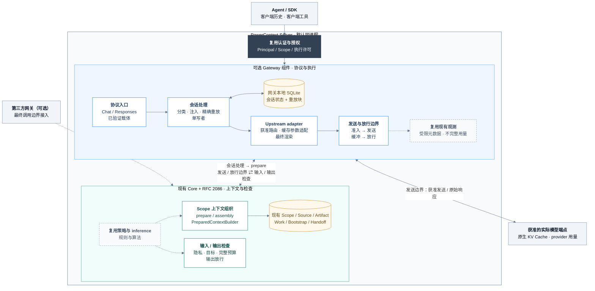
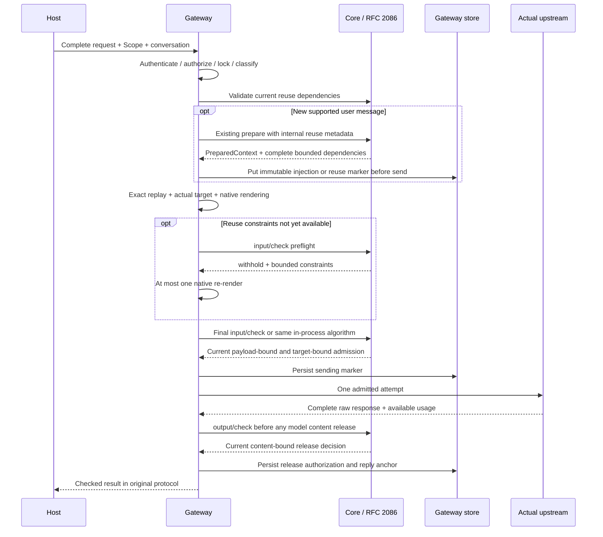
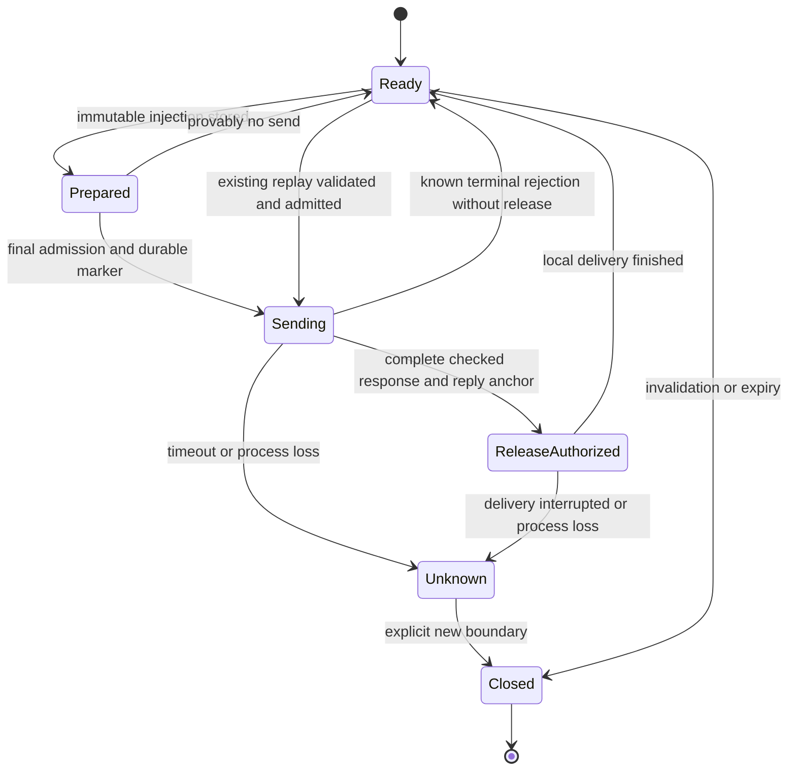

- Proposal Name: `powercontext_gateway`
- Start Date: 2026-10-22
- RFC PR: [oceanbase/powercontext#2199](https://github.com/oceanbase/powercontext/pull/2199)
- Related RFCs: [RFC 2086](https://github.com/oceanbase/powercontext/pull/2086)、
  [RFC 0016](0016_pydantic_ai_inference_integration.md)、[RFC 0046](0046_observability_foundations.md)、
  [RFC 1345](1345_scope_organization_and_agent_integration.md)、[RFC 1396](1396_handoff_access_control.md)、
  [RFC 1429](1429_project_bootstrap_context.md)、[RFC 1770](1770-decision-policy-governance.md)、
  [RFC 1783](1783-handoff-session-rollover.md)、[Working Note 设计](1790_source_backed_working_notes.md)

# Summary

PowerContext Gateway 是可选的模型调用入口。它把现有 PowerContext 的上下文组织能力接到 Agent 的模型请求路径，
在客户端保有历史和工具执行权的前提下，完成 Scope 绑定、按需准备、准确重放、实际目标选择、原生缓存适配和受控发送。
核心产品目标与 [RFC 2086](https://github.com/oceanbase/powercontext/pull/2086) 相同：
**上下文层的隐私安全拦截 + Token 效率优化**。

两份 RFC 组成同一条链路。#2086 定义 Core 的内容选择、表示策略、隐私与预算检查、复用约束及检查接口；
本 RFC 定义网关如何消费这些契约并控制最终请求、每次真实发送与首次响应释放。
网关不新增 ContextRuntime、GateRuntime、记忆算法或策略数据库，也不替代 Core 的领域提交。

首期随现有 Python Server 按需启用，共用进程、端口、认证和授权边界。
支持完整历史的 Chat Completions 与无服务端会话依赖的 Responses；上下文增强要求可信的会话关联。
仅在启用持久重放时增加**一个网关本地 SQLite 文件、两张专用表**，不增加 Core 表或数据库服务。
首期不建设独立管理后台、自动工具循环、自动转录入库、自动摘要压缩、计费账本或语义响应缓存。

本 RFC 与 #2086 均为提案。源码基线为 `0bc42d0b`，协作设计基线为 #2086；
下述路由、权限、内部准备元信息和网关存储均不是基线已发布能力。

| 决策 | 内容 |
| --- | --- |
| Core 的权威 | 上下文选择、资料资格、表示算法、隐私判断、复用约束和领域写入。 |
| Gateway 的权威 | 协议、可信会话、注入位置、不可变重放、实际目标、最终渲染、发送、缓冲和释放。 |
| 宿主的权威 | 用户历史、是否采用回答、客户端工具与副作用、工作完成、Handoff 时机。 |
| 模型服务的权威 | 原生 KV 的保存、复用和淘汰，以及供应商定义的用量。 |
| 接口增量 | 网关协议入口和两个会话元数据操作；Core 检查复用 #2086 的两个操作。 |
| 持久化增量 | 网关独立、按需启用的两张表；没有转录库、响应恢复库和全量 attempt 账本。 |
| 默认部署 | Server 内嵌，默认关闭；独立部署是使用同一契约的后续交付。 |
| 安全默认 | 必需检查不可用则暂缓；strict 响应批准前不释放模型内容。 |

# Motivation

只调用 `/v1/context/prepare`，PowerContext 能保证交付了什么，却看不到宿主随后添加的指令、工具结果和最终模型目标。
每一轮重新准备还可能改动历史前缀，增加召回成本，并降低模型原生缓存的复用机会。

网关补上执行侧的可见性和所有权：

1. 在真实模型入口检查完整请求，包括没有经过 PowerContext 的宿主历史和工具结果。
2. 只在受支持的新用户消息边界准备内容；普通工具轮次沿用原有注入。
3. 将已采用的上下文按原位置、原内容重放，减少不必要的表示变化。
4. 在实际模型/API/账号/区域确定后适配原生缓存，测量真实用量和完整任务成本。
5. 复用现有部署和领域 API，避免每个 Agent 自建召回、缓存参数和错误处理。

缓存稳定服从授权、资料资格、隐私和正确性。目标是改善复用条件，不能承诺命中、节省比例或模型质量提升。

# Guide-level explanation

## 一个 Coding Agent 如何使用

用户已注册 `project:powercontext`，部署方为该 Scope 配置允许的调用主体和模型 profile。
客户端把模型 base URL 指向网关，使用 PowerContext 认可的调用凭据。
支持额外请求头的宿主还传递稳定的会话 ID；不同工作使用不同会话。

下面是**提议接口**的完整历史调用示意，`coding-default` 是部署方的模型别名，不是供应商品牌：

```bash
curl https://pc.example/gateway/v1/chat/completions \
  -H "Authorization: Bearer $POWERCONTEXT_TOKEN" \
  -H "X-PowerContext-Scope-ID: project:powercontext" \
  -H "X-PowerContext-Conversation-ID: coding-client-001" \
  -H "Content-Type: application/json" \
  -d '{
    "model": "coding-default",
    "messages": [
      {"role": "user", "content": "修复 API 客户端，保留契约生成要求"}
    ],
    "stream": false,
    "max_tokens": 2048
  }'
```

1. 网关认证调用者，校验当前 Scope 读取权、付费调用权和 profile 使用许可。
2. Core 通过现有 prepare/assembly 选择带引用的上下文。网关不自行搜索数据库或排序 Memory。
3. 网关在协议允许的最新用户内容末尾追加完整 PreparedContext，保留其历史材料信任包装。经 Core 批准的准确重复整块可以继续使用历史注入。
4. 网关持久化准确注入、位置和复用依赖，再渲染目标请求，经 #2086 的最终输入检查后发送。
5. 原始回答完整到达并通过输出释放检查后，网关按客户端协议交付。
6. 客户端运行工具，再提交原历史和工具结果。网关原样放回已有注入，本轮不重新召回，仍检查完整输入。
7. 新用户消息可触发一次新的有界准备。刷新、撤销或资料失效时建立新边界，不为缓存继续使用失效内容。

准备结果 empty 是正常结果；隐私拒绝、复用资格失效和策略不可用有明确状态。
网关成功交付回答不代表工具已执行、Memory 已写入或任务已完成。

## 三种接入方式

| 接入方式 | 使用方法 | 能力边界 |
| --- | --- | --- |
| Server 内嵌网关 | 启用可选组件并将模型请求发到 `/gateway`；首期推荐。 | 经同一认证/授权执行器访问 Core，复用进程内准备元信息与检查。 |
| 独立 PowerContext Gateway | 后续以 HTTP 调用现有 prepare 和 #2086 检查接口。 | 必须有可信委托；远端持久重放还需本文定义的可验证准备绑定。 |
| 第三方网关 | 在其最终发送/释放边界接入 #2086；也可作为经过验证的上游路径。 | 不要求使用本网关的会话表；实际目标、变换、重试和可见性决定覆盖。 |

只修改 base URL 不一定能启用可靠会话增强。没有稳定会话关联的客户端首期使用 `check_only`：
仍检查完整请求和响应，不推测项目、继承旧会话或自动注入。
受支持客户端清单必须记录真实版本、请求头能力、完整历史、取消、流式超时和原生签名行为。

## 两份 RFC 的分工

| 问题 | #2086 的契约 | 本 RFC 的落实 |
| --- | --- | --- |
| 放哪些上下文 | 现有 Scoped prepare、assembly、Builder、资料资格和获准表示。 | 在新消息边界调用一次，保留结果，不复制选择算法。 |
| 是否能继续复用 | 授权、新鲜度、保留范围、完整来源依赖与复用限制。 | 发送前验证资格；持久化准确块，失效则停止该重放 epoch。 |
| 怎么检查 | 同一输入/输出算法、模式、失败动作与临时绑定。 | 最终渲染后调用，每个真实尝试重新准入，strict 首次释放前检查。 |
| 怎么命中缓存 | Core 提供可复用边界，实际命中属于模型服务。 | Native adapter 选择目标能力、断点、TTL 和路由提示，解析可用 usage。 |
| 谁保存运行状态 | Core 不建立推理数据库；原 Source/Artifact 保持领域契约。 | 网关仅保存恢复注入所需的两张表，不写通用模型转录。 |
| 如何写回知识 | 现有 Source/Artifact、Work/Handoff 及其验证。 | 首期不自动保存；后续显式采用现有 API，不能绕过提交。 |

# Reference-level explanation

## 1. 范围、层次与非目标

网关是执行适配器，业务代码置于 `src/powercontext/gateway/`，不让现有 Runtime 反向依赖网关。
协议处理、最终渲染和传输属于网关；共享隐私/表示算法留在 #2086 指定的 context/inference/policy 所属模块。

首期支持单机、单网关进程、无 context references 的单 Scope、完整文本和已验证结构化工具载体。
增强 profile 先显式选择 `assembly.sections=[{"family":"memory","limit":6},{"family":"experience","limit":2}]`，
`include_code=false`；其他 family/代码/跨 Scope 只有完整复用依赖与验收齐备后才能进入持久重放。
这不改变原 prepare 用户的默认选择。

首期不提供任意协议互转、动态“便宜模型”升级、负载均衡、通用反向代理、全局费用硬预留、
多机共享 SQLite、上下文自动有损压缩、响应/语义缓存、秘密恢复或任意 Agent 工具执行。
Core 后台的 Embedding/rerank/提取仍由自己的 inference 边界负责，不强制绕经网关、不自动注入 Agent 上下文。

## 2. 组件和调用关系



蓝色分组为网关协议与执行，绿色分组为 Core 上下文与检查，暖色节点为持久状态；虚线表示策略、观测和第三方可选接入。分组间连线标明实际调用方与入口。

图中 Core 与网关是职责边界，不是两个必需服务。内嵌路径调用相同 application/检查算法，
仍经过 Server 的认证授权执行器；不能因为同进程就直接取 repository 绕过资源授权。
独立和第三方路径经已有 HTTP 契约接入，不导入 Server 私有 handler，也不直连 Core 数据库。

实现按内聚职责拆分协议、upstream、replay/store 和请求流水线；不先建设通用插件框架或新“运行时”门面。
Native adapter 必须接入最后一次实际发送；高层 SDK 若隐藏重试/内容变换，不能据此声明完整覆盖。

## 3. 身份、Scope 和执行许可

复用 `AuthenticationProvider` 得到的 `AuthenticationResult`、Principal/actor/credential identity、
当前 Scope 目录和 `AuthorizationProvider`。不新增网关用户库、独立租户体系或网关密钥表。
已有静态 Bearer 只映射一个固定主体，不能宣传为多用户隔离。

| 约束 | 设计 |
| --- | --- |
| Scope 选择 | `X-PowerContext-Scope-ID`，或可信部署配置将某一凭据绑定到唯一 Scope；有歧义则拒绝。 |
| Scope 权限 | 每次请求和必要重放验证当前 `scope.read`，原资料仍按自己的 access profile 授权。 |
| 付费执行 | 提议在现有授权词汇中增加 Scope action `gateway.invoke` 与最小角色 `gateway.user`；读取权不隐含模型消费权。 |
| Profile 许可 | 已认证主体只能使用部署方允许的 profile/模型别名；客户端 model 值只是选择请求。 |
| 状态隔离 | `deployment + principal + scope_id + conversation_id + epoch` 完整分区；他人的 ID 不可读、猜测或接管。 |
| 管理 | 配置变更复用运维配置与 `server.admin`；会话状态读取/删除还必须校验主体归属。 |
| 凭据 | 客户端的 PowerContext 凭据不转给模型；provider 凭据由获准 profile 从 secret reference 解析。 |

`gateway.invoke` 和 `gateway.user` 都是新增提案，不是已有枚举；现有角色不自动扩大授权。
是否授予管理员相应执行许可由明确角色映射决定，并在升级契约中说明。
会话 Scope 不可原地切换；切项目创建新会话。客户端 user、metadata、提示词标签和 provider session ID 都不能授予权限。
`for_scope` 只是分区绑定，不能代替 Server 的授权。

独立部署携带原用户认证或受支持的可信委托，Core 同时识别 subject/actor。
不能使用一个全权限服务 token 再信任请求中的任意 principal/scope，也不能在 PDP 不可用时继续读取或付费发送。
首期不增加跨用户共享重放；同 Scope 协作也不能读取另一主体的网关注入副本。

## 4. 配置、路由和目标 profile

使用现有 Server 配置加载机制增加可选 `gateway` 段。以下字段是提议值，阈值需在验收时固定：

```yaml
gateway:
  enabled: false
  context_owner: gateway
  privacy_mode: enforcing
  output_mode: strict
  replay:
    enabled: true
    idle_ttl_seconds: 3600
    max_age_seconds: 86400
    max_context_blocks: 128
    max_context_bytes: 262144
    max_reuse_dependencies: 64
  limits:
    max_request_bytes: 8388608
    max_response_bytes: 2097152
    max_inflight: 16
  upstream_profiles:
    coding-default:
      protocol: openai-chat
      model: deployment-model-id
      base_url: https://approved-model.example/v1
      credential_ref: env:MODEL_API_KEY
      cache_adapter: validated-deployment-profile
```

`context_owner` 从可信配置选择 `gateway` 或 `host`。Host 已管理 prepare/bootstrap/Handoff 时，
网关不重复准备或追加第二份上下文，但完整请求检查始终执行。
提示词中出现某个标签不是 host 所有权证明，更不能关闭安全检查。

`UpstreamProfile` 与 #2086 使用同一契约，不建立第二套缓存能力模型：
包括准确目标、API/协议和 renderer 版本、账号/区域、允许的数据处理与保留、
模型窗口/输出上限、工具/schema/reasoning 能力、原生缓存模式/边界/TTL 语义及 usage 映射。
Profile 和配置快照有版本；普通变化在新 epoch 生效，吊销/安全规则变化立即按当前检查契约生效。

路由按可信 profile、请求协议、获准模型别名确定唯一目标，并在 epoch 内保持稳定。
相同优先级歧义在配置加载时拒绝；首期不做自动 fallback。
目标禁用/凭据失效时显式失败，不能静默换账号、区域、模型或协议。
未来允许目标切换也须重新规划、验证历史兼容性和完整准入，不能沿用旧缓存绑定。

默认禁止 provider 重定向、客户端指定 base URL、任意透传 authorization/cookie、未知查询参数和凭据拼接。
端点解析、DNS/IP 与网络出口策略必须防止受控配置变更绕过获准目标；不把字符串前缀匹配当作目的地证明。
第三方上游 profile 还须验证隐藏路由/重试，未知实际目标不能标记为已覆盖。

## 5. 协议、载体和会话识别

| 路径/协议 | 首期行为 |
| --- | --- |
| `POST /gateway/v1/chat/completions` | 完整 history、经验证的文本/工具请求；原协议输出。 |
| `POST /gateway/v1/responses` | 完整 input、`store:false`、没有 provider 端隐式历史；原协议输出。 |
| `GET /gateway/v1/models` | 只列出调用者可执行的已配置模型别名，不向任意上游广泛探测。 |
| `POST /gateway/v1/messages` | 后续独立适配和验收；不是首期已支持路径。 |
| Embeddings、批任务、文件、WebSocket、音视频和未知路径 | 首期拒绝；不自动变成未检查的通用代理。 |

Responses 的 `previous_response_id`、`conversation`、`background`、item reference、
不透明推理/签名块等，只有 profile 能还原检查所需内容并保持原生约束时才可支持。
首期 enforcing 路径无法检查隐藏历史时拒绝；不能静默透传并继续声称完整保护。
Chat/Responses 不互转；native signed/reasoning 内容不跨模型迁移，不自动改写或删除。

会话 ID 优先由受支持宿主稳定传递；网关生成 epoch，客户端不能指定旧 epoch 绕过校验。
同一 ID 仍需验证 history prefix、消息角色、工具 call/result 配对和此前回答的完整关联；
相同开场问题或相同 query hash 不构成同一会话。
首期不采用模糊历史检索或跨会话祖先猜测，未绑定请求只进入 `check_only`。

请求分类仅决定可选增强：

| 类型 | prepare | 既有注入重放 | 输入/输出检查 |
| --- | --- | --- | --- |
| 首条/新的用户消息 | 至多一次有界准备 | 验证后重放已有块 | 必需 |
| 工具结果、同轮续答、传输前重试 | 不重新准备 | 验证后准确重放 | 每次真实尝试必需 |
| 标题、后台 housekeeping 等已识别辅助请求 | 不增强、不自动存储 | 仅按已验证协议需要处理 | 独立完整检查 |
| 无可信会话关联或 host 所有权 | 不自动准备 | 不从网关继承 | 必需 |
| 无法识别的历史变更、客户端压缩/编辑 | 暂停旧 epoch | 不猜测补全 | 返回显式冲突或要求新边界 |

分类未知时可停止增强，但不降低安全覆盖；签名或历史一致性无法保证时拒绝该请求。
工具定义、参数、结果、错误文本和宿主新增材料都在完整检查范围。

## 6. 上下文准备、准确注入与可信复用依赖

新消息通过已有 `ScopedContextApplication.prepare` 流程取得一次 PreparedContext；
沿用 assembly、Builder 的引用、信任包装、UTF-8 预算和遗漏行为。
不重新拼装一份网关版 Memory 目录，也不把已有 prepare 再调用为“安全预检”。
先按同一 anchor 读取已有块；存在则直接验证并复用，不再 prepare。
empty 也保存无正文标记，避免重试反复召回。崩溃前未提交的准备候选可能重算，
因此承诺的是单一准确已提交表示，而不是准备计算恰好一次。

网关按协议在**最新用户内容末尾**追加完整上下文块，不提高它的指令级别。
不改写旧 system/developer/tools，不向稳定段插入随机 ID、时间戳或诊断字符串。
不能为了腾空间截断已经生成的引用包装。协议不允许安全追加时关闭该增强能力或拒绝必需增强 profile。

重放记录包含精确 prepared 文本、注入位置、目标原生块及 renderer 版本、内容摘要、消息 anchor、
来源复用绑定、保留约束和创建/失效时间。它在首次发送前以 put-if-absent 写入。
同一分区/epoch/anchor 发生不同值冲突时停止发送，不覆盖旧块、不重新召回“修复”旧注入。
写入失败时不发送该增强请求；发送后无法保存释放状态时不释放正文，保留 Unknown 语义。
客户端历史是事实权威；网关只保存自己增加的派生块，不保存用户完整 transcript。

anchor 使用固定版本的协议 canonicalizer，对原始客户端消息的有序前缀建立增量 HMAC 链，
包含消息序号、role、支持内容及工具 ID，不包含网关注入。
相同文本出现在不同位置、客户端编辑旧消息或改变工具关联时不会误用同一 anchor；
计算按完整请求线性推进，不为每个块重复扫描历史。

新用户消息仍可能选中已经存在的内容。Core 的可选整块交付复用策略只有在准确 prepared 文本、
完整依赖/版本、信任与位置约束都匹配，且旧块确实保留在本次待发历史并仍获准时，
才允许网关省略本轮重复追加；旧块保持原位，新的 anchor 保存有界复用标记。
判断归现有 context/inference 的复用约束，不由网关仅凭 hash 推断。
部分重合时首期不拆块、不删除单条 Memory、不改写包装；继续交付完整新块，
或者因总预算不符而暂缓。该可选策略沿用 #2086 的 off/shadow/active 和独立质量验收；
未启用或无法证明等价时不能声称已经去重。

### 6.1 准备结果不是授权凭据

四字段 `PreparedContext`、正文中的引用、`PreparedContextBuild.lineages` 和 Bootstrap receipt 都不足以单独批准持久重放。
Core 需要在实际选中并完成 render/fit 的路径上产生**完整、有界的复用依赖**：
确切资源/版本、所属 Scope、内容摘要、适用资格/新鲜度规则、最大保留时间和输出内容绑定。
已有 origins/lineages 可以提供部分输入，不能直接改名为授权证明。

首期内嵌网关在同一次授权 application 调用中取得这份内部元信息。
这是对现有准备路径的可选内部扩展，不另建 prepare 算法、不暴露私有 `_prepare_build` 给网关，
不改变公开 PreparedContext 的四字段结果。
未实现完整依赖的 family/代码/reference 不能进入该增强 profile；缺失依赖不能解释成“无需校验”。

每次发送前，由 Core 的原领域读取/授权能力验证这些有界依赖：
当前 Scope/资料权限、被选版本是否仍可用于该历史用途、active/retired、必要 head/freshness、
当前隐私与保留策略。此验证不重新做语义搜索或 Embedding。
单 Scope 也需验证资料生命周期；Scope 可读不代表已撤销资料可以永久外发。

任何依赖失效、过期或无法确认时返回 `context_refresh_required` / withhold，停止旧 epoch。
宿主以新会话或显式 Handoff 建立新边界；不可原地替换旧块、拼接两个语义窗口或破坏原生签名。
新增资料不要求每次重算所有历史查询；profile 必须明确最大新鲜度期限，以及新用户消息/显式刷新边界。

### 6.2 独立部署的可验证绑定

远端增强是后续交付，不能仅从普通 prepare 正文推导来源。
提议在**现有 prepare 操作**上协商可选响应头 `X-PowerContext-Reuse-Binding`：
仅在调用者请求该能力且 Core 已建立完整依赖时返回，JSON body 仍为原四字段。

绑定使用有版本、可认证且加密的短期 envelope，包含部署/主体/Scope、准确正文摘要、
完整依赖、策略/准备 profile 和期限，不包含正文；设置严格长度/数量上限。
拒绝篡改、过期、错误 audience/subject/Scope 和未知 key version。
它不是 bearer 权限，也不是已注入证明。每次调用 #2086 的 `input/check` 仍重新认证和验证当前依赖；
最终结果只绑定此次真实载荷和目标。

此扩展不增加第三个 Core 操作或永久 receipt 表；绑定轮换、有效期、长度与吊销延迟必须验收。
未协商该能力的客户端保持原契约；远端 Gateway 在能力缺失时仅使用 `check_only`，
不以不安全的冻结重放代替。第三方可选使用相同绑定，无需部署本网关状态库。

## 7. 模型原生缓存与完整预算

网关保存的是可重建模型输入的准确注入；模型服务保存的 KV 是另一种状态。
每次真实调用仍生成新回答。首期没有答案、语义或工具副作用缓存。

```text
Request 1: unchanged instructions/tools | user-1 + exact context-A
Request 2: same native prefix           | accepted answer-1 | tool results
Request 3: same historical placement    | user-2 + context-B
```

这是逻辑示意，实际缓存资格遵守目标协议的角色、内容块、token 边界和部署规则。

Native adapter 消费 #2086 的 `reuse_constraints`，在获准 profile 内选择自动/显式缓存能力、
合格原生断点、TTL 与路由提示。Core 不生成通用 `cache_control`，网关不自行决定哪些失效资料还能保留。
缓存设置在最终渲染前完成，随后检查准确正文、相关请求头、目标和输出限制。

| 部署缓存能力 | Adapter 如何执行 | 支持边界 |
| --- | --- | --- |
| 隐式前缀缓存 | 保持准确原生前缀；仅在目标支持时提供稳定路由提示；映射其实际 cached-input 用量。 | 没有显式断点也不能省略历史/目标验证，不承诺命中。 |
| 显式断点缓存 | 在 profile 允许的 tools/system/message 内容块设置原生断点与保留参数。 | 不把断点当作跨协议通用字段；必须保持对应原生边界。 |
| 独立远端缓存资源 | 涉及额外创建/引用/删除、付费与保留生命周期。 | 首期不支持；需独立验证完整输入可见性与资源治理，不预先批准存储。 |

模型别名不能自动推断以上能力。每个获准 profile 需固定实测能力、最小前缀要求和 usage 定义。
需要路由提示时从部署/主体/Scope/epoch/目标 profile 的稳定分区派生，不使用不断增长的完整请求摘要，
也不暴露原始业务身份；提示只影响目标支持的路由机制。

| 变化 | 处理 |
| --- | --- |
| 普通新工具结果/新用户消息 | 保持此前准确块与原生位置；对完整新增请求重新检查。 |
| 工具/schema、system、reasoning 设置变化 | 判断该协议是否可继续；新的缓存资格不能冒充旧绑定。 |
| 模型/API/账号/区域/renderer 变化 | 新目标规划与准入，必要时新 epoch；不迁移私有 KV。 |
| 权限撤销、资料失效、必需策略变化 | 优先停止旧复用，允许缓存失效。 |
| 可选缓存参数不支持 | 仅在原请求仍获准且预算合法时省略，再检查变化后的最终载荷。 |
| 缓存未命中 | 正常生成，不重试、不默认填充内容以凑缓存门槛。 |

省略 cache 参数不能证明禁用供应商隐式缓存。目标保留/地域/隔离要求无法满足时拒绝该 profile。
Scope/route key 不等于物理缓存隔离，缓存 TTL 不等于隐私删除期限。
稳定请求字节是本地可验证不变量，不证明供应商内部 token/KV 相同；
原生兼容、实际用量与延迟分别验收。

完整 token 预算包括指令、原客户端历史、已重放块、工具/schema、协议开销和输出预留，
使用声明过误差的目标估算器/profile。`prepare.max_bytes` 只限制补充上下文。
空间不足时暂缓，让宿主显式缩小下一次 prepare 或 Handoff，不自动裁剪历史或已批准上下文。
Core 表示策略在准备阶段执行；网关不得二次压缩已经冻结的 prepared 文本。

## 8. 发送、输出与失败状态



检查沿用 #2086 的 `allow/block/withhold`、当前授权、可信 stage/profile、
覆盖范围、最终内容/目标绑定和有效期；check-only 操作本身不证明真实发送行为。
内嵌与远端执行必须用同一规则和一致性样例，不在网关实现另一个更宽松的隐私判断。

接收时先限制原始字节、严格解析 UTF-8/JSON、拒绝重复键和不支持结构，再执行可选增强。
原始载体保留到检查完成，与最终载荷一起纳入适用内容检查，避免序列化归一化隐藏禁止值；
目标 token 预算只对真正外发的最终载荷计算。
prepare 所需查询 Embedding/rerank 仍在 Core 自己的发送前检查边界，不能等主模型准入才保护这些辅助调用。

强制检查覆盖指令、历史、上下文、工具定义/参数/结果、支持的结构化内容、
原始输出、可暴露错误和完成状态。重复 JSON 键、转义/数字表示和未知字段不能隐藏敏感内容。
禁止资料不能先发送给远端分类器/摘要器，再判断是否可以外发；可选优化关停不影响必需规则。

### 8.1 严格输出与流式

`strict` 缓冲完整受支持输出，完成检查后再组装普通响应或 SSE。
在批准前可以发送无模型内容的协议心跳，不能向客户端发送答案片段、工具参数或原始 provider 错误。
这不是实时 token 透传，会增加首次内容释放延迟，需验证客户端和反向代理超时。
`observe` 只观测，不宣称阻止输出泄露；未独立验收 bounded streaming 前不提供相应 enforcing 声明。

缓冲限制覆盖响应字节、时间、并发、解析深度和总内存。2 MiB × 16 只是正文下界，不能当作进程 RSS 上限。
超限、不完整 JSON/工具参数、上游断流、释放检查失败或不可用时，不释放并尽力取消。
不把敏感响应溢写到 SQLite 或临时文件。发送与释放前校验当前策略，撤销延迟按实际边界测量。
SSE 头已发出后，用受支持错误事件终止，不能声称改变已发出的 HTTP 状态。

### 8.2 有界发送与重启

连接池和存储等待计入准入期限；真实写入网络前复核绑定仍有效，过期就重新检查。
已持久化发送标记不能延长权限、策略或目标绑定，也不能被当作永久发送许可。

一次模型请求只有一个 retry owner；底层 SDK 的隐藏重试必须关闭或被最终边界逐次覆盖。
确定未发送的连接失败才可在有界预算内重试，重新完成准入。
任何可能到达上游的超时、连接丢失或进程崩溃都记为 `outcome_unknown`，不自动付费重发、不自动 fallback。

会话只允许一个在途请求，进程内锁加数据库版本 CAS 保证状态更新。
首期不依赖租约过期推导“上游没执行”，不宣称分布式恰好一次。
同会话并发冲突返回 409，客户端在原调用完成后重试；取消按实际发送状态保存已知/不确定结果。
发送前被 block/withhold 不推进已发送状态；已取得完整终态但拒绝释放时记录已知失败，
不把明确拒绝误标为未知，也不自动再次调用模型。



重启读取 `Sending` 或未确认交付的 `ReleaseAuthorized` 时转入 Unknown，而不是重放旧模型请求。
没有持久响应正文，所以即使输入相同也不能恢复上一份回答。
`release authorized` 仅说明本地检查批准，不证明宿主采用、网络送达或任务完成。

首期不承诺客户端重复请求的模型幂等性。新的再生成可能再次计费；
Unknown 状态中的同一未解决调用返回 409，宿主显式开启新边界并决定是否承担再次执行。
#2086 的无持久响应恢复限制保持不变；网关状态仅防止它自己在重启后盲目自动重发。

## 9. 最小接口清单

Core API 的请求体继续使用 `scope_id` 和现有扁平 operationId；网关模型协议不往供应商 body 强塞领域字段。

| 类别 | 接口/操作 | 状态与归属 |
| --- | --- | --- |
| 上下文 | `prepare_context`；按宿主流程使用 Bootstrap/Work/Handoff | 已有 Core API，准备算法不复制。 |
| 输入/输出 | `POST /v1/inference/input/check` / `check_inference_input`；`POST /v1/inference/output/check` / `check_inference_output` | #2086 的提议；本网关消费，不新增替代检查 API。 |
| 协议入口 | `/gateway/v1/chat/completions`、`/gateway/v1/responses`、`/gateway/v1/models` | 本 RFC 首期提议；使用对应协议的成功响应。 |
| 会话状态 | `GET /v1/scopes/{scope_id}/gateway/conversations/{conversation_id}` / `get_gateway_conversation` | 本 RFC 提议；仅返回 owner 可见的元数据。 |
| 删除派生副本 | `DELETE /v1/scopes/{scope_id}/gateway/conversations/{conversation_id}` / `delete_gateway_conversation` | 本 RFC 提议；关闭 epoch、阻止后续使用并删除网关重放块。 |
| 能力发现 | 现有 `get_capabilities` | 实现时扩展声明：协议、carrier、strict、增强、重放、远端绑定及版本。 |
| 远端准备绑定 | 现有 prepare 的可选 `X-PowerContext-Reuse-Binding` 响应头 | 后续协商扩展；不改默认 body、不增加 operation。 |

会话创建随首个合法增强请求发生，无需 start/plan/prepare/finalize 一组网关 CRUD。
GET 不返回上下文/响应正文、凭据或命中秘密；已不存在会话仍按隐私约束处理，不泄露他人资源存在性。
DELETE 是对网关派生副本的操作，不等于删除 Source/Artifact，也不能收回已发送给模型的材料。
删除与在途发送/释放在同一会话状态机排序；正在取消的请求返回 409/稍后重试，
成功只在阻止后续本地使用并完成可见行删除后确认，不承诺 SQLite 页、备份或 provider 端物理擦除。

`X-PowerContext-Scope-ID` 必须与可信绑定一致；领域会话路径以路径 Scope 为准，冲突输入不能换归属。
如客户端不能传 Scope header，可信的一凭据单 Scope 绑定可以省略它；不能以全局默认 Scope 猜测隔离。

模型路径保留原生 envelope，失败使用协议允许的错误形状，带有无正文的稳定原因和请求关联。
`401/403` 用于认证授权，`409` 用于历史/在途/Unknown 冲突，`422` 用于不支持载体或窗口约束，
`429` 用于网关准入容量，`503` 用于强制策略/依赖暂不可用；被策略明确禁止的内容用 403。
不把 withhold、empty、upstream error 和本地拒绝混成同一种成功响应。
所有 PowerContext 控制头、复用绑定和调用凭据均在最终上游请求中剥离；只发送获准 provider headers。

上述均为设计，本文不修改 `openapi/powercontext.yaml`。实现时 Core 检查/管理元数据操作进入该权威契约、
生成客户端并运行 `make api-generate` / `make contract-test`；
模型 wire schema 单独版本化、记录 OpenAPI 入口和一致性 fixture，不用普通 Core ErrorResponse 冒充供应商协议。

## 10. 持久化、成本与生命周期

### 10.1 为什么需要两张网关专用表

精确注入需在请求重试和网关重启后恢复，单靠内存不能保证历史一致。
现有 Source 是领域证据、Artifact 是版本化知识，Bootstrap receipt 是特定交付去重，
usage 日聚合是允许缺失的统计；均不能承担未交付模型调用或不可变注入的状态机。
不应为少建表而把这些私密副本塞入 Source/Artifact、processing lease 或 decision observation。

只在可选网关持久重放启用时建立 `gateway.sqlite3`：

| 表 | 主键与必要内容 | 更新约束 |
| --- | --- | --- |
| `gateway_conversations` | deployment/principal/Scope/conversation/epoch；配置/renderer/目标 profile；客户端历史摘要、最近回答 anchor；最新 attempt 状态/摘要；版本、期限。 | CAS 更新；最新 attempt 是有界防盲重发标记，不是全量账本；不含完整历史或回答正文。 |
| `gateway_replay_blocks` | 完整会话分区 + message anchor；准确注入/原生位置、复用绑定、内容摘要、创建/失效时间。 | put-if-absent；冲突失败；按会话/期限可删除；只保存该网关注入。 |

首期不新增 Core 表，不新增 profile/key/log/response/capture/tool/summary 表。
配置用可信文件/secret reference，低敏诊断用已有可观测性；选中版本和提交仍使用 Core 的领域存储。
如果关闭持久重放，必须回到无自动跨请求增强的 check_only，不能在已有增强会话中悄悄丢失注入。

SQLite 单机本地 WAL，严格目录/文件权限，不放共享文件系统；仅支持单进程网关所有者。
打开状态库时持有生命周期级的独占进程锁；第二个所有者启动失败，不能依赖请求级 CAS 掩盖多进程发送。
不因 Core 使用其他数据库就默认提供网关多机恢复。
新文件有独立且显式的版本迁移；未知版本拒绝打开，迁移先备份并验证准确块读回。
升级不能静默给旧块绑定今天的来源/权限；缺失新版本必需依赖时关闭旧 epoch。

### 10.2 上限、过期与清理

持久正文遵守部署保留策略，使用受管理密钥的认证加密；密钥不可用时拒绝敏感持久写入。
密钥不写进 SQLite；加密不能替代 Scope/owner 校验、备份权限和当前授权。
会话/消息摘要使用部署 HMAC，避免把低熵内容 hash 当作可公开诊断。

默认上限提议为 idle 1 小时、绝对 24 小时、128 个块、每会话 256 KiB；
真正有效期限取配置、Core 绑定和资料允许保留期限的最小值。
TTL 到期先停止读取/发送，再异步清理；cleanup 尚未执行不能延长资格。

128 块是条目上限，256 KiB 是累计 payload 上限，不是每块上限。
一个主体最多 100 个活跃增强会话时，正文上界约 25 MiB；1,000 个主体约 25 GiB，
还需计算索引、加密、WAL 和备份。部署必须配置主体与全局总字节/会话准入上限，不能仅靠 TTL。
容量达到上限时拒绝新增强，不能驱逐仍需重放的块后继续发送。

读写按完整会话键和有界 anchor 批量查询；每次 prepare 的候选仍受原条目上限约束。
完整会话去重后的复用依赖最多 64 个，当前资格验证受该总上限约束，而不是只计算本轮 8 个候选。
达到依赖上限就暂缓并要求新边界，不能截断依赖清单继续发送。
单次新消息不扫描所有会话、全部 Source 或整份 Memory 集合。
过期清理按索引有界批次推进；测量热会话并发、WAL 增长、重启和清理延迟。

客户端历史虽不持久化，仍要逐次解析/扫描，成本随请求长度线性增长；
完整隐私检查和 strict 输出缓冲的 CPU/内存成本不能被“只为新消息召回”掩盖。

## 11. 用量、运行治理与可观测性

共用现有 telemetry、usage wrappers、统计/sink 和无内容诊断规范。
新增 operation/unit/outcome、协议、有限原因与 coverage 必须登记字段白名单并同步中英文指南，
使用 `log_safely`，复用请求/trace 身份，不记录 prompt、引用正文、响应、密钥或敏感路径。
日志与允许丢失的 usage 不能充当响应恢复、审计或财务账本。

网关产生有类型的 attempt 元信息：实际目标/profile、准备/检查/发送/缓冲/释放耗时、
可取得的普通输入/缓存读写/输出/reasoning 用量、已知/估算/未知状态和未完成原因。
复用 #2086 在 inference/usage 边界的可选元信息，不另定义第二套通用用量模型；
日聚合不能反推出缺失的缓存或失败尝试，unknown 不记零。
关联 task ID 是观测信息，不证明宿主任务成功。

首期执行治理是有界并发、输入/输出大小、超时、取消与背压，不建设复杂限流或硬费用预留。
区分上游首 token、第一次获准内容释放和交付结束；
客户端断开后尽力取消，不能假设上游立即停止计费。
强制依赖不可用时 readiness/操作显式报告，不能把安全组件故障降级成裸透传。

## 12. 后续能力与现有领域的组合

| 能力 | 组合方式 | 开启前的独立验收 |
| --- | --- | --- |
| 独立部署 | 同一 Core prepare/check、可信委托和可验证复用绑定。 | HTTP 真实链路、当前授权、key rotation、绑定长度/过期、取消和故障。 |
| 只读记忆工具 | 显式允许的 MCP/HTTP 工具；结果保持原证据/权限，工具往返纳入完整检查与准确重放。 | 模型可见目录、宿主可见行为、轮数/成本上限、原生 tool/reasoning 配对。 |
| 写工具/副作用 | 默认关闭；用户明确授权，沿用领域审批、幂等和提交。 | 不能把执行许可当工具授权，不能在隐藏循环中默认批准写入。 |
| 显式保存对话片段 | 用户/宿主要求时，复用 `/v1/sources/content` 或 working-notes；稳定 source_id + 准确同值重试。 | 剥离网关注入仅依据可信注入记录；隐私/保留、回执、冲突与读取验收。 |
| 长对话连续性 | 优先宿主显式 Handoff/rollover，采用原 prepare/finalize/commit/continue 流程。 | 真实持久化/readback，不把临时摘要当 Handoff，不自动宣称接收/完成。 |
| 自动 compaction | 若有独立质量与完整费用证据，再定义新窗口、摘要证据和签名兼容。 | 摘要调用也逐次检查/计费，明确缓存失效与不可逆信息损失。 |

网关模型完成不等于用户采用，下一轮重复出现也不等于明确知识保存授权；首期不根据这些启发式自动入库。
未来保存使用现有同值 capture 幂等契约：同一完整 Source identity 和准确内容/metadata 返回原回执，
不同内容是冲突。不能因超时生成新 ID 掩盖不确定写入，也不能因 Source 202 声称 Memory 已生成。
Working Note 是显式短期证据，不自动晋升 Memory。

网关不重新实现后台写入门；强制隐私失败/unknown 不能被转成写入 HOLD 或空提取成功，
不能推进未处理 Source 游标。后台领域恢复和重试预算继续由原消费者负责。

## 13. 分期与验收

### P0：随 Server 运行的最小闭环

先交付单 Scope、明确会话 ID、memory/experience 的完整复用依赖、Chat 和完整历史 Responses、
单一获准部署 profile、strict 文本/结构化工具响应、准确持久重放及有界执行。
不透明 carrier 或其他 family 通过能力声明排除，不以宽松透传补齐。

#2086 的共享输入/输出检查和内部完整复用依赖是安全前置条件；
其独立无网关切片仍可先交付。本组件只有前置条件验收后才能开启 enforcing/增强声明。
P0 内嵌无需 HTTP 检查往返、独立网关部署或远端准备绑定。
只需要检查的用户可以不开 replay，不创建两张网关表。

### P1：远端与更多协议

验证已有 prepare 的可选绑定响应头及 #2086 两个远端检查，交付独立部署/第三方 conformance 样例。
补齐 Messages、相应原生签名和更多受支持 carrier/family；每项单独公布真实客户端和部署版本。
不因 P0 已通过就默认这些路径受保护。

### P2：按证据扩展

在明确需求和独立评审后增加只读工具、显式保存、更大部署规模或质量验证的 compaction。
这些不是完成 P0 的前提，也不预先批准新表、自动写知识或动态模型调度。

### 必需验证

| 维度 | 可复现验收 |
| --- | --- |
| 两份 RFC 一致 | 进程内和 HTTP 使用相同策略样例；未知/不可用、授权、真实目标、内容绑定和有效期一致。 |
| 隐私 | 在宿主历史、上下文、工具结构、转义/重复键、原始错误植入禁止值；受控上游/宿主分别证明未收到阻断内容。 |
| 复用与权限 | 当前 Scope 拒绝、Artifact retired/删除、head/freshness 变化、绑定篡改/过期、跨用户/Scope ID 不能继续重放。 |
| 历史一致性 | 首条、新消息、工具轮、准确整块重复与部分重合、重新生成、客户端编辑/压缩、不同会话同一问题、host/gateway 同时接入。 |
| 原生载体 | 角色/工具 ID/顺序/内容块不变，renderer 变化明确，签名或隐藏历史不支持时拒绝。 |
| 状态和恢复 | 块冲突/磁盘满阻止发送；真实进程崩溃覆盖发送前、发送后、释放前后；Unknown 不自动重发。 |
| 并发与取消 | 同会话只准一个在途，PDP/策略失败不旁路，客户端中断、SSE 背压、超限和清理不泄露。 |
| 部署与迁移 | 默认关闭不创建状态库；开启后重启准确读回；未知 schema/key 拒绝；删除阻止后续本地使用。 |
| 领域复用 | prepare 四字段不变，不重复注入，不自动建 Source/Memory/Handoff，不把隐私失败消费成成功窗口。 |

实际协议支持需用受支持客户端和真实 provider 逐项验收。
Mock 上游适合证明本地字节/错误处理，不能证明真实缓存命中、签名兼容或真实宿主可用。

### 效率实验和上线标准

在同一任务/仓库/模型/协议/工具/schema、证据、策略、输出预算和质量标准下比较：

1. 当前直接调用，加相同必需隐私检查。
2. 经网关调用、关闭可选增强，测量网关和 strict 的额外成本。
3. 相同准备内容加准确重放，测量 prepare 次数、最终原生前缀和实际缓存用量。
4. 同一复用条件下再开启已验收表示/原生缓存策略，隔离其增量价值。

区分冷启动/预热/多轮、上下文刷新、模型参数变化、撤销和窗口边界。
供应商可能默认缓存，不能把“没传缓存参数”写成关闭缓存的基线。
所有组保留已有 Core 去重和召回优化，不人为重复检索放大节省。

记录完整任务质量、失败/修复/重试、主辅模型费用、检索/Embedding/rerank/判断、
缓存写/读、unknown 覆盖、CPU/RSS/磁盘、上游首 token/首次释放/总时长及 P95/P99。
需要真实付费对照时使用独立实验预算；shadow 候选不默认增加模型调用。
只有隐私、质量和资源约束通过，且实测收益达到事先固定的目标，才默认开启相应优化；
没有实验就不公布收益数字。

# Drawbacks

网关进入关键模型调用路径，会增加故障点、授权/扫描开销、strict 交付延迟和隐私副本保留责任。
持久重放带来本地状态、密钥、清理和升级成本；单机 SQLite 不提供多机故障转移。
可靠增强要求会话/完整历史/协议能力，不能覆盖所有只改 base URL 的客户端。

缓存稳定、实时流式、即时资料变化和自动摘要存在取舍。
本设计优先当前授权、安全与准确历史，因此刷新可能降低缓存复用，strict 可能显著推迟内容交付。

# Rationale and alternatives

| 备选 | 决策 |
| --- | --- |
| 所有算法放网关 | 会重复 #2086 和现有 Core，后台/嵌入式用户也被迫使用网关。共享领域算法留在 Core。 |
| 只做无状态 prepare 代理 | 无法恢复客户端看不到的旧注入，破坏历史一致性；用于 check_only，不冒充稳定增强。 |
| 每轮重做全部召回 | 增加调用成本并改动历史前缀；只为新用户消息准备，当前资格验证不做语义搜索。 |
| 把完整 prompt 写 Source/Artifact | 混淆领域证据和网关私密派生副本，增加自动提取和保留副作用；采用两张受限专用表。 |
| 复制完整转录和响应/attempt 账本 | 首期没有相应恢复/财务保证需求，只保留注入和最近未解决状态。 |
| 新建网关用户/租户/策略管理平台 | 重复现有 Principal/Scope/Access/Policy；先复用现有边界和可信配置。 |
| 通过不透明下游代理宣称完整安全 | 无法验证真实目标/变换/重试；必须经最终插件或受验证透传路径。 |
| 缓存优先保留旧内容 | 可能继续外发已撤销资料；当前安全与资料资格优先。 |

# Prior art

现有 scoped context/assembly/Builder、Source/Artifact、Bootstrap/Work/Handoff、
Server 身份授权、DecisionPolicy、inference adapters 与 usage wrappers 提供可复用基础。
[RFC 2086](https://github.com/oceanbase/powercontext/pull/2086) 是本组件消费的上下文保护与效率契约，
不是另一份由网关重新实现的算法设计。模型协议及 provider 原生缓存由具体部署的适配器和验收 fixture 描述。

# Unresolved questions

合并前确定首个真实客户端/provider/SDK 版本组合、配置入口、部署 profile 所需的资料保留约束、
完整依赖的 family 细节、密钥设施和资源/SLO 验收数值。
执行许可 action/role、两张专用表、默认内嵌、最终边界检查和不确定发送不自动重试均为明确设计决策。

远端响应头的 envelope 编码/加密 key rotation 属于 P1 实现前需固定的 wire contract；
未完成时 P1 不得声称支持远端持久增强，不影响 P0 使用同一内部依赖契约。
多机、财务账本、自动 compaction 和写工具不属于首期未完成工作。

# Future possibilities

在已验证的最小闭环上扩展多协议、受控只读工具、显式知识保存和宿主连续性。
需要多机或持久响应恢复时，再单独论证共享状态、单次执行/交付、不确定结果和数据删除，
不能把本地两张表直接宣传为分布式执行平台。
