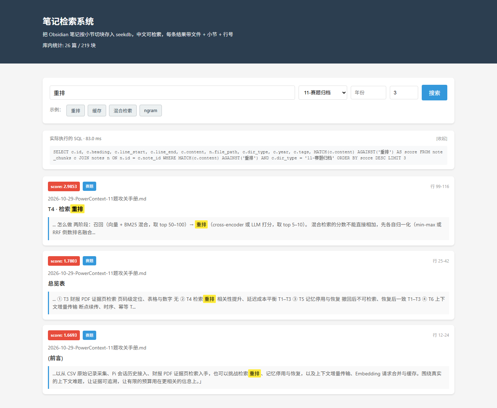
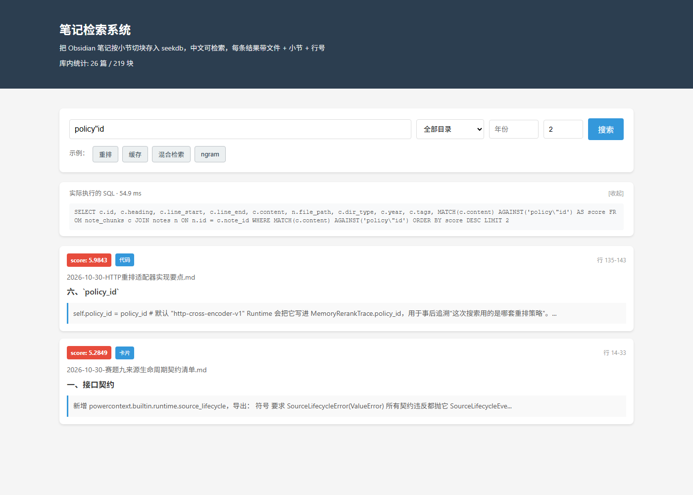

# Obsidian 笔记库检索助手

> 为 Obsidian 笔记库提供**带精确出处**的全文检索：中文可检索 + 结构化过滤 + 每条结果可跳转到原文件对应行。

## 真实痛点

Obsidian 自带搜索对中文支持差（默认分词器把整句中文当一个 token，搜"重排"找不到"检索重排策略"），且无法按目录/年份/标签过滤，搜索结果也没有行号定位。

本工具用 seekdb 的 ngram 全文索引解决中文可检索性问题，按 H2 切块保留出处行号，支持结构化过滤，每条结果都能跳转到原文件的具体章节。

**注意**：ngram 提供的是字符级可检索性，不是语义检索。搜"重新排序"能出结果只是因为与"跨批次排序"共享 bigram「排序」，换个说法（如"打乱顺序"）就召回不到。

## 功能

- **中文全文检索**：基于 seekdb ngram 全文索引，字符级匹配，无需分词词典
- **结构化过滤**：按目录类型、年份、标签组合筛选
- **精确出处定位**：每条结果返回原文件路径 + 行号范围，CLI 可直接跳转查看
- **Web 界面**：单页 HTML，关键词高亮 + 上下文展开 + SQL 透明显示
- **增量索引**：基于文件 hash 跳过未变更文件，只处理新增/修改内容
- **chunk 一致性验证**：`verify_chunks.py --all` 严格比对数据库内容与原文件

## 界面

搜索「重排」，目录限定「11-赛题归档」，Top 3。SQL 面板默认展开，可以直接核对实际执行的语句：



关键词自带双引号（`?q=policy"id`）：搜索框原样保留，属性转义后点击卡片仍能正确高亮，不会截断或注入：



## 数据流

```
md 文件
  ↓
ingest（按 H2 切块 + frontmatter 解析）
  ↓
seekdb（ngram 全文索引，数据库目录 C:/Temp/mmkb_db）
  ↓
search（关键词 + 结构化过滤）
  ↓
Web / CLI
```

## 运行环境

**实测环境**：Windows 11 + Python 3.13.5（未在其他平台验证）。

| 依赖 | requirements 约束 | 实测版本 |
|---|---|---|
| Python | — | 3.13.5 |
| pylibseekdb | `>=1.4.0` | 1.4.0.post2 |
| pyyaml | `>=6.0` | 6.0.3 |
| fastapi | `>=0.100.0` | 0.162.0 |
| uvicorn | `>=0.23.0` | 0.54.0 |
| pytest | `>=7.4.0` | 9.2.0 |

### seekdb 的部署与接入方式

**不需要单独部署 seekdb 服务，也不需要连远端实例。** seekdb 以嵌入式方式接入：

- 通过 `pylibseekdb` 在进程内直接打开一个本地库目录，无独立 server、无端口、无账号密码；
- 库目录固定在 `backend/app/config.py` 的 `DB_DIR`，默认 `C:/Temp/mmkb_db`；
- 首次运行 `index` 时自动建库、建表、建索引，无需手工执行 DDL；
- 库目录必须是**纯 ASCII 路径**（seekdb 无法打开含中文的路径，而本项目路径含"大赛"，故不能放项目内）。

因为是进程内嵌入式库，**同一个库目录同时只能被一个进程打开**：跑 CLI 或 pytest 前先停掉 Web 服务。

## 快速开始

### 1. 安装依赖

```bash
pip install -r requirements.txt
```

### 2. 建索引

```bash
# 增量索引（只处理新增/修改的文件）
python -m backend.app.cli index

# 全量重建（清空后重灌）
python -m backend.app.cli index --rebuild
```

输出示例：
```
本次运行统计（耗时 5.44s）：
  新增文件: 0
  新增块数: 0
  跳过文件（hash 未变）: 26
  无内容文件: 1
    - 未命名.md

库内合计: 26 篇 / 219 块
```

### 3. CLI 搜索

```bash
# 基础搜索
python -m backend.app.cli search "重排"

# 带过滤
python -m backend.app.cli search "缓存" --type card --year 2026 --top-k 5

# 查看 chunk 原文
python -m backend.app.cli show 2000012
```

### 4. 启动 Web

```bash
python -m uvicorn backend.app.main:app --host 127.0.0.1 --port 8000
```

浏览器打开 http://127.0.0.1:8000

## 设计取舍

### 为什么必须用 ngram

seekdb 默认分词器按空格/标点切词，对中文无效。"重新排序"被当作一个完整 token，而笔记里写的是"重排"，两者 token 不同，MATCH AGAINST 返回 0 命中。ngram 分词器将文本切为重叠的 n-gram（默认 bigram），"重排"会被切为"重排"本身，而包含"重排"的更长文本也会被切出"重排"这个 ngram，从而实现字符级的部分匹配。

**对照实验**：非 ngram 表搜索"重排"命中 0 条，ngram 表命中 19 条（见 `backend/tests/test_search.py::TestNgramNecessity`）。

### 为什么用单列 MATCH(content)

seekdb 报错 `Can't find FULLTEXT index matching the column list` (code=1191)，因为 `ft_content` 和 `ft_heading` 是两个独立的单列全文索引，不存在联合索引 `(content, heading)`。统一使用 `MATCH(content) AGAINST(...)`。content 已包含 H2 标题行（见 chunker.py），因此标题文字同样可被检索到。

### 为什么行号要加 frontmatter offset

`parse_frontmatter()` 返回的 body 是已剥离 frontmatter 的正文，`chunk_body(body)` 在 body 内部从 0 开始数行。如果直接用 body 行号，所有带 frontmatter 的文件行号都会偏小（偏移量 = frontmatter 行数）。修复方案：`parse_frontmatter()` 返回三元组 `(fm, body, offset)`，`chunk_body(body, line_offset=offset)` 将 offset 加到所有行号上。

## 已知限制

1. **ngram 是字符级可检索，不是语义检索**。搜"重新排序"能出结果只是因为与"跨批次排序"共享 bigram「排序」，换个说法（如"打乱顺序"）就召回不到。
2. **没有向量检索 / 重排**。纯关键词匹配，无语义理解能力。
3. **只按 H2 切块，超长小节不二次切分**。如果某个 H2 下有 500 行内容，整个 500 行作为一个 chunk。
4. **Windows 下 seekdb 库目录不可删（文件锁）**，重建只能清空表数据（`DELETE FROM note_chunks; DELETE FROM notes`），不能删 `C:/Temp/mmkb_db` 目录。

## 验证证据

> 完整的分步验证样例（初始数据 / 输入 / 操作步骤 / 预期结果 / seekdb 发挥作用的记录）见
> **[docs/样例.md](docs/样例.md)**，其中每条命令与输出均可直接照做复现。

### pytest 全量结果

```
23 passed in 3.51s

test_chunker.py: 7 tests (含 frontmatter 行号偏移测试 + 末尾空行不溢出测试)
test_search.py: 16 tests (关键词/过滤/top_k/ngram 对照)
```

### chunk 内容一致性验证

```bash
python tools/verify_chunks.py --all
```

输出示例：
```
验证全部 219 个 chunk...

[OK]   chunk 2000127: 2026-10-30-赛题五HTTP重排跨批次排序契约清单.md 行 69-81
[OK]   chunk 2000058: 2026-10-30-AMD赛道seekdb-CAGRA构建加速开局清单.md 行 22-44
[OK]   chunk 2000100: 2026-10-30-赛题三Pi会话分支采集契约清单.md 行 134-166
[OK]   chunk 2000166: 2026-10-30-赛题四PDF页级采集与证据检索契约清单.md 行 34-43
[OK]   chunk 2000133: 2026-10-30-赛题八Embedding合并与缓存契约清单.md 行 68-83
... (省略 214 行)

============================================================
验证结果: 219 OK / 0 BAD
```

### ngram 对照实验

见 `backend/tests/test_search.py::TestNgramNecessity`：
- 非 ngram 表搜索"重排"：0 命中
- ngram 表搜索"重排"：19 命中

## 开发过程留痕

本项目在 Qoder 中分阶段完成。每轮交给 Qoder 的提示词都留在仓库根目录（`01-提示词-*.txt` ~ `09-提示词-*.txt`），
可以直接对照代码看出每一轮改了什么、为什么改：

| 阶段 | 提示词 | 内容 |
|---|---|---|
| 1 | `01-提示词-设计阶段.txt` | 需求拆解与技术选型（seekdb 嵌入式 + ngram 全文索引） |
| 2 | `02-提示词-阶段1数据层.txt` | 建表、frontmatter 解析、H2 切块、入库 |
| 3 | `03-提示词-阶段2检索.txt` | 检索 SQL、过滤条件、CLI 三条命令 |
| 4 | `04-提示词-阶段3修bug与CLI.txt` | 修 MATCH 多列报错（code=1191）、行号偏移 |
| 5 | `05-提示词-阶段4前端与README.txt` | 单页 Web、关键词高亮、URL 参数复现 |
| 6 | `06-提示词-阶段5修越界与页面完成度.txt` | 末尾块行号越界、卡片显示完整路径、内联 onclick |
| 7 | `07-提示词-阶段6-收尾与转义修复.txt` | 属性转义（XSS）、verify 严格化、SQL 透明面板 |
| 8 | `08-提示词-阶段7-卡片排版与摘要清洗.txt` | 卡片头部两列、摘要去 Markdown |
| 9 | `09-提示词-阶段8-表格残留与SQL默认展开.txt` | 表格竖线清洗、SQL 面板默认展开 |

每轮都以「pytest 全量 + `tools/verify_chunks.py --all` + 页面截图」作为验收证据，截图见 `docs/screenshots/`。

## 目录结构

```
qoder/
├── backend/
│   ├── app/
│   │   ├── main.py              # FastAPI 入口
│   │   ├── config.py            # 配置（笔记目录、DB 路径）
│   │   ├── database.py          # seekdb 连接 + schema
│   │   ├── cli.py               # CLI 命令
│   │   ├── ingest/              # 数据导入
│   │   │   ├── scanner.py       # 文件扫描
│   │   │   ├── parser.py        # frontmatter 解析
│   │   │   ├── chunker.py       # H2 切块
│   │   │   └── pipeline.py      # 编排
│   │   ├── search/
│   │   │   └── engine.py        # 检索引擎
│   │   └── templates/
│   │       └── index.html       # Web 前端
│   └── tests/
│       ├── test_chunker.py
│       └── test_search.py
├── tools/
│   ├── verify_chunks.py         # chunk 一致性验证
│   └── ngram_compare.py         # ngram 必要性对照实验
├── docs/
│   ├── design.md                # 设计说明
│   ├── 样例.md                  # 验证样例（初始数据/输入/步骤/预期结果）
│   ├── screenshots/             # 界面截图
│   └── records/                 # Qoder 开发过程截图
├── 01~09-提示词-*.txt           # 各轮交给 Qoder 的提示词
├── requirements.txt
└── README.md
```

## 数据库位置

seekdb 数据库目录固定在 `C:/Temp/mmkb_db`（原因：seekdb 无法打开含非 ASCII 字符的路径，而项目路径 `D:/OceanBase大赛/qoder-lab/qoder` 含中文"大赛"）。

笔记源目录（含中文）只是被读取，不受影响。
